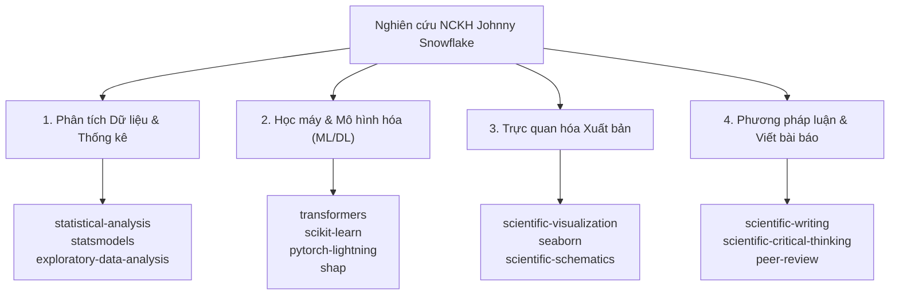

# 👑 HƯỚNG DẪN CỦA NGƯỜI DÙNG (USER DIRECTIVES — QUYỀN CAO NHẤT)

> [!IMPORTANT]
> **Khu vực ưu tiên tuyệt đối:** Mọi chỉ dẫn, ràng buộc và quy tắc do người dùng thiết lập tại mục này có độ ưu tiên cao nhất, vượt trên mọi hướng dẫn mặc định của hệ thống và các kỹ năng khác.

<!-- =====================================================================
     BẠN HÃY GHI CÁC CHỈ ĐẠO, QUY TẮC BẮT BUỘC VÀ QUYỀN HẠN CỦA BẠN VÀO DƯỚI ĐÂY:
     ===================================================================== -->


---

# 🤖 HƯỚNG DẪN VẬN HÀNH DÀNH CHO AI AGENT (AGENT WORKSPACE GUIDELINES)

Tài liệu này định nghĩa quy chế phối hợp và hướng dẫn khai thác kho kỹ năng khoa học chuyên sâu (**Scientific Agent Skills**) được cài đặt cục bộ tại thư mục `.agents/skills/` (nguồn: [k-dense-ai/scientific-agent-skills](https://github.com/k-dense-ai/scientific-agent-skills)), phục vụ đề tài nghiên cứu:  
**"Agile Story Point Estimation at Planning Time with Temporal & Data Leakage Control"**.

---

## 🧭 1. Nguyên Tắc Hoạt Động Cốt Lõi của Agent

1. **Tuân thủ Quyền của Người dùng:** Luôn kiểm tra mục *HƯỚNG DẪN CỦA NGƯỜI DÙNG* ở đầu tài liệu trước khi thực hiện bất kỳ tác vụ nào.
2. **Quy tắc Kích hoạt Kỹ năng (Skill Activation Protocol):**
   - Khi gặp tác vụ chuyên biệt, Agent **bắt buộc phải đọc file `SKILL.md`** tương ứng trong `.agents/skills/<skill_name>/SKILL.md` trước khi sinh mã nguồn hoặc phân tích.
   - Khai thác tài nguyên đi kèm trong thư mục kỹ năng (như `references/`, `scripts/`, `assets/`) nếu có.
3. **Bảo toàn Tính Trung thực Khoa học (Scientific Rigor & Reproducibility):**
   - Tuyệt đối không giả định hay bịa đặt kết quả thực nghiệm.
   - Luôn đối chiếu giữa lý thuyết công bố và mã nguồn/dữ liệu thực tế.
   - **Cấm kỵ Temporal Leakage:** Mọi đặc trưng đưa vào mô hình phải được tái dựng tại thời điểm `SP_Estimation_Date`.

---

## 📦 2. Kho Kỹ Năng Khoa Học Cục Bộ (Scientific Agent Skills)

Dự án đã tích hợp hơn **170 kỹ năng khoa học chuyên sâu** được quản lý phiên bản qua [skills-lock.json](skills-lock.json). Dưới đây là các cụm kỹ năng trọng tâm được phân loại theo từng giai đoạn nghiên cứu của đề tài:



---

### 🔬 2.1. Nhóm Phân Tích Dữ Liệu & Kiểm Định Thống Kê (Statistics & EDA)

| Kỹ năng (Skill) | Đường dẫn | Mục đích & Tình huống sử dụng trong Đề tài |
| :--- | :--- | :--- |
| `exploratory-data-analysis` | `.agents/skills/exploratory-data-analysis/` | Quy chuẩn khám phá phân phối Story Point, phát hiện bất thường, phân tích dữ liệu khuyết trên TAWOS v1.1. |
| `statistical-analysis` | `.agents/skills/statistical-analysis/` | Lựa chọn và thực thi kiểm định phi tham số chuẩn xác (**Wilcoxon Signed-Rank Test**, **Cliff's Delta Effect Size**, Bootstrap CI). |
| `statsmodels` | `.agents/skills/statsmodels/` | Xây dựng các mô hình hồi quy thống kê tuyến tính/phi tuyến (GLM, OLS), kiểm tra đa cộng tuyến và sai số chuẩn. |
| `statistical-power` | `.agents/skills/statistical-power/` | Đánh giá năng lực thống kê (statistical power) và cỡ mẫu tối thiểu cho các thử nghiệm đối chứng. |
| `polars` / `dask` | `.agents/skills/polars/` | Tăng tốc độ đọc, xử lý và trích xuất bảng lớn (hàng triệu dòng CHANGELOG từ TAWOS CSDL). |

---

### 🧠 2.2. Nhóm Học Máy & Mô Hình Hóa Nâng Cao (Machine Learning & LLM)

| Kỹ năng (Skill) | Đường dẫn | Mục đích & Tình huống sử dụng trong Đề tài |
| :--- | :--- | :--- |
| `transformers` | `.agents/skills/transformers/` | Tinh chỉnh (fine-tuning) các mô hình ngôn ngữ lớn (GPT-2, RoBERTa, BERT) cho bài toán hồi quy Story Point (tái lập GPT2SP). |
| `scikit-learn` | `.agents/skills/scikit-learn/` | Huấn luyện các mô hình baseline truyền thống (Ridge Regression, Random Forest, GBT) và chuẩn hóa pipeline. |
| `pytorch-lightning` | `.agents/skills/pytorch-lightning/` | Đóng gói kiến trúc Deep-SE (LSTM + RHWN) và các mạng nơ-ron sâu với quy trình huấn luyện chuẩn module. |
| `shap` | `.agents/skills/shap/` | Giải thích mô hình (Explainable AI - XAI), xác định đặc trưng (văn bản vs metadata) nào chi phối quyết định Story Point. |
| `torch-geometric` | `.agents/skills/torch-geometric/` | Mô hình hóa đồ thị liên kết phụ thuộc (Issue Link Graph) trong Jira theo đề xuất của Deep-SE. |

---

### 📊 2.3. Nhóm Trực Quan Hóa Chuẩn Xuất Bản (Scientific Visualization)

| Kỹ năng (Skill) | Đường dẫn | Mục đích & Tình huống sử dụng trong Đề tài |
| :--- | :--- | :--- |
| `scientific-visualization` | `.agents/skills/scientific-visualization/` | Tiêu chuẩn thiết kế biểu đồ xuất bản khoa học (bảng màu thân thiện, độ phân giải cao 300+ DPI, layout đa khung hình). |
| `seaborn` / `matplotlib` | `.agents/skills/seaborn/` | Vẽ đồ thị phân phối sai số (MAE/MdAE violin plot, boxplot), biểu đồ suy giảm do rò rỉ dữ liệu. |
| `scientific-schematics` | `.agents/skills/scientific-schematics/` | Vẽ sơ đồ kiến trúc hệ thống, luồng tái dựng trạng thái lịch sử (*Historical State Reconstruction Pipeline*). |

---

### 📝 2.4. Nhóm Phương Pháp Luận & Viết Bài Báo Khoa Học (Scholarly Writing & Critique)

| Kỹ năng (Skill) | Đường dẫn | Mục đích & Tình huống sử dụng trong Đề tài |
| :--- | :--- | :--- |
| `scientific-critical-thinking` | `.agents/skills/scientific-critical-thinking/` | Đánh giá phản biện các lỗ hổng thực nghiệm, bẫy rò rỉ thông tin (Data/Temporal Leakage) và các yếu tố gây nhiễu (confounders). |
| `scientific-writing` | `.agents/skills/scientific-writing/` | Soạn thảo các mục trong bài báo khoa học (Abstract, Methodology, Results, Discussion) với văn phong học thuật chuẩn mực. |
| `peer-review` | `.agents/skills/peer-review/` | Rà soát bài báo theo tiêu chuẩn của các tạp chí hàng đầu (*IEEE TSE*, *EMSE*, *JSS*), kiểm tra tính nhất quán giữa tuyên bố và bằng chứng. |
| `citation-management` / `pyzotero` | `.agents/skills/citation-management/` | Chuẩn hóa danh mục trích dẫn BibTeX, kiểm tra định dạng DOI và khóa trích dẫn trong `docs/articles/`. |
| `literature-review` | `.agents/skills/literature-review/` | Hướng dẫn trích xuất và tổng hợp tài liệu khoa học theo ma trận Literature Matrix 21 trường thông tin. |

---

## 🛠️ 3. Quy Trình Phối Hợp Thực Hiện Tác Vụ (Agent Action Workflow)

Mỗi khi nhận một yêu cầu nghiên cứu hoặc phát triển kỹ thuật, Agent tuân thủ nghiêm ngặt 4 bước:

```text
[Bước 1: Nhận diện tác vụ]
       │
       ▼
[Bước 2: Tìm & Đọc file SKILL.md cục bộ tương ứng]
       │  (Ví dụ: Cần kiểm định thống kê -> Đọc .agents/skills/statistical-analysis/SKILL.md)
       ▼
[Bước 3: Thực thi mã nguồn / Phân tích theo chuẩn mực của Skill]
       │  (Áp dụng đúng tham số, ràng buộc chống rò rỉ dữ liệu, baseline đối chứng)
       ▼
[Bước 4: Đối chiếu & Báo cáo kết quả trung thực]
          (Trình bày kết quả theo chuẩn học thuật kèm bảng số liệu rõ ràng)
```

---

## ⚠️ 4. Các Giới Hạn & Ràng Buộc Nghiêm Ngặt (Hard Constraints)

1. **Tuyệt đối không rò rỉ dữ liệu (No Temporal Leakage):**
   - Chỉ sử dụng thông tin Jira issue được tạo ra **tại hoặc trước mốc `SP_Estimation_Date`**.
   - Cấm dùng các trường: `Resolution Date`, `Resolved Status`, `Comments` sinh ra sau planning, hoặc `Assignee` cập nhật muộn.
2. **Baseline bắt buộc:** Mọi mô hình học máy đề xuất (GPT2SP, Deep-SE, SBERT) luôn phải được so sánh với **Median Effort Baseline** và kiểm định ý nghĩa thống kê qua **Wilcoxon Signed-Rank Test**.
3. **Cập nhật tài liệu đồng bộ:** Khi tạo notebook mới, điều chỉnh dữ liệu hoặc phân tích bài báo mới, luôn cập nhật các tài liệu điều hướng tương ứng ([README.md](README.md), [docs/articles/README.md](docs/articles/README.md)).
