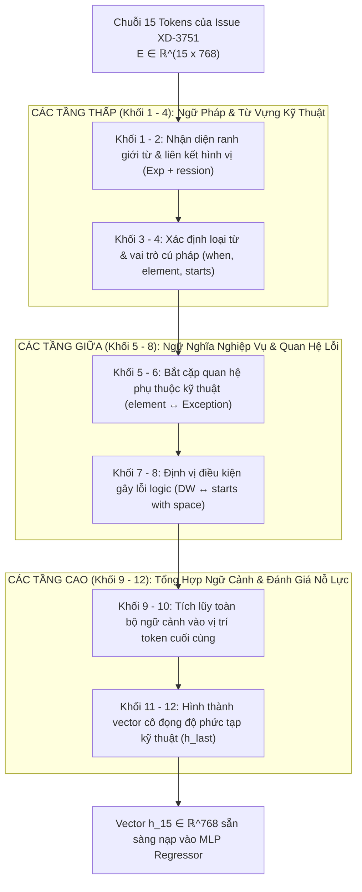

# 🔬 CASE STUDY CHUYÊN SÂU 01: HÀNH TRÌNH DỮ LIỆU QUA 12 KHỐI TRANSFORMER DECODERS

> **Tài liệu gốc liên kết:** Mục 3.2 (Step 2b: Xếp chồng 12 khối Transformer Decoders), Trang 5, bài báo *GPT2SP* (IEEE TSE 2023).  
> **Dự án thực tế:** Spring XD — Issue `XD-3751`: `"ExpressionExecutionException when element that expects a DW starts with space"` ($y = 3$ Story Points).

---

## 📌 1. ĐẶT VẤN ĐỀ: TẠI SAO PHẢI XẾP CHỒNG 12 KHỐI?

Trong các mô hình Deep Learning trước đây như **Deep-SE (Choetkiertikul et al., 2019)**:
* Mô hình sử dụng mạng hồi quy LSTM chỉ có $1$ đến $2$ tầng tuần tự.
* Hạn chế: Mạng quá nông, chỉ học được các mối quan hệ từ vựng bề mặt (Surface-level word co-occurrence), hoàn toàn thất bại trong việc nắm bắt các cấu trúc ngữ nghĩa trừu tượng và sự phụ thuộc xa giữa các khái niệm kỹ thuật trong User Story.

**GPT2SP** kế thừa kiến trúc **GPT-2 Small** gồm đúng **12 khối Transformer Decoders** xếp chồng liên tiếp. Mỗi khối hoạt động như một tầng lọc tư duy sâu, giúp nâng cấp dần mức độ trừu tượng của biểu diễn dữ liệu:



---

## 🔍 2. HÀNH TRÌNH TỪNG TẦNG CỦA ISSUE XD-3751

Sau bước mã hóa từ và vị trí (Step 2a), ma trận đầu vào $E \in \mathbb{R}^{15 \times 768}$ gồm 15 vector đại diện cho 15 tokens:
$$T = [\text{"Exp"}, \text{"ression"}, \text{"Exec"}, \text{"ution"}, \text{"Exception"}, \text{"when"}, \text{"element"}, \text{"that"}, \text{"expects"}, \text{"a"}, \text{"D"}, \text{"W"}, \text{"starts"}, \text{"with"}, \text{"space"}]$$

Dưới đây là sự biến đổi ngữ nghĩa cụ thể của các vector qua 3 chặng tầng:

### Chặng 1: Tầng thấp (Khối 1 đến Khối 4) — Hàn gắn từ vựng & Cú pháp
* **Nhiệm vụ:** Lúc mới nạp vào, token `Exp` và token `ression` chỉ là 2 mảnh rời rạc độc lập.
* **Hành vi Self-Attention:**
  * Đầu chú ý số 2 (Head #2) ở Khối 1 phân bổ trọng số chú ý cực lớn giữa `Exp` và `ression`, giữa `Exec` và `ution`.
  * Khối 2 tổng hợp thông tin và "hàn gắn" 5 mảnh rời rạc lại thành khái niệm nguyên khối: **`ExpressionExecutionException`**.
* **Đầu ra Chặng 1:** Mỗi token đã hiểu rõ nó thuộc về từ ngữ nào trong câu và nắm được vai trò cú pháp cơ bản (chủ ngữ, động từ, điều kiện `when`).

---

### Chặng 2: Tầng giữa (Khối 5 đến Khối 8) — Khám phá quan hệ phụ thuộc kỹ thuật
* **Nhiệm vụ:** Nắm bắt xem "ai đang tác động lên ai" và "lỗi xảy ra trong hoàn cảnh nào".
* **Hành vi Self-Attention:**
  * **Liên kết Đối tượng — Lỗi:** Token `element` (vị trí 7) phân bổ trọng số chú ý cao tới `Exception` (vị trí 5) $\rightarrow$ Mô hình ghi nhận: Một phần tử cấu hình đang phát sinh ngoại lệ runtime.
  * **Liên kết Ràng buộc — Công nghệ:** Token `expects` (vị trí 9) chú ý mạnh tới `D` và `W` (vị trí 11, 12) $\rightarrow$ Mô hình xác định module bị ảnh hưởng là luồng dữ liệu **Data Workflow (DW)** trong Spring XD.
  * **Liên kết Điều kiện kích hoạt lỗi:** Cụm `starts with` (vị trí 13, 14) hướng trọng số chú ý đến `space` (vị trí 15) $\rightarrow$ Phát hiện nguyên nhân gốc rễ là ký tự khoảng trắng vô hiệu hóa parser.
* **Đầu ra Chặng 2:** Các vector không còn là từ ngữ độc lập nữa mà đã trở thành các **khối tri thức liên kết** (Contextualized Representations).

---

### Chặng 3: Tầng cao (Khối 9 đến Khối 12) — Tích lũy thông tin về Token cuối
* **Nhiệm vụ:** Chuẩn bị sẵn sàng thông tin ngữ nghĩa toàn cục để phục vụ bài toán hồi quy Story Point.
* **Quy luật Masked Attention (Mặt nạ nhân quả):**
  * Vì GPT-2 sử dụng ma trận mặt nạ tam giác $M$, các token đứng trước **không được phép nhìn tương lai**.
  * Token đầu tiên `Exp` chỉ nhìn được chính nó.
  * Token cuối cùng `space` (vị trí 15) có thể nhìn thấy **toàn bộ 14 tokens đứng trước nó**!
* **Hiện tượng hội tụ ngữ cảnh (Context Accumulation):**
  * Tại Khối 11 và 12, vector tại vị trí token thứ 15 ($\mathbf{h}_{15}$) nhận luồng thông tin dồn dập từ cả 14 tokens trước.
  * Vector $\mathbf{h}_{15} \in \mathbb{R}^{768}$ tại đầu ra Khối 12 không còn chỉ mang nghĩa đơn thuần là "khoảng trắng", mà mang trọn vẹn thông điệp toàn cục: *"Một lỗi phân tích cú pháp nghiêm trọng tại module Data Workflow do khoảng trắng đầu chuỗi gây ra"*.

---

## ⚙️ 3. CƠ CHẾ NỘI TẠI TRONG 1 KHỐI TRANSFORMER DUY NHẤT

Mỗi khối trong số 12 khối đều tuân thủ cấu trúc chuẩn mực với 2 tầng mạng con và 2 đường kết nối tắt phần dư:

```text
                  Vector đầu vào x (kích thước: 15 x 768)
                                │
        ┌───────────────────────┴───────────────────────┐
        │                                               │
        ▼                                               │
 [LayerNorm 1]                                          │
        │                                               │
        ▼                                               │
 [Masked Multi-Head Self-Attention]                     │ (Đường tắt Residual 1)
 (12 heads song song, d_k = 64)                         │
        │                                               │
        ▼                                               │
 [Ma trận chiếu đầu ra W^O: 768 x 768]                  │
        │                                               │
        ▼                                               │
      ( + ) <───────────────────────────────────────────┘
        │
   Vector x_mid (15 x 768)
        │
        ┌───────────────────────┴───────────────────────┐
        │                                               │
        ▼                                               │
 [LayerNorm 2]                                          │
        │                                               │
        ▼                                               │
 [Mạng truyền thẳng FFN]                                │ (Đường tắt Residual 2)
 W1: 768 → 3072 + Kích hoạt GELU                         │
 W2: 3072 → 768                                         │
        │                                               │
        ▼                                               │
      ( + ) <───────────────────────────────────────────┘
        │
                  Vector đầu ra x_out (kích thước: 15 x 768)
```

### 1. Cơ chế Masked Multi-Head Self-Attention
Với mỗi token $i$, vector truy vấn $Q_i$ quét qua toàn bộ các vector khóa $K_j$ ($j \le i$):

$$\text{Attention}(Q, K, V) = \text{softmax}\left(\frac{QK^T}{\sqrt{64}} + M\right) V$$

* $M_{i,j} = 0$ nếu $j \le i$ (được phép chú ý vào quá khứ).
* $M_{i,j} = -\infty$ nếu $j > i$ (ngăn cấm nhìn trộm tương lai).

### 2. Mạng Feed-Forward (FFN) — Bộ nhớ tri thức
Vector sau Attention được đưa qua FFN để kích hoạt các đặc trưng phi tuyến tính:

$$\text{FFN}(x) = \text{GELU}(x W_1 + b_1) W_2 + b_2$$

* $W_1$ phóng đại vector lên $3072$ chiều ($4 \times 768$), mở rộng không gian tìm kiếm tri thức.
* Hàm kích hoạt GELU lọc các mẫu hình quan trọng.
* $W_2$ nén thông tin trở lại $768$ chiều.

### 3. Hai đường tắt Residual Connections — Ống dẫn gradient
Giúp đạo hàm toán học từ Khối 12 chạy ngược một mạch về Khối 1 mà không bị suy hao:

$$x_{\text{mid}} = x + \text{AttentionSubLayer}(x)$$

$$x_{\text{out}} = x_{\text{mid}} + \text{FFNSubLayer}(x_{\text{mid}})$$

---

## 📊 4. TỔNG KẾT BÀI HỌC TỪ 12 KHỐI DECODERS

1. **Tính kế thừa sâu sắc:** Không một tầng đơn lẻ nào có thể vừa hiểu cú pháp từ vựng vừa đánh giá được độ phức tạp công việc. Cần đủ 12 tầng để hoàn thiện quá trình trừu tượng hóa từ mức byte ký tự lên mức nỗ lực công việc.
2. **Vai trò độc nhất của token cuối cùng:** Nhờ cơ chế Masked Attention, vector tại token cuối cùng $\mathbf{h}_{15}$ tích lũy toàn bộ tinh hoa ngữ cảnh của 14 từ đứng trước, trở thành đầu vào lý tưởng cho bộ phận ước lượng Story Point.
