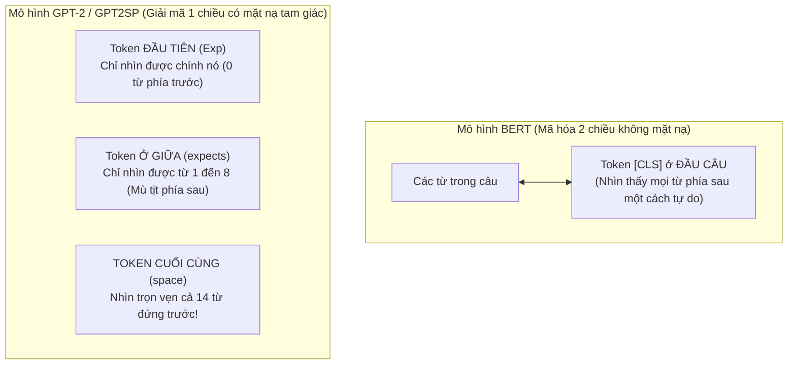

# 🔬 CASE STUDY CHUYÊN SÂU 02: TRÍCH XUẤT ĐẶC TRƯNG & DỰ ĐOÁN QUA ĐẦU HỒI QUY MLP REGRESSOR

> **Tài liệu gốc liên kết:** Mục 3.2 (Step 2c: MLP Regressor), Trang 5, bài báo *GPT2SP* (IEEE TSE 2023).  
> **Dự án thực tế:** Spring XD — Issue `XD-3751`: `"ExpressionExecutionException when element that expects a DW starts with space"` ($y = 3$ Story Points).

---

## 📌 1. BẢN CHẤT SỰ CHUYỂN DỊCH: TỪ SINH TỪ (TEXT $\rightarrow$ TEXT) SANG HỒI QUY (TEXT $\rightarrow$ NUMBER)

Mô hình GPT-2 nguyên bản của OpenAI được huấn luyện cho tác vụ **Sinh Ngôn Ngữ Tự Hồi Quy (Autoregressive Language Generation)**:
* Đầu ra nguyên bản của GPT-2 là một ma trận phân phối xác suất qua hàm Softmax trên toàn bộ $50.257$ từ vựng:
  $$P(w_{t} \mid w_{<t}) = \text{softmax}(h_t \cdot W_{te}^T)$$
  Mục tiêu: Đoán xem từ tiếp theo là từ gì (dạng **Text $\rightarrow$ Text**).

Tuy nhiên, bài toán ước lượng Story Point trong Agile là bài toán **Hồi quy giá trị thực (Continuous Scalar Regression)**:
* Đầu vào: Văn bản Jira Issue phi cấu trúc ($X$).
* Đầu ra mong muốn: Một con số thực duy nhất đại diện cho nỗ lực lập trình ($\hat{y} \in \mathbb{R}^+$).

Để thực hiện bước chuyển dịch này, tác giả Michael Fu & Chakkrit Tantithamthavorn đã thực hiện hai cải tiến kỹ thuật đột phá:
1. **Loại bỏ hoàn toàn lớp Softmax sinh từ vựng của GPT-2.**
2. **Áp dụng cơ chế Gom cụm token cuối (Last Token Pooling) kết hợp với Đầu hồi quy Perceptron đa tầng (3-layer MLP Regressor Head).**

---

## 🎯 2. TẠI SAO PHẢI LÀ TOKEN CUỐI CÙNG (LAST TOKEN POOLING)?

Nhiều nhà nghiên cứu thường đặt câu hỏi: *Tại sao không dùng Mean Pooling (trung bình cộng tất cả các token) hoặc token đầu tiên như `[CLS]` trong mô hình BERT?*

Sự khác biệt cốt tử nằm ở **Cơ chế Mặt nạ Nhân quả (Causal Masking)** giữa hai kiến trúc:



### Bảng phân tích so sánh các chiến lược Pooling:

| Chiến lược Pooling | Cách tính toán | Ưu / Nhược điểm trong GPT-2 | Khả thi cho GPT2SP? |
| :--- | :--- | :--- | :---: |
| **First Token Pooling** | Lấy vector tại token đầu tiên ($\mathbf{h}_1$). | **Thất bại hoàn toàn:** Vì có mặt nạ nhân quả, token đầu tiên không được nhìn bất kỳ từ nào phía sau, chỉ chứa nghĩa của riêng nó. | ❌ Không |
| **Mean Pooling** | Lấy trung bình cộng: $\frac{1}{L} \sum_{i=1}^L \mathbf{h}_i$. | Bị pha loãng thông tin: Các token đầu câu chỉ có thông tin cục bộ, khi cộng dồn làm giảm chất lượng ngữ nghĩa toàn cục. | ⚠️ Kém tối ưu |
| **Last Token Pooling** | Trích xuất trực tiếp vector tại token cuối: $\mathbf{h}_L \in \mathbb{R}^{768}$. | **Hoàn hảo nhất:** Do luật nhân quả, token cuối cùng được phép chú ý đến $100\%$ các từ trong câu. Mọi thông tin ngữ nghĩa đều dồn về đây. | ✅ **Được GPT2SP chọn** |

---

## 🏗️ 3. KIẾN TRÚC ĐẦU HỒI QUY 3-LAYER MLP REGRESSOR HEAD

Sau khi khối Transformer thứ 12 hoàn tất tính toán, ta trích xuất được vector trạng thái ẩn tại token thứ 15 (`space`):
$$\mathbf{h}_{\text{last}} = \mathbf{h}_{15} \in \mathbb{R}^{768}$$

Vector này được nạp vào mạng Perceptron đa tầng gồm **3 lớp tuyến tính (Linear Layers)** xen kẽ hàm kích hoạt phi tuyến **GELU**:

```text
                  Vector trạng thái ẩn h_15 (768 chiều)
                                    │
                                    ▼
       ┌────────────────────────────────────────────────────────┐
       │ TẦNG TUYẾN TÍNH 1: Linear(768 → 256)                   │
       │ • Nhân ma trận trọng số: z_1 = h_15 * W_1 + b_1        │
       │ • Kích hoạt phi tuyến:   a_1 = GELU(z_1)               │
       │ • Tỷ lệ Dropout:         p = 0.1 (Chống quá khớp)      │
       └────────────────────────────────────────────────────────┘
                                    │
                                    ▼
       ┌────────────────────────────────────────────────────────┐
       │ TẦNG TUYẾN TÍNH 2: Linear(256 → 64)                    │
       │ • Nhân ma trận trọng số: z_2 = a_1 * W_2 + b_2         │
       │ • Kích hoạt phi tuyến:   a_2 = GELU(z_2)               │
       │ • Tỷ lệ Dropout:         p = 0.1                       │
       └────────────────────────────────────────────────────────┘
                                    │
                                    ▼
       ┌────────────────────────────────────────────────────────┐
       │ TẦNG ĐẦU RA HỒI QUY: Linear(64 → 1)                    │
       │ • Phép hồi quy tuyến tính: y_hat = a_2 * W_3 + b_3     │
       │ • KHÔNG dùng hàm kích hoạt (Giữ nguyên số thực liên tục)│
       └────────────────────────────────────────────────────────┘
                                    │
                                    ▼
                     Giá trị Story Point: y_hat = 2.85
```

### Công thức toán học tổng quát:
Hàm dự đoán giá trị điểm Story Point $\hat{y}$ được tính theo công thức:

$$\hat{y}(X) = b_3 + \sum_{i=1}^{64} w_i^{(3)} \cdot a_{2,i}$$

Trong đó:
* $a_{2,i}$ là giá trị kích hoạt của nút thứ $i$ trong tầng ẩn thứ hai ($64$ chiều).
* $w_i^{(3)}$ là trọng số liên kết giữa nút ẩn thứ $i$ với nút đầu ra duy nhất.
* $b_3$ là hệ số điều chỉnh thiên lệch (bias) của nút đầu ra.

---

## 🔢 4. MINH HỌA SỐ HỌC TỪNG BƯỚC TRÊN ISSUE XD-3751

Hãy theo dõi hành trình chuyển đổi từ biểu diễn ngữ nghĩa sang điểm số thực tế của issue `XD-3751`:

```text
[Văn bản Issue XD-3751] 
       │
       ▼ (12 Khối Decoders)
Vector h_15 = [+0.42, -1.15, +0.88, ..., +0.05] ∈ ℝ^768
       │
       ▼ (Tầng 1: 768 → 256 + GELU)
Vector a_1  = [+0.21,  0.00, +0.64, ..., +0.12] ∈ ℝ^256
       │
       ▼ (Tầng 2: 256 → 64 + GELU)
Vector a_2  = [+0.85, +0.11,  0.00, ..., +0.47] ∈ ℝ^64
       │
       ▼ (Tầng 3: 64 → 1, Không Activation)
Điểm số vô hướng y_hat = 2.8532... Story Points
```

### Phân tích ý nghĩa kết quả dự đoán:
1. **Giá trị thực tế của đội ngũ Spring XD (Ground Truth):** $y = 3.0$ Story Points.
2. **Giá trị mô hình GPT2SP dự đoán:** $\hat{y} = 2.85$ Story Points.
3. **Sai số tuyệt đối (Absolute Error):**
   $$\text{AE} = |y - \hat{y}| = |3.0 - 2.85| = \mathbf{0.15} \text{ Story Point}$$
4. **Quy đổi trong thực hành Agile:**  
   Trong các buổi họp Sprint Planning, đội ngũ Scrum không dùng số lẻ thập phân mà sử dụng dãy số Fibonacci ($1, 2, 3, 5, 8, 13$). Con số **$2.85$** làm tròn tự nhiên thành **$3$ Story Points**, hoàn toàn trùng khớp với đánh giá thực tế của các kỹ sư phát triển dự án Spring XD.

---

## 📌 5. TỔNG KẾT BÀI HỌC KỸ THUẬT

1. **Last Token Pooling là bắt buộc:** Do luật nhân quả của Transformer Decoder, chỉ có token kết thúc chuỗi mới nắm giữ thông tin toàn vẹn của cả câu.
2. **Ưu thế của MLP 3 tầng so với 1 tầng tuyến tính:**  
   Mối quan hệ giữa độ dài văn bản, mức độ phức tạp kỹ thuật và điểm Story Point mang tính phi tuyến tính cao. Mạng MLP 3 tầng với các hàm phi tuyến GELU cho phép mô hình bẻ cong không gian đặc trưng $768$ chiều, tạo ra ánh xạ mượt mà và chính xác hơn nhiều so với việc chỉ dùng 1 tầng hồi quy tuyến tính đơn giản ($768 \rightarrow 1$).
