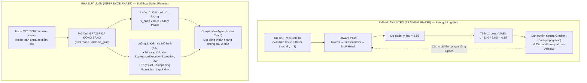

# 🔬 CASE STUDY CHUYÊN SÂU 03: ĐỐI CHỨNG TOÀN DIỆN PHA HUẤN LUYỆN (TRAINING) VÀ PHA SUY LUẬN (INFERENCE)

> **Tài liệu gốc liên kết:** Mục 3 (THE GPT2SP ARCHITECTURE - Overview), Trang 3–4, bài báo *GPT2SP* (IEEE TSE 2023).  
> **Dự án thực tế:** Spring XD — Minh họa chi tiết quy trình học và ứng dụng trên Issue `XD-3751` ($y = 3$ Story Points).

---

## 📌 1. TỔNG QUAN: HAI PHA HOẠT ĐỘNG KHÉP KÍN TRONG HÌNH 2

Trong sơ đồ kiến trúc Hình 2 của bài báo gốc, quy trình vận hành của GPT2SP được phân tách thành hai nửa độc lập nhưng gắn kết chặt chẽ:
* **Nửa trên — Pha Huấn luyện (Training Phase):** Mô hình học tri thức nỗ lực từ kho dữ liệu lịch sử các issue đã hoàn thành trong quá khứ.
* **Nửa dưới — Pha Suy luận & Hỗ trợ (Inference Phase):** Mô hình được đóng băng trọng số, triển khai vào thực tế để phục vụ buổi họp Sprint Planning cho các issue hoàn toàn mới.



---

## 🏋️ 2. CHI TIẾT PHA HUẤN LUYỆN (TRAINING PHASE)

Mục tiêu của pha này là điều chỉnh toàn bộ $117$ triệu tham số của mạng Transformer Decoders và đầu hồi quy MLP sao cho khoảng cách giữa điểm số dự đoán $\hat{y}$ và điểm thực tế $y$ là nhỏ nhất.

### Bước 1: Lan truyền xuôi (Forward Pass)
Mỗi issue từ tập huấn luyện (ví dụ `XD-3751`) được nạp qua hệ thống:
1. Bộ BPE phân rã văn bản thành $15$ subwords: `['Exp', 'ression', ..., 'space']`.
2. Khối Word & Positional Embedding ánh xạ thành ma trận đầu vào $E \in \mathbb{R}^{15 \times 768}$.
3. Ma trận $E$ chạy xuyên suốt qua 12 khối Transformer Decoders.
4. Trích xuất vector trạng thái ẩn token cuối cùng $\mathbf{h}_{15} \in \mathbb{R}^{768}$.
5. Nạp vào MLP Regressor 3 tầng xuất ra giá trị dự đoán liên tục: $\hat{y} = 2.85$.

---

### Bước 2: Tính toán hàm mất mát $L_1$ Loss (MAE Loss)
Sai số dự đoán được tính toán trực tiếp qua hàm mất mát sai số tuyệt đối ($L_1$ Loss):

$$\mathcal{L}_{L1} = |y_{\text{true}} - \hat{y}| = |3.0 - 2.85| = \mathbf{0.15}$$

> **Tại sao bài báo dùng $L_1$ Loss (MAE) mà không dùng $L_2$ Loss (MSE)?**  
> Trong dữ liệu công nghệ phần mềm thực tế, phân phối Story Point bị lệch phải rất mạnh (Heavy-tailed distribution) và chứa nhiều giá trị ngoại lai (Outliers) — ví dụ các Epic hoặc task khổng lồ bị gán $40$ hay $100$ điểm.  
> * Nếu dùng $L_2$ Loss ($|y - \hat{y}|^2 = 0.15^2 = 0.0225$), sai số của các task dị biệt bị bình phương lên hàng ngàn lần, làm bùng nổ gradient và làm méo mó trọng số mô hình.  
> * $L_1$ Loss duy trì gradient hằng số, giúp việc huấn luyện mô hình cực kỳ bền vững (Robust) trước các giá trị ngoại lai.

---

### Bước 3: Lan truyền ngược (Backpropagation) & Tối ưu hóa AdamW
1. Đạo hàm $\frac{\partial \mathcal{L}}{\partial \hat{y}}$ được truyền ngược từ nút đầu ra của MLP, chạy xuyên qua các hàm kích hoạt GELU, và tràn vào khối Transformer thứ 12.
2. Nhờ hệ thống **24 đường tắt Residual Connections**, dòng gradient chảy ngược không suy giảm xuyên qua toàn bộ 12 khối về tận ma trận nhúng ban đầu.
3. Thuật toán tối ưu **AdamW** cập nhật trọng số $\theta$:

$$\theta_{t+1} = \theta_t - \eta \cdot \frac{\hat{m}_t}{\sqrt{\hat{v}_t} + \epsilon} - \eta \cdot \lambda \theta_t$$

* Tốc độ học (Learning Rate): $\eta = 5 \times 10^{-4}$ (kết hợp cơ chế Linear Warm-up giảm dần).
* Hệ số phân rã trọng số (Weight Decay): $\lambda = 0.01$ (ngăn ngừa quá khớp).
* Batch size: $64$ issues/lần cập nhật trên card đồ họa NVIDIA RTX 3090.

---

## ⚡ 3. CHI TIẾT PHA SUY LUẬN & ỨNG DỤNG (INFERENCE PHASE)

Sau khi quá trình huấn luyện hoàn tất, mô hình được đóng băng hoàn toàn trạng thái (`model.eval()`, `torch.no_grad()`). Khi có một Jira Issue mới cần ước lượng trong buổi họp Sprint Planning, hệ thống khởi động cơ chế **Đột phá Hai luồng song song (Dual-Output Stream)**:

```text
                               Jira Issue Mới Tinh
                                        │
                                        ▼
                            [Bộ Phân Tách Từ Con BPE]
                                        │
                                        ▼
                             [Mô Hình GPT2SP Đóng Băng]
                                        │
             ┌──────────────────────────┴──────────────────────────┐
             │                                                     │
             ▼                                                     ▼
     [LUỒNG DỰ ĐOÁN ĐIỂM]                                  [LUỒNG MINH CHỨNG XAI]
• Đưa qua 3-layer MLP Head                           • Thuật toán Integrated Gradients
• Xuất ra điểm số khách quan                          • Tính điểm đóng góp của từng từ
• Làm tròn theo Fibonacci                             • Tô sáng từ khóa rủi ro kỹ thuật
             │                                        • Truy xuất 3 Supporting Examples
             │                                                     │
             └──────────────────────────┬──────────────────────────┘
                                        │
                                        ▼
                          [BÀN GIAO CHO ĐỘI NGŨ AGILE]
                   Scrum Master & Developers tự tin thống nhất
```

---

### Luồng 1: Dự đoán điểm số nỗ lực (Story Point Estimation)
* Mô hình thực hiện một lượt truyền xuôi (Forward Pass duy nhất) mất **dưới $0.1$ giây**.
* Trực tiếp hiển thị con số điểm nỗ lực ước tính: $\hat{y} = 2.85$ (quy đổi về **3 Story Points**).

---

### Luồng 2: Kiểm tra mô hình & Giải thích XAI (Model Inspection)
Thay vì là một "hộp đen" bí ẩn, GPT2SP giải trình minh bạch quyết định qua 2 công cụ trực quan:

#### A. Tô sáng từ khóa qua Integrated Gradients (Gradient Tích Phân)
Hệ thống tính toán tích phân đường đi của gradient từ vector cơ sở rỗng $x'$ đến vector từ vựng thực tế $x$:

$$\text{IG}_i(x) = (x_i - x_i') \times \int_{0}^1 \frac{\partial F(x' + \alpha(x - x'))}{\partial x_i} d\alpha$$

* **Từ khóa kéo điểm lên (Tô màu xanh lá cây):**
  * `ExpressionExecutionException` (+0.82 điểm): Lỗi tầng lõi thực thi biểu thức phức tạp.
  * `DW` (+0.45 điểm): Ràng buộc luồng dữ liệu Data Workflow.
  * `starts with space` (+0.38 điểm): Lỗi logic biên chuỗi.
* **Từ ngữ trung tính:** `when`, `element`, `that`, `a` (điểm đóng góp $\approx 0$).

#### B. Truy xuất ví dụ đối chứng lịch sử (Supporting Examples Retrieval)
Hệ thống tự động sử dụng vector ngữ nghĩa $\mathbf{h}_{\text{last}}$ để quét qua kho dữ liệu của dự án Spring XD, tìm ra 3 task quá khứ có độ tương đồng cosin cao nhất và có cùng mức điểm $3$ SP:
1. `XD-2914`: *"SpelEvaluationException in module execution with special characters"* (Điểm thực tế: 3 SP).
2. `XD-3105`: *"DW parser fails when payload definition contains leading whitespace"* (Điểm thực tế: 3 SP).
3. `XD-1872`: *"ExpressionParser syntax error on empty space delimiter"* (Điểm thực tế: 2 SP).

---

## 📊 4. BẢNG ĐỐI SOÁT HAI PHA TOÀN DIỆN

| Tiêu chí đối soát | Pha Huấn luyện (Training Phase) | Pha Suy luận (Inference Phase) |
| :--- | :--- | :--- |
| **Bối cảnh thực thi** | Phòng thí nghiệm / Server GPU máy chủ | Buổi họp Sprint Planning / Giao diện Web Jira |
| **Dữ liệu đầu vào** | Tập các issue lịch sử **đã có sẵn nhãn điểm $y$**. | Issue mới chuẩn bị làm, **chưa hề có điểm số**. |
| **Trạng thái mô hình** | Trọng số $\theta$ được cập nhật liên tục qua Backpropagation. | Trọng số $\theta$ được đóng băng hoàn toàn (`eval` mode). |
| **Hàm mục tiêu / Loss** | Tính $L_1$ Loss ($\mathcal{L} = |y - \hat{y}|$) để tối ưu. | **Không tính Loss**, chỉ xuất ra điểm số $\hat{y}$. |
| **Thuật toán cốt lõi** | Tối ưu hóa AdamW, Learning Rate Scheduler. | Forward Pass + Integrated Gradients XAI. |
| **Thời gian xử lý** | Vài chục phút đến vài giờ cho một dự án. | Cực nhanh: **$< 0.1$ giây/issue**. |
| **Sản phẩm bàn giao** | Checkpoint mô hình có trọng số tối ưu. | **Điểm số ước lượng + Giao diện tô sáng từ khóa & Ví dụ đối chứng**. |

---

## ⚠️ 5. CẢNH BÁO TEMPORAL LEAKAGE TRONG THỰC HIỆN ĐỀ TÀI NCKH

> [!CAUTION]
> **Ràng buộc nghiên cứu tối thượng của Đề tài Johnny Snowflake:**  
> Trong triển khai gốc của bài báo GPT2SP, tác giả thu thập dữ liệu huấn luyện từ ảnh chụp cuối cùng (**Final Snapshot**) của Jira issue.  
> 
> * **Lỗ hổng khoa học:** Khi issue đã đóng, tiêu đề và mô tả có thể đã bị kỹ sư sửa đổi sau buổi họp planning để bổ sung thêm tên lỗi chính xác (`ExpressionExecutionException`) hoặc nguyên nhân cụ thể (`DW starts with space`). Đây chính là **Rò rỉ dữ liệu tương lai (Temporal Leakage)**.  
> * **Giải pháp chuẩn hóa:** Trong Đề tài NCKH, toàn bộ văn bản issue nạp vào Pha Huấn luyện cũng như Pha Suy luận đều bắt buộc phải được tái dựng lại chính xác tại thời điểm diễn ra phiên họp ước lượng (`SP_Estimation_Date`), bảo toàn tính liêm chính và trung thực của mô hình AI trong kỹ nghệ phần mềm.
