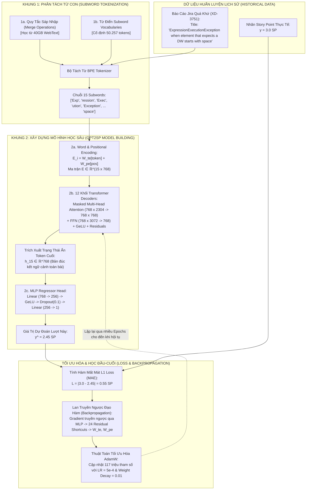

# 🔬 CASE STUDY CHUYÊN SÂU 04: PHA HUẤN LUYỆN (TRAINING PHASE) CỦA MÔ HÌNH GPT2SP

> **Tài liệu gốc liên kết:**  
> * Mục 3 (THE GPT2SP ARCHITECTURE - Overview & Model Building), Trang 3 – 5, bài báo *GPT2SP: A Transformer-Based Agile Story Point Estimation Approach* (IEEE TSE 2023).  
> * Minh họa nửa trên **Hình 2 (Fig. 2: Training Phase)**.  
> **Dự án thực tế áp dụng:** Spring XD — Khảo sát chi tiết quá trình huấn luyện trên Issue lịch sử `XD-3751` ($y = 3.0$ Story Points).

---

## 🏗️ 1. TỔNG QUAN PHA HUẤN LUYỆN TRONG HÌNH 2 BÀI BÁO GỐC

Trong nửa trên của Hình 2 (bài báo gốc IEEE TSE 2023), **Pha Huấn luyện (Training Phase)** là quá trình tối ưu hóa đồng thời toàn bộ $117$ triệu tham số của mạng nơ-ron thông qua phương pháp học có giám sát (Supervised Fine-Tuning) trên các báo cáo Jira issue đã hoàn thành trong quá khứ:



---

## 📋 2. BƯỚC 1: TIẾP NHẬN DỮ LIỆU & KIỂM SOÁT TEMPORAL LEAKAGE

### 2.1. Bản ghi dữ liệu huấn luyện mẫu (Issue `XD-3751`)
* **Project:** Spring XD (Hệ thống điều phối dữ liệu lớn phân tán).
* **Issue Key:** `XD-3751`.
* **Tiêu đề (Title):** `"ExpressionExecutionException when element that expects a DW starts with space"`.
* **Mô tả (Description):** Mô tả chi tiết việc trình thông dịch biểu thức ném lỗi ngoại lệ khi phần tử cấu hình luồng dữ liệu DataWeave (DW) bắt đầu bằng ký tự khoảng trắng.
* **Nhãn thực tế (Ground Truth Story Point):** $y = \mathbf{3.0}$ SP (đã được đội ngũ phát triển Spring XD ước lượng và hoàn thành trong quá khứ).

> [!IMPORTANT]
> **Ràng buộc Khoa học — Chống rò rỉ dữ liệu thời gian (No Temporal Leakage):**  
> Trong pha huấn luyện, mô hình chỉ được phép tiếp cận thông tin có sẵn **tại thời điểm lập kế hoạch (Planning Time)**.  
> Tuyệt đối **KHÔNG** đưa vào các trường sinh ra sau planning như: `Resolution Date`, `Resolved Status`, `Fix Comments`, hay `Actual Time Spent`.

---

## 🔤 3. BƯỚC 2: PHÂN TÁCH TỪ CON BPE (SUBWORD TOKENIZATION)

### 3.1. Cơ chế vận hành của Khung 1 (Step 1a & Step 1b)
1. **Step 1a — Merge Operations (Quy tắc sáp nhập):**  
   Kế thừa từ mô hình nền tảng GPT-2 được huấn luyện trên 40GB văn bản WebText. BPE khởi tạo từ 256 byte UTF-8 và liên tục sáp nhập các cặp byte có tần suất cao nhất thành các đơn vị từ con.
2. **Step 1b — Subword Vocabularies (Bộ từ điển cố định):**  
   Bộ từ vựng chuẩn hóa gồm đúng **$50.257$ tokens**, không thay đổi trong suốt quá trình huấn luyện.

### 3.2. Kết quả tách từ thực tế trên Issue `XD-3751`
Từ ghép kỹ thuật cực dài `ExpressionExecutionException` bị coi là từ lạ ngoài từ điển (`OOV = <UNK>`) trong mô hình Deep-SE cũ, nhưng bộ tách từ BPE của GPT2SP đã phân rã linh hoạt thành chuỗi các subwords quen thuộc:

$$\text{Tokens} = [\text{"Exp"}, \text{"ression"}, \text{"Exec"}, \text{"ution"}, \text{"Exception"}, \text{"when"}, \text{"element"}, \text{"that"}, \text{"expects"}, \text{"a"}, \text{"D"}, \text{"W"}, \text{"starts"}, \text{"with"}, \text{"space"}]$$

* Độ dài chuỗi token: $L = 15$ subwords.
* Mọi từ ngữ kỹ thuật đều được giữ trọn vẹn ngữ nghĩa, **tỷ lệ Out-of-Vocabulary bằng đúng 0%**.

---

## 🧮 4. BƯỚC 3: WORD & POSITIONAL ENCODING (KHUNG 2a)

Với mỗi token $x_i$ ($i = 1, \dots, 15$), hệ thống tra cứu đồng thời hai ma trận nhúng:
1. **Ma trận nhúng từ ngữ (Word Embedding):** $W_{te} \in \mathbb{R}^{50257 \times 768}$ $\rightarrow$ tra cứu lấy vector ngữ nghĩa $\mathbf{w}_i = W_{te}[x_i] \in \mathbb{R}^{768}$.
2. **Ma trận nhúng vị trí (Positional Embedding):** $W_{pe} \in \mathbb{R}^{1024 \times 768}$ $\rightarrow$ tra cứu lấy vector thứ tự $\mathbf{p}_i = W_{pe}[i] \in \mathbb{R}^{768}$.

$$E_i = \mathbf{w}_i + \mathbf{p}_i \in \mathbb{R}^{768} \quad \Longrightarrow \quad E = \begin{bmatrix} E_1 \\ E_2 \\ \vdots \\ E_{15} \end{bmatrix} \in \mathbb{R}^{15 \times 768}$$

* **Ý nghĩa:** Ma trận $E$ vừa mang bản sắc ngữ nghĩa của các thuật ngữ (`Exception`, `DataWeave`), vừa mang thông tin thứ tự trước sau của các từ trong câu.

---

## ⚙️ 5. BƯỚC 4: LAN TRUYỀN XUÔI QUA 12 KHỐI TRANSFORMER DECODERS (KHUNG 2b)

Dữ liệu $E$ lần lượt đi qua **12 khối Transformer Decoders** xếp chồng:

```text
E (15 × 768) ───> [Khối Decoder 1] ───> [Khối Decoder 2] ───> ... ───> [Khối Decoder 12] ───> H_12 (15 × 768)
```

Tại mỗi khối Decoder, tín hiệu trải qua hai giai đoạn tính toán cốt lõi:

### 5.1. Cơ chế Masked Multi-Head Attention ($768 \times 2304 \rightarrow 768 \times 768$)
* **Phép nhân ma trận gộp (Matrix Fusion):** Nhân tensor đầu vào với ma trận trọng số gộp $W_{QKV} \in \mathbb{R}^{768 \times 2304}$ để sinh đồng thời $Q, K, V$ trong 1 lần gọi GPU kernel.
* **Chia tách 12 đầu chú ý ($H = 12$):** Mỗi đầu làm việc trên vector $d_k = 64$ chiều ($12 \times 64 = 768$).
* **Mặt nạ nhân quả (Causal Masking):** Đảm bảo token tại bước $i$ chỉ được phép chú ý đến các token từ $1$ đến $i$ (nửa tam giác trên bị gán $-\infty$).
* **Hòa trộn liên đầu (Inter-head Mixing):** Nhân với ma trận chiếu $W^O \in \mathbb{R}^{768 \times 768}$ để tổng hợp góc nhìn của cả 12 đầu.
* **Cộng đường tắt Residual 1:** $\tilde{X} = X + \text{Attention}(X)$.

### 5.2. Mạng nơ-ron truyền thẳng FFN ($768 \times 3072 \rightarrow 768$)
* **Chiếu mở rộng:** Nhân với $W_1 \in \mathbb{R}^{768 \times 3072}$ để đưa lên không gian $3072$ chiều (gấp 4 lần $d_{\text{model}}$), kích hoạt các mẫu tri thức phần mềm qua hàm phi tuyến **GELU**.
* **Chiếu thu hẹp:** Nhân với $W_2 \in \mathbb{R}^{3072 \times 768}$ để nén tri thức trở lại 768 chiều.
* **Cộng đường tắt Residual 2:** $X_{\text{out}} = \tilde{X} + \text{FFN}(\tilde{X})$.

---

## 🎯 6. BƯỚC 5: TRÍCH XUẤT TOKEN CUỐI & DỰ ĐOÁN QUA MLP REGRESSOR (KHUNG 2c)

### 6.1. Tại sao chỉ lấy vector trạng thái ẩn của Token cuối cùng ($\mathbf{h}_{15}$)?
Do cơ chế **Masked Attention**, token số 1 chỉ nhìn thấy chính nó, token số 2 chỉ nhìn thấy từ 1 và 2... Nhưng **chỉ duy nhất token cuối cùng (token số 15: `"space"`) mới được phép nhìn thấu toàn bộ 14 token đứng trước nó**!  
Vì vậy, vector $\mathbf{h}_{15} \in \mathbb{R}^{768}$ là nơi tụ hội trọn vẹn ngữ cảnh của toàn bộ câu mô tả issue.

### 6.2. Phép tính bên trong MLP Regressor Head
Vector $\mathbf{h}_{15}$ được đưa qua đầu hồi quy đa tầng:
$$\mathbf{z}_1 = \mathbf{h}_{15} \cdot W_1 + b_1 \quad (\text{với } W_1 \in \mathbb{R}^{768 \times 256})$$
$$\mathbf{a}_1 = \text{GELU}(\mathbf{z}_1) \in \mathbb{R}^{256}$$
$$\mathbf{a}_1 = \text{Dropout}(\mathbf{a}_1, p = 0.1)$$
$$\hat{y} = \mathbf{a}_1 \cdot W_2 + b_2 \quad (\text{với } W_2 \in \mathbb{R}^{256 \times 1})$$

* Giả sử tại vòng lặp huấn luyện này, mô hình xuất ra giá trị dự đoán:  
  $$\hat{y} = \mathbf{2.45\text{ Story Points}}$$

---

## 📉 7. BƯỚC 6: TÍNH HÀM MẤT MÁT $L_1$ LOSS (MAE LOSS)

Sai số giữa giá trị dự đoán $\hat{y}$ và giá trị nhãn thực tế $y$ được tính toán trực tiếp:

$$
\mathcal{L}_{L1} = |y_{\text{true}} - \hat{y}| = |3.0 - 2.45| = \mathbf{0.55\text{ SP}}
$$

### 🔬 Phân tích khoa học: Vì sao GPT2SP chọn $L_1$ Loss thay vì $L_2$ Loss (MSE)?
Trong các dự án phần mềm Jira, phân phối Story Point bị **lệch phải rất nặng (Heavy Right-Skewed)** và chứa các task ngoại lai (outliers) có điểm số khổng lồ ($40$ hoặc $100$ SP):

| Loại hàm mất mát | Công thức tính lỗi | Phản ứng khi gặp Task bình thường (Lệch 0.55 SP) | Phản ứng khi gặp Task ngoại lai dị biệt (Lệch 20 SP) | Hậu quả đối với mô hình |
| :--- | :---: | :---: | :---: | :--- |
| **$L_2$ Loss (MSE)** | $(y - \hat{y})^2$ | $(0.55)^2 = \mathbf{0.3025}$ | $(20)^2 = \mathbf{400.0}$ | Đạo hàm bùng nổ gấp $400$ lần, giật phăng toàn bộ trọng số, làm hỏng mô hình. |
| **$L_1$ Loss (MAE - GPT2SP)** | $|y - \hat{y}|$ | $\mathbf{0.55}$ | $\mathbf{20.0}$ | Đạo hàm luôn giữ ở mức hằng số $\pm 1$, **kháng ngoại lai (robust) tuyệt đối**! |

---

## 🔄 8. BƯỚC 7: LAN TRUYỀN NGƯỢC (BACKPROPAGATION) & CẬP NHẬT ADAMW

### 8.1. Hành trình lội ngược dòng của Gradient Đạo hàm
1. Đạo hàm $\frac{\partial \mathcal{L}}{\partial \hat{y}} = \text{sign}(\hat{y} - y) = -1$ xuất phát từ hàm mất mát $L_1$.
2. Truyền ngược qua lớp Tuyến tính $256 \rightarrow 1$, qua lớp Dropout, qua hàm kích hoạt GeLU, và qua lớp Tuyến tính $768 \rightarrow 256$ của **MLP Regressor Head**.
3. Đổ vào vector trạng thái ẩn $\mathbf{h}_{15}$ tại Khối Transformer thứ 12.
4. **Nhờ 24 đường tắt Residual Connections**, dòng gradient chảy ngược không ma sát qua toàn bộ 12 khối giải mã mà không bị triệt tiêu (No Vanishing Gradient).
5. Lan tỏa đến tận các ma trận nhúng $W_{te}$ và $W_{pe}$ ở đáy mô hình!

### 8.2. Cập nhật trọng số qua thuật toán AdamW
Toàn bộ $117$ triệu tham số $\theta$ được cập nhật theo quy tắc **Decoupled Weight Decay**:

$$
\theta_{t+1} = \theta_t - \eta \cdot \frac{\hat{m}_t}{\sqrt{\hat{v}_t} + \epsilon} - \eta \cdot \lambda \theta_t
$$

* **Tốc độ học (Learning Rate):** $\eta = 5 \times 10^{-4}$ (kết hợp lịch trình Linear Warmup giảm dần).
* **Hệ số suy giảm trọng số (Weight Decay):** $\lambda = 0.01$ (ngăn ngừa hiện tượng học vẹt trên dữ liệu Jira nhỏ).
* **Cơ chế Batching:** Mini-batch size = $64$ issues/lần cập nhật.
* **Thời gian huấn luyện:** Hoàn tất hội tụ sau $10 - 20$ epochs trên GPU NVIDIA RTX 3090.

---

## ⏱️ 9. TỔNG KẾT BẢN CHẤT PHA HUẤN LUYỆN (THE ELEVATOR PITCH)

* **Bản chất:** Pha Huấn luyện là quy trình tinh chỉnh toàn diện đầu-cuối (End-to-End Supervised Fine-Tuning) biến mô hình ngôn ngữ GPT-2 thành một chuyên gia thẩm định nỗ lực phần mềm.
* **Đặc trưng cốt lõi:** Dữ liệu Jira lịch sử được tách qua BPE ($50.257$ vocabs), chạy xuôi qua 12 khối Decoder và đầu hồi quy MLP để tính sai số $L_1$ Loss đối chiếu với điểm thực tế.
* **Kết quả thu được:** Dòng gradient từ hàm $L_1$ Loss chạy ngược toàn bộ mạng nơ-ron qua thuật toán AdamW, tôi luyện toàn bộ 117 triệu tham số đạt trạng thái hội tụ tối ưu, sẵn sàng đóng băng để chuyển sang Pha Suy luận.