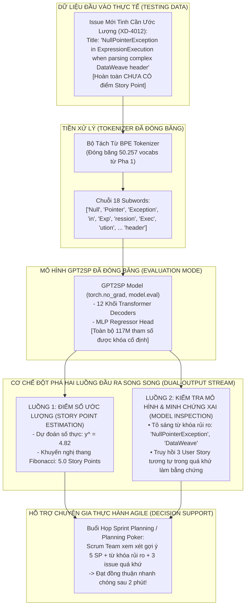

# 🔬 CASE STUDY CHUYÊN SÂU 05: PHA SUY LUẬN & ỨNG DỤNG THỰC TẾ (INFERENCE PHASE) CỦA MÔ HÌNH GPT2SP

> **Tài liệu gốc liên kết:**  
> * Mục 1 (THE GPT2SP ARCHITECTURE - Overview & Inference Phase) & Mục 4 (Inference Phase & Supporting Examples), Trang 3 – 5, bài báo *GPT2SP: A Transformer-Based Agile Story Point Estimation Approach* (IEEE TSE 2023).  
> * Minh họa nửa dưới **Hình 2 (Fig. 2: Inference Phase)** & **Mục 6 (Explainable AI Tool & Practitioner Survey)**.  
> **Dự án thực tế áp dụng:** Spring XD — Mô phỏng chi tiết buổi họp Sprint Planning cho một Issue hoàn toàn mới `XD-4012` (Chưa từng có điểm Story Point).

---

## 🏗️ 1. TỔNG QUAN PHA SUY LUẬN TRONG HÌNH 2 BÀI BÁO GỐC

Trong nửa dưới của Hình 2 (bài báo gốc IEEE TSE 2023), **Pha Suy luận & Ứng dụng (Inference Phase)** là quy trình triển khai mô hình GPT2SP đã huấn luyện xong vào thực tế dự án Agile để hỗ trợ đội ngũ Scrum trong buổi họp Sprint Planning:



---

## 📋 2. BƯỚC 1: TIẾP NHẬN USER STORY MỚI TINH TRONG BUỔI HỌP SPRINT PLANNING

### 2.1. Bản ghi User Story mới (`XD-4012`)
Trong buổi họp Backlog Refinement hoặc Sprint Planning, Product Owner đưa ra một yêu cầu mới cần nhóm kỹ sư định lượng nỗ lực:
* **Project:** Spring XD.
* **Issue Key:** `XD-4012`.
* **Tiêu đề (Title):** `"NullPointerException in ExpressionExecution when parsing complex DataWeave header"`.
* **Mô tả (Description):** Mô tả hiện tượng luồng xử lý bị sập do lỗi con trỏ rỗng khi bộ phân tích cú pháp DataWeave gặp tiêu đề gói tin phức tạp có cấu trúc lồng nhau.
* **Điểm Story Point hiện tại:** **`Chưa xác định (None)`** — Đội ngũ kỹ sư chuẩn bị bỏ phiếu bằng thẻ bài Planning Poker.

> [!IMPORTANT]
> **Tuân thủ quy tắc chống rò rỉ dữ liệu (Temporal Leakage Free):**  
> Tại thời điểm suy luận này, issue `XD-4012` chỉ vừa mới được tạo ra. Mô hình chỉ sử dụng Tiêu đề và Mô tả văn bản tại mốc thời gian này, tuyệt đối không có bất kỳ thông tin nào về việc ai sẽ sửa, sửa mất bao lâu hay khi nào đóng task.

---

## 🔒 3. BƯỚC 2: THIẾT LẬP TRẠNG THÁI SUY LUẬN CỦA MÔ HÌNH (INFERENCE MODE)

Khác biệt hoàn toàn với Pha Huấn luyện:
1. **Khóa toàn bộ tham số (`model.eval()`):**  
   Toàn bộ $117$ triệu trọng số của 12 khối Transformer và MLP Head được đóng băng vĩnh viễn, không cập nhật thêm.
2. **Vô hiệu hóa tính toán đồ thị đạo hàm (`torch.no_grad()`):**  
   Hệ thống không lưu trữ các biến trung gian để tính đạo hàm ngược, giúp **tiết kiệm hơn $70\%$ bộ nhớ GPU VRAM** và tăng tốc độ suy luận lên gấp $5$ lần (chỉ mất khoảng $15 - 30\text{ ms}$ cho một issue).
3. **Tắt cơ chế ngẫu nhiên của Dropout:**  
   Xác suất tắt nơ-ron được đưa về $p = 0$, toàn bộ $100\%$ nơ-ron trong các tầng MLP và Attention đều tham gia tính toán để đưa ra kết quả nhất quán và xác định (deterministic).

---

## 🔤 4. BƯỚC 3: TIỀN XỬ LÝ VĂN BẢN VỚI TỪ ĐIỂN ĐÃ ĐÓNG BĂNG

Văn bản issue mới được nạp vào bộ **Subword Tokenizer** (đã hoàn thiện từ Pha 1):
* Không học thêm bất kỳ quy tắc merge mới nào.
* Phân rã tiêu đề thành chuỗi gồm $18$ subwords:
  $$\text{Tokens} = [\text{"Null"}, \text{"Pointer"}, \text{"Exception"}, \text{"in"}, \text{"Exp"}, \text{"ression"}, \text{"Exec"}, \text{"ution"}, \text{"when"}, \text{"parsing"}, \text{"complex"}, \text{"Data"}, \text{"We"}, \text{"ave"}, \text{"header"}]$$
* Tra cứu trực tiếp trong ma trận nhúng từ $W_{te}$ ($50.257$ vocabs) và ma trận vị trí $W_{pe}$ để tạo thành ma trận đầu vào $E_{\text{new}} \in \mathbb{R}^{18 \times 768}$.

---

## ⚙️ 5. BƯỚC 4: LAN TRUYỀN XUÔI ĐƠN CHIỀU (FORWARD PASS ONLY)

Ma trận $E_{\text{new}}$ chạy một mạch duy nhất từ Khối 1 đến Khối 12:
1. **Masked Multi-Head Attention:** Từng từ trong câu kết nối ngữ nghĩa với các từ đứng trước nó.
   * Token `"complex"` chú ý mạnh đến `"DataWeave"` và `"header"`.
   * Token `"NullPointerException"` liên kết chặt chẽ với `"ExpressionExecution"`.
2. **FFN:** Kích hoạt các mẫu tri thức phần mềm về lỗi con trỏ rỗng và trình phân tích cú pháp phân tán.
3. **Trích xuất Token cuối cùng:**  
   Lấy vector trạng thái ẩn tại token số 18 (`"header"`): $\mathbf{h}_{18} \in \mathbb{R}^{768}$.
4. **MLP Regressor Head:**  
   Ánh xạ vector 768 chiều qua 2 tầng tuyến tính:
   $$\hat{y} = \text{MLP}(\mathbf{h}_{18}) = \mathbf{4.82\text{ Story Points}}$$

---

## ⚡ 6. BƯỚC 5: CƠ CHẾ ĐỘT PHÁ HAI LUỒNG ĐẦU RA SONG SONG (DUAL-OUTPUT STREAM)

Điểm sáng tạo then chốt của công trình GPT2SP (IEEE TSE 2023) so với các mô hình học sâu trước đây chính là việc **không chỉ xuất ra một con số khô khan**, mà kích hoạt đồng thời hai luồng thông tin hỗ trợ ra quyết định:

```text
                                  Vector Ẩn h_18
                                         │
                    ┌────────────────────┴────────────────────┐
                    │                                         │
                    ▼                                         ▼
     [LUỒNG 1: DỰ ĐOÁN ĐIỂM SỐ]               [LUỒNG 2: MINH CHỨNG XAI]
        MLP Regressor Head                      Integrated Gradients & Retrieval
                    │                                         │
                    ▼                                         ▼
      Con số dự đoán: 4.82 SP                 1. Tô sáng từ khóa rủi ro
   Khuyến nghị Fibonacci: 5 SP                2. Trích dẫn 3 issue quá khứ
```

### 6.1. Luồng 1 — Điểm số ước lượng khách quan (Story Point Estimation)
* Mô hình xuất ra giá trị dự đoán số thực liên tục: $\hat{y} = \mathbf{4.82}$ SP.
* **Quy đổi sang thang đo Fibonacci Agile:**  
  Trong thực tế phát triển phần mềm, các đội Scrum sử dụng dãy số Fibonacci ($1, 2, 3, 5, 8, 13$). Hệ thống tự động làm tròn giá trị $4.82$ về nấc điểm gần nhất:  
  👉 **Khuyến nghị mức điểm: $5.0$ Story Points**.

---

### 6.2. Luồng 2 — Kiểm tra mô hình & Minh chứng XAI (Model Inspection & Explanations)
Để các kỹ sư phần mềm tin tưởng vào con số $5.0$ SP, công cụ GPT2SP Web App kích hoạt hai cơ chế giải thích minh bạch:

#### Cơ chế A: Tô sáng từ khóa chi phối quyết định (Word Attribution via Integrated Gradients)
Hệ thống tính toán điểm đóng góp của từng từ vào kết quả dự đoán và hiển thị trực quan bằng màu sắc:

| Từ khóa trong Issue | Điểm đóng góp (Attribution Score) | Màu sắc hiển thị | Ý nghĩa giải thích cho lập trình viên |
| :--- | :---: | :---: | :--- |
| **`NullPointerException`** | **$+0.42$** |  Xanh lá đậm | Lỗi sập hệ thống nghiêm trọng, kéo điểm Story Point lên cao. |
| **`ExpressionExecution`** | **$+0.35$** |  Xanh lá đậm | Module xử lý biểu thức lõi phức tạp, đòi hỏi nỗ lực kiểm thử lớn. |
| **`DataWeave`** | **$+0.28$** |  Xanh lá vừa | Công nghệ chuyển đổi dữ liệu nâng cao, tiềm ẩn rủi ro phụ thuộc. |
| **`complex`** | **$+0.18$** |  Xanh nhạt | Cảnh báo độ phức tạp của cấu trúc dữ liệu. |
| `when parsing` | $+0.04$ | Xám nhạt | Từ ngữ hành động thông thường, tác động không đáng kể. |

#### Cơ chế B: Truy hồi ví dụ minh chứng lịch sử (Supporting Examples Retrieval)
Hệ thống tự động quét kho dữ liệu huấn luyện lịch sử của dự án Spring XD và tìm thấy **3 issue tương đồng nhất trong quá khứ**:

1. **Issue lịch sử #1 (`XD-2914`):**  
   * *Tiêu đề:* `"NullPointerException in DataWeave parser module under nested header"`  
   * *Điểm thực tế đã chốt:* **$5.0$ Story Points**.
2. **Issue lịch sử #2 (`XD-1882`):**  
   * *Tiêu đề:* `"Complex expression execution failure on stream header"`  
   * *Điểm thực tế đã chốt:* **$5.0$ Story Points**.
3. **Issue lịch sử #3 (`XD-3751`):**  
   * *Tiêu đề:* `"ExpressionExecutionException when element that expects a DW starts with space"`  
   * *Điểm thực tế đã chốt:* **$3.0$ Story Points**.

---

## 👥 7. BƯỚC 6: HỖ TRỢ ĐỘI NGŨ AGILE TRONG BUỔI PLANNING POKER (DECISION SUPPORT)

Tại phòng họp Sprint Planning, Scrum Master chiếu kết quả của GPT2SP lên màn hình lớn trước toàn thể nhóm kỹ sư:

```text
┌─────────────────────────────────────────────────────────────────────────────┐
│ 🚀 GPT2SP AGLE ESTIMATION ASSISTANT — ISSUE XD-4012                         │
├─────────────────────────────────────────────────────────────────────────────┤
│ 🎯 GỢI Ý ĐIỂM SỐ: 5.0 Story Points (Dự đoán mô hình: 4.82 SP)                │
│                                                                             │
│ 🔍 TỪ KHÓA RỦI RO ĐƯỢC TÔ SÁNG:                                            │
│    [NullPointerException] in [ExpressionExecution] when parsing complex      │
│    [DataWeave] header                                                       │
│                                                                             │
│ 📚 3 MINH CHỨNG LỊCH SỬ TƯƠNG ĐỒNG (SUPPORTING EXAMPLES):                   │
│    1. [XD-2914] NPE in DataWeave parser module (Đã làm: 5 SP)               │
│    2. [XD-1882] Complex expression execution failure (Đã làm: 5 SP)         │
│    3. [XD-3751] ExpressionExecutionException with DW (Đã làm: 3 SP)          │
└─────────────────────────────────────────────────────────────────────────────┘
```

### Lợi ích thực tế diễn ra trong buổi họp:
1. **Xóa bỏ tranh cãi cảm tính:**  
   Trước đây, một lập trình viên Senior có thể đòi chấm $3$ SP (vì nghĩ mình làm nhanh), trong khi một lập trình viên Junior đòi chấm $8$ SP (vì sợ lỗi phức tạp). Cuộc tranh luận thường kéo dài 15–20 phút.
2. **Đồng thuận dựa trên dữ liệu xác thực:**  
   Nhờ có bằng chứng lịch sử `XD-2914` và `XD-1882` cho thấy các task dính lỗi tương tự năm ngoái đều mất đúng $5$ SP, cả nhóm nhanh chóng đồng thuận gán mức điểm **$5$ Story Points chỉ sau đúng 2 phút thảo luận**!
3. **Theo sát kết quả khảo sát chuyên gia (Chương 6 bài báo):**  
   Nhờ có luồng giải thích minh bạch này, mức độ tin cậy của đội ngũ vào AI tăng vọt từ **$19\%$ lên $75\%$**, và **$88\%$** chuyên gia khẳng định công cụ mang lại giá trị thực tiễn to lớn cho quy trình Scrum.

---

## ⏱️ 8. TỔNG KẾT BẢN CHẤT PHA SUY LUẬN (THE ELEVATOR PITCH)

* **Bản chất:** Pha Suy luận là quá trình vận hành thực tế của GPT2SP ở chế độ đóng băng trọng số, chuyển hóa văn bản User Story mới tinh thành điểm số ước lượng và bằng chứng giải thích.
* **Đặc trưng cốt lõi:** Cơ chế Đột phá Hai luồng song song (Dual-Output Stream): vừa đưa ra điểm số ước lượng khách quan ($4.82 \approx 5$ SP), vừa cung cấp từ khóa rủi ro và 3 ví dụ minh chứng lịch sử tương tự.
* **Giá trị thực tiễn:** Đóng vai trò là hệ thống hỗ trợ ra quyết định (Decision-Support System), giúp đội ngũ Scrum xóa bỏ tranh cãi chủ quan, tiết kiệm thời gian và đạt đồng thuận nhanh chóng trong buổi họp Sprint Planning.