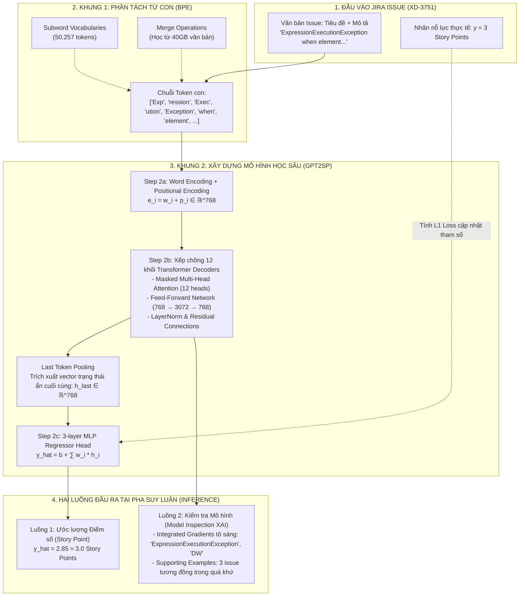

# 🔬 NGHIÊN CỨU TÌNH HUỐNG THỰC TẾ (CASE STUDY)
# MINH HỌA QUY TRÌNH ƯỚC LƯỢNG STORY POINT BẰNG KIẾN TRÚC GPT2SP

> **Chuyên đề:** Minh họa chi tiết từng bước vận hành của mô hình GPT2SP trên một hạng mục công việc thực tế (Jira Issue).  
> **Ánh xạ sơ đồ kiến trúc:** Đối chiếu trực tiếp với sơ đồ tại [03_the_gpt2sp_architecture.md](file:///d:/NCKH_3/docs/articles/paper-information/explanation/03_the_gpt2sp_architecture.md) (Trích xuất từ Figure 2, Trang 4, bài báo gốc IEEE TSE 2023 [Fu & Tantithamthavorn]).  
> **Dự án mục tiêu:** Hệ thống mã nguồn mở **Spring XD** (`XD`) thuộc kho dữ liệu TAWOS / Choetkiertikul et al.

---

## 📌 1. TỔNG QUAN TÌNH HUỐNG (PROBLEM SCENARIO)

Để làm sáng tỏ cách thức mô hình GPT2SP tiếp nhận một yêu cầu phát triển phần mềm phi cấu trúc và chuyển đổi thành điểm số nỗ lực (Story Point) kèm luận cứ giải thích, chúng ta phân tích một Jira Issue kinh điển được chính nhóm tác giả bài báo lựa chọn làm ví dụ tại Hình 1 và Mục 3:

```text
+----------------------------------------------------------------------------------------------------+
| 🎫 THÔNG TIN JIRA ISSUE THỰC TẾ TRONG DỰ ÁN SPRING XD                                               |
+----------------------------------------------------------------------------------------------------+
| Issue Key:      XD-3751                                                                            |
| Loại Issue:     Bug / Defect                                                                       |
| Tiêu đề:        ExpressionExecutionException when element that expects a DW starts with space       |
| Điểm nỗ lực:    3 Story Points (Ground Truth y = 3)                                                |
| Mô tả kỹ thuật: Parser ném ra ngoại lệ ExpressionExecutionException khi thuộc tính cấu hình        |
|                 yêu cầu Data Workflow (DW) có tiền tố khoảng trắng vô hiệu hóa bộ phân tích chuỗi.  |
+----------------------------------------------------------------------------------------------------+
```

### Bản đồ ánh xạ qua sơ đồ kiến trúc Hình 2:



---

## 🔤 2. BƯỚC 1: PHÂN TÁCH TỪ CON SUBWORD TOKENIZATION (BPE)

> 📍 **Ánh xạ sơ đồ Hình 2:** Hộp `Subword Tokenization (BPE)` gồm `1a Merge Operations` & `1b Subword Vocabularies`.

### 2.1. Thách thức Out-of-Vocabulary (OOV) của phương pháp truyền thống
Nếu sử dụng phương pháp Word-level của Deep-SE (dựa trên Word2Vec):
* Cụm từ kỹ thuật ghép `ExpressionExecutionException` là một từ hiếm, chưa từng xuất hiện nguyên khối trong tập huấn luyện của dự án khác.
* Kết quả: Deep-SE buộc phải thay thế bằng mã lạ `<UNK>` (Unknown Word), làm mất toàn bộ ngữ nghĩa then chốt liên quan đến lỗi thực thi biểu thức (`Expression Execution`).

### 2.2. Cơ chế xử lý của BPE trong GPT2SP
Bộ phân tách BPE tận dụng từ điển $50.257$ từ con được tiền huấn luyện trên 40GB văn bản:
1. **Phân rã từ hiếm/dài:** Thuật toán áp dụng các phép sáp nhập (Merge Operations) để chia tách thuật ngữ phức tạp thành các mảnh hình vị có nghĩa:
   $$\text{"ExpressionExecutionException"} \longrightarrow \left[\text{"Exp"}, \text{"ression"}, \text{"Exec"}, \text{"ution"}, \text{"Exception"}\right]$$
2. **Bảo tồn từ phổ biến:** Các từ ngữ thông dụng được giữ nguyên vẹn ở dạng 1 token:
   $$\text{"when"}, \text{"element"}, \text{"that"}, \text{"expects"}, \text{"a"}, \text{"starts"}, \text{"with"}, \text{"space"}$$
3. **Từ viết tắt kỹ thuật:** Viết tắt đặc thù `DW` (Data Workflow) được tách thành:
   $$\text{"D"}, \text{"W"}$$

**Kết quả phân tách chuỗi token (Subword Tokenized Issue):**
$$T = [t_1, t_2, \dots, t_{15}] = \left[\text{"Exp"}, \text{"ression"}, \text{"Exec"}, \text{"ution"}, \text{"Exception"}, \text{"when"}, \text{"element"}, \text{"that"}, \text{"expects"}, \text{"a"}, \text{"D"}, \text{"W"}, \text{"starts"}, \text{"with"}, \text{"space"}\right]$$

> [!TIP]
> **Ưu thế thực nghiệm:** Số lượng token biểu diễn chỉ dài $15$ phần tử nhưng **không có bất kỳ token `<UNK>` nào**. Mọi mảnh từ con đều có vector đại diện ngữ nghĩa trong kho tri thức của GPT-2.

---

## 🧠 3. BƯỚC 2: XÂY DỰNG MÔ HÌNH HỌC SÂU (MODEL BUILDING)

> 📍 **Ánh xạ sơ đồ Hình 2:** Hộp `Model Building (GPT2SP Model)` gồm 3 bước: `2a Word & Positional Encoding`, `2b 12 x Stacking Transformer Decoders`, và `2c MLP Regressor`.

### 3.1. Step 2a: Mã hóa từ và vị trí (Word & Positional Encoding)

Với chuỗi $15$ tokens đầu vào, hệ thống thực hiện hai phép tra cứu bảng song song:

* **Vector nhúng từ (Word Encoding):** Tra cứu từ ma trận trọng số $W_{te} \in \mathbb{R}^{50257 \times 768}$.
  * Ví dụ: Token $t_1 = \text{"Exp"}$ (chỉ số ID: $11598$) tra cứu được vector $\mathbf{w}_1 \in \mathbb{R}^{768}$.

* **Vector nhúng vị trí (Positional Encoding):** Tra cứu từ ma trận trọng số $W_{pe} \in \mathbb{R}^{1024 \times 768}$.
  * Vị trí đầu tiên $i = 1$ tra cứu được vector vị trí $\mathbf{p}_1 \in \mathbb{R}^{768}$.

* **Tổng hợp vector đầu vào:**  
  Vector biểu diễn đầu vào $\mathbf{e}_1$ cho token đầu tiên là phép cộng vector trực tiếp:

$$\mathbf{e}_1 = \mathbf{w}_1 + \mathbf{p}_1 \in \mathbb{R}^{768}$$

  Thực hiện tương tự cho toàn bộ $15$ tokens trong chuỗi ($i = 1, 2, \dots, 15$), ta thu được ma trận đầu vào $E$:

$$E = \begin{bmatrix} \mathbf{e}_1 \\ \mathbf{e}_2 \\ \vdots \\ \mathbf{e}_{15} \end{bmatrix} \in \mathbb{R}^{15 \times 768}$$

---

### 3.2. Step 2b: Xử lý qua 12 khối Transformer Decoders
Ma trận $E$ được nạp tuần tự qua **12 khối Transformer Decoders** (mô hình GPT-2 Small với 117M tham số). Tại mỗi khối:

#### 1. Cơ chế Masked Multi-Head Self-Attention ($H = 12$ heads)
Mỗi đầu chú ý (Attention Head) tính toán mức độ phụ thuộc giữa các từ:
$$\text{Attention}(Q, K, V) = \text{softmax}\left(\frac{QK^T}{\sqrt{64}} + M\right) V$$
* **Khám phá mối quan hệ ngữ nghĩa trong XD-3751:**
  * Từ `element` (vị trí 7) phân bổ trọng số chú ý cao đến `Exception` (vị trí 5) $\rightarrow$ Mô hình nhận biết đối tượng gây ra lỗi.
  * Cụm `expects` (vị trí 9) chú ý mạnh đến `DW` (vị trí 11, 12) $\rightarrow$ Nhận diện ràng buộc logic nghiệp vụ của luồng dữ liệu.
  * Cụm `starts with` (vị trí 13, 14) chú ý đến `space` (vị trí 15) $\rightarrow$ Xác định điều kiện biên (edge condition) gây ra lỗi.

#### 2. Mạng Feed-Forward (FFN) & Tích hợp GELU
Vector sau khi tổng hợp thông tin chú ý được đưa qua mạng nơ-ron truyền thẳng mở rộng chiều từ $768 \rightarrow 3072$ rồi thu hẹp về $768$:
$$\text{FFN}(x) = \text{GELU}(x W_1 + b_1) W_2 + b_2$$

#### 3. Chuẩn hóa & Kết nối tắt (LayerNorm & Residual Connections)
Giúp luồng gradient truyền thông suốt qua toàn bộ 12 khối mà không bị tiêu biến:
$$x^{(l)} = \text{LayerNorm}\left(x^{(l-1)} + \text{SubLayer}\left(x^{(l-1)}\right)\right)$$

---

### 3.3. Step 2c: Trích xuất đặc trưng & Dự đoán qua MLP Regressor

```text
[Chuỗi 15 Tokens] ──> [Block 1] ──> ... ──> [Block 12] ──> Trạng thái ẩn tại Token #15 ("space")
                                                                        │
                                                                        ▼
                                                         Vector h_last ∈ ℝ^768
                                                                        │
                                                                        ▼
                                                    [3-layer MLP Regressor Head]
                                                    Linear(768 → 256) + GELU
                                                    Linear(256 → 64)  + GELU
                                                    Linear(64  → 1)   (Scalar Output)
                                                                        │
                                                                        ▼
                                                        Điểm dự đoán y_hat = 2.85
```

* **Last Token Pooling:** Trích xuất vector trạng thái ẩn tại token cuối cùng $\mathbf{h}_{15} \in \mathbb{R}^{768}$. Do cơ chế Masked Attention, token cuối cùng đã "tích lũy" trọn vẹn ngữ cảnh của toàn bộ câu văn trước nó.

* **Tính toán qua đầu hồi quy MLP 3 tầng:**  
  Vector $\mathbf{h}_{15}$ được nạp qua mạng MLP để tính điểm Story Point:

$$\hat{y}(X) = b + \sum_{i=1}^{M} w_i \cdot h_i$$

  Mô hình xuất ra giá trị dự đoán điểm nỗ lực liên tục:

$$\hat{y} = 2.85$$

---

## 🔄 4. ĐỐI SOÁT HAI PHA HOẠT ĐỘNG: TRAINING VS. INFERENCE

> 📍 **Ánh xạ sơ đồ Hình 2:** Đối chiếu giữa nửa trên (`Training Phase`) và nửa dưới (`Inference Phase`).

| Khía cạnh đối chiếu | Pha Huấn luyện (Training Phase) | Pha Suy luận (Inference Phase) |
| :--- | :--- | :--- |
| **Dữ liệu nạp vào** | Lịch sử các Issue đã hoàn thành, có sẵn nhãn điểm $y = 3$ Story Points. | Issue mới (`XD-3751`) chuẩn bị đưa vào buổi họp Sprint Planning, **hoàn toàn chưa có điểm**. |
| **Trạng thái mô hình** | Trọng số $\theta$ được cập nhật liên tục qua từng Epoch. | Trọng số $\theta$ được đóng băng hoàn toàn (`eval` mode). |
| **Hàm mục tiêu** | Tính sai số tuyệt đối $L_1$ Loss:<br>$\mathcal{L}_{L1} = \|y - \hat{y}\| = \|3.0 - 2.85\| = 0.15$ | Không tính Loss, trực tiếp xuất ra con số điểm ước lượng $\hat{y} = 2.85 \approx 3$. |
| **Thuật toán tối ưu** | Lan truyền ngược gradient, cập nhật bằng **AdamW** (LR = $5 \times 10^{-4}$, Weight Decay = $0.01$). | Chạy chiều xuôi (Forward Pass duy nhất), độ trễ tính toán $< 0.1$ giây. |
| **Đầu ra bàn giao** | Checkpoint mô hình có trọng số tối ưu. | **2 luồng song song:** Điểm số ước lượng + Giao diện XAI giải thích. |

---

## 🎯 5. KẾT QUẢ ĐẦU RA THỰC TẾ TẠI PHA SUY LUẬN (INFERENCE OUTPUTS)

Tại buổi họp lập kế hoạch Sprint (Sprint Planning), GPT2SP hỗ trợ các lập trình viên và Scrum Master thông qua **hai luồng thông tin độc lập nhưng tương hỗ**:

### 5.1. Luồng 1: Điểm số ước lượng khách quan (Story Point Estimation)
* Điểm số mô hình đề xuất: $\hat{y} = 2.85$ Story Points.
* Quy đổi theo dãy số Fibonacci chuẩn trong Agile: Đội ngũ thống nhất làm tròn thành **3 Story Points**.
* Sai số tuyệt đối so với điểm nỗ lực thực tế của đội ngũ Spring XD ($y = 3$):
  $$\text{Absolute Error} = |3 - 2.85| = 0.15 \text{ SP}$$

---

### 5.2. Luồng 2: Kiểm tra mô hình & Giải thích XAI (Model Inspection & Supporting Examples)

Thay vì buộc nhóm phát triển phải tin tưởng mù quáng vào con số $2.85$, công cụ GPT2SP hiển thị giao diện minh chứng:

#### 1. Tô sáng từ khóa quan trọng (Keyword Attribution via Integrated Gradients)
Thuật toán Gradient Tích phân đo lường mức độ đóng góp của từng token vào điểm số dự đoán:
* 🟢 **Đóng góp tích cực (Kéo điểm nỗ lực lên cao - Độ phức tạp & Rủi ro lớn):**
  * Token `ExpressionExecutionException` (+0.82 điểm): Lỗi liên quan đến bộ thực thi biểu thức là lỗi hệ thống lõi phức tạp.
  * Token `DW` (+0.45 điểm): Module Data Workflow yêu cầu tích hợp luồng dữ liệu nhiều bước.
  * Token `starts with space` (+0.38 điểm): Lỗi xử lý chuỗi và parsing biên đòi hỏi viết thêm test case kiểm thử ngặt nghèo.
* ⚪ **Trung tính / Không ảnh hưởng:** Các từ `when`, `element`, `that`, `a` (điểm đóng góp $\approx 0$).

#### 2. Truy xuất ví dụ đối chứng trong lịch sử (Supporting Examples Retrieval)
Hệ thống tự động truy vấn cơ sở dữ liệu của dự án Spring XD để tìm ra 3 task quá khứ có độ tương đồng cao nhất:

```text
+----------------------------------------------------------------------------------------------------+
| 📂 3 VÍ DỤ ĐỐI CHỨNG LỊCH SỬ ĐƯỢC HỆ THỐNG TRUY XUẤT TỰ ĐỘNG                                       |
+----------------------------------------------------------------------------------------------------+
| [1] Issue XD-2914: "SpelEvaluationException in module execution with special characters"           |
|     => Điểm thực tế: 3 Story Points | Thời gian giải quyết: 2 ngày | Trạng thái: Resolved          |
|                                                                                                    |
| [2] Issue XD-3105: "DW parser fails when payload definition contains leading whitespace"           |
|     => Điểm thực tế: 3 Story Points | Thời gian giải quyết: 3 ngày | Trạng thái: Resolved          |
|                                                                                                    |
| [3] Issue XD-1872: "ExpressionParser syntax error on empty space delimiter"                        |
|     => Điểm thực tế: 2 Story Points | Thời gian giải quyết: 1.5 ngày | Trạng thái: Resolved        |
+----------------------------------------------------------------------------------------------------+
```

### 5.3. Giá trị thực tiễn trong phiên họp Sprint Planning
* **Trước khi có XAI:** Nếu AI chỉ xuất ra "2.85 SP", các lập trình viên sẽ tranh cãi vì cho rằng sửa lỗi khoảng trắng (`starts with space`) rất dễ, chỉ đáng 1 SP.
* **Sau khi có XAI:** Lập trình viên nhận thấy từ khóa `ExpressionExecutionException` và xem lại `XD-2914`, họ nhận ra rằng lỗi này không phải chỉ là `trim()` chuỗi đơn giản, mà liên quan đến tầng phân tích cú pháp biểu thức SpEL (Spring Expression Language), đòi hỏi cấu hình lại luồng Data Workflow (`DW`).
* **Sự đồng thuận:** Nhóm phát triển đồng thuận gán **3 Story Points** chỉ sau 2 phút thảo luận, loại bỏ hoàn toàn tình trạng phỏng đoán cảm tính.

---

## ⚠️ 6. ĐÁNH GIÁ PHẢN BIỆN: CẢNH BÁO RÒ RỈ DỮ LIỆU (TEMPORAL LEAKAGE)

> [!CAUTION]
> **Ràng buộc học thuật cốt lõi trong đề tài NCKH Johnny Snowflake:**  
> Trong triển khai thực tế của bài báo GPT2SP, văn bản Jira Issue được lấy từ ảnh chụp cuối cùng (**Final Snapshot**) sau khi issue đã hoàn tất và đóng lại.  
> 
> * **Nguy cơ rò rỉ:** Tiêu đề hoặc mô tả có thể đã được các lập trình viên chỉnh sửa, bổ sung thêm tên lỗi chính xác (`ExpressionExecutionException`) hoặc nguyên nhân cụ thể (`DW starts with space`) **SAU KHI** họ đã điều tra xong mã nguồn.  
> * **Giải pháp chuẩn hóa của Đề tài:** Khi tái lập thực nghiệm trong Đề tài NCKH, bắt buộc phải tái dựng lại văn bản Jira Issue tại thời điểm diễn ra phiên họp ước lượng (`SP_Estimation_Date`), tuyệt đối không sử dụng các chỉnh sửa hoặc bình luận phát sinh trong quá trình sửa lỗi (Planning-Time Snapshot).

---

## 🔬 CÁC CASE STUDY CHUYÊN SÂU ĐÀO SÂU TỪNG PHÂN HỆ

* 🔬 **[Case Study 01: Hành trình dữ liệu qua 12 khối Transformer Decoders](01_case_study_12_transformer_decoders.md)** — Mổ xẻ chi tiết sự phân tầng trừu tượng từ Khối 1 đến Khối 12.
* 🔬 **[Case Study 02: Cơ chế Last Token Pooling & Đầu hồi quy MLP Regressor 3 tầng](02_case_study_mlp_regressor_head.md)** — Giải mã cách biến đổi vector 768 chiều thành con số Story Point.
* 🔬 **[Case Study 03: Đối chứng toàn diện Pha Huấn luyện (Training) và Pha Suy luận (Inference)](03_case_study_training_vs_inference_phases.md)** — Chi tiết hàm mất mát L1 Loss, AdamW và cơ chế Dual-Output Stream tại Sprint Planning.

---

## 🔗 TÀI LIỆU LIÊN KẾT

* 📖 [Chương 3: Kiến trúc mô hình GPT2SP](file:///d:/NCKH_3/docs/articles/paper-information/explanation/03_the_gpt2sp_architecture.md) — Phân tích chi tiết công thức toán học và cấu tạo 12 khối Transformer Decoders.
* 📖 [Chương 4: Thiết lập thực nghiệm](file:///d:/NCKH_3/docs/articles/paper-information/explanation/04_experimental_setup.md) — Quy trình phân chia dữ liệu Chronological Split và các siêu tham số huấn luyện.
* 📖 [Chương 6: Công cụ XAI & Khảo sát chuyên gia Agile](file:///d:/NCKH_3/docs/articles/paper-information/explanation/06_xai_tool_and_practitioner_survey.md) — Kết quả khảo sát 16 chuyên gia về tính hữu ích và độ tin cậy của GPT2SP.
* 📚 [Thuật ngữ: Byte-Pair Encoding (BPE)](file:///d:/NCKH_3/docs/articles/paper-information/glossary/byte_pair_encoding.md)
* 📚 [Thuật ngữ: Transformer Decoder](file:///d:/NCKH_3/docs/articles/paper-information/glossary/transformer_decoder.md)
* 📚 [Thuật ngữ: MLP Regressor Head](file:///d:/NCKH_3/docs/articles/paper-information/glossary/mlp_regressor_head.md)
