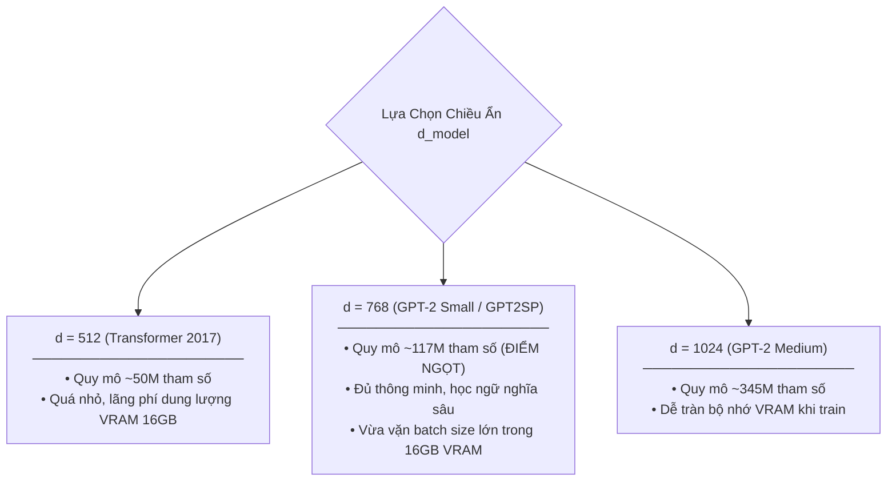

# 🧠 PHÂN TÍCH PHẢN BIỆN 02: NGUỒN GỐC CON SỐ "VÀNG" 768 CHIỀU ẨN (HIDDEN DIMENSION)

> **Câu hỏi phản biện:**  
> *"Tại sao chiều ẩn (hidden dimension - $d_{\text{model}}$) của GPT-2 và GPT2SP lại là con số lẻ 768 mà không phải là một số tròn chẵn như 500 hay 1000? Con số 768 thực sự từ đâu sinh ra?"*

---

## 🎯 1. NGUỒN GỐC TỪ CƠ CHẾ ĐA ĐẦU CHÚ Ý ($12 \times 64 = 768$)

Nguồn gốc trực tiếp nhất của con số **$768$** xuất phát từ công thức phân bổ kích thước trong cơ chế **Multi-Head Self-Attention** của kiến trúc Transformer.

Trong bài báo gốc của Google (*"Attention Is All You Need"*, Vaswani et al., 2017):
* Toàn bộ vector biểu diễn ẩn $d_{\text{model}}$ được chia đều cho $H$ đầu chú ý song song (Attention Heads):
  $$d_k = \frac{d_{\text{model}}}{H}$$
  *(Trong đó $d_k$ là số chiều vector mà mỗi đầu chú ý phụ trách).*

### Vì sao mỗi đầu lại chọn kích thước chuẩn $d_k = 64$?
* **Về mặt toán học:** Trong công thức Scaled Dot-Product Attention:
  $$\text{Attention}(Q, K, V) = \text{softmax}\left(\frac{QK^T}{\sqrt{d_k}}\right) V$$
  Tích vô hướng $QK^T$ có phương sai tỷ lệ thuận với $d_k$. Nếu $d_k$ quá lớn (ví dụ $256$), tích vô hướng bùng nổ rất lớn khiến hàm Softmax rơi vào vùng bão hòa (gradient gần bằng $0$, gây triệt tiêu gradient).  
  Các tác giả thực nghiệm nhận thấy **$d_k = 64$** (kết hợp với hệ số chia $\frac{1}{\sqrt{64}} = \frac{1}{8}$) là điểm cân bằng vàng: đủ sức chứa đặc trưng ngôn ngữ mà gradient vẫn lan truyền cực kỳ ổn định.
* **Số lượng đầu chú ý ($H = 12$ heads):**  
  Để mô hình có thể quan sát $12$ khía cạnh ngữ nghĩa độc lập cùng một lúc (cú pháp câu, đối tượng gây lỗi, liên kết logic, dấu câu...), OpenAI thiết lập $H = 12$.

Từ đó, chiều ẩn tổng thể của mô hình bắt buộc phải là:
$$d_{\text{model}} = H \times d_k = 12 \times 64 = \mathbf{768}$$

---

## 💻 2. TỐI ƯU HÓA PHẦN CỨNG GPU (WARP ALIGNMENT & TENSOR CORES)

Trong kỹ thuật máy tính, các chip đồ họa GPU (đặc biệt là GPU NVIDIA) không xử lý dữ liệu theo từng luồng đơn lẻ, mà tính toán theo từng bó luồng song song gọi là **Warp**:
* Mỗi Warp của NVIDIA luôn luôn có đúng **$32$ luồng (threads)**.
* Các nhân tính toán ma trận chuyên dụng (**Tensor Cores**) được thiết kế để nạp và nhân các khối ma trận kích thước là bội số của **$16$**, **$32$**, và **$64$**.

Con số **$768$** là một con số "cực kỳ thân thiện với phần cứng" (Hardware-aligned number):

$$768 = 24 \times 32 \quad (\text{Chia hết cho 32 luồng của 1 Warp})$$
$$768 = 12 \times 64 \quad (\text{Khớp hoàn hảo với Tensor Core GEMM})$$
$$768 = 3 \times 256 \quad (\text{Căn chỉnh theo đường truyền bộ nhớ cache 256-bit})$$

> [!TIP]
> **Hệ quả phần cứng:** Nếu ta chọn một con số tròn trịa theo thói quen con người như $500$ hay $1000$, GPU sẽ không thể chia đều cho các Warp 32 luồng. Phần cứng buộc phải thực hiện kỹ thuật chèn thêm các số 0 (padding), gây lãng phí bộ nhớ đệm, chậm băng thông và xuất hiện hiện tượng xung đột hàng bộ nhớ (Bank Conflict). Con số $768$ giúp GPU chạy ở **100% công suất lý thuyết**.

---

## ⚖️ 3. "ĐIỂM NGỌT" NGÂN SÁCH THAM SỐ TRÊN GPU 16GB VRAM

Vào thời điểm GPT-1 (2018) và GPT-2 (2019) ra đời, phần cứng mạnh mẽ nhất trong các phòng thí nghiệm AI là card đồ họa **NVIDIA Tesla V100 có 16GB VRAM**.

Hãy xem điều gì xảy ra với các lựa chọn chiều ẩn khác nhau khi xếp chồng 12 tầng Decoders:

Với $d_{\text{model}} = 768$ và $12$ khối Transformer, tổng số tham số mô hình được tính như sau:
* **Ma trận nhúng từ & vị trí:** $(50.257 + 1024) \times 768 \approx 39.4\text{M}$
* **12 Khối Transformer Decoders:** $12 \times \approx 7.08\text{M} \approx 85\text{M}$
* **Tổng cộng:** $\approx \mathbf{124\text{M}}$ tham số (khoảng $117\text{M}$ trọng số biến đổi độc lập).

Quy mô 117M tham số cho phép huấn luyện mô hình với batch size đủ lớn (ví dụ: batch size = 64 hoặc 128) nằm trọn vẹn trong một card GPU 16GB VRAM mà không bị tràn bộ nhớ.

---

## 📊 4. MỌI BIẾN THỂ GPT-2 ĐỀU LÀ BỘI SỐ CỦA 64!

Để chứng minh rằng con số $768$ bắt nguồn từ công thức $H \times 64$, hãy nhìn vào bảng thông số kỹ thuật của toàn bộ 4 phiên bản GPT-2 mà OpenAI công bố:

| Phiên bản GPT-2 | Số tầng ($L$) | Chiều ẩn ($d_{\text{model}}$) | Số đầu chú ý ($H$) | Kích thước 1 đầu ($d_k$) | Kiểm chứng toán học |
| :--- | :---: | :---: | :---: | :---: | :---: |
| **GPT-2 Small** *(Dùng trong GPT2SP)* | **12** | **768** | **12** | **64** | $12 \times 64 = \mathbf{768}$ |
| **GPT-2 Medium** | 24 | **1024** | **16** | **64** | $16 \times 64 = \mathbf{1024}$ |
| **GPT-2 Large** | 36 | **1280** | **20** | **64** | $20 \times 64 = \mathbf{1280}$ |
| **GPT-2 XL** | 48 | **1600** | **25** | **64** | $25 \times 64 = \mathbf{1600}$ |

*Tất cả mọi biến thể đều giữ bất di bất dịch kích thước một đầu là $d_k = 64$ và tăng dần số đầu chú ý $H$, kéo theo chiều ẩn $d_{\text{model}}$ tăng lên tương ứng!*

---

## 📌 5. TỔNG KẾT

Con số **768** được sinh ra từ:
1. **Toán học Attention:** $12 \text{ đầu chú ý} \times 64 \text{ chiều/đầu} = \mathbf{768}$.
2. **Kiến trúc phần cứng GPU:** Bội số của $32$ luồng trong một NVIDIA Warp, giúp loại bỏ 100% lãng phí tính toán.
3. **Giới hạn thực tế:** Tạo ra mô hình quy mô 117M tham số, vừa khít bộ nhớ 16GB VRAM của thế hệ phần cứng GPU thời điểm đó.
