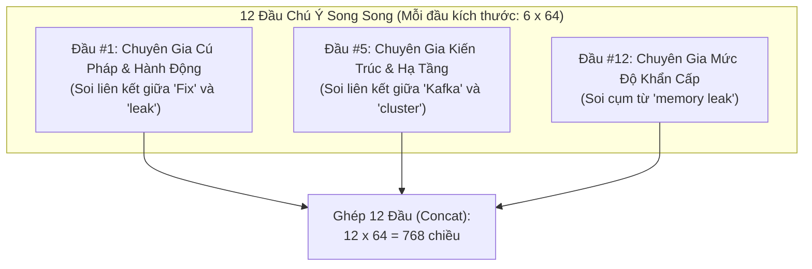
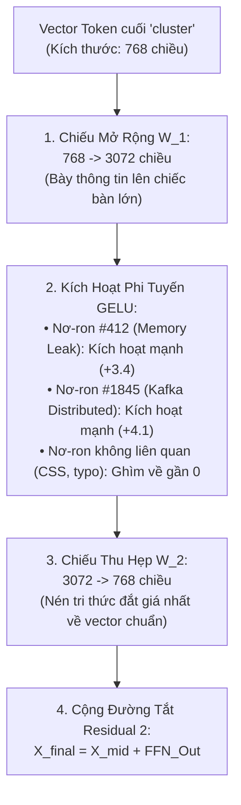

# 🧠 PHÂN TÍCH PHẢN BIỆN 03: GIẢI MÃ CÁC KÍCH THƯỚC MA TRẬN TRONG TRANSFORMER ($2304$, $768$, VÀ $3072$)

> **Câu hỏi phản biện:**  
> *"Tại sao ma trận biến đổi Query/Key/Value lại là $768 \times 2304$ rồi sau đó lại có ma trận chiếu $768 \times 768$? Và tại sao mạng truyền thẳng (FFN) lại chiếu mở rộng không gian đặc trưng lên con số $768 \times 3072$?"*

---

## 🎯 1. NGUỒN GỐC MA TRẬN GHÉP $W_{QKV} \in \mathbb{R}^{768 \times 2304}$

Trong lý thuyết kinh điển của Transformer (Vaswani et al., 2017), với một vector đầu vào $x \in \mathbb{R}^{768}$, ta cần biến đổi nó thành 3 vector độc lập:
* Vector Truy vấn (**Query - $Q$**): kích thước $768$
* Vector Khóa (**Key - $K$**): kích thước $768$
* Vector Giá trị (**Value - $V$**): kích thước $768$

Nếu thiết kế theo cách ngây thơ, ta sẽ cần **3 ma trận trọng số độc lập**:
$$W^Q \in \mathbb{R}^{768 \times 768}, \quad W^K \in \mathbb{R}^{768 \times 768}, \quad W^V \in \mathbb{R}^{768 \times 768}$$

### Nút thắt phần cứng (Hardware Bottleneck)
Nếu giữ 3 ma trận riêng biệt, GPU sẽ phải thực thi 3 lệnh nhân ma trận (3 GPU Kernel Launches) tuần tự:
$$Q = x \cdot W^Q, \quad K = x \cdot W^K, \quad V = x \cdot W^V$$
Việc kích hoạt 3 kernel riêng biệt làm tăng độ trễ điều phối (scheduling overhead) và lãng phí băng thông bộ nhớ VRAM của GPU.

### Giải pháp tối ưu: Kỹ thuật Ghép Ma Trận (Matrix Fusion)
Các kỹ sư OpenAI đã ghép 3 ma trận $W^Q, W^K, W^V$ nằm cạnh nhau thành **một ma trận duy nhất** (trong mã nguồn Hugging Face gọi là tầng `c_attn`):

$$W_{QKV} = \begin{bmatrix} W^Q & W^K & W^V \end{bmatrix} \in \mathbb{R}^{768 \times (768 + 768 + 768)} = \mathbf{768 \times 2304}$$

$$\text{Bởi vì: } 768 \times 3 = \mathbf{2304}$$

```text
                  ┌───────────────── W_QKV (768 × 2304) ─────────────────┐
                  │                                                      │
Vector vào x ───> │  [ W^Q: 768 × 768 ]  [ W^K: 768 × 768 ]  [ W^V: 768 × 768 ]  │
 (1 × 768)        │                                                      │
                  └──────────────────────────────────────────────────────┘
                                             │
                                             ▼  (1 phép nhân ma trận duy nhất)
                      Vector kết quả: [ Q (768) | K (768) | V (768) ] (1 × 2304)
                                             │
                                             ▼  (.split(768, dim=-1))
                                      Q        K        V
```

> [!TIP]
> **Hiệu quả:** Chỉ cần **1 phép nhân ma trận duy nhất** trên GPU, sau đó hệ thống chỉ việc cắt mảng (slice) thành 3 đoạn $768$ bằng nhau với chi phí tính toán bằng $0$ ($\mathcal{O}(1)$).

---

## 🔄 2. MA TRẬN CHIẾU ĐẦU RA $W^O \in \mathbb{R}^{768 \times 768}$ DÙNG ĐỂ LÀM GÌ?

Sau khi có $Q, K, V$, hệ thống chia thành $12$ đầu chú ý song song ($H = 12$). Mỗi đầu chú ý tính toán trên vector $64$ chiều:
$$\text{head}_i = \text{Attention}(Q_i, K_i, V_i) \in \mathbb{R}^{64} \quad (i = 1, \dots, 12)$$

Ghép kết quả của cả 12 đầu lại với nhau:
$$\text{Concat}(\text{head}_1, \dots, \text{head}_{12}) \in \mathbb{R}^{12 \times 64} = \mathbb{R}^{768}$$

### Vì sao không dùng luôn vector 768 này mà lại phải nhân tiếp với ma trận $768 \times 768$?
Nếu chỉ ghép nối đơn thuần, thông tin của 12 đầu vẫn nằm tách biệt trên các trục tọa độ riêng (Head 1 nằm từ chiều 0-63, Head 2 từ 64-127...).  
Mô hình cần một **Ma trận Chiếu Đầu Ra (Output Projection Matrix $W^O \in \mathbb{R}^{768 \times 768}$, trong Hugging Face là `c_proj`)** để:
1. **Hòa trộn đặc trưng liên đầu (Inter-head Feature Mixing):** Cho phép các tri thức học được từ Head 1 (ngữ pháp) tương tác và kết hợp với Head 5 (ngữ nghĩa kỹ thuật).
2. **Khớp nối kết nối tắt (Residual Connection):** Đảm bảo không gian biểu diễn tương thích để thực hiện phép cộng tắt:
   
$$x_{\text{out}} = \text{LayerNorm}(x + \text{Attention}(x) \cdot W^O)$$


---

## 🚀 3. TẠI SAO TẦNG FFN LẠI CHIẾU MỞ RỘNG ĐẾN $768 \times 3072$?

Mạng nơ-ron truyền thẳng (Feed-Forward Network - FFN) trong Transformer gồm 2 tầng biến đổi tuyến tính kẹp giữa bởi hàm kích hoạt phi tuyến GELU:
$$\text{FFN}(x) = \text{GELU}(x W_1 + b_1) W_2 + b_2$$

Trong đó:
* $W_1 \in \mathbb{R}^{768 \times 3072}$ (Chiếu mở rộng - Up-projection)
* $W_2 \in \mathbb{R}^{3072 \times 768}$ (Chiếu thu hẹp - Down-projection)

Con số **$3072$** chính là:
$$3072 = 4 \times 768 = \mathbf{4 \times d_{\text{model}}}$$

### Bản chất trí tuệ nhân tạo: FFN hoạt động như một "Bộ nhớ tri thức" (Key-Value Memory)
Nhiều nghiên cứu đột phá về cơ chế hoạt động của Transformer (như Geva et al., EMNLP 2021) đã chứng minh rằng:
* **Tầng Attention chỉ làm nhiệm vụ "định tuyến thông tin" (Information Routing):** Nó giúp từ này biết từ kia là gì trong câu (giao tiếp giữa các tokens).
* **Tầng FFN chính là nơi "lưu trữ tri thức thực tế" (Facts & Knowledge Storage):** Nó hoạt động giống hệt một bảng băm bộ nhớ (Key-Value Store):
  * Ma trận $W_1$ ($768 \rightarrow 3072$): Hoạt động như tập hợp các **Keys** phát hiện mẫu ngữ nghĩa (ví dụ: phát hiện cụm từ này là "lỗi bộ nhớ").
  * Hàm GELU: Đóng vai trò bộ lọc ngưỡng kích hoạt (chỉ kích hoạt các nơ-ron khớp mẫu).
  * Ma trận $W_2$ ($3072 \rightarrow 768$): Hoạt động như các **Values** tổng hợp tri thức để bổ sung vào biểu diễn của từ.

```text
                  Vector vào x (768 chiều)
                             │
                             ▼  (Chiếu mở rộng qua W1: 768 × 3072)
            ┌─────────────────────────────────────────┐
            │  Không gian tiềm ẩn mở rộng 3072 chiều  │
            │  (Đủ sức chứa hàng ngàn quy luật ngữ    │
            │   nghĩa, cú pháp và mẫu lỗi phần mềm)   │
            └─────────────────────────────────────────┘
                             │
                             ▼  (Lọc phi tuyến tính GELU)
            ┌─────────────────────────────────────────┐
            │       Kích hoạt tri thức then chốt      │
            └─────────────────────────────────────────┘
                             │
                             ▼  (Nén thu hẹp qua W2: 3072 × 768)
                  Vector ra (768 chiều chuẩn hóa)
```

> [!IMPORTANT]
> **Quy tắc mở rộng 4 lần ($4 \times d_{\text{model}}$):**  
> Nếu không mở rộng không gian lên $3072$ chiều (ví dụ giữ nguyên $768 \rightarrow 768$), mạng FFN sẽ bị nghẽn cổ chai (information bottleneck), không có đủ số lượng nơ-ron để ghi nhớ các mẫu phức tạp. Con số mở rộng $4$ lần là chuẩn mực tối ưu được chứng minh thực nghiệm trên toàn bộ các mô hình Transformer hiện đại.

---

## 📊 4. TỔNG HỢP KÍCH THƯỚC TRONG 1 KHỐI TRANSFORMER CỦA GPT2SP

Dưới đây là bảng tổng kết toàn bộ các ma trận trọng số cấu thành nên một khối Decoder duy nhất của GPT-2 Small:

| Tầng mạng | Tên lớp trong code | Kích thước ma trận | Số lượng tham số | Vai trò chức năng |
| :--- | :--- | :---: | :---: | :--- |
| **Fused Self-Attention** | `c_attn.weight` | **$768 \times 2304$** | $1.769.472$ | Chiếu đồng thời $Q, K, V$ trong 1 lần gọi GPU kernel. |
| **Attention Bias** | `c_attn.bias` | **$2304$** | $2.304$ | Hệ số điều chỉnh thiên lệch cho $Q, K, V$. |
| **Output Projection** | `c_proj.weight` | **$768 \times 768$** | $589.824$ | Hòa trộn đặc trưng giữa 12 đầu chú ý (Inter-head mixing). |
| **Output Bias** | `c_proj.bias` | **$768$** | $768$ | Bias đầu ra của tầng Attention. |
| **FFN Chiếu mở rộng** | `mlp.c_fc.weight` | **$768 \times 3072$** | $2.359.296$ | Mở rộng không gian lên $4 \times d_{\text{model}}$ để kích hoạt tri thức. |
| **FFN FC Bias** | `mlp.c_fc.bias` | **$3072$** | $3.072$ | Bias tầng FFN mở rộng. |
| **FFN Chiếu thu hẹp** | `mlp.c_proj.weight`| **$3072 \times 768$** | $2.359.296$ | Nén thông tin tri thức trở lại chiều chuẩn $768$. |
| **FFN Proj Bias** | `mlp.c_proj.bias` | **$768$** | $768$ | Bias đầu ra của mạng FFN. |
| **LayerNorm 1 & 2** | `ln_1`, `ln_2` | $2 \times (768 + 768)$ | $3.072$ | Chuẩn hóa tầng trước Attention và FFN. |
| **TỔNG CỘNG 1 KHỐI** | — | — | **$\approx 7.087.872$** | Nhân với 12 khối $\approx \mathbf{85\text{M}}$ tham số. |

---

## 🔬 4.1. CASE STUDY THỰC TẾ: HÀNH TRÌNH MỘT JIRA ISSUE ĐI QUA 1 KHỐI TRANSFORMER

Để hiểu rõ tại sao các kích thước ma trận $768 \times 2304$, $768 \times 768$, và $768 \times 3072$ lại phối hợp nhịp nhàng để giải quyết bài toán ước lượng Story Point, chúng ta hãy cùng theo dõi một **Case Study thực tế** mô phỏng từng bước biến đổi dữ liệu bên trong một khối Transformer Decoder của GPT2SP.

### 📝 ĐẦU VÀO CỦA TÁC VỤ JIRA (INPUT CONTEXT)
Giả sử kỹ sư nhập một User Story lỗi nghiêm trọng trên Jira:
> **Tiêu đề Issue:** `"Fix memory leak in Kafka cluster"`

Qua bộ tách từ Byte-level BPE, câu văn được chia thành chuỗi $L = 6$ subword tokens:
```python
# Ký tự Ġ đại diện cho khoảng trắng đầu từ trong GPT-2 BPE:
tokens = ["Fix", "Ġmemory", "Ġleak", "Ġin", "ĠKafka", "Ġcluster"]
```

Khi nạp vào khối Transformer thứ $l$, dữ liệu là một ma trận tensor có kích thước:
$$X \in \mathbb{R}^{6 \times 768} \quad (\text{gồm 6 dòng, mỗi dòng là một vector 768 chiều})$$

---

### ⚙️ BƯỚC 1: TIỀN CHUẨN HÓA QUA LAYERNORM 1 (`ln_1`)
Trước khi nạp vào tầng Attention, ma trận $X$ được chuẩn hóa độc lập trên từng dòng:
$$\tilde{X} = \text{LayerNorm}_1(X) \in \mathbb{R}^{6 \times 768}$$
* **Nhiệm vụ:** Đưa giá trị trung bình về $0$ ($\mu = 0$) và độ lệch chuẩn về $1$ ($\sigma = 1$) trên trục 768 chiều, giúp tín hiệu ổn định và ngăn ngừa nổ gradient.

---

### ⚡ BƯỚC 2: PHÉP NHÂN MA TRẬN GHÉP $W_{QKV} \in \mathbb{R}^{768 \times 2304}$ (`c_attn`)
GPU chỉ thực thi **đúng một lệnh nhân ma trận duy nhất**:

$$
\text{Tín hiệu gộp } Z = \tilde{X} \cdot W_{QKV} + b_{QKV} \in \mathbb{R}^{6 \times 2304}
$$

Ngay sau đó, bộ nhớ GPU thực hiện phép cắt mảng (slice) siêu tốc không tốn chi phí:
$$Q, K, V = \mathrm{split}(Z, \text{size}=768, \text{dim}=-1)$$
* Ma trận Truy vấn: $Q \in \mathbb{R}^{6 \times 768}$
* Ma trận Chìa khóa: $K \in \mathbb{R}^{6 \times 768}$
* Ma trận Giá trị: $V \in \mathbb{R}^{6 \times 768}$

Tiếp tục tách thành $H = 12$ đầu chú ý song song, mỗi đầu nhận một ma trận con $6 \times 64$ ($64 = 768 / 12$):
$$Q_h, K_h, V_h \in \mathbb{R}^{6 \times 64} \quad (h = 1, 2, \dots, 12)$$

---

### 🎯 BƯỚC 3: MASKED ATTENTION TẠI CÁC ĐẦU CHÚ Ý SONG SONG
Mỗi đầu chú ý $h$ tự động đóng vai trò là một "chuyên gia" phân tích một khía cạnh riêng biệt của tác vụ Jira:



#### Hành vi thực tế tại Đầu số 1 (Chuyên gia Cú pháp & Hành động):
* Token `"Ġleak"` (vị trí 3) phát ra vector truy vấn $Q_{\text{leak}}^{(1)}$ hỏi: *"Hành động nào đang tác động lên tôi?"*.
* Vector chìa khóa $K_{\text{Fix}}^{(1)}$ của token `"Fix"` (vị trí 1) bắt trúng truy vấn này với tích vô hướng cực lớn:
  $$\frac{Q_{\text{leak}}^{(1)} \cdot (K_{\text{Fix}}^{(1)})^T}{\sqrt{64}} = +4.8$$
* Sau khi qua mặt nạ nhân quả $M$ và hàm Softmax, trọng số chú ý giữa `"Ġleak"` và `"Fix"` đạt tới **$52\%$**.
* Kết quả là vector giá trị $V_{\text{Fix}}$ được truyền mạnh mẽ sang biểu diễn của `"Ġleak"`, định hình thông điệp: *"Lỗi rò rỉ này đang là đối tượng của một hành động sửa chữa khẩn cấp!"*.

#### Hành vi thực tế tại Đầu số 5 (Chuyên gia Hạ tầng Hệ thống):
* Token cuối cùng `"Ġcluster"` (vị trí 6) phát ra vector truy vấn $Q_{\text{cluster}}^{(5)}$ tìm kiếm xem cụm này thuộc công nghệ gì.
* Nó bắt gặp Key của `"ĠKafka"` (vị trí 5) với điểm chú ý **$68\%$**, lập tức nhận dạng: *"Đây không phải cụm máy chủ web thông thường, mà là cụm xử lý dữ liệu phân tán Apache Kafka!"*.

---

### 🔄 BƯỚC 4: HÒA TRỘN ĐA ĐẦU QUA $W^O \in \mathbb{R}^{768 \times 768}$ (`c_proj`) VÀ RESIDUAL 1
Sau khi tính xong tại 12 đầu, ta ghép nối lại:
$$\mathbf{H}_{\text{multi}} = \text{Concat}(\text{head}_1, \dots, \text{head}_{12}) \in \mathbb{R}^{6 \times 768}$$

Lúc này, thông tin về "hành động sửa lỗi" (từ Đầu 1) và thông tin về "cụm phân tán Kafka" (từ Đầu 5) vẫn nằm cách biệt trên các trục tọa độ riêng lẻ ($0-63$ và $256-319$).  
**Ma trận Chiếu Đầu Ra $W^O \in \mathbb{R}^{768 \times 768}$ thực hiện phép hòa trộn toàn diện:**

$$\mathbf{A}_{\text{mixed}} = \mathbf{H}_{\text{multi}} \cdot W^O + b^O \in \mathbb{R}^{6 \times 768}$$

Tiếp theo, tín hiệu được cộng dồn với dữ liệu gốc qua **Đường tắt Residual Connection 1**:
$$X_{\text{mid}} = X + \mathbf{A}_{\text{mixed}} \in \mathbb{R}^{6 \times 768}$$
> 💡 *Nhờ phép cộng này, bản sắc gốc của từng từ không bị mất đi, nhưng mỗi từ đã được làm giàu thêm bằng ngữ cảnh của toàn bộ các từ đứng trước nó.*

---

### 🧠 BƯỚC 5: TẦNG BỘ NHỚ TRI THỨC FFN ($768 \rightarrow 3072 \rightarrow 768$)
Sau khi chuẩn hóa qua `LayerNorm 2`, ma trận $X_{\text{mid}}$ bước vào mạng truyền thẳng hai tầng:



1. **Phép chiếu mở rộng $W_1 \in \mathbb{R}^{768 \times 3072}$:**  
   Vector 768 chiều được phóng đại lên $3072$ chiều. Không gian mở rộng này đủ chỗ để đối chiếu với hàng ngàn mẫu hình tri thức phần mềm đã học được trong quá trình tiền huấn luyện WebText.
2. **Bộ lọc kích hoạt phi tuyến GELU:**  
   * Nơ-ron số `#412` (chuyên nhận diện các mẫu sự cố rò rỉ tài nguyên bộ nhớ) phát hiện tín hiệu từ `memory` + `leak`, bị kích hoạt cực mạnh.
   * Nơ-ron số `#1845` (chuyên nhận diện độ phức tạp của các hệ thống hàng đợi phân tán Kafka) được kích hoạt cực mạnh.
   * Các nơ-ron không liên quan (như nơ-ron giao diện người dùng, nơ-ron tài liệu hướng dẫn) nhận giá trị âm và bị hàm GELU triệt tiêu êm ái về gần $0$.
3. **Phép chiếu nén $W_2 \in \mathbb{R}^{3072 \times 768}$:**  
   Tổng hợp kết quả kích hoạt của 3072 nơ-ron lại thành một vector tri thức cô đọng 768 chiều, mang thông điệp: *"Đây là tác vụ có độ phức tạp thuật toán và rủi ro kiến trúc ở mức rất cao!"*.

---

### 🏁 BƯỚC 6: ĐẦU RA HOÀN CHỈNH CỦA KHỐI TRANSFORMER
Cộng đường tắt phần dư thứ hai:
$$X_{\text{out}} = X_{\text{mid}} + \text{FFN}(X_{\text{mid}}) \in \mathbb{R}^{6 \times 768}$$

#### 🔍 SO SÁNH SỰ THAY ĐỔI CỦA TOKEN CUỐI CÙNG (`Ġcluster`):

| Thời điểm | Bản chất vector của token `Ġcluster` | Khả năng định giá Story Point |
| :--- | :--- | :--- |
| **Trước khi vào Khối** | Chỉ là vector từ vựng tĩnh mang nghĩa chung chung: *"cluster = một cụm/nhóm máy móc"*. | Hoàn toàn mù tịt, không biết task này dễ hay khó. |
| **Sau khi đi qua Khối Transformer** | Vector đã được **hòa trộn ngữ cảnh hoàn chỉnh**: <br>1. Qua Self-Attention: Biết cụm này thuộc về **Apache Kafka**, đang bị dính lỗi **memory leak**, và cần hành động **Fix**.<br>2. Qua FFN: Bộ nhớ tri thức kích hoạt nhận định đây là **sự cố hạ tầng phân tán có rủi ro nghiêm trọng**. | Đã tích lũy đủ thông tin chất lượng cao để sẵn sàng nạp vào các khối tiếp theo và đẩy sang **MLP Regressor Head** dự đoán chính xác mức Story Point cao (**8 hoặc 13 SP**)! |

---

## 📌 5. TỔNG KẾT

* **Con số 2304** = $768 \times 3$ (Query + Key + Value), sinh ra từ kỹ thuật **ghép ma trận (Matrix Fusion)** giúp tối ưu hóa phần cứng GPU (giảm từ 3 lần chạy kernel xuống còn 1 lần duy nhất).
* **Con số 768 chiếu lại** = Ma trận chiếu giúp **hòa trộn thông tin của 12 đầu chú ý** và đưa kích thước về chuẩn để cộng Residual Connection.
* **Con số 3072** = $4 \times 768$, tuân theo **Quy tắc mở rộng 4 lần** kinh điển của Transformer, biến tầng FFN thành một **kho bộ nhớ tri thức** lưu trữ các đặc trưng ngôn ngữ và kỹ thuật phức tạp.
