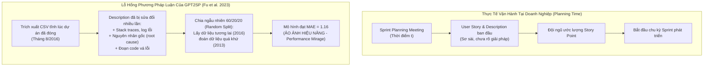
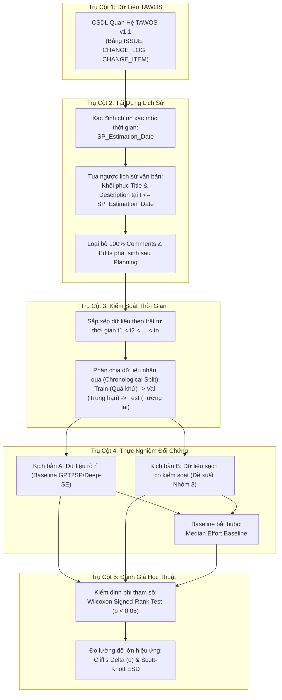

# 🧠 PHÂN TÍCH PHẢN BIỆN 09: BÀI BÁO GPT2SP ĐÃ GIẢI QUYẾT VẤN ĐỀ DATA LEAKAGE CHƯA VÀ KẾ HOẠCH HÀNH ĐỘNG CỦA NHÓM 3

> **Chuyên mục:** Phân tích phản biện khoa học độc lập (Scientific Critical Thinking).  
> **Chủ đề trung tâm:** Đánh giá tính chân thực của dữ liệu thực nghiệm trong bài báo *GPT2SP* (IEEE TSE 2023), vạch trần lỗ hổng rò rỉ dữ liệu (Data Leakage), và thiết lập lộ trình nghiên cứu của Đề tài NCKH Nhóm 3:  
> **"Agile Story Point Estimation at Planning Time with Temporal & Data Leakage Control"**.

---

## 🎯 1. BÀI BÁO GPT2SP ĐÃ GIẢI QUYẾT VẤN ĐỀ DATA LEAKAGE CHƯA?

### Câu trả lời trực diện: **HOÀN TOÀN CHƯA!**

Ngược lại với sự kỳ vọng vào một công trình xuất bản trên tạp chí hàng đầu thế giới (*IEEE Transactions on Software Engineering*), bài báo GPT2SP của Fu & Tantithamthavorn (2023) **hoàn toàn bỏ qua vấn đề Data Leakage**. 

* Trong toàn bộ 19 trang của bài báo, từ khóa **"Data Leakage"** hay **"Temporal Leakage"** không hề xuất hiện dù chỉ một lần.
* Tại **Section 9 (Threats to Validity)** trên Trang 14 – 15, nhóm tác giả chỉ bàn luận về độ nhiễu của nhãn Story Point, việc tối ưu siêu tham số, và giới hạn khảo sát 16 người. Họ hoàn toàn không nhận thức (hoặc né tránh) nguy cơ rò rỉ thông tin tương lai trong tập dữ liệu thực nghiệm.



---

## 🔍 2. BÓC TÁCH 3 LỖ HỔNG RÒ RỈ DỮ LIỆU CỐT LÕI TRONG BÀI BÁO GPT2SP

### 2.1. Lỗ hổng 1: Rò rỉ Văn bản sau Lập kế hoạch (Post-Planning Description Leakage)
* **Bản chất kỹ thuật:** Tác giả sử dụng nguyên vẹn bộ dữ liệu CSV tĩnh từ nghiên cứu của Choetkiertikul et al. (2016). Các file CSV này được trích xuất (dump) tại thời điểm dự án đã kết thúc hoặc sau nhiều năm phát triển.
* **Cơ chế rò rỉ trong Jira thực tế:**
  1. Khi một issue mới được tạo ra trước buổi Sprint Planning, trường `Description` thường rất ngắn (ví dụ: *"Cần sửa lỗi tràn bộ nhớ khi đồng bộ dữ liệu người dùng"*).
  2. Sau khi được chốt Story Point (ví dụ: 8 điểm), lập trình viên nhận task, debug mã nguồn, tìm ra nguyên nhân, và liên tục cập nhật trường `Description` bổ sung:
     * Dấu vết ngăn xếp chi tiết (`Stack trace`, log exception).
     * Tên các file mã nguồn, tên class, method bị lỗi (`UserSyncService.java`).
     * Các bước tái hiện lỗi chi tiết và phương án vá lỗi (Pull Request link).
* **Hậu quả:** GPT2SP đưa toàn bộ các thông tin kỹ thuật phát sinh **sau khi task đã được làm xong** vào mô hình để "dự đoán" điểm Story Point ban đầu. Mô hình dễ dàng đạt điểm cao không phải vì hiểu độ phức tạp của bài toán, mà vì nó đọc được chính đáp án và vết tích của quá trình giải quyết trong tương lai!

---

### 2.2. Lỗ hổng 2: Rò rỉ Dòng thời gian do Phân chia Ngẫu nhiên (Lookahead Bias / Random Split Leakage)
* **Bản chất kỹ thuật:** Bài báo phân chia tập dữ liệu theo tỷ lệ $60\%$ Training, $20\%$ Validation, $20\%$ Testing bằng phương pháp **phân chia ngẫu nhiên (Random Split)** trên toàn bộ 23.313 issues.
* **Nghịch lý du hành thời gian (Time-Travel Paradox):**
  * Một issue phát sinh vào tháng **06/2013** có thể bị xếp vào tập Test.
  * Trong khi đó, các issue phát sinh vào tháng **12/2015** lại nằm trong tập Training của mô hình!
* **Vi phạm nguyên lý nhân quả trong Công nghệ Phần mềm:**
  * Trong thực tế doanh nghiệp, nhóm phát triển chỉ có thể dùng tri thức của các Sprint trong quá khứ ($t \le T$) để ước lượng cho Sprint tiếp theo ($T + 1$). 
  * Không bao giờ tồn tại kịch bản nhóm kỹ sư lấy kiến thức của năm 2016 để quay ngược thời gian ước lượng cho công việc năm 2013. Việc áp dụng Random Split đã bơm toàn bộ tri thức của tương lai (ngữ vựng mới, phong cách viết issue mới, công nghệ mới cập nhật) vào tập huấn luyện.

---

### 2.3. Lỗ hổng 3: Rò rỉ Mục tiêu từ Siêu dữ liệu Sau Hoàn thành (Target & Metadata Leakage)
* Trong các hệ thống quản lý như Jira, nhiều trường dữ liệu chỉ xuất hiện hoặc biến đổi sau khi task đã hoàn thành:
  * Trạng thái `Resolution`, ngày giải quyết `Resolution Date`.
  * Danh sách các bình luận thảo luận (`Comments`) chứa toàn bộ quá trình tranh luận sửa lỗi.
  * Sự thay đổi người thực hiện (`Assignee`) từ nhân viên thực tập sang chuyên gia cao cấp.
* Dữ liệu CSV tĩnh gom tất cả trạng thái cuối cùng thành một bản ghi phẳng, khiến mô hình học trên các đặc trưng đã bị biến đổi hoàn toàn so với nguyên trạng lúc Planning.

> [!CAUTION]
> **KẾT LUẬN VỀ HIỆU NĂNG CỦA GPT2SP:**  
> Con số $\text{MAE} = 1,16$ (nội dự án) và $\text{MAE} = 0,96$ (trên dự án Spring XD) được công bố trên IEEE TSE 2023 thực chất là một **"bong bóng hiệu năng ảo"**. Khi triển khai công cụ Streamlit GPT2SP vào một buổi Sprint Planning thực tế với mô tả issue sơ khai, độ chính xác của mô hình chắc chắn sẽ sụt giảm nghiêm trọng.

---

## 🛡️ 3. SỨ MỆNH VÀ KẾ HOẠCH HÀNH ĐỘNG CỦA NHÓM NCKH 3 (JOHNNY SNOWFLAKE)

Để khắc phục triệt để lỗ hổng phương pháp luận mang tính hệ thống của các công trình tiền nhiệm (Deep-SE, GPT2SP), đề tài nghiên cứu của Nhóm 3 được định vị trực diện:  
**"Agile Story Point Estimation at Planning Time with Temporal & Data Leakage Control"**.

Nhóm nghiên cứu cam kết triển khai kế hoạch hành động 5 trụ cột khoa học:



---

### 3.1. Trụ cột 1: Chuyển đổi nguồn dữ liệu từ CSV tĩnh sang CSDL quan hệ TAWOS v1.1
* Không sử dụng các file CSV phẳng trích xuất tại một thời điểm cố định.
* Khai thác cơ sở dữ liệu quan hệ **TAWOS (The Agile Web-based Open-source Software dataset)** lưu trữ toàn bộ lịch sử biến động của các issue Jira thông qua các bảng:
  * `ISSUE`: Thông tin cơ bản ban đầu của task.
  * `CHANGE_LOG` & `CHANGE_ITEM`: Nhật ký ghi lại từng thao tác sửa đổi trường (field), giá trị cũ (`oldvalue`), giá trị mới (`newvalue`) và dấu thời gian (`created`).

---

### 3.2. Trụ cột 2: Tái dựng nguyên trạng Issue tại đúng mốc Lập kế hoạch (`SP_Estimation_Date`)
Đây là đóng góp kỹ thuật cốt lõi bảo đảm **Tính toàn vẹn khoa học (Scientific Rigor)**:

1. **Xác định mốc `SP_Estimation_Date`:**  
   Truy vấn trong bảng nhật ký thay đổi để tìm chính xác thời điểm đầu tiên trường Story Point được gán giá trị:
   $$t_{\text{SP\_Estimation}} = \min \{ t \mid \text{field} = \text{'Story Points'} \wedge \text{newvalue} \neq \emptyset \}$$
2. **Khôi phục văn bản ngược thời gian (Time-Travel Text Reconstruction):**  
   * Lấy phiên bản trường `Title` và `Description` tồn tại **ngay tại hoặc trước mốc $t_{\text{SP\_Estimation}}$**.
   * Nếu người dùng sửa mô tả sau mốc $t_{\text{SP\_Estimation}}$, toàn bộ các chỉnh sửa đó bị đảo ngược (rollback) về trạng thái cũ.
3. **Thanh lọc dữ liệu tương lai:**  
   * Cắt bỏ toàn bộ các bình luận (`Comments`) được tạo ra sau mốc $t_{\text{SP\_Estimation}}$.
   * Loại trừ các trường kết quả: `Resolution Date`, `Resolved Status`, `Fix Versions`, và các nhãn gắn muộn.

---

### 3.3. Trụ cột 3: Chiến lược phân chia dữ liệu theo dòng thời gian nghiêm ngặt (Chronological Split)
* **Triệt tiêu hoàn toàn Random Split:** Tuyệt đối không xáo trộn ngẫu nhiên dữ liệu xuyên qua các năm.
* **Quy trình phân chia theo trục thời gian (Time-based / Prequential Evaluation):**
  1. Toàn bộ các issue của dự án được sắp xếp theo thứ tự tăng dần của mốc $t_{\text{SP\_Estimation}}$.
  2. Phân tách dòng dữ liệu thành 3 giai đoạn không chồng lấn:
     $$\text{Train} = \{ \text{Issue}_i \mid t_i \le T_1 \}$$
     $$\text{Validation} = \{ \text{Issue}_j \mid T_1 < t_j \le T_2 \}$$
     $$\text{Test} = \{ \text{Issue}_k \mid T_2 < t_k \}$$
  3. Bảo đảm $100\%$ rằng mô hình chỉ dùng tri thức của các Sprint đã qua để dự báo cho Sprint trong tương lai, phản ánh trung thực bài toán tại các doanh nghiệp.

---

### 3.4. Trụ cột 4: Thiết kế thực nghiệm đối chứng đa chiều (Ablation Study on Leakage)
Để chứng minh cho hội đồng khoa học thấy mức độ tác động của Data Leakage, Nhóm 3 sẽ thực hiện thí nghiệm đối chứng song song trên 2 môi trường:

| Tiêu chí đối chứng | Môi trường 1: Rò rỉ Dữ liệu (Mô phỏng GPT2SP) | Môi trường 2: Kiểm soát Rò rỉ (Đề xuất Nhóm 3) |
| :--- | :--- | :--- |
| **Nguồn dữ liệu** | CSV tĩnh năm 2016 (Choetkiertikul et al.) | CSDL TAWOS khôi phục tại $t_{\text{SP\_Estimation}}$ |
| **Văn bản Description** | Bản cuối cùng (chứa stack trace, fix details) | Bản gốc lúc họp Sprint Planning |
| **Phương pháp phân chia** | Ngẫu nhiên (Random Split 60/20/20) | Nhân quả theo thời gian (Chronological Split) |
| **Mô hình thử nghiệm** | GPT2SP, Deep-SE, SBERT, Baselines | GPT2SP, Deep-SE, SBERT, Baselines |
| **Baseline bắt buộc** | Mean / Median | **Median Effort Baseline** (Cố định theo từng Sprint quá khứ) |

---

### 3.5. Trụ cột 5: Kiểm định ý nghĩa thống kê chuẩn mực
* Tuân thủ quy định tại [AGENTS.md](file:///d:/NCKH_3/AGENTS.md):
  * Mọi cải tiến của mô hình đề xuất đều phải vượt qua **Median Effort Baseline**.
  * Kiểm định phi tham số **Wilcoxon Signed-Rank Test** với mức ý nghĩa thống kê $\alpha = 0,05$.
  * Đo lường kích thước hiệu ứng thực chất thông qua **Cliff's Delta ($\delta$)** (phải đạt mức *Medium* hoặc *Large*, tránh hiện tượng cải thiện số liệu không đáng kể).

---

## 📋 4. BẢNG TỔNG KẾT SO SÁNH GIỮA GPT2SP (2023) VÀ ĐỀ TÀI NHÓM 3

```text
┌─────────────────────────────┬─────────────────────────────────┬─────────────────────────────────┐
│ Thuộc tính so sánh          │ Bài báo gốc GPT2SP (TSE 2023)   │ Đề tài NCKH Nhóm 3 (Đề xuất)    │
├─────────────────────────────┼─────────────────────────────────┼─────────────────────────────────┤
│ Nhận diện Data Leakage      │ ❌ Hoàn toàn bỏ qua             │ ✅ Trọng tâm phương pháp luận   │
│ Nguồn dữ liệu trích xuất    │ ❌ CSV tĩnh (cuối vòng đời)     │ ✅ CSDL TAWOS v1.1 có lịch sử   │
│ Thời điểm tái dựng đặc trưng│ ❌ Thời điểm kết xuất 2016      │ ✅ Chuẩn xác SP_Estimation_Date │
│ Chiến lược chia tập dữ liệu │ ❌ Random Split (vi phạm thì)   │ ✅ Chronological Split (nhân quả│
│ Rủi ro Description sau task │ ❌ Chứa log lỗi / lời giải      │ ✅ Rollback về bản thô sơ khai  │
│ Đối chứng hiệu năng thực tế │ ❌ Ảo ảnh hiệu năng (MAE 1.16)  │ ✅ Số liệu trung thực, tin cậy  │
│ Ứng dụng trong Sprint họp   │ ❌ Rớt độ chính xác khi áp dụng │ ✅ Sẵn sàng tích hợp thực tế    │
└─────────────────────────────┴─────────────────────────────────┴─────────────────────────────────┘
```

---

## 🚀 5. LỘ TRÌNH TRIỂN KHAI KỸ THUẬT TIẾP THEO CHO NHÓM 3

1. **Xây dựng Script trích xuất và lọc TAWOS:** Viết mã nguồn Python / SQL để truy vấn CSDL TAWOS, xác định cột mốc `SP_Estimation_Date` và tái dựng lịch sử văn bản cho dự án thí điểm đầu tiên (**Spring XD**).
2. **Xây dựng Pipeline Chronological Data Loader:** Thiết lập bộ nạp dữ liệu PyTorch tuân thủ nguyên tắc dòng thời gian.
3. **Tái lập mô hình GPT2SP trên 2 bộ dữ liệu:** Chạy huấn luyện và đánh giá trên bộ dữ liệu rò rỉ (CSV gốc) và bộ dữ liệu sạch (TAWOS tái dựng) để đo lường độ chênh lệch sai số thực tế.
4. **Viết bài báo khoa học công bố phát hiện:** Trình bày kết quả thực nghiệm chứng minh rằng các nghiên cứu SOTA trước đây đã đánh giá quá cao năng lực của AI do rò rỉ thông tin tương lai, từ đó khẳng định giá trị tiên phong của đề tài Nhóm 3.

---

## 🔗 Liên Kết Điều Hướng Hệ Thống

* 🛡️ [Chương 9: Các mối đe dọa đối với tính hợp lệ trong bài báo gốc](file:///d:/NCKH_3/docs/articles/paper-information/explanation/09_threats_to_validity.md)
* 🔬 [Chương 4: Thiết lập thực nghiệm gốc của Fu et al.](file:///d:/NCKH_3/docs/articles/paper-information/explanation/04_experimental_setup.md)
* 📖 [Chương 10: Kết luận và cam kết Open Science](file:///d:/NCKH_3/docs/articles/paper-information/explanation/10_conclusion.md)
* 📚 [Chuyên mục Critical Thinking tổng quan](file:///d:/NCKH_3/docs/articles/paper-information/critical-thinking/README.md)
* 👑 [Quy chuẩn vận hành nghiên cứu NCKH Nhóm 3](file:///d:/NCKH_3/AGENTS.md)
