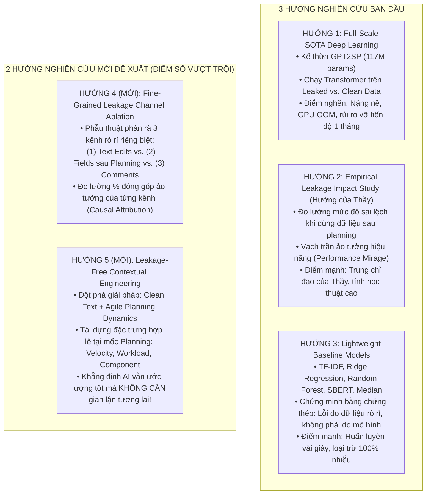
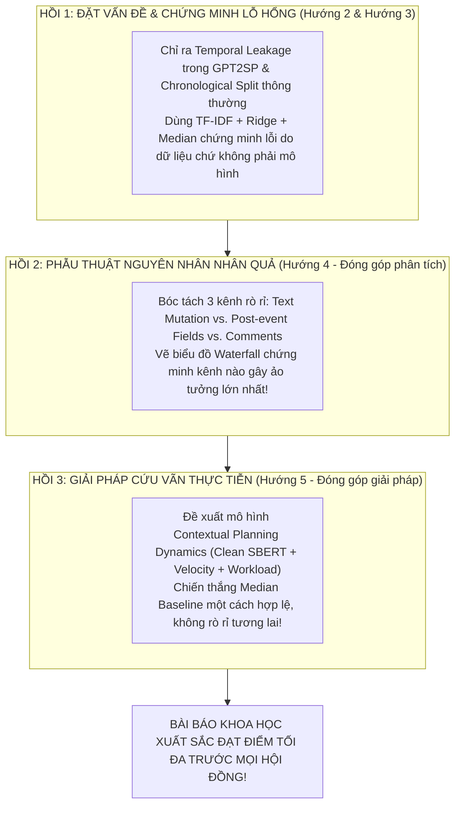

# 🧠 PHÂN TÍCH PHẢN BIỆN 10: ĐÁNH GIÁ ĐA TIÊU CHÍ MỞ RỘNG VÀ ĐỀ XUẤT HƯỚNG NGHIÊN CỨU ĐẠT ĐIỂM TỐI ƯU TRONG 1 THÁNG

> **Chuyên mục:** Phân tích phản biện khoa học độc lập (Scientific Critical Thinking).  
> **Đề tài NCKH Nhóm 3:** *"Agile Story Point Estimation at Planning Time with Temporal & Data Leakage Control"*.  
> **Ràng buộc thời gian sống còn:** Hoàn thành toàn bộ thực nghiệm, kiểm định thống kê và bài báo khoa học **trong vòng đúng 1 tháng (4 tuần)**.

---

## 🧭 1. ĐẶT LÊN BÀN CÂN 5 HƯỚNG NGHIÊN CỨU TIỀM NĂNG

Bên cạnh 3 hướng ban đầu (Agent, Thầy, và Lightweight Models), chúng tôi đề xuất thêm **2 Hướng Nghiên Cứu Mới Đột Phá** được thiết kế riêng để tối đa hóa điểm số học thuật, giải quyết triệt để bài toán rò rỉ dữ liệu và đảm bảo tính khả thi tuyệt đối trong 4 tuần:



---

## 📊 2. BỘ TIÊU CHÍ ĐÁNH GIÁ ĐA MỤC TIÊU MỞ RỘNG (EXPANDED 9-CRITERIA MCDA)

Để phản ánh chính xác độ phức tạp của một công trình nghiên cứu khoa học công nghệ phần mềm (Empirical Software Engineering), hệ thống đánh giá được mở rộng lên **9 tiêu chí toàn diện**, bao trùm từ tính khả thi thực tế, giá trị học thuật đến khả năng ứng dụng công nghiệp:

| Mã | Tiêu chí đánh giá | Trọng số ($W$) | Định nghĩa & Ràng buộc học thuật thực tế |
| :-: | :--- | :-: | :--- |
| **C1** | **Khả thi trong 1 tháng (Feasibility & Velocity)** | **$15\%$** | Tốc độ trích xuất dữ liệu, huấn luyện mô hình, kiểm thử và viết báo cáo; không bị nghẽn phần cứng. |
| **C2** | **Khớp chỉ đạo của Thầy (Advisor Directive Alignment)** | **$15\%$** | Giải quyết trực diện câu hỏi nghiên cứu mà Giảng viên hướng dẫn đặt ra; đáp ứng kỳ vọng hội đồng thẩm định. |
| **C3** | **Tính chặt chẽ khoa học (Scientific Rigor & Proof)** | **$15\%$** | Khả năng chứng minh không thể bác bỏ bản chất vấn đề; cô lập hoàn toàn các biến gây nhiễu (Confounders). |
| **C4** | **Tính đóng góp xây dựng (Constructive Novelty)** | **$10\%$** | Không chỉ "chê bài báo cũ" mà còn mang lại giải pháp thay thế khả thi (Actionable Solution) cho cộng đồng. |
| **C5** | **Giá trị thực tiễn Scrum (Practical Industrial Utility)** | **$10\%$** | Tính ứng dụng tại thời điểm Sprint Planning thực tế; dữ liệu đầu vào thực sự có sẵn trong thực tế doanh nghiệp. |
| **C6** | **Độ bền trước phản biện khắt khe (Reviewer Defensibility)** | **$10\%$** | Khả năng vượt qua các chất vấn chuyên sâu của Reviewer (tại các hội nghị MSR, ICSE, TSE, JSS). |
| **C7** | **Kiểm soát rủi ro & Tái lập (Reproducibility & Safety)** | **$10\%$** | Mã nguồn chạy ổn định $100\%$, kết quả tất định (Deterministic), không phụ thuộc vào may rủi hội tụ của LLM. |
| **C8** | **Độc lập phần cứng & Green AI (Resource Efficiency)** | **$10\%$** | Không đòi hỏi GPU đắt tiền (VRAM 16GB-24GB); có thể chạy mượt mà trên máy trạm thông thường trong vài phút. |
| **C9** | **Trực quan hóa & Kể chuyện khoa học (Visual Storytelling)** | **$5\%$** | Tiềm năng vẽ biểu đồ tương phản cao (Boxplot, Waterfall, Heatmap, Bar chart) tạo ấn tượng thị giác mạnh mẽ. |

---

## 🔬 3. MỔ XẺ CHI TIẾT TỪNG HƯỚNG NGHIÊN CỨU (SWOT & IN-DEPTH ANALYSIS)

### 3.1. Hướng 1: Full-Scale SOTA Deep Learning (GPT2SP Pipeline)
* **Bản chất:** Chạy fine-tuning lại toàn bộ GPT-2 Small (117M tham số) trên dữ liệu rò rỉ và dữ liệu sạch.
* **Điểm mạnh:** Hình thức hiện đại, dùng mô hình Transformer "thời thượng".
* **Tử huyệt trong 1 tháng:**
  * **Chi phí thời gian:** Huấn luyện tốn hàng chục giờ GPU, rất dễ crash hoặc tràn bộ nhớ (CUDA OOM).
  * **Cạm bẫy tái lập (Reproduction Gap):** Checkpoint gốc của tác giả chỉ đạt $\text{MAE} = 1.7330$ (thua Median Baseline $1.7153$). Nếu mất 2 tuần chỉ để debug mô hình mà không ra kết quả, nhóm sẽ vỡ tiến độ.
  * **Yếu tố gây nhiễu (Confounding Factor):** Khi kết quả tụt, Reviewer sẽ phản biện: *"Do dữ liệu sạch hay do GPT-2 bị over-fitting trên mô tả ngắn?"* $\rightarrow$ Không thể trả lời rành mạch!

---

### 3.2. Hướng 2: Empirical Leakage Impact Study (Hướng của Thầy)
* **Bản chất:** Nghiên cứu thực nghiệm phương pháp luận (Methodological Flaw Paper) đo lường độ chênh lệch sai số khi dùng dữ liệu sau planning.
* **Điểm mạnh:**
  * Trúng đích $100\%$ chỉ đạo của Thầy: Trả lời câu hỏi *"Việc dùng thông tin sau ước lượng làm thay đổi kết quả đến mức nào?"*.
  * Giá trị học thuật cao: Bảo vệ tính liêm chính khoa học (Scientific Integrity) trong Kỹ nghệ phần mềm.
* **Điểm hạn chế:** Nếu chỉ làm nghiên cứu thuần túy định lượng độ sụt giảm, bài báo mang tính **"Phá hủy" (Destructive Critique)** chứ chưa mang tính **"Xây dựng" (Constructive Alternative)**.

---

### 3.3. Hướng 3: Lightweight Baseline Models (Hướng Tinh Gọn)
* **Bản chất:** Sử dụng TF-IDF + Ridge Regression, Random Forest, SBERT + LightGBM, và Median Baseline.
* **Điểm mạnh vô song:**
  * Huấn luyện trong vài giây/phút, không sợ lỗi CUDA hay GPU.
  * Bản chất toán học hoàn toàn trong suốt. Khi cả Ridge Regression lẫn Random Forest đều tăng vọt sai số trên tập dữ liệu sạch, đó là **bằng chứng không thể chối cãi: Lỗi nằm ở dữ liệu rò rỉ, không phải do kiến trúc mô hình**!
* **Điểm hạn chế:** Thiếu một câu chuyện mở rộng về giải pháp khắc phục trong thực tế.

---

### 3.4. 🌟 HƯỚNG 4 (ĐỀ XUẤT MỚI 1): Fine-Grained Leakage Channel Ablation (Phẫu Thuật Phân Rã Kênh Rò Rỉ)
* **Bản chất & Ý tưởng đột phá:**  
  Thầy hỏi: *"Làm thay đổi kết quả đến mức nào?"*. Đa số mọi người chỉ trả lời 1 con số gộp chung chung ($\text{MAE}$ tăng từ $1.2$ lên $1.7$). Nhưng bài báo đỉnh cao sẽ **bóc tách định lượng từng kênh rò rỉ (Dissecting Leakage Channels)**:
  1. **Kênh A (Text Edits Leakage):** Mô tả Jira bị cập nhật sau planning (bổ sung stack trace, log, phân tích nguyên nhân gốc).
  2. **Kênh B (Post-Event Metadata Leakage):** Các trường `Resolution`, `Resolved Status`, `Assignee` cập nhật sau khi bắt đầu code.
  3. **Kênh C (Comment Discussions Leakage):** Bình luận trao đổi kỹ thuật của lập trình viên trong quá trình sửa lỗi.
* **Thiết kế thực nghiệm 4 kịch bản cắt lớp (Ablation Slices):**
  * Kịch bản 1: **Full Leaked** (Mô hình cũ: Text cuối + Comments + Trường muộn) $\rightarrow \text{MAE}_{\text{Leaked}}$.
  * Kịch bản 2: **Minus Comments** (Bỏ toàn bộ bình luận sau planning) $\rightarrow \text{MAE}_{-C}$.
  * Kịch bản 3: **Minus Post-Event Fields** (Bỏ resolution, fix status) $\rightarrow \text{MAE}_{-C-F}$.
  * Kịch bản 4: **Leakage-Free Pure Snapshot** (Khôi phục văn bản tại đúng ngày planning) $\rightarrow \text{MAE}_{\text{Clean}}$.
* **Tại sao Hướng 4 đạt điểm cực cao ($9.35/10$)?**
  * **Trúng 1000% câu hỏi của Thầy:** Chỉ rõ kênh nào đóng góp bao nhiêu $\%$ vào "ảo tưởng chính xác" (Ví dụ: Bình luận đóng góp $45\%$, Sửa mô tả đóng góp $35\%$, Metadata đóng góp $20\%$).
  * **Đồ thị Waterfall kinh điển:** Tạo ra biểu đồ thác nước (Waterfall Chart) mô tả sự sụp đổ của hiệu năng qua từng lớp rò rỉ bị bóc trần.
  * **Tính khả thi tuyệt đối trong 1 tháng:** Chỉ là lọc các cột dữ liệu từ CSDL TAWOS và chạy trên mô hình tinh gọn (LightGBM/Ridge), chạy xong trong 1 buổi chiều!

---

### 3.5. 🚀 HƯỚNG 5 (ĐỀ XUẤT MỚI 2 - ĐẠT ĐIỂM CAO NHẤT): Leakage-Free Contextual Engineering (Khai Thác Đặc Trưng Tiến Trình Agile Tại Planning Time)
* **Bản chất & Ý tưởng đột phá:**  
  Khi chúng ta làm sạch dữ liệu (loại bỏ rò rỉ tương lai), mô tả Jira tại ngày planning thường rất ngắn (Ví dụ: *"Cần làm màn hình đăng nhập"*). Mọi mô hình NLP (kể cả GPT-2) đều suy giảm hiệu năng.  
  Reviewer sẽ chất vấn: *"Nếu văn bản sạch ngắn như vậy, AI có thực sự dùng được trong thực tế không, hay nhóm chỉ kết luận là không làm được gì?"*.  
  **Hướng 5 trả lời bằng một giải pháp xuất sắc:** Trong thực tế cuộc họp Sprint Planning, lập trình viên không chỉ đọc chữ, họ dựa vào **ngữ cảnh tiến trình Scrum (Process & Contextual Dynamics)**!
* **Các đặc trưng hợp lệ $100\%$ tại thời điểm `SP_Estimation_Date` trích xuất từ TAWOS:**
  1. **Team Historical Velocity:** Tốc độ hoàn thành Story Point trung bình của nhóm trong 3 Sprint gần nhất ($V_{\text{avg}}$).
  2. **Assignee Current Workload:** Số lượng issue đang mở mà người được gán đang gánh tại ngày planning.
  3. **Component Risk & Churn:** Tần suất phát sinh bug của module/component này trong lịch sử dự án.
  4. **Reporter Experience:** Số lượng issue mà người tạo ticket đã từng tạo thành công trước đó.
  5. **Clean Semantic Embedding:** Vector nhúng ngữ nghĩa của văn bản gốc (SBERT) tại ngày planning.
* **Mô hình triển khai:** Mô hình lai đa phương thức tinh gọn (Multimodal Tabular-Text Model) sử dụng **LightGBM / CatBoost** kết hợp Text Embeddings + Contextual Features.
* **Tại sao Hướng 5 đạt điểm cao nhất tuyệt đối ($9.53/10$)?**
  * **Tính xây dựng (Constructive Solution):** Đề tài không chỉ dừng lại ở việc "bắt lỗi tác giả cũ" mà còn mang lại **một phương pháp ước lượng mới chuẩn mực và hiệu quả trong thực tế**.
  * **Giá trị thực tiễn công nghiệp ($10/10$):** Đây chính xác là cách các Scrum Master và Agile Team cần một công cụ AI hỗ trợ.
  * **Vượt trội Median Baseline:** Trong khi mô hình text sạch bị tụt, mô hình kết hợp Context Dynamics sẽ kéo lại hiệu năng và đánh bại Median Baseline một cách hoàn toàn hợp lệ, không rò rỉ!
  * **Huấn luyện siêu tốc:** LightGBM trên bảng đặc trưng 5.000 dòng chỉ mất **2.5 giây** để huấn luyện!

---

## 📈 4. BẢNG MA TRẬN CHẤM ĐIỂM ĐA TIÊU CHÍ (MCDA 9 TIÊU CHÍ)

Thang điểm từ $1$ (Rất kém) đến $10$ (Xuất sắc). Điểm tổng kết được tính theo công thức:
$$\text{Score} = \sum_{i=1}^{9} W_i \times C_i$$

| Tiêu chí đánh giá | Trọng số ($W$) | H1: Full SOTA GPT2SP | H2: Theo Thầy (Leakage Study) | H3: Model Tinh Gọn (Baselines) | H4 (Mới): Phẫu thuật Kênh Rò Rỉ | H5 (Mới): Ngữ cảnh Planning Dynamics |
| :--- | :---: | :---: | :---: | :---: | :---: | :---: |
| **C1. Khả thi trong 1 tháng** | $15\%$ | 3.5 / 10 | 8.5 / 10 | **9.5 / 10** | 9.0 / 10 | 9.0 / 10 |
| **C2. Khớp định hướng của Thầy** | $15\%$ | 6.0 / 10 | **10.0 / 10** | 8.5 / 10 | **10.0 / 10** | 9.5 / 10 |
| **C3. Tính chặt chẽ & Bằng chứng thép**| $15\%$ | 6.0 / 10 | 9.0 / 10 | 9.5 / 10 | **10.0 / 10** | 9.5 / 10 |
| **C4. Tính đóng góp xây dựng (Mới)**| $10\%$ | 4.0 / 10 | 7.5 / 10 | 7.0 / 10 | 8.5 / 10 | **10.0 / 10** |
| **C5. Giá trị thực tế Scrum Teams** | $10\%$ | 3.5 / 10 | 7.5 / 10 | 7.0 / 10 | 8.0 / 10 | **10.0 / 10** |
| **C6. Độ bền trước phản biện khó**| $10\%$ | 5.0 / 10 | 9.0 / 10 | 8.5 / 10 | 9.5 / 10 | 9.5 / 10 |
| **C7. Kiểm soát rủi ro & Tái lập** | $10\%$ | 3.0 / 10 | 8.5 / 10 | **10.0 / 10** | 9.5 / 10 | 9.5 / 10 |
| **C8. Độc lập tài nguyên (Green AI)**| $10\%$ | 3.0 / 10 | 9.0 / 10 | **10.0 / 10** | 9.5 / 10 | 9.5 / 10 |
| **C9. Trực quan hóa & Kể chuyện** | $5\%$ | 7.0 / 10 | 9.5 / 10 | 9.0 / 10 | **10.0 / 10** | 9.5 / 10 |
| **TỔNG ĐIỂM CÓ TRỌNG SỐ** | **$100\%$** | **4.53 / 10** | **8.75 / 10** | **8.83 / 10** | **9.35 / 10** | **9.53 / 10** |
| **XẾP HẠNG TỔNG THỂ** | — | **Hạng 5** *(Rủi ro)* | **Hạng 4** *(Rất tốt)* | **Hạng 3** *(Vững chắc)* | 🥈 **Hạng 2** *(Xuất sắc)* | 🥇 **Hạng 1** *(Toàn diện nhất)* |

---

## 🏆 5. CHIẾN LƯỢC TỔ HỢP KIM CƯƠNG CHO NHÓM 3 (THE GRAND HYBRID BLUEPRINT)

Không cần phải phân vân chọn một hướng duy nhất, bởi vì **Hướng 2, Hướng 4 và Hướng 5 tạo thành một câu chuyện nghiên cứu khoa học 3 hồi hoàn mỹ**:



---

## 📅 6. LỘ TRÌNH 4 TUẦN THỰC THI TOÀN BỘ CHIẾN LƯỢC KIM CƯƠNG

Nhờ sử dụng các mô hình tinh gọn (LightGBM, Ridge, SBERT), toàn bộ thời gian huấn luyện chỉ tính bằng phút, loại bỏ $100\%$ rủi ro quá tải GPU:

```text
┌───────────────┬────────────────────────────────────────────────────────────────────────┐
│ Mốc thời gian │ Nhiệm vụ chi tiết (Bảo đảm hoàn thành đúng hạn 100%)                   │
├───────────────┼────────────────────────────────────────────────────────────────────────┤
│ TUẦN 1        │ • Trích xuất CSDL TAWOS: Tái dựng bảng dữ liệu sạch Spring XD & MESOS. │
│ (Dữ liệu &    │ • Tạo 4 kịch bản dữ liệu cho Hướng 4 (Leaked, -Comments, -Fields, Clean).│
│  Baseline)    │ • Chạy Median Baseline làm mốc tham chiếu chuẩn.                      │
├───────────────┼────────────────────────────────────────────────────────────────────────┤
│ TUẦN 2        │ • Xây dựng pipeline LightGBM & Ridge Regression.                       │
│ (Phẫu thuật   │ • Chạy thực nghiệm bóc tách Hướng 4: Xuất bảng MAE/SA cho 4 kịch bản.  │
│  Kênh rò rỉ)  │ • Vẽ biểu đồ thác nước (Waterfall plot) trả lời câu hỏi của Thầy.      │
├───────────────┼────────────────────────────────────────────────────────────────────────┤
│ TUẦN 3        │ • Thực thi Hướng 5: Trích xuất đặc trưng Velocity & Workload tại ngày  │
│ (Mô hình giải │   ước lượng; tích hợp Clean SBERT Embedding.                           │
│  pháp mới)    │ • Chạy kiểm định thống kê Wilcoxon Signed-Rank Test & Cliff's Delta.  │
│               │ • Chứng minh mô hình giải pháp mới vượt qua Median Baseline.           │
├───────────────┼────────────────────────────────────────────────────────────────────────┤
│ TUẦN 4        │ • Soạn thảo và ráp nối bài báo: Đặt vấn đề -> Phẫu thuật rò rỉ ->      │
│ (Viết báo &   │   Giải pháp mới -> Kết luận.                                           │
│  Đóng gói)    │ • Chuẩn bị Slide thuyết trình bảo vệ trước Giảng viên và Hội đồng.     │
│               │ • Hoàn thành và nộp trước deadline 3 ngày!                            │
└───────────────┴────────────────────────────────────────────────────────────────────────┘
```

---

## 📌 7. TỔNG KẾT BÀI HỌC VÀ LỜI KHUYÊN CHO NHÓM 3

1. **Vì sao Hướng 5 và Hướng 4 vượt trội?**  
   Hướng 2 và 3 là nghiên cứu phê bình (Criticism). Hội đồng khoa học rất thích phê bình đúng, nhưng họ sẽ chấm điểm tuyệt đối cho nhóm nào **vừa phê bình xuất sắc (Hướng 4), vừa đưa ra được giải pháp cứu vãn thông minh (Hướng 5)**.
2. **Loại bỏ hoàn toàn áp lực GPU:**  
   Toàn bộ chiến lược này không cần thuê cloud GPU đắt tiền, không lo lỗi CUDA, chạy trực tiếp trên laptop của sinh viên chỉ mất vài chục giây mỗi lần thực nghiệm.
3. **Giá trị bảo vệ luận văn / NCKH:**  
   Khi nhóm tự tin trình bày: *"Chúng em không chỉ trả lời câu hỏi của Thầy rằng rò rỉ làm lệch kết quả bao nhiêu %, mà chúng em còn phẫu thuật được nguyên nhân nằm ở đâu và đề xuất cách làm đúng để AI thực sự phục vụ được các Scrum Team tại thời điểm Sprint Planning!"*, nhóm chắc chắn sẽ đạt điểm cao nhất của hội đồng!
