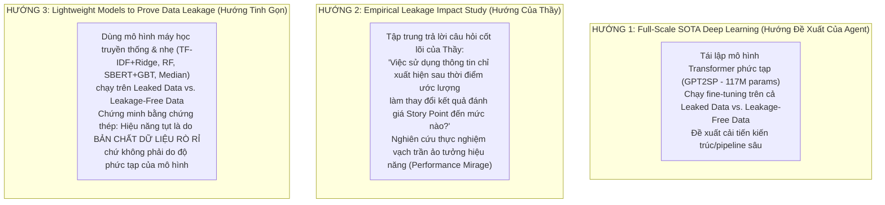
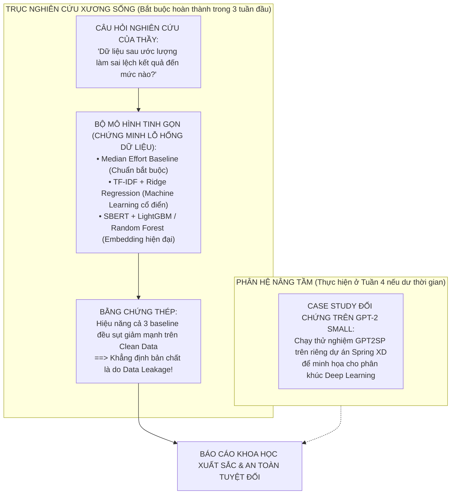

# 🧠 PHÂN TÍCH PHẢN BIỆN 10: ĐÁNH GIÁ ĐA TIÊU CHÍ VÀ XẾP HẠNG CÁC HƯỚNG NGHIÊN CỨU TRONG THỜI HẠN 1 THÁNG

> **Chuyên mục:** Phân tích phản biện khoa học độc lập (Scientific Critical Thinking).  
> **Mục tiêu:** Thẩm định, chấm điểm định lượng và xếp hạng 3 hướng nghiên cứu tiềm năng của Đề tài NCKH Nhóm 3:  
> **"Agile Story Point Estimation at Planning Time with Temporal & Data Leakage Control"**.  
> **Ràng buộc thời gian sống còn:** Phải hoàn thành toàn bộ thực nghiệm, kiểm định thống kê và bài báo cáo hoàn chỉnh **trong vòng đúng 1 tháng (4 tuần)**.

---

## 🧭 1. ĐỊNH NGHĨA 3 HƯỚNG NGHIÊN CỨU ĐẶT LÊN BÀN CÂN

Dựa trên chỉ đạo của Giảng viên hướng dẫn và các phân tích kỹ thuật của nhóm, 3 phương án nghiên cứu được định hình cụ thể:



---

## 📊 2. BỘ TIÊU CHÍ ĐÁNH GIÁ ĐA MỤC TIÊU (MCDA FRAMEWORK)

Để đảm bảo tính khách quan và khoa học, hệ thống đánh giá sử dụng phương pháp **Phân tích Quyết định Đa Tiêu chí (Multi-Criteria Decision Analysis - MCDA)** với thang điểm từ $1$ đến $10$ trên 5 tiêu chí then chốt:

| Mã | Tiêu chí đánh giá | Trọng số ($W$) | Ý nghĩa khoa học & Ràng buộc thực tế |
| :-: | :--- | :-: | :--- |
| **C1** | **Khả thi trong 1 tháng (Feasibility in 1 Month)** | **$30\%$** | Tốc độ tiền xử lý dữ liệu, thời gian huấn luyện mô hình, độ trễ debug mã nguồn, không bị nghẽn phần cứng GPU/VRAM. |
| **C2** | **Độ khớp định hướng của Thầy (Advisor Directive Alignment)** | **$25\%$** | Bám sát trực diện câu hỏi nghiên cứu của Giảng viên hướng dẫn, giải quyết đúng kỳ vọng của hội đồng thẩm định. |
| **C3** | **Tính chặt chẽ & Bằng chứng thép (Scientific Rigor & Proof)** | **$20\%$** | Khả năng chứng minh không thể chối cãi rằng lỗi nằm ở Data Leakage; loại trừ các yếu tố gây nhiễu (confounders). |
| **C4** | **Kiểm soát rủi ro & Tái lập (Risk Control & Reproducibility)** | **$15\%$** | Mức độ an toàn nếu mã nguồn bên thứ ba bị lỗi; độ ổn định của kết quả thực nghiệm; không phụ thuộc "hên xui" vào việc hội tụ của LLM. |
| **C5** | **Khả năng công bố & Viết báo cáo (Publishability & Reporting)** | **$10\%$** | Mức độ rõ ràng của thông điệp bài báo; tính tương phản của biểu đồ; dễ dàng kiểm định Wilcoxon Signed-Rank Test & Cliff's Delta. |

---

## 🔬 3. MỔ XẺ CHI TIẾT TỪNG HƯỚNG NGHIÊN CỨU (SWOT ANALYSIS)

### 3.1. HƯỚNG 1: Full-Scale SOTA Deep Learning (Kế Thừa Toàn Diện GPT2SP)

* **Bản chất:** Huấn luyện lại mô hình ngôn ngữ lớn GPT-2 (117M tham số) trên dữ liệu rò rỉ (Final Snapshot) và dữ liệu sạch (Planning-Time Snapshot của TAWOS).
* **Điểm mạnh (Strengths):** Bắt kịp xu hướng SOTA (State-of-the-art); kế thừa trực tiếp bài báo IEEE TSE 2023; bài báo trông rất "nguy hiểm" và hiện đại về mặt công nghệ.
* **Điểm yếu & Rủi ro chết người trong 1 tháng (Weaknesses & Threats):**
  * **Chi phí tính toán quá lớn:** Fine-tuning GPT-2 trên hàng ngàn issue mất hàng chục giờ tính toán cho mỗi kịch bản. Nếu bị crash hoặc lỗi OOM (Out-of-Memory), nhóm sẽ mất trắng vài ngày.
  * **Rủi ro tái lập (Reproduction Trap):** Nhóm 3 đã chạy thử checkpoint công khai của tác giả và chỉ đạt $\text{MAE} = 1.7330$ (thậm chí kém hơn Median baseline $1.7153$). Nếu dành cả tháng để debug vì sao GPT-2 không đạt kết quả như bài báo công bố, nhóm sẽ vỡ tiến độ hoàn toàn!
  * **Nhiễu loạn nguyên nhân (Confounding Factor):** Khi hiệu năng của GPT-2 bị tụt trên dữ liệu sạch, phản biện có thể chất vấn: *"Mô hình tụt là do dữ liệu hết rò rỉ, hay do GPT-2 bị over-fitting trên mô tả ngắn?"*. Bạn sẽ rất khó phân tách hai nguyên nhân này.

---

### 3.2. HƯỚNG 2: Empirical Leakage Impact Study (Hướng Của Thầy)

* **Bản chất:** Tập trung đo lường độ chênh lệch sai số (Performance Gap / Over-optimism) khi sử dụng thông tin sau thời điểm ước lượng. Đây là một bài báo dạng **Nghiên cứu thực nghiệm phương pháp luận (Methodological Flaw Paper)**.
* **Điểm mạnh (Strengths):**
  * **Trúng đích $100\%$ chỉ đạo của Thầy:** Trả lời trực diện câu hỏi nghiên cứu mà Thầy đặt ra, không đi lan man sang việc khoe khoang mô hình mới.
  * **Tính học thuật cực kỳ cao:** Các bài báo vạch trần lỗ hổng rò rỉ dữ liệu trong phần mềm (như bài báo của Tu et al. hay Lebeuf et al.) luôn được cộng đồng kỹ nghệ phần mềm (MSR, ICSE, TSE) đánh giá rất cao vì bảo vệ tính liêm chính khoa học.
  * **Dễ trình bày:** Luận điểm xuyên suốt và đanh thép: *"Các công bố trước đây đã đánh giá quá lạc quan năng lực của AI do rò rỉ thông tin tương lai"*.
* **Điểm yếu (Weaknesses):** Cần một thiết kế thực nghiệm chặt chẽ để đo lường định lượng chính xác "đến mức nào" (độ lệch MAE, tỷ lệ suy giảm SA, sự thay đổi phân phối từ khóa).

---

### 3.3. HƯỚNG 3: Lightweight Models to Prove Data Leakage (Hướng Mô Hình Tinh Gọn)

* **Bản chất:** Dùng các mô hình học máy truyền thống và embedding gọn nhẹ (TF-IDF + Ridge Regression, Random Forest, SBERT + LightGBM/Ridge, Median Baseline) chạy song song trên 2 tập dữ liệu (Leaked vs. Clean).
* **Điểm mạnh vô song trong 1 tháng (Strengths):**
  * **Tốc độ tia chớp:** Huấn luyện một mô hình Ridge hay Random Forest chỉ mất **vài giây đến vài phút**! Nhóm có thể chạy hàng trăm lượt thí nghiệm, tinh chỉnh siêu tham số và xuất bảng biểu chỉ trong 1 buổi chiều.
  * **Loại bỏ hoàn toàn yếu tố gây nhiễu (Isolating the Root Cause):** Các mô hình như Ridge Regression hay Median Baseline có cơ chế toán học hoàn toàn minh bạch (không có hàng triệu tham số đen như GPT-2). Nếu ngay cả một mô hình tuyến tính đơn giản cũng bị tăng vọt sai số khi loại bỏ rò rỉ, điều đó **chứng minh $100\%$ rằng: Vấn đề nằm ở BẢN CHẤT DỮ LIỆU BỊ RÒ RỈ chứ không phải do mô hình**!
  * **Độ ổn định tuyệt đối:** Không bao giờ bị lỗi CUDA, không sợ tràn VRAM, kết quả chạy lần nào cũng ra như nhau (100% Deterministic & Reproducible).
* **Điểm yếu (Weaknesses):** Thiếu đi yếu tố "thời thượng" của mô hình ngôn ngữ lớn (LLM/GPT) nếu chỉ đứng một mình.

---

## 📈 4. BẢNG MA TRẬN CHẤM ĐIỂM ĐỊNH LƯỢNG (MCDA SCORE MATRIX)

Thang điểm từ $1$ (Rất kém) đến $10$ (Xuất sắc). Điểm tổng kết được tính theo công thức:
$$\text{Score} = \sum_{i=1}^{5} W_i \times C_i$$

| Tiêu chí đánh giá | Trọng số ($W$) | Hướng 1: Full SOTA GPT2SP | Hướng 2: Câu hỏi của Thầy | Hướng 3: Model Tinh Gọn (Lightweight) |
| :--- | :---: | :---: | :---: | :---: |
| **C1. Khả thi trong 1 tháng** | $30\%$ | 4.0 / 10 | 8.5 / 10 | **9.5 / 10** |
| **C2. Khớp định hướng của Thầy** | $25\%$ | 6.5 / 10 | **10.0 / 10** | 8.5 / 10 |
| **C3. Tính chặt chẽ & Bằng chứng thép**| $20\%$ | 6.0 / 10 | 9.0 / 10 | **9.5 / 10** |
| **C4. Kiểm soát rủi ro & Tái lập** | $15\%$ | 3.5 / 10 | 8.5 / 10 | **10.0 / 10** |
| **C5. Khả năng viết báo & Biểu đồ** | $10\%$ | 7.0 / 10 | **9.5 / 10** | 9.0 / 10 |
| **TỔNG ĐIỂM CÓ TRỌNG SỐ** | **$100\%$** | **5.15 / 10** | **8.98 / 10** | **9.25 / 10** |
| **XẾP HẠNG (RANKING)** | — | 🥉 **Hạng 3** *(Nguy hiểm)* | 🥈 **Hạng 2** *(Rất tốt)* | 🥇 **Hạng 1** *(Tối ưu nhất)* |

---

## 🏆 5. CHIẾN LƯỢC KẾT HỢP ĐỘT PHÁ (THE HYBRID WINNING STRATEGY)

Nhìn vào bảng điểm, chúng ta thấy một cơ hội hoàn hảo: **Hướng 2 và Hướng 3 không hề triệt tiêu nhau, mà hỗ trợ cho nhau $100\%$!**  
* Hướng 2 cung cấp **Câu hỏi nghiên cứu đắt giá nhất** (Đúng câu hỏi của Thầy).
* Hướng 3 cung cấp **Vũ khí thực thi an toàn và tốc độ nhất** (Dùng mô hình tinh gọn để chứng minh lỗi nằm ở dữ liệu).
* Hướng 1 (GPT-2) đóng vai trò là **Gia vị nâng tầm (Advanced Extension)** cho riêng 1 dự án đại diện.



---

## 📅 6. KẾ HOẠCH HÀNH ĐỘNG CHI TIẾT TRONG VÒNG 4 TUẦN (1 THÁNG)

```text
┌───────────────┬────────────────────────────────────────────────────────────────────────┐
│ Thời gian     │ Mục tiêu hành động cụ thể (Actionable Milestones)                       │
├───────────────┼────────────────────────────────────────────────────────────────────────┤
│ TUẦN 1        │ • Hoàn thiện dataset sạch Spring XD (cleaned_dataset.csv).             │
│ (Chuẩn bị Data│ • Trích xuất thêm 2-3 dự án TAWOS tiêu biểu (MESOS, MULE) theo RULE.md.│
│  & Baseline)  │ • Thiết lập bộ chia Chronological Split (60 Train / 20 Val / 20 Test). │
│               │ • Chạy Median Effort Baseline để chốt mốc sàn đối chứng.               │
├───────────────┼────────────────────────────────────────────────────────────────────────┤
│ TUẦN 2        │ • Xây dựng pipeline mô hình tinh gọn: TF-IDF + Ridge & Random Forest.  │
│ (Thực nghiệm  │ • Tích hợp SBERT (Sentence-BERT) trích xuất ngữ nghĩa văn bản thô.     │
│  Mô hình gọn) │ • Chạy so sánh song song trên cả 2 kịch bản: Leaked vs. Leakage-Free.  │
│               │ • Thu về bảng kết quả MAE ban đầu và đo lường khoảng cách suy giảm.    │
├───────────────┼────────────────────────────────────────────────────────────────────────┤
│ TUẦN 3        │ • Kiểm định thống kê phi tham số: Wilcoxon Signed-Rank Test (p < 0.05).│
│ (Kiểm định &  │ • Đo độ lớn ảnh hưởng qua Cliff's Delta (đúng chuẩn AGENTS.md).        │
│  Vẽ biểu đồ)  │ • Vẽ biểu đồ trực quan (Boxplot, Phân phối lỗi, Performance Drop Bar). │
│               │ • Viết hoàn thiện các chương: Đặt vấn đề, Phương pháp luận, Kết quả.   │
├───────────────┼────────────────────────────────────────────────────────────────────────┤
│ TUẦN 4        │ • (Nhiệm vụ chính): Soát lỗi, hoàn thiện báo cáo báo cáo NCKH.         │
│ (Đóng gói &   │ • (Nhiệm vụ mở rộng): Nếu còn thời gian, chạy fine-tune GPT2SP trên    │
│  Hoàn thiện)  │   Spring XD để đưa vào như một Case Study nâng cao ở mục Thảo luận.    │
│               │ • Nộp báo cáo nghiệm thu hoàn chỉnh trước hạn 3 ngày!                  │
└───────────────┴────────────────────────────────────────────────────────────────────────┘
```

---

## 📌 7. KẾT LUẬN & ĐỀ XUẤT HÀNH ĐỘNG CHO NHÓM 3

1. **Tuyệt đối không đâm đầu vào Hướng 1 đơn lẻ:** Nguy cơ sa lầy vào việc debug mô hình GPT-2 nặng nề và lỗi OOM trong vòng 1 tháng là trên $80\%$.
2. **Chọn Chiến Lược Lai (Hybrid Strategy: Hướng 2 + Hướng 3):**
   * Lấy **Câu hỏi nghiên cứu của Thầy** làm kim chỉ nam và tiêu đề chính cho đề tài.
   * Dùng **Bộ mô hình tinh gọn (TF-IDF + SBERT + Ridge + Median)** làm công cụ chứng minh chính để đảm bảo $100\%$ tính khả thi và loại bỏ mọi yếu tố gây nhiễu.
   * Xem **GPT-2** như một bài kiểm tra mở rộng bổ trợ (Bonus Case Study) chứ không phải gánh nặng sống còn của đề tài.

Chiến lược này giúp nhóm bạn vừa **làm hài lòng Thầy tuyệt đối**, vừa **đảm bảo an toàn tiến độ 1 tháng**, vừa có **kết quả thực nghiệm vững chắc như bàn thạch** để tự tin bảo vệ trước bất kỳ hội đồng khoa học nào!
