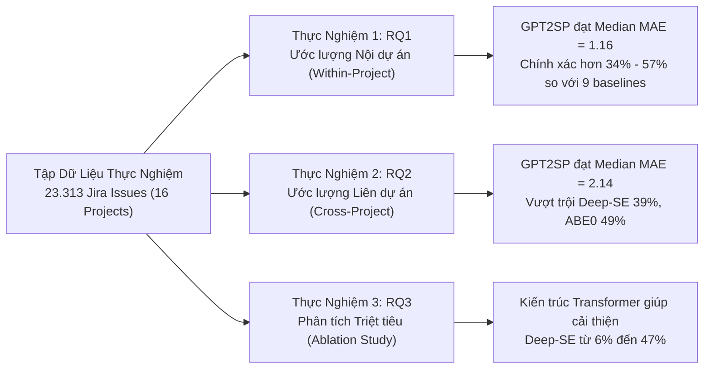

# 📖 CHƯƠNG 1: GIỚI THIỆU (INTRODUCTION)

> **Tài liệu gốc:** Mục 1 (INTRODUCTION), Trang 1 – 3, bài báo *GPT2SP: A Transformer-Based Agile Story Point Estimation Approach* (IEEE TSE 2023).  
> **Tác giả:** Michael Fu, Chakkrit Tantithamthavorn (Đại học Monash, Úc).

---

## 🎯 1. BỐI CẢNH & TẦM QUAN TRỌNG CỦA ƯỚC LƯỢNG STORY POINT

> 📍 **Vị trí bài báo gốc:** Mục 1 (INTRODUCTION), Trang 1, Cột 1 (Dòng 1 – 35) & Cột 2 (Dòng 1 – 15).

> *"Good estimation helps product owners optimize for efficiency and impact."*  
> — Một Giám đốc Sản phẩm tại Atlassian khẳng định [1] *(Trích dẫn: Trang 1, Cột 1, Dòng 1 – 2)*.

Trong quy trình phát triển phần mềm theo phương pháp linh hoạt (Agile Software Development), **ước lượng điểm câu chuyện (Story Point Estimation)** là một trong những tác vụ khó khăn, phức tạp và mang tính quyết định nhất:
* **Khái niệm Story Point (Trang 1, Cột 1, Dòng 3 – 7):** Là đơn vị đo lường nỗ lực tương đối (relative effort) cần thiết để hoàn thành trọn vẹn một hạng mục công việc trong sản phẩm (Product Backlog Item - PBI hoặc Issue).
* **Bốn yếu tố cấu thành nỗ lực (Trang 1, Cột 1, Dòng 8 – 15):** Đội ngũ phát triển khi chấm điểm Story Point phải cân nhắc tổng hòa 4 khía cạnh:
  1. Khối lượng công việc dự kiến (*Amount of work*).
  2. Độ phức tạp kỹ thuật (*Technical complexity*).
  3. Các yếu tố rủi ro tiềm ẩn (*Risk*).
  4. Mức độ bất định hoặc thiếu thông tin ban đầu (*Uncertainty*).

### Thực trạng phương pháp truyền thống & Hệ quả tiêu cực
> 📍 **Vị trí bài báo gốc:** Trang 1, Cột 2, Dòng 1 – 15.
Hiện nay, các đội ngũ Agile chủ yếu sử dụng các kỹ thuật dựa trên sự đồng thuận nhóm như **Planning Poker**, phương pháp tương tự (**Analogy**) hoặc phán đoán của chuyên gia (**Expert Judgment**). Tuy nhiên, nghiên cứu của Usman et al. [53] đã chỉ ra rằng:
* Phán đoán mang nặng tính chủ quan của con người rất dễ đưa vào **thiên kiến nhận thức (cognitive bias)** và áp lực tâm lý từ các thành viên có tiếng nói lớn trong nhóm.
* **Hậu quả của ước lượng sai lệch:**
  * **Ước lượng quá cao (Overestimation):** Dẫn đến lãng phí thời gian nhàn rỗi của lập trình viên, suy giảm năng suất tổng thể và đẩy chi phí dự án lên cao (*cost overruns*).
  * **Ước lượng quá thấp (Underestimation):** Gây vỡ kế hoạch Sprint, trễ hạn bàn giao, kiệt sức (burnout) cho đội ngũ phát triển, giảm sút lòng tin của khách hàng và thậm chí làm thất bại toàn bộ dự án phần mềm.

---

## 🔍 2. SỰ TIẾN HÓA CỦA CÁC GIẢI PHÁP AI VÀ 3 HẠN CHẾ CHÍ TỬ CỦA DEEP-SE

> 📍 **Vị trí bài báo gốc:** Mục 1 (INTRODUCTION), Trang 1, Cột 2 (Dòng 16 – 58) – Trang 2, Cột 1 (Dòng 1 – 8).

Nhằm khắc phục tính chủ quan của con người, Trí tuệ nhân tạo (AI) và Học máy (ML) đã dần được áp dụng:
* **Giai đoạn đầu - Machine Learning cổ điển (Trang 1, Cột 2, Dòng 16 – 24):** Porru et al. [36] sử dụng biểu diễn văn bản dạng túi từ (Bag-of-Words - BoW) kết hợp với các thuật toán học máy như Support Vector Machine (SVM). Nhược điểm: Phải thiết kế và trích xuất đặc trưng thủ công (hand-crafted features), tốn rất nhiều công sức và không nắm bắt được ngữ cảnh câu.
* **Giai đoạn học sâu - Deep Learning SOTA (Trang 1, Cột 2, Dòng 25 – 36):** Choetkiertikul et al. [7] công bố **Deep-SE**, mô hình học sâu đầu-cuối (end-to-end) sử dụng mạng Word2Vec kết hợp **Long Short-Term Memory (LSTM)** và **Recurrent Highway Network (RHWN)** để tự động học biểu diễn phân tán của từ vựng từ mô tả issue và dự đoán Story Point.

Tuy nhiên, bài báo GPT2SP vạch trần **3 giới hạn nghiêm trọng** khiến Deep-SE không thể ứng dụng hiệu quả trong thực tế:

| Giới hạn của Deep-SE | Nguyên nhân kỹ thuật | Hậu quả thực nghiệm | Vị trí bài báo gốc |
| :--- | :--- | :--- | :--- |
| **1. Tốn thời gian & Không thể chuyển giao tri thức (Not Transferable)** | Deep-SE phải tự tiền huấn luyện một mô hình ngôn ngữ riêng biệt (project-specific) từ dữ liệu issue của từng dự án. | Mất **2 đến 7 giờ** chỉ để tiền huấn luyện cho mỗi dự án. Kho từ vựng bị bó hẹp trong các từ đã biết của dự án đó; khi mang sang dự án khác (cross-project), mô hình hoàn toàn thất bại. | **Trang 1, Cột 2, Dòng 37 – 47** |
| **2. Bị giới hạn bộ nhớ ngắn hạn & Bỏ sót ngữ cảnh toàn cục** | Deep-SE dùng mạng hồi quy LSTM một chiều (unidirectional). Mạng chỉ đọc từ trái sang phải, không nắm bắt được phụ thuộc từ hiện tại về quá khứ (phải sang trái). | Không thể nắm bắt mối quan hệ phụ thuộc toàn cục dài hạn giữa các từ xa nhau trong mô tả issue dài; bỏ sót ngữ cảnh hai chiều. | **Trang 1, Cột 2, Dòng 48 – 58** |
| **3. Mô hình hộp đen, hoàn toàn không thể giải thích (Not Interpretable)** | Kiến trúc xếp chồng phức tạp của LSTM + RHWN không cung cấp bất kỳ manh mối nào về việc từ ngữ nào dẫn đến điểm số dự đoán. | Lập trình viên và Scrum Master không hiểu vì sao AI lại đưa ra con số đó, dẫn đến sự nghi ngờ, mất niềm tin và từ chối áp dụng trong thực tế [7, 9, 48, 49]. | **Trang 2, Cột 1, Dòng 1 – 8** |

---

## 💡 3. KIẾN TRÚC ĐỀ XUẤT: GPT2SP (TRANSFORMER-BASED)

> 📍 **Vị trí bài báo gốc:** Mục 1 (INTRODUCTION), Trang 2, Cột 1 (Dòng 9 – 32) & Cột 2 (Đoạn "Survey Study").

Để giải quyết triệt để 3 rào cản trên của Deep-SE, Fu & Tantithamthavorn đề xuất **GPT2SP**:
1. **Phân tách từ con Byte-Pair Encoding (BPE) (Trang 2, Cột 1, Dòng 12 – 17):** Thay vì tách theo từ đơn (word-level), GPT2SP áp dụng BPE để phân rã từ hiếm thành các đơn vị từ con, giảm kích thước từ vựng tới **$73\%$** (từ $186.625$ từ xuống $50.257$ từ) và giải quyết dứt điểm vấn đề Out-of-Vocabulary (OOV).
2. **Khai thác Mô hình Ngôn ngữ Nền tảng (Foundation Model) (Trang 2, Cột 1, Dòng 18 – 22):** Tận dụng mô hình **GPT-2** đã được tiền huấn luyện trên quy mô khổng lồ (40GB văn bản từ 8 triệu trang web). Nhờ vốn tri thức ngôn ngữ bao quát, mô hình hiểu sâu sắc quan hệ ngữ nghĩa của từ ngữ kỹ thuật mà **không cần tiền huấn luyện lại từ đầu cho từng dự án** (tiết kiệm 2-7 giờ tính toán).
3. **Cơ chế Masked Multi-Head Self-Attention (Trang 2, Cột 1, Dòng 23 – 32):** Cho phép từng từ trong mô tả issue "chú ý" đồng thời đến mọi từ khác trong câu cùng vị trí chính xác của nó (Positional Encoding), giúp nắm bắt trọn vẹn ngữ cảnh kỹ thuật phức tạp của yêu cầu phần mềm.
4. **Trí tuệ nhân tạo có thể giải thích (XAI) (Trang 2, Cột 2, Đoạn "Survey Study"):** Tận dụng trực tiếp trọng số chú ý (Attention Weights) để tô sáng chính xác những từ ngữ then chốt (keywords) chi phối quyết định Story Point, kèm ví dụ đối chứng trong quá khứ ($20\%$ ví dụ hỗ trợ trùng khớp hoàn toàn token quan trọng và điểm Story Point).

---

## 📊 4. TÓM TẮT KẾT QUẢ THỰC NGHIỆM ĐỘT PHÁ

> 📍 **Vị trí bài báo gốc:** Mục 1 (INTRODUCTION), Trang 2, Cột 1 (Dòng 33) – Cột 2 (Dòng 65).

Nghiên cứu tiến hành đánh giá quy mô lớn trên **23.313 issues** thuộc **16 dự án mã nguồn mở lớn** với 10 mô hình baseline đối chứng:

### Các phát hiện thực nghiệm then chốt:
* **RQ1 — Ước lượng Nội dự án (Trang 2, Cột 1, Dòng 45 – Cột 2, Dòng 5):** GPT2SP đạt sai số tuyệt đối trung vị $\text{MAE} = 1.16$, vượt trội có ý nghĩa thống kê (**$34\% – 57\%$**) so với 9 mô hình baseline (Deep-SE, LSTM+RF, BoW+RF, Doc2Vec+RF, SVM, Mean/Median). Kiểm định Scott-Knott ESD khẳng định GPT2SP là mô hình **duy nhất thuộc Rank-1**.
* **RQ2 — Ước lượng Liên dự án (Trang 2, Cột 2, Dòng 6 – 22):** Trong kịch bản chuyển giao giữa các tổ chức khác biệt (Cross-Repository), GPT2SP đạt $\text{MAE} = 2.14$, vượt Deep-SE (3.82) tới **$39\%$** và phương pháp tương đồng kinh điển ABE0 (4.55) tới **$49\%$**.
* **RQ3 — Nghiên cứu triệt tiêu thành phần (Ablation Study) (Trang 2, Cột 2, Dòng 23 – 35):** Việc thay thế LSTM bằng khối Transformer Decoder giúp cải thiện hiệu năng của Deep-SE từ **$6\%$ đến $47\%$**, khẳng định kiến trúc Transformer là nhân tố cốt lõi tạo nên bước nhảy vọt.
* **Khảo sát thực tế với 16 chuyên gia Agile (Trang 2, Cột 2, Dòng 41 – 65):**
  * Đa số chuyên gia nhận định việc ước lượng Story Point là tác vụ "cực kỳ thách thức" (*extremely challenging*).
  * Mô hình AI có kèm giải thích minh chứng (Explainable AI) được đánh giá là **đáng tin cậy hơn và hữu ích hơn vượt trội** so với mô hình hộp đen.
  * Phân tích kiểm tra mô hình (*Model Inspection*) cho thấy GPT2SP tìm ra **$20\%$** ví dụ hỗ trợ tương đồng trong quá khứ có cùng token quan trọng và cùng số Story Point.

---

## 🏆 5. NĂM ĐÓNG GÓP KHOA HỌC CHÍNH (CONTRIBUTIONS)

> 📍 **Vị trí bài báo gốc:** Mục 1 (INTRODUCTION - Novelty & Contributions và Open Science), Trang 2, Cột 2 (Dòng 66 – 85) – Trang 3, Cột 1 (Dòng 1 – 3).

Theo tuyên bố của tác giả, bài báo mang lại 5 đóng góp học thuật đầu tiên trong lĩnh vực Kỹ nghệ Phần mềm (SE):
1. **Tiên phong áp dụng Transformer cho Story Point (Trang 2, Cột 2, Dòng 69 – 70):** Là công trình đầu tiên ứng dụng mô hình nền tảng ngôn ngữ Transformer (GPT-2) để giải quyết bài toán hồi quy ước lượng Story Point trong Agile.
2. **Đánh giá thực nghiệm toàn diện nhất (Trang 2, Cột 2, Dòng 71 – 74):** Khảo sát trên 23.313 issues của 16 dự án, so sánh đối chứng chặt chẽ với 9 phương pháp baseline (bao gồm Deep-SE) trên cả hai kịch bản trong nội bộ dự án và liên dự án.
3. **Phân tích bóc tách thành phần - Ablation Study (Trang 2, Cột 2, Dòng 75 – 77):** Định lượng rành mạch đóng góp riêng biệt của bộ phân tách từ con (BPE) và các khối chú ý Transformer.
4. **Phát triển công cụ minh chứng XAI thực tế (Trang 2, Cột 2, Dòng 78 – 80):** Xây dựng ứng dụng web Streamlit trực quan, hỗ trợ lập trình viên tra cứu từ ngữ quan trọng và các ví dụ tương đồng trong lịch sử.
5. **Khoa học mở - Open Science (Trang 2, Cột 2 cuối – Trang 3, Cột 1):** Toàn bộ mã nguồn, dữ liệu nghiên cứu, kịch bản thực nghiệm và kết quả dự đoán thô đều được công khai minh bạch tại:
   * GitHub Repository: [awsm-research/gpt2sp](https://github.com/awsm-research/gpt2sp)
   * Demo Web App: [awsm-research/gpt2sp_webapp](https://share.streamlit.io/awsm-research/gpt2sp_webapp/main/app.py)
