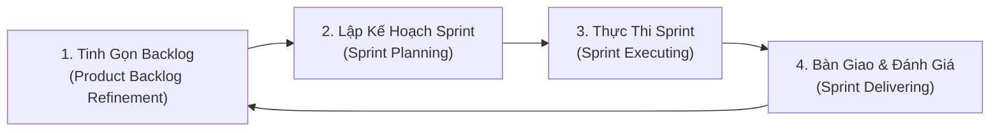
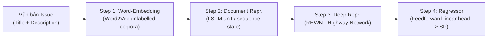

# 📖 CHƯƠNG 2: KIẾN THỨC NỀN TẢNG (BACKGROUND)

> **Tài liệu gốc:** Mục 2 (BACKGROUND), Trang 3, bài báo *GPT2SP: A Transformer-Based Agile Story Point Estimation Approach* (IEEE TSE 2023).  
> **Tác giả:** Michael Fu, Chakkrit Tantithamthavorn (Đại học Monash, Úc).

---

## 🔄 1. QUY TRÌNH PHÁT TRIỂN AGILE & 4 BƯỚC VÒNG LẶP (SPRINT CYCLE)

> 📍 **Vị trí bài báo gốc:** Mục 2 (BACKGROUND), Trang 3, Cột 1, Đoạn 1 (Dòng 1 – 25).

Agile là quy trình phát triển phần mềm lặp đi lặp lại (iterative process), chia nhỏ quá trình phát triển thành các chu kỳ ngắn (thường từ 1 đến 4 tuần) gọi là **Sprint**. Trong quy trình Scrum/Agile chuẩn, có 4 bước cốt lõi diễn ra tuần tự:

### Bước 1: Tinh gọn danh mục sản phẩm (Product Backlog Refinement)
> 📍 **Vị trí bài báo gốc:** Trang 3, Cột 1, Dòng 8 – 16.
* **Thu thập yêu cầu:** Product Owner (Chủ sản phẩm) làm việc với khách hàng và các bên liên quan (stakeholders) để tập hợp danh sách các tính năng, yêu cầu kỹ thuật và lỗi cần sửa thành một danh mục công việc gọi là **Product Backlog**.
* **Phân rã công việc (Work Breakdown):** Một số yêu cầu ban đầu quá lớn và khái quát (gọi là **Epic** - Yêu cầu lớn). Đội ngũ phát triển (Development Team) cùng Product Owner tiến hành phân rã Epic thành các hạng mục nhỏ hơn, độc lập và khả thi hơn, gọi là các **User Story** hoặc **Issue** (hạng mục công việc).
* **Ước lượng sơ bộ:** Nhóm tiến hành thảo luận để hiểu rõ phạm vi yêu cầu, độ phức tạp kỹ thuật và gán mức điểm nỗ lực sơ bộ cho từng User Story.

### Bước 2: Lập kế hoạch Sprint (Sprint Planning)
> 📍 **Vị trí bài báo gốc:** Trang 3, Cột 1, Dòng 16 – 21.
* **Xác định mục tiêu Sprint (Sprint Goal):** Product Owner và nhóm thống nhất mục tiêu giá trị cần đạt được trong chu kỳ tới.
* **Đo lường năng lực đội ngũ (Team Capacity):** Dựa trên lịch sử số Story Point hoàn thành ở các Sprint trước (gọi là **Vận tốc - Velocity**), nhóm tính toán tổng năng lực có thể đảm đương.
* **Lựa chọn Sprint Backlog:** Nhóm lựa chọn các User Story có độ ưu tiên cao nhất từ Product Backlog đưa vào **Sprint Backlog** sao cho tổng số Story Point không vượt quá năng lực của nhóm.

### Bước 3: Thực thi Sprint (Sprint Executing)
> 📍 **Vị trí bài báo gốc:** Trang 3, Cột 1, Dòng 21 – 24.
* Các kỹ sư phần mềm bắt tay vào lập trình, kiểm thử đơn vị, tích hợp liên tục và giải quyết các task kỹ thuật.
* Các cuộc họp ngắn hàng ngày (Daily Stand-up) được tổ chức để cập nhật tiến độ, phát hiện điểm nghẽn và điều chỉnh phối hợp.

### Bước 4: Bàn giao và cải tiến (Sprint Delivering & Retrospective)
> 📍 **Vị trí bài báo gốc:** Trang 3, Cột 1, Dòng 23 – 25.
* Nhóm tổ chức buổi trình diễn sản phẩm (Sprint Review) với khách hàng để nghiệm thu các tính năng đã hoàn thành ("Done").
* Cuối cùng, buổi họp rút kinh nghiệm (Sprint Retrospective) giúp đội ngũ nhìn nhận lại quy trình làm việc, độ chính xác của ước lượng Story Point và các cải tiến cho chu kỳ tiếp theo.

---

## 🎯 2. BẢN CHẤT CỦA STORY POINT VÀ THÁCH THỨC CỦA PHÁN ĐOÁN CON NGƯỜI

> 📍 **Vị trí bài báo gốc:** Mục 2 (BACKGROUND), Trang 3, Cột 1, Đoạn 2 (Dòng 26 – 43).

### Story Point là gì?
> 📍 **Vị trí bài báo gốc:** Trang 3, Cột 1, Dòng 26 – 34.
**Story Point (SP)** là thước đo nỗ lực mang tính tương đối (relative metric). Thay vì đo lường bằng số giờ công tuyệt đối (man-hours hay person-days) vốn rất dễ bị sai lệch do sự chênh lệch trình độ giữa các lập trình viên, Story Point phản ánh độ khó tổng thể dựa trên **4 trụ cột**:
1. **Khối lượng công việc (Amount of work):** Độ dài của mã nguồn, số lượng màn hình, API cần viết.
2. **Độ phức tạp kỹ thuật (Technical complexity):** Thuật toán xử lý phức tạp, tích hợp nhiều hệ thống phân tán, xử lý bất đồng bộ.
3. **Mức độ rủi ro (Risk):** Phụ thuộc vào thư viện ngoài chưa ổn định, nguy cơ ảnh hưởng đến kiến trúc cũ.
4. **Độ bất định (Uncertainty):** Yêu cầu khách hàng chưa rõ ràng, nghiệp vụ mới chưa từng làm.

### Hạn chế của các phương pháp ước lượng truyền thống
> 📍 **Vị trí bài báo gốc:** Trang 3, Cột 1, Dòng 29 – 43.
* **Planning Poker (Bầu chọn bằng thẻ bài):** Mỗi lập trình viên giữ một bộ bài in các số Fibonacci ($1, 2, 3, 5, 8, 13, 20, 40, 100$). Sau khi thảo luận về User Story, các thành viên đồng loạt úp/mở bài để tránh việc người có điểm cao gây áp lực tâm lý cho người khác.
* **Analogy (Ước lượng theo tương đồng):** Nhóm đối chiếu User Story hiện tại với các User Story tương tự đã làm trong quá khứ để gán mức điểm tương đương.
* **Expert Judgment (Phán đoán của chuyên gia):** Dựa hoàn toàn vào kinh nghiệm trực giác của Tech Lead hoặc Senior Developer.

> [!WARNING]
> **Khủng hoảng thiên kiến chủ quan (Subjective Bias):**  
> *(Trang 3, Cột 1, Dòng 34 – 43, trích dẫn nghiên cứu Usman et al. [53])*  
> Nghiên cứu của Usman et al. [53] chứng minh rằng các phương pháp phán đoán chuyên gia bị chi phối mạnh mẽ bởi trạng thái tâm lý, áp lực tiến độ từ quản lý và năng lực cá nhân. Hệ quả là ước lượng thường xuyên bị sai lệch:
> * **Đánh giá quá non (Underestimate):** Khiến nhóm nhận quá tải công việc, dẫn đến tăng ca, lỗi chất lượng và vỡ kế hoạch Sprint.
> * **Đánh giá quá già (Overestimate):** Gây ra hiện tượng lãng phí thời gian trống (idle time), kéo dài chu kỳ phát hành và gia tăng chi phí phần mềm.

---

## 🤖 3. MÔ HÌNH HỌC SÂU DEEP-SE (CHOETKIERTIKUL ET AL., 2019)

> 📍 **Vị trí bài báo gốc:** Mục 2 (BACKGROUND), Trang 3, Cột 1 (Đoạn 3) – Cột 2 & Hình 1 (Fig. 1).

Để tự động hóa bài toán ước lượng Story Point, Choetkiertikul et al. [7] đã đề xuất **Deep-SE** — mô hình học sâu đầu-cuối (end-to-end deep learning) đầu tiên cho bài toán này, được đánh giá trên cả hai kịch bản **within-project** (trong dự án) và **cross-project** (qua dự án).

### 3.1 Bộ dữ liệu đánh giá
> 📍 **Vị trí bài báo gốc:** Trang 3, Cột 1, Dòng 46 – 52 & **Hình 1 (Fig. 1: An example JIRA issue with an associated story point - Trang 3)**.

Deep-SE được thực nghiệm trên tập dữ liệu lớn gồm **23.313 issues** thu thập từ **16 dự án mã nguồn mở** trên hệ thống theo dõi lỗi **JIRA**. Mỗi issue bao gồm ba trường thông tin chính được sử dụng làm đầu vào:

| Trường thông tin | Ý nghĩa |
| :--- | :--- |
| **Title (Tiêu đề)** | Tóm tắt ngắn về tính năng hoặc lỗi cần xử lý. |
| **Description (Mô tả)** | Nội dung chi tiết kỹ thuật và yêu cầu nghiệp vụ. |
| **Story Point (Nhãn đầu ra)** | Điểm nỗ lực đã được đội ngũ gán trong quá khứ. |

> [!NOTE]
> **Hình 1 (Fig. 1, Trang 3)** trong bài báo gốc minh họa rõ ràng một ví dụ thực tế về Jira Issue (`XD-3751`) với Title, Description, Type, Priority, Component và điểm Story Point thực tế được gán trong quá khứ.

### 3.2 Quy trình hoạt động của Deep-SE
> 📍 **Vị trí bài báo gốc:** Trang 3, Cột 1 (Dòng 58) – Cột 2 (Dòng 1 – 23), bao gồm 4 bước (Step 1 – Step 4).

1. **Step 1: Word-Embedding (Trang 3, Cột 1 cuối – Cột 2 đầu):** Thu thập toàn bộ văn bản issue trong một dự án Jira, huấn luyện mô hình **Word2Vec** hoặc n-gram để biến đổi mỗi từ thành một vector biểu diễn phân tán (dense vector liên tục, số thực chiều thấp).
2. **Step 2: Document Representation using LSTM (Trang 3, Cột 2, Dòng 8 – 14):** Nạp chuỗi các vector từ vào mạng bộ nhớ dài-ngắn (**LSTM**) để sinh chuỗi vector trạng thái, sau đó thực hiện pooling tạo thành một document-level vector đại diện cho toàn bộ issue.
3. **Step 3: Deep Representation using RHWN (Trang 3, Cột 2, Dòng 15 – 19):** Nhằm ngăn chặn hiện tượng quá khớp (overfitting), Deep-SE sử dụng mạng đường cao tốc hồi quy (**Recurrent Highway Network — RHWN**) để biến đổi vector tài liệu nhiều lần trước khi sinh ra vector đặc trưng trừu tượng cuối cùng.
4. **Step 4: Regressor (Trang 3, Cột 2, Dòng 20 – 23):** Đưa vector tài liệu vào một hàm kích hoạt tuyến tính trong mạng nơ-ron truyền thẳng (feedforward neural network) để ước lượng điểm số Story Point.

### 3.3 Kết quả thực nghiệm và so sánh baseline
> 📍 **Vị trí bài báo gốc:** Trang 3, Cột 1, Dòng 53 – 57 (Đoạn 3).

Deep-SE đạt mức **MAE trung bình = 2.08**, vượt trội so với tất cả các baseline học máy truyền thống được so sánh trong bài báo:

| Mô hình baseline | Phương pháp | Ghi chú |
| :--- | :--- | :--- |
| **LSTM + RF** | LSTM để rút trích đặc trưng, Random Forest để hồi quy. | Thiếu khả năng học biểu diễn phi tuyến sâu. |
| **BoW + RF** | Bag-of-Words (đặc trưng từ tần suất), Random Forest. | Mất hoàn toàn thứ tự và ngữ cảnh của từ. |
| **Doc2Vec + RF** | Nhúng tài liệu Doc2Vec, Random Forest. | Phụ thuộc chất lượng của Doc2Vec embeddings. |
| **TF-IDF + SVM** | TF-IDF weighting, Support Vector Machine [36]. | Mô hình tuyến tính, không học được quan hệ phi tuyến. |
| **Median Baseline** | Dự đoán bằng giá trị trung vị Story Point của lịch sử. | Baseline đơn giản nhất, không dùng văn bản. |

> [!IMPORTANT]
> **Ý nghĩa khoa học của Deep-SE:**  
> Deep-SE là mô hình đầu tiên chứng minh rằng học sâu có thể học được biểu diễn ngữ nghĩa có ích từ mô tả issue để ước lượng Story Point — đặt nền tảng khái niệm cho GPT2SP kế thừa và phát triển.

### 3.4 Hạn chế còn tồn tại
> 📍 **Vị trí bài báo gốc:** Mục 1 (INTRODUCTION, Trang 1 – 2, Cột 1 – 2) & Mục 3.1 (SUBWORD TOKENIZATION, Trang 4, Cột 2).

* **Chi phí Word2Vec:** Mô hình Word2Vec của Deep-SE phụ thuộc hoàn toàn vào từ vựng của dự án hiện tại, tốn 2–7 giờ huấn luyện và **không thể tái sử dụng** sang dự án khác (Not Transferable).
* **Quên ngữ cảnh xa:** Mạng LSTM xử lý tuần tự từng từ một, khiến cho thông tin ở đầu câu dễ bị pha loãng (vanishing gradient / short-term memory refresh) khi chuỗi văn bản dài.
* **Không tận dụng tri thức ngoài & Bùng nổ từ vựng:** Deep-SE chỉ học từ dữ liệu nội bộ với tập từ vựng lên đến $185.625$ từ, gặp vấn đề từ ngoài từ điển (OOV) trầm trọng — điều mà các Foundation Model như GPT-2 với BPE Tokenization trong Chương 3 sẽ giải quyết triệt để.
