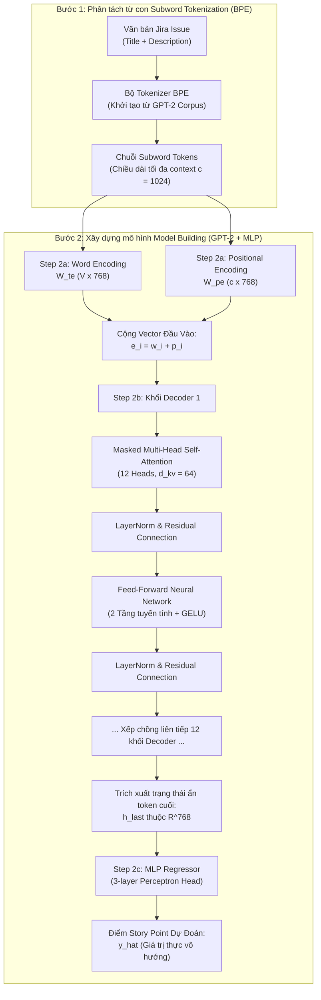

# 📖 CHƯƠNG 3: KIẾN TRÚC MÔ HÌNH GPT2SP (THE GPT2SP ARCHITECTURE)

> **Tài liệu gốc:** Mục 3 (THE GPT2SP ARCHITECTURE), Trang 3 – 5, bài báo *GPT2SP: A Transformer-Based Agile Story Point Estimation Approach* (IEEE TSE 2023).  
> **Tác giả:** Michael Fu, Chakkrit Tantithamthavorn (Đại học Monash, Úc).

---

## 🏗️ 1. TỔNG QUAN LUỒNG KIẾN TRÚC (3. OVERVIEW)

> 📍 **Vị trí bài báo gốc:** Mục 3 (THE GPT2SP ARCHITECTURE - Overview), Trang 3, Cột 2 (Dòng 24 – 42) – Trang 4, Cột 1 (Dòng 1 – 2) & **Hình 2 (Fig. 2: An overview architecture of our GPT2SP, Trang 4)**.

Kiến trúc GPT2SP được thiết kế nhằm chuyển dịch mô hình ngôn ngữ sinh tự hồi quy (Autoregressive Generative Language Model - GPT-2) sang một mô hình **hồi quy dự đoán giá trị thực (Scalar Regression Model)** để ước lượng Story Point cho các hạng mục công việc (Jira issues).

Quy trình hoạt động tổng thể của GPT2SP gồm **hai bước chính** xuyên suốt hai pha: **Pha Huấn luyện (Training Phase)** và **Pha Suy luận (Inference Phase)**:

### Tóm lược hai bước xử lý cốt lõi:
1. **Bước 1 (Step 1 — Subword Tokenization):** Nhận báo cáo issue đầu vào, thực hiện phân tách thành chuỗi từ con (subword tokens) bằng thuật toán Byte-Pair Encoding (BPE) dựa trên bộ từ vựng tiền huấn luyện của GPT-2.
2. **Bước 2 (Step 2 — Model Building):** Xây dựng mạng học sâu GPT2SP gồm 3 công đoạn tuần tự:
   * **Step 2a (Word & Positional Encoding):** Mã hóa ngữ nghĩa từ và vị trí tương đối trong chuỗi, sinh ra vector nhúng đầu vào $\mathbf{e}_i$.
   * **Step 2b (Stack of 12 Transformer Decoders):** Đưa vector vào 12 khối giải mã Transformer xếp chồng với cơ chế Masked Multi-Head Self-Attention và Feed-Forward Neural Network.
   * **Step 2c (Multi-Layer Perceptron Regressor):** Đưa vector biểu diễn cuối cùng qua đầu hồi quy MLP 3 tầng để xuất ra điểm Story Point dự đoán $\hat{y}$.

---

## 🔤 2. PHÂN TÁCH TỪ CON BẰNG BYTE-PAIR ENCODING (3.1 SUBWORD TOKENIZATION)

> 📍 **Vị trí bài báo gốc:** Mục 3.1 (Subword Tokenization), Trang 4, Cột 1 (Dòng 3 – 20) – Cột 2 (Dòng 1 – 35).

Phân tách từ (Tokenization) là bước tiên quyết trong Xử lý Ngôn ngữ Tự nhiên (NLP) nhằm chia nhỏ văn bản phi cấu trúc thành các phần tử rời rạc (tokens).

### 2.1. Ba cấp độ phân tách từ & Hạn chế của Deep-SE
> 📍 **Vị trí bài báo gốc:** Trang 4, Cột 1, Dòng 8 – 20 & Cột 2, Dòng 1 – 15.

Trong NLP tồn tại 3 cấp độ phân tách từ vựng:
1. **Word-level Tokenization (Tách theo từ đơn):**
   * *Cách tiếp cận của Deep-SE:* Tách câu theo khoảng trắng và dấu câu.
   * *Hạn chế chí tử:* Làm bùng nổ kho từ vựng khổng lồ (**$185.625$ từ duy nhất** trong tập dữ liệu của Deep-SE). Deep-SE chỉ biểu diễn được các từ đã thấy trong tập huấn luyện của dự án đó; khi gặp từ mới trong dự án khác hoặc từ hiếm, mô hình bị lỗi **Out-of-Vocabulary (OOV)** và phải gán token lạ `<UNK>`, làm mất hoàn toàn ngữ nghĩa.
2. **Character-level Tokenization (Tách theo ký tự):**
   * Giải quyết được OOV nhưng từng ký tự đơn lẻ không mang giá trị ngữ nghĩa độc lập. Chuỗi đầu vào bị kéo dài quá mức, làm bùng nổ chi phí tính toán self-attention vốn tỷ lệ thuận với bình phương độ dài chuỗi ($O(n^2)$).
3. **Subword-level Tokenization (Tách theo từ con):**
   * Cân bằng tối ưu giữa cấp độ từ và cấp độ ký tự. Đây là hướng đi đột phá được GPT2SP lựa chọn.

### 2.2. Thuật toán Byte-Pair Encoding (BPE) trong GPT2SP
> 📍 **Vị trí bài báo gốc:** Trang 4, Cột 2, Dòng 16 – 35.

GPT2SP sử dụng thuật toán **Byte-Pair Encoding (BPE)** (Sennrich et al., 2016; Radford et al., 2019):
* **Nguyên lý giữ nguyên từ phổ biến & phân rã từ hiếm:**
  * Các từ kỹ thuật thông dụng được giữ nguyên vẹn ở dạng 1 token (ví dụ: `when`, `element`, `database`).
  * Các từ ghép hiếm gặp hoặc thuật ngữ lập trình dài được phân tách thành các mảnh từ con giàu ý nghĩa.  
    *Ví dụ thực tế trong bài báo (Jira Issue `XD-3751` ở Hình 1):*  
    Tiêu đề: `"ExpressionExecutionException when element that expects a DW starts with space"`  
    Được phân tách thành: `["Exp", "ression", "Exec", "ution", "Exception", "when", "element", ...]`  
    Thuật ngữ lạ `ExpressionExecutionException` được phân rã khéo léo thành 5 mảnh từ con quen thuộc thay vì bị biến thành `<UNK>`.

### 2.3. Hai bước vận hành của thuật toán BPE (Step 1a & Step 1b)
> 📍 **Vị trí bài báo gốc:** Trang 4, Cột 2, Dòng 25 – 35 & **Hình 2 (Pha 1: 1a Merge Operations & 1b Subword Vocabularies)**.

1. **Step 1a — Sinh các phép sáp nhập (Generating Merge Operations):** BPE bắt đầu bằng việc phân tách toàn bộ từ ngữ thành các chuỗi ký tự đơn lẻ. Sau đó, thuật toán liên tục thống kê cặp ký hiệu kế tiếp nhau xuất hiện nhiều nhất trong kho ngữ liệu và sáp nhập chúng lại thành một ký hiệu mới.
2. **Step 1b — Áp dụng phép sáp nhập vào bộ từ vựng (Applying Merge Operations):** Áp dụng danh sách các quy tắc sáp nhập đã học để mã hóa bất kỳ văn bản issue mới nào thành chuỗi subwords.
3. **Hiệu quả thực nghiệm:** GPT2SP kế thừa các quy tắc sáp nhập và từ điển subword được tiền huấn luyện từ kho ngữ liệu khổng lồ của GPT-2 (**40GB văn bản từ 8 triệu trang web**). Nhờ đó, kích thước từ điển giảm mạnh **$73\%$** (từ $186.625$ từ của Deep-SE xuống còn **$50.257$ vocabs**), loại bỏ hoàn toàn lỗi OOV.

---

## 🧠 3. XÂY DỰNG MÔ HÌNH HỌC SÂU (3.2 MODEL BUILDING)

> 📍 **Vị trí bài báo gốc:** Mục 3.2 (Model Building), Trang 4, Cột 2 (Dòng 36 – 50) – Trang 5, Cột 2 (Dòng 1 – 45).

### 3.1. Thách thức ngữ nghĩa trong Issue & Vai trò của Foundation Model GPT-2
> 📍 **Vị trí bài báo gốc:** Trang 4, Cột 2 (Dòng 36 – 50) – Trang 5, Cột 1 (Dòng 1 – 19).

* **Mối quan hệ phụ thuộc ngữ cảnh:** Các báo cáo Jira Issue được viết bằng ngôn ngữ tự nhiên kỹ thuật. Nghĩa của từng từ phụ thuộc chặt chẽ vào ngữ cảnh và vị trí của nó trong câu.  
  *Ví dụ tiêu đề issue trong Hình 1:* Từ `element` liên kết trực tiếp với `Exception`, từ `expect` liên kết với `DW`, và `start` liên kết với `space`.
* **Khắc phục 2 nhược điểm cốt tử của Deep-SE:**
  1. *Giới hạn chuyển giao (Transferability):* Deep-SE phải tự huấn luyện mô hình ngôn ngữ riêng cho từng dự án (mất 2 đến 7 giờ tính toán) và thất bại khi mang sang dự án khác. GPT2SP sử dụng mô hình nền tảng (**Foundation Model**) GPT-2 được tiền huấn luyện không giám sát trên quy mô 40GB văn bản, mang sẵn tri thức ngôn ngữ bao quát và có thể chuyển giao trực tiếp sang bất kỳ dự án mới nào.
  2. *Giới hạn tuần tự một chiều của LSTM:* Mạng LSTM của Deep-SE xử lý tuần tự từ trái qua phải, dễ bị trôi mất thông tin ngữ cảnh xa và không nắm bắt được quan hệ hai chiều giữa các từ trong câu. GPT2SP khắc phục bằng cơ chế Self-Attention đa đầu.

---

### 3.2. Step 2a: Mã hóa từ và vị trí (Word & Positional Encoding)
> 📍 **Vị trí bài báo gốc:** Trang 5, Cột 1, Đoạn 3 (Dòng 20 – 34).

Mục tiêu của bước này là biến đổi chuỗi subword tokens thành các vector số học chứa trọn vẹn cả ngữ nghĩa lẫn vị trí của từ trong yêu cầu:
1. **Vector nhúng từ (Word Encoding Vector):** Tra cứu từ ma trận nhúng từ $W_{te} \in \mathbb{R}^{|V| \times d}$, trong đó kích thước từ điển $|V| = 50.257$ và số chiều nhúng $d = 768$.
2. **Vector nhúng vị trí (Positional Encoding Vector):** Tra cứu từ ma trận nhúng vị trí $W_{pe} \in \mathbb{R}^{c \times d}$, trong đó chiều dài ngữ cảnh tối đa $c = 1024$ tokens và số chiều $d = 768$.
3. **Phép cộng tổng hợp đầu vào:** Vector đầu vào $\mathbf{e}_i$ cho khối Transformer tại vị trí $i$ là phép cộng trực tiếp của vector từ và vector vị trí:

$$\mathbf{e}_i = \mathbf{w}_i + \mathbf{p}_i \quad (\mathbf{e}_i \in \mathbb{R}^{768})$$

---

### 3.3. Step 2b: Xếp chồng 12 khối Transformer Decoder (Stack of 12 Decoder Blocks)
> 📍 **Vị trí bài báo gốc:** Trang 5, Cột 1 (Dòng 35) – Cột 2 (Dòng 28).

Chuỗi vector đầu vào được nạp qua cấu trúc gồm **12 khối giải mã Transformer (GPT-2 Small architecture)** xếp chồng liên tiếp. Mỗi khối decoder gồm 2 tầng mạng con chính:

#### 1. Cơ chế Chú ý Đa đầu có Mặt nạ (Masked Multi-Head Self-Attention)
> 📍 **Vị trí bài báo gốc:** Trang 5, Cột 1 (Dòng 40 – 55) – Cột 2 (Dòng 1 – 25).
* Cho phép từng từ "chú ý" đồng thời đến mọi từ khác trong câu để xác định mức độ phụ thuộc ngữ nghĩa toàn cục.
* Vector đầu vào được chiếu qua 3 ma trận trọng số học được $W^Q, W^K, W^V$ tạo thành ba ma trận: **Truy vấn (Query - $Q$)**, **Khóa (Key - $K$)**, và **Giá trị (Value - $V$)**.
* Ma trận chú ý chuẩn hóa (Scaled Dot-Product Attention) được tính theo công thức:

$$\text{Attention}(Q, K, V) = \text{softmax}\left(\frac{QK^T}{\sqrt{d_{kv}}} + M\right) V$$

Trong đó:
* $d_{kv} = 64$ là số chiều vector của mỗi đầu chú ý. Tỷ lệ $\frac{1}{\sqrt{d_{kv}}}$ giúp ổn định gradient.
* $M$ là ma trận mặt nạ tam giác (Masking matrix) gán $-\infty$ cho các vị trí tương lai nhằm đảm bảo tính tự hồi quy.
* **Đa đầu chú ý (Multi-Head Attention):** Sử dụng $H = 12$ đầu chú ý song song, mỗi đầu nắm bắt một mối quan hệ ngữ pháp/kỹ thuật khác nhau. Đầu ra của 12 đầu được ghép nối và nhân qua ma trận chiếu $W^O$:

$$\text{MultiHead}(Q, K, V) = \text{Concat}(\text{head}_1, \dots, \text{head}_{12}) W^O$$

#### 2. Mạng Nơ-ron Truyền Thẳng (Feed-Forward Neural Network - FFN)
> 📍 **Vị trí bài báo gốc:** Trang 5, Cột 2, Dòng 26 – 28.
Bao gồm hai phép biến đổi tuyến tính xen giữa bởi hàm kích hoạt phi tuyến **GELU (Gaussian Error Linear Unit)**:

$$\text{FFN}(x) = \text{GELU}(x W_1 + b_1) W_2 + b_2$$

#### 3. Chuẩn hóa tầng & Kết nối phần dư (LayerNorm & Residual Connection)
> 📍 **Vị trí bài báo gốc:** Hình 2 (Trang 4) & Trang 5, Cột 1.
Mỗi tầng mạng con đều áp dụng kết nối tắt (skip-connection) và chuẩn hóa lớp:

$$\text{Output} = \text{LayerNorm}(x + \text{SubLayer}(x))$$

---

### 3.4. Step 2c: Đầu hồi quy MLP Regressor & Dự đoán Story Point
> 📍 **Vị trí bài báo gốc:** Trang 5, Cột 2, Dòng 29 – 45 (Step 2c).

Khác với mô hình GPT-2 nguyên bản được thiết kế cho tác vụ sinh ngôn ngữ tự nhiên (dạng **Text $\rightarrow$ Text** qua lớp Softmax dự đoán xác suất token tiếp theo), bài toán ước lượng Story Point đòi hỏi ánh xạ từ văn bản sang một con số thực duy nhất (dạng **Text $\rightarrow$ Number**):

* **Trích xuất trạng thái ẩn cuối cùng:** Trích xuất vector trạng thái ẩn $\mathbf{h}_{\text{last}} \in \mathbb{R}^{768}$ tại vị trí token kết thúc chuỗi của khối Transformer thứ 12, đại diện cho toàn bộ ngữ nghĩa cô đọng của Jira Issue.
* **Thay thế tầng phân loại bằng MLP Regressor 3 tầng:** Thay thế tầng sinh từ bằng một mạng Perceptron đa tầng 3 lớp (**3-layer Multi-Layer Perceptron - MLP**) với hàm hồi quy tuyến tính:

$$\hat{y}(X) = b + \sum_{i=1}^{M} w_i \cdot h_i$$

Trong đó:
* $\hat{y}(X) \in \mathbb{R}^+$ là giá trị điểm Story Point vô hướng ước lượng.
* $M$ là số nút ẩn trong tầng MLP.
* $b$ là hệ số điều chỉnh thiên lệch (bias) của nút đầu ra.
* $w_i$ là trọng số kết nối giữa nút thứ $i$ trong tầng ẩn với nút đầu ra.

---

> [!NOTE]
> **Chuyển tiếp sang Chương 4 (Thiết lập Thực nghiệm):**  
> Quy trình tối ưu hóa các tham số mô hình $\theta$ thông qua hàm mất mát **$L_1$ Loss** ($\mathcal{L}_{L1} = \sum |y_{\text{true}} - \hat{y}|$), thuật toán **AdamW** ($\text{LR} = 5 \times 10^{-4}$) và chi tiết cấu hình siêu tham số của biến thể **GPT-2 Small** (117M parameters) được tác giả trình bày tại **Mục 4.3 & 4.4 (Trang 6)** và được phân tích chi tiết tại [04_experimental_setup.md](file:///d:/NCKH_3/docs/articles/paper-information/explanation/04_experimental_setup.md).
