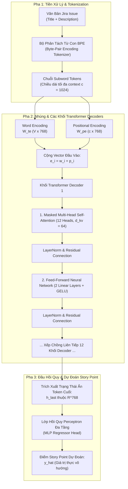

# 📖 CHƯƠNG 3: KIẾN TRÚC MÔ HÌNH GPT2SP (THE GPT2SP ARCHITECTURE)

> **Tài liệu gốc:** Trang 3 – 5, bài báo *GPT2SP: A Transformer-Based Agile Story Point Estimation Approach* (IEEE TSE 2023).  
> **Tác giả:** Michael Fu, Chakkrit Tantithamthavorn (Đại học Monash, Úc).

---

## 🏗️ 1. TỔNG QUAN LUỒNG KIẾN TRÚC GPT2SP

Kiến trúc của GPT2SP được thiết kế nhằm chuyển đổi mô hình ngôn ngữ sinh tự hồi quy (Autoregressive Generative Language Model - GPT-2) thành một mô hình **hồi quy dự đoán giá trị thực (Scalar Regression Model)** để ước lượng Story Point.

Quy trình xử lý hoàn chỉnh gồm hai pha chính: **Pha Huấn luyện (Training Phase)** và **Pha Suy luận (Inference Phase)**, với 3 cấu phần cốt lõi:

---

## 🔤 2. PHÂN TÁCH TỪ CON BẰNG BYTE-PAIR ENCODING (3.1 SUBWORD TOKENIZATION)

### 2.1. Hạn chế của các phương pháp phân tách từ trước đây
Trong xử lý ngôn ngữ tự nhiên (NLP), việc chia nhỏ văn bản tự do thành các đơn vị rời rạc (tokens) có thể thực hiện ở 3 cấp độ:

1. **Word-level Tokenization (Tách theo từ đơn):**
   * *Cách làm của Deep-SE:* Tách câu theo dấu cách và dấu câu.
   * *Hậu quả:* Tập từ vựng bùng nổ khổng lồ (**185.625 từ duy nhất** trong kho dữ liệu của Deep-SE). Việc này làm tăng kích thước ma trận nhúng cực lớn và không thể biểu diễn các từ mới xuất hiện ngoài tập huấn luyện (**Out-of-Vocabulary - OOV**), khiến mô hình phải gán token lạ `<UNK>` và làm mất sạch thông tin ngữ nghĩa.
2. **Character-level Tokenization (Tách theo ký tự):**
   * Giải quyết được OOV nhưng từng ký tự đơn lẻ không mang giá trị ngữ nghĩa, chuỗi đầu vào bị kéo dài quá mức làm bùng nổ chi phí tính toán self-attention ($O(n^2)$).

### 2.2. Giải pháp của GPT2SP: Thuật toán Byte-Pair Encoding (BPE)
GPT2SP áp dụng giải thuật **Byte-Pair Encoding (BPE)** (Sennrich et al., 2016; Radford et al., 2019):
* **Nguyên lý hoạt động:** Bắt đầu từ tập ký tự cơ bản, thuật toán lặp đi lặp lại việc thống kê và sáp nhập (merge operations) các cặp byte/ký tự xuất hiện thường xuyên nhất trong kho ngữ liệu để tạo thành các đơn vị từ con (subwords).
* **Ưu điểm vượt trội:**
  * **Bảo tồn từ phổ biến:** Các từ kỹ thuật quen thuộc (như `database`, `configuration`, `test`) được giữ nguyên là 1 token duy nhất.
  * **Phân rã linh hoạt từ hiếm:** Các từ ghép, định danh biến hoặc thuật ngữ lạ chưa từng thấy sẽ được phân tách thành các mảnh từ con có nghĩa (ví dụ: `Unstoppable` $\rightarrow$ `Un` + `stoppable`; `NullPointerException` $\rightarrow$ `Null` + `Pointer` + `Exception`).
  * **Giải quyết dứt điểm OOV:** Không bao giờ xuất hiện token `<UNK>`, giúp mô hình luôn tạo ra vector biểu diễn giàu ngữ nghĩa cho bất kỳ issue phần mềm mới nào.

---

## 🧠 3. XÂY DỰNG MÔ HÌNH HỌC SÂU (3.2 MODEL BUILDING)

Mô hình GPT2SP được xây dựng gồm 3 thành phần chính:

### 3.1. Thành phần 2a: Word & Positional Encoding (Mã hóa từ & Vị trí)
Để mô hình vừa hiểu ngữ nghĩa từ vựng vừa nắm bắt được vị trí xuất hiện của từ trong yêu cầu kỹ thuật:
1. **Word Encoding Matrix ($W_{te} \in \mathbb{R}^{|V| \times d}$):** Ánh xạ mỗi subword token trong từ điển ($|V| = 50.257$) sang một vector nhúng ngữ nghĩa có kích thước $d = 768$.
2. **Positional Encoding Matrix ($W_{pe} \in \mathbb{R}^{c \times d}$):** Mã hóa vị trí thứ tự của token trong chuỗi đầu vào với chiều dài ngữ cảnh tối đa $c = 1024$.
3. **Tổng hợp vector đầu vào:** Vector đầu vào $\mathbf{e}_i$ tại vị trí $i$ là phép cộng trực tiếp của vector từ và vector vị trí:

$$\mathbf{e}_i = \mathbf{w}_i + \mathbf{p}_i \quad (\mathbf{e}_i \in \mathbb{R}^{768})$$

---

### 3.2. Thành phần 2b: Xếp chồng 12 Khối Transformer Decoder (Stack of 12 Decoder Blocks)
GPT2SP sử dụng biến thể **GPT-2 Small** gồm 12 khối giải mã Transformer giống hệt nhau xếp chồng lên nhau. Mỗi khối gồm hai tầng mạng con cốt lõi:

#### 1. Cơ chế Masked Multi-Head Self-Attention
Cơ chế này cho phép mô hình liên kết và tính toán mức độ quan trọng giữa mọi từ trong chuỗi:
* Đầu vào chuỗi biểu diễn $X$ được nhân với 3 ma trận trọng số học được $W^Q, W^K, W^V$ để tạo ra ba ma trận: **Truy vấn (Query - $Q$)**, **Khóa (Key - $K$)**, và **Giá trị (Value - $V$)**.
* Ma trận chú ý chuẩn hóa (Scaled Dot-Product Attention) được tính theo công thức:

$$\text{Attention}(Q, K, V) = \text{softmax}\left(\frac{QK^T}{\sqrt{d_{kv}}} + M\right) V$$

Trong đó:
* $d_{kv} = 64$ là kích thước không gian vector của mỗi đầu chú ý. Hệ số tỷ lệ $\frac{1}{\sqrt{d_{kv}}}$ giúp ổn định gradient khi tích vô hướng quá lớn.
* $M$ là ma trận mặt nạ tam giác (Masking matrix), gán giá trị $-\infty$ cho các vị trí tương lai để đảm bảo tính tự hồi quy (không nhìn trước tương lai).
* **Đa đầu chú ý (Multi-Head):** Sử dụng $H = 12$ đầu chú ý độc lập. Mỗi đầu học một kiểu quan hệ ngữ cảnh khác nhau (ví dụ: phụ thuộc cú pháp, liên kết đối tượng, thuộc tính lỗi). Đầu ra của 12 đầu được nối lại thành vector chiều $12 \times 64 = 768$:

$$\text{MultiHead}(Q, K, V) = \text{Concat}(\text{head}_1, \dots, \text{head}_{12}) W^O$$

#### 2. Mạng Nơ-ron Truyền Thẳng (Feed-Forward Neural Network - FFN)
Bao gồm hai phép biến đổi tuyến tính xen giữa bởi hàm kích hoạt phi tuyến **GELU (Gaussian Error Linear Unit)**:

$$\text{FFN}(x) = \text{GELU}(x W_1 + b_1) W_2 + b_2$$

#### 3. Chuẩn hóa tầng & Kết nối phần dư (LayerNorm & Residual Connection)
Mỗi tầng mạng con đều được bao bọc bởi một kết nối tắt (residual skip-connection) theo sau bởi tầng chuẩn hóa lớp (Layer Normalization):

$$\text{Output} = \text{LayerNorm}(x + \text{SubLayer}(x))$$

Kỹ thuật này giúp giải quyết hiện tượng triệt tiêu gradient (vanishing gradient), cho phép luồng thông tin truyền sâu qua 12 tầng mạng mà không bị suy hao.

---

### 3.3. Thành phần 2c: Đầu hồi quy MLP Regressor & Dự đoán Story Point
Khác với bài toán sinh ngôn ngữ tự nhiên (dự đoán token tiếp theo qua lớp Softmax trên toàn bộ từ điển $|V|$):
* GPT2SP trích xuất vector trạng thái ẩn cuối cùng $\mathbf{h}_{\text{last}} \in \mathbb{R}^{768}$ tại vị trí token kết thúc chuỗi của khối Transformer thứ 12. Vector này đại diện cho toàn bộ ngữ cảnh ngữ nghĩa cô đọng của Jira Issue.
* Đưa $\mathbf{h}_{\text{last}}$ qua một tầng nơ-ron Perceptron đa tầng (**MLP Regressor Head**) với hàm kích hoạt tuyến tính để ánh xạ thành một giá trị thực vô hướng duy nhất:

$$\hat{y} = \mathbf{w}_r^T \mathbf{h}_{\text{last}} + b_r$$

Trong đó $\hat{y} \in \mathbb{R}^+$ là giá trị điểm Story Point ước lượng.

---

## ⚙️ 4. HÀM MẤT MÁT VÀ QUY TRÌNH TINH CHỈNH (FINE-TUNING)

### 4.1. Hàm mất mát L1 Loss (Mean Absolute Error Loss)
Để tối ưu hóa các tham số $\theta$ của mô hình trong quá trình huấn luyện, GPT2SP sử dụng hàm mất mát sai số tuyệt đối $L_1$:

$$\mathcal{L}_{L1}(\theta) = \sum_{i=1}^{n} |y_{\text{true}, i} - \hat{y}_{\text{predicted}, i}|$$

> [!NOTE]
> **Lý do chọn L1 Loss thay vì L2 Loss (MSE):**  
> Trong các dự án phần mềm thực tế, phân phối Story Point bị lệch phải rất mạnh (right-skewed) với nhiều giá trị ngoại lai cực lớn (outliers như 40, 100 SP). Nếu dùng hàm tổn thất bình phương $L_2$ ($\text{MSE} = (y - \hat{y})^2$), các ngoại lai này sẽ tạo ra gradient khổng lồ khiến mô hình bị kéo lệch và dự đoán thiên vị các task lớn. Hàm mất mát $L_1$ có độ dốc không đổi, giúp mô hình bền vững (robust) hơn nhiều trước các ngoại lai.

### 4.2. Thuật toán tối ưu hóa AdamW
* Sử dụng bộ tối ưu hóa **AdamW** (Loshchilov & Hutter, 2019) với tốc độ học (**Learning Rate**) được thiết lập ở mức:

$$\text{LR} = 5 \times 10^{-4}$$

* AdamW tách biệt việc phân rã trọng số (Weight Decay) ra khỏi việc cập nhật bước dốc thích nghi của Adam, giúp kiểm soát hiện tượng quá khớp (overfitting) hiệu quả hơn trên các tập dữ liệu có quy mô vài nghìn issues.
* Lan truyền ngược (**Back-propagation**) được thực thi để tính toán đạo hàm riêng và cập nhật toàn bộ trọng số của các khối Transformer và MLP Regressor.
