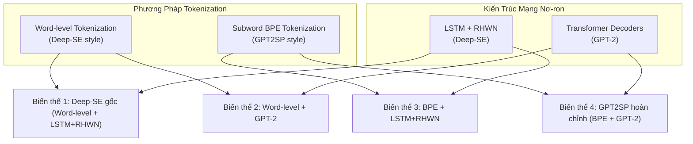

# 📖 CHƯƠNG 5: THIẾT KẾ THỰC NGHIỆM VÀ PHÂN TÍCH KẾT QUẢ (EXPERIMENTAL DESIGN AND RESULTS)

> **Tài liệu gốc:** Trang 7 – 10 và Trang 19 (Table 2, Table 3), bài báo *GPT2SP: A Transformer-Based Agile Story Point Estimation Approach* (IEEE TSE 2023).  
> **Tác giả:** Michael Fu, Chakkrit Tantithamthavorn (Đại học Monash, Úc).

---

## 📌 1. RQ1: ĐÁNH GIÁ TRONG NỘI BỘ DỰ ÁN (WITHIN-PROJECT ESTIMATION)

### 1.1. Thiết lập kịch bản & 9 Mô hình đối chứng (Baselines)
Trong kịch bản này, mô hình được huấn luyện và đánh giá trên từng dự án riêng lẻ ($60\%$ Train, $20\%$ Val, $20\%$ Test). Nhóm tác giả so sánh GPT2SP với **9 mô hình đối chứng chuẩn mực**:
1. **Deep-SE (SOTA - Choetkiertikul et al., 2019):** Mô hình học sâu kết hợp Word2Vec + LSTM + Recurrent Highway Network (RHWN).
2. **LSTM + Random Forest (LSTM+RF):** Trích xuất vector từ tầng ẩn cuối của LSTM và đưa vào mô hình Random Forest.
3. **LSTM + Support Vector Machine (LSTM+SVM):** Kết hợp vector đại diện của LSTM với mô hình hồi quy SVM.
4. **Doc2Vec + Random Forest (Doc2Vec+RF):** Biểu diễn toàn bộ issue qua vector Doc2Vec và dự đoán bằng Random Forest.
5. **Bag-of-Words + Random Forest (BOW+RF):** Biểu diễn tần suất từ (BoW) kết hợp Random Forest (kế thừa Porru et al.).
6. **LSTM + ATLM:** LSTM kết hợp thuật toán biến đổi tuyến tính tự động (Automatically Transform Linear Models).
7. **LSTM + Linear Regression (LSTM+LR):** LSTM kết hợp hồi quy tuyến tính chuẩn.
8. **Median Effort Baseline:** Luôn dự đoán bằng **trung vị** Story Point của tập huấn luyện.
9. **Mean Effort Baseline:** Luôn dự đoán bằng **trung bình cộng** Story Point của tập huấn luyện.

Công thức tính tỷ lệ phần trăm cải thiện sai số MAE:
$$\text{Percentage Improvement} = \frac{\text{MAE}_{\text{baseline}} - \text{MAE}_{\text{GPT2SP}}}{\text{MAE}_{\text{baseline}}} \times 100\%$$

---

### 1.2. Bảng kết quả thực nghiệm chi tiết trên 16 dự án (Table 2 trong bài báo)

Dưới đây là bảng số liệu nguyên bản đầy đủ sai số MAE của GPT2SP và 9 baseline trên toàn bộ 16 dự án:

| Dự án (Project) | GPT2SP (Cải thiện %) | Deep-SE | LSTM+RF | LSTM+SVM | Doc2Vec+RF | BOW+RF | LSTM+ATLM | LSTM+LR | Median | Mean |
| :--- | :---: | :---: | :---: | :---: | :---: | :---: | :---: | :---: | :---: | :---: |
| **Appcelerator Studio** | **0,84** ($38\%$) | 1,36 | 1,62 | 1,46 | 1,62 | 1,83 | 1,59 | 1,68 | 1,30 | 5,64 |
| **Aptana Studio** | **1,93** ($29\%$) | 2,71 | 2,96 | 3,06 | 3,20 | 2,97 | 3,06 | 3,75 | 3,61 | 3,60 |
| **Bamboo** | **0,44** ($41\%$) | 0,74 | 1,01 | 0,81 | 1,12 | 1,34 | 1,97 | 1,26 | 0,75 | 1,21 |
| **Clover** | **1,98** ($6\%$) | 2,11 | 3,08 | 2,50 | 3,16 | 2,98 | 3,11 | 3,36 | 3,75 | 4,58 |
| **Data Management** | **3,10** ($18\%$) | 3,77 | 4,51 | 4,20 | 4,71 | 4,78 | 4,70 | 5,30 | 6,19 | 8,66 |
| **DuraCloud** | **0,48** ($29\%$) | 0,68 | 0,69 | 0,75 | 0,77 | 0,96 | 0,87 | 0,80 | 0,81 | 0,99 |
| **Jira Software** | **0,92** ($33\%$) | 1,38 | 1,71 | 2,04 | 2,10 | 2,10 | 2,10 | 2,10 | 2,28 | 2,37 |
| **Mesos** | **0,66** ($35\%$) | 1,02 | 1,08 | 1,07 | 1,14 | 1,31 | 1,08 | 1,10 | 1,22 | 1,41 |
| **Moodle** | **4,09** ($31\%$) | 5,97 | 9,86 | 6,70 | 8,02 | 10,20 | 9,97 | 9,97 | 6,48 | 12,57 |
| **Mule** | **1,43** ($34\%$) | 2,18 | 2,20 | 2,28 | 2,21 | 2,31 | 2,46 | 2,46 | 2,47 | 2,59 |
| **Mule Studio** | **2,04** ($37\%$) | 3,23 | 3,30 | 3,31 | 3,40 | 3,31 | 3,42 | 3,42 | 3,58 | 3,66 |
| **Spring XD** | **0,96** ($40\%$) | 1,61 | 1,81 | 1,80 | 1,88 | 1,98 | 1,83 | 1,85 | 1,72 | 2,05 |
| **Talend Data Quality** | **1,58** ($47\%$) | 2,97 | 3,89 | 3,49 | 4,33 | 4,49 | 3,86 | 3,79 | 3,30 | 4,55 |
| **Talend ESB** | **0,50** ($22\%$) | 0,64 | 0,66 | 0,70 | 0,70 | 0,86 | 0,70 | 0,77 | 0,91 | 1,03 |
| **Titanium** | **1,36** ($31\%$) | 1,97 | 2,32 | 2,00 | 2,41 | 2,58 | 2,51 | 2,71 | 2,04 | 3,02 |
| **Usergrid** | **0,68** ($34\%$) | 1,03 | 1,07 | 1,06 | 1,12 | 1,19 | 1,40 | 1,40 | 1,16 | 1,20 |
| **TRUNG BÌNH (Average)**| **1,44** ($31\%$) | **2,08** | **2,61** | **2,33** | **2,62** | **2,82** | **2,79** | **2,86** | **2,77** | **3,17** |

---

### 1.3. Phân tích kết luận RQ1
* **Độ chính xác vượt trội:** GPT2SP đạt trung vị sai số **$\text{MAE} = 1,16$** (trung bình $1,44$).
* **Mức độ cải thiện so với Deep-SE:** GPT2SP giảm sai số từ **$6\%$** (trên dự án Clover) đến **$47\%$** (trên dự án Talend Data Quality). Trên dự án mục tiêu trọng điểm **Spring XD**, GPT2SP giảm sai số từ $1,61$ xuống còn **$0,96$** (cải thiện **$40\%$**).
* **So với các baseline khác:** GPT2SP chính xác hơn từ **$34\%$ đến $57\%$** so với các mô hình học máy và vượt trội từ **$38\%$ đến $75\%$** so với baseline thống kê Mean.
* **Xếp hạng thống kê Scott-Knott ESD:** GPT2SP là mô hình duy nhất đứng ở **Rank-1**, tách biệt hoàn toàn về mặt thống kê so với Rank-2 (Deep-SE) và các Rank thấp hơn.

---

## 🌐 2. RQ2: ĐÁNH GIÁ CHUYỂN GIAO LIÊN DỰ ÁN (CROSS-PROJECT ESTIMATION)

Trong thực tế Agile, một dự án phần mềm mới bắt đầu hoàn toàn không có dữ liệu lịch sử để huấn luyện mô hình. RQ2 kiểm tra xem mô hình được huấn luyện từ một dự án nguồn (Source) có thể dự đoán chính xác trên dự án đích (Target) hay không.

### 2.1. Hai bối cảnh đánh giá liên dự án
1. **Cross-Repositories (Khác tổ chức):** Chuyển giao giữa hai dự án thuộc hai tổ chức hoàn toàn xa lạ nhau (ví dụ từ tổ chức Talend sang Appcelerator).
2. **Within-Repositories (Cùng tổ chức):** Chuyển giao giữa hai dự án thuộc cùng một tổ chức (ví dụ giữa hai dự án của Apache hoặc Mulesoft).

### 2.2. Bảng kết quả thực nghiệm liên dự án (Table 3 trong bài báo)

| Kịch bản | Dự án Nguồn (Train) | Dự án Đích (Test) | GPT2SP (Cải thiện %) | Deep-SE | ABE0 |
| :--- | :--- | :--- | :---: | :---: | :---: |
| **Cross-Repositories** | Clover | Usergrid | **0,92** ($41\%$) | 1,57 | 2,04 |
| | Talend ESB | Mesos | **1,54** ($26\%$) | 2,08 | 2,14 |
| | Talend Data Quality | Aptana Studio | **4,14** ($23\%$) | 5,37 | 6,95 |
| | Mule | Titanium | **3,14** ($51\%$) | 6,36 | 7,10 |
| | Talend Data Quality | Appcelerator Studio | **2,54** ($54\%$) | 5,55 | 6,77 |
| | Mule Studio | Titanium | 3,21 ($-20\%$) | **2,67** | 3,94 |
| | Appcelerator Studio | Mule Studio | **1,74** ($59\%$) | 4,24 | 4,45 |
| | Appcelerator Studio | Mule | **1,67** ($38\%$) | 2,70 | 2,97 |
| **Trung bình Cross-Repo** | - | - | **2,36** ($38\%$) | **3,82** | **4,55** |
| **Within-Repositories** | Mesos | Usergrid | **0,58** ($46\%$) | 1,07 | 1,23 |
| | Usergrid | Mesos | 1,46 ($-28\%$) | **1,14** | 1,22 |
| | Appcelerator Studio | Aptana Studio | **2,63** ($4\%$) | 2,75 | 3,08 |
| | Appcelerator Studio | Titanium | 2,58 ($-30\%$) | **1,99** | 2,56 |
| | Titanium | Appcelerator Studio | **2,07** ($27\%$) | 2,85 | 3,00 |
| | Aptana Studio | Titanium | 3,52 ($-3\%$) | **3,41** | 3,53 |
| | Mule | Mule Studio | **2,89** ($8\%$) | 3,14 | 3,55 |
| | Mule Studio | Mule | **2,25** ($3\%$) | 2,31 | 2,64 |
| **Trung bình Within-Repo**| - | - | **2,25** ($4\%$) | **2,33** | **2,60** |

---

### 2.3. Phân tích kết luận RQ2
* **Bước nhảy vọt trong kịch bản Cross-Repositories:**  
  GPT2SP đạt trung vị **$\text{MAE} = 2,14$**, vượt trội **$39\%$ so với Deep-SE** ($\text{MAE} = 3,50$) và **$49\%$ so với ABE0** ($\text{MAE} = 4,20$). Phân cụm Scott-Knott ESD xếp hạng rõ ràng: **GPT2SP (Rank-1) > Deep-SE (Rank-2) > ABE0 (Rank-3)**.
* **Nguyên nhân kỹ thuật sâu xa:**  
  Deep-SE bị bó cứng trong kho từ vựng hạn hẹp của dự án nguồn do mô hình Word2Vec được tiền huấn luyện cục bộ. Khi mang sang dự án khác gặp từ vựng mới, Deep-SE sụp đổ. Ngược lại, GPT-2 sở hữu vốn tri thức tiền huấn luyện khổng lồ từ trước, giúp mô hình hiểu được ngữ nghĩa kỹ thuật xuyên suốt nhiều dự án khác nhau.
* **Kịch bản Within-Repositories:**  
  Hai dự án cùng tổ chức chia sẻ vốn từ vựng tương đồng, do đó Deep-SE phát huy tương đối tốt ($\text{MAE} = 2,33$). GPT2SP đạt $\text{MAE} = 2,25$, hai phương pháp cùng nằm trong nhóm **Rank-1**.

---

## 🔬 3. RQ3: PHÂN TÍCH TRIỆT TIÊU THÀNH PHẦN (ABLATION STUDY)

Để chứng minh luận điểm khoa học: *Đâu là cấu phần quyết định sự thành công của GPT2SP?*, các tác giả tiến hành thực nghiệm bóc tách chéo giữa các giải thuật Tokenization và kiến trúc mạng:

### Kết quả phân tích thành phần:
1. **Đóng góp của kiến trúc Transformer (GPT-2 vs LSTM+RHWN):**
   * Khi giữ nguyên phương pháp Word-level tokenization và chỉ thay thế mạng `LSTM + RHWN` bằng các khối `Transformer Decoders`, sai số MAE của Deep-SE giảm mạnh từ **$6\%$ đến $47\%$** (mức cải thiện trung vị đạt **$34\%$**).
   * Điều này khẳng định cơ chế **Masked Multi-Head Self-Attention** là yếu tố quyết định hàng đầu, giải quyết triệt để vấn đề mất mát thông tin qua thời gian của bộ nhớ ngắn hạn LSTM.
2. **Đóng góp của bộ phân tách từ con (BPE vs Word-level):**
   * Việc chuyển từ Word-level sang BPE giúp cải thiện thêm độ chính xác và đảm bảo mô hình không bị lỗi OOV trên các từ ngữ lạ, dù mức độ ảnh hưởng số học nhỏ hơn sự thay đổi kiến trúc Transformer.
   * Khi so sánh giữa các giải thuật subword khác nhau (**BPE**, **WordPiece**, **SentencePiece**), kết quả cho thấy **BPE** là giải thuật đạt MAE ổn định và tốt nhất cho GPT2SP.
