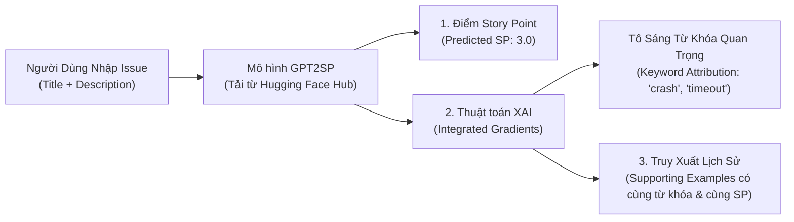
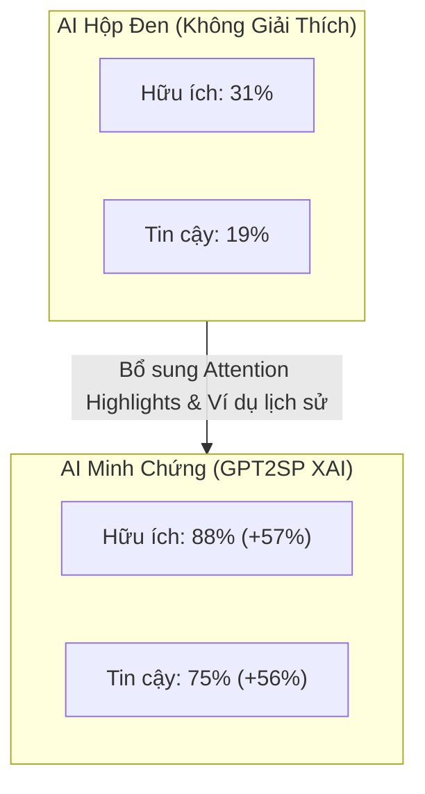

# 📖 CHƯƠNG 6: CÔNG CỤ MINH CHỨNG XAI VÀ KHẢO SÁT CHUYÊN GIA AGILE (EXPLAINABLE AI TOOL & PRACTITIONER SURVEY)

> **Tài liệu gốc:** Trang 10 – 13, bài báo *GPT2SP: A Transformer-Based Agile Story Point Estimation Approach* (IEEE TSE 2023).  
> **Tác giả:** Michael Fu, Chakkrit Tantithamthavorn (Đại học Monash, Úc).

---

## 🛠️ 1. CÔNG CỤ GPT2SP WEB VÀ CƠ CHẾ GIẢI THÍCH (6.1 A GPT2SP TOOL)

Để đưa mô hình từ phòng thí nghiệm ra ứng dụng thực tiễn và giúp các lập trình viên tin tưởng vào kết quả dự đoán của AI, nhóm tác giả phát triển một công cụ thử nghiệm (Proof-of-Concept) chạy trên nền tảng **Streamlit**:
* **Địa chỉ triển khai thử nghiệm:** `https://share.streamlit.io/awsm-research/gpt2sp_webapp/main/app.py`
* **Kiến trúc công cụ:**
  1. Người dùng chọn dự án mục tiêu (ví dụ: `Spring XD`, `Mesos`...). Công cụ tự động tải mô hình tương ứng từ kho lưu trữ **Hugging Face Model Hub**.
  2. Người dùng nhập Tiêu đề (Title) và Mô tả (Description) của Jira Issue cần ước lượng.
  3. Mô hình dự đoán điểm Story Point.
  4. Hệ thống trích xuất **giải thích trực quan (Visual Explanations)** và **ví dụ minh chứng lịch sử (Supporting Examples)**.

---

### 1.1. Giải thuật trích xuất điểm đóng góp từ (Word Attribution via Integrated Gradients)
Thay vì chỉ hiển thị một con số Story Point vô hồn ("hộp đen"), GPT2SP giải thích tường tận xem **từ ngữ nào trong yêu cầu đã thôi thúc mô hình đưa ra mức điểm đó**:
* Sử dụng giải thuật **Integrated Gradients (Gradient Tích Phân)** (Sundararajan et al., 2017) [46] thông qua thư viện `transformers-interpret`.
* **Nguyên lý tiên đề:** Integrated Gradients tính tích phân đường đi của gradient từ một vector rỗng cơ sở (baseline) đến vector nhúng của câu văn thực tế:
  $$\text{IG}_i(x) = (x_i - x'_i) \times \int_{0}^{1} \frac{\partial F(x' + \alpha(x - x'))}{\partial x_i} d\alpha$$
* **Trực quan hóa:** Từ khóa có điểm đóng góp dương lớn (kéo mức Story Point lên cao do độ phức tạp, rủi ro) được tô màu xanh lá cây đậm; các từ làm giảm độ phức tạp được tô màu đối lập.

### 1.2. Cơ chế truy hồi ví dụ minh chứng (Supporting Examples Retrieval)
Công cụ tự động quét kho dữ liệu huấn luyện lịch sử của dự án để tìm các issue quá khứ thỏa mãn 3 điều kiện:
1. Thuộc cùng dự án.
2. Chứa cùng từ khóa quan trọng được tô sáng.
3. Có cùng mức Story Point thực tế được chốt bởi đội ngũ phát triển.
* *Tác dụng thực tiễn:* Lập trình viên có thể click vào liên kết Jira quá khứ để xem đội ngũ đã từng mất bao nhiêu nỗ lực giải quyết tác vụ tương tự, biến dự đoán của AI thành luận cứ đanh thép trong buổi thảo luận Planning Poker.

---

## 📋 2. THIẾT KẾ KHẢO SÁT CHUYÊN GIA AGILE (6.2 SURVEY STUDY)

Nghiên cứu tiến hành khảo sát thực nghiệm để trả lời câu hỏi: *Các chuyên gia Agile đánh giá như thế nào về độ khó của việc chấm Story Point, và liệu việc AI cung cấp lời giải thích có thực sự làm tăng tính hữu ích và độ tin cậy hay không?*

### Quy trình 3 bước thực hiện khảo sát:
* **Bước 1 (Thiết kế bảng hỏi):**
  * *Phần 1:* Nhân khẩu học (Vị trí công tác, số năm kinh nghiệm Agile).
  * *Phần 2 (Q1):* Đánh giá mức độ thách thức của tác vụ ước lượng Story Point (Thang đo Likert 5 mức từ "Hoàn toàn không thách thức" đến "Cực kỳ thách thức").
  * *Phần 3 (Q2):* So sánh mức độ hữu ích (**Usefulness**) và độ tin cậy (**Trust**) của AI trong hai trường hợp: **Không có giải thích** vs. **Có kèm giải thích & ví dụ lịch sử**. Cuối cùng là câu hỏi về việc có sẵn sàng dùng thử nếu tích hợp vào Jira hay không (Q2.7).
* **Bước 2 (Thu thập dữ liệu):** Phát tán khảo sát trên mạng lưới nghề nghiệp toàn cầu (LinkedIn, các diễn đàn Agile chuyên nghiệp), thu về tổng cộng 33 phản hồi.
* **Bước 3 (Kiểm chứng & Lọc sạch dữ liệu):**
  * Loại bỏ nghiêm ngặt 17 phản hồi không có kinh nghiệm thực tế về Agile hoặc chưa từng tham gia chấm Story Point.
  * Giữ lại **16 chuyên gia Agile thực thụ** (đảm bảo $100\%$ tính hợp lệ và am hiểu chuyên môn sâu sắc).

---

## 📊 3. KẾT QUẢ KHẢO SÁT THỰC NGHIỆM (6.3 SURVEY RESULTS)

Dưới đây là tổng hợp định lượng kết quả khảo sát từ 16 chuyên gia (minh họa theo Figure 8 trong bài báo):

### 3.1. Nhận thức về độ khó của bài toán Story Point (Q1)
* **$57\%$** chuyên gia đánh giá việc ước lượng Story Point là công việc **"Thách thức" (Challenging - $19\%$)** hoặc **"Cực kỳ thách thức" (Extremely Challenging - $38\%$)**.
* **$44\%$** giữ quan điểm trung lập. Không có bất kỳ chuyên gia nào cho rằng công việc này là dễ dàng.

---

### 3.2. Bước nhảy vọt về Tính Hữu Ích (Usefulness) và Độ Tin Cậy (Trust) nhờ XAI (Q2)

| Khía cạnh đánh giá | Khi AI chỉ đưa ra điểm số (Không có giải thích) | Khi AI có kèm giải thích XAI & Ví dụ lịch sử | Mức độ gia tăng |
| :--- | :---: | :---: | :---: |
| **Tính Hữu Ích (Usefulness)** | Chỉ **$31\%$** đồng tình / rất đồng tình | **$88\%$** đồng tình / rất đồng tình ($62\%$ Agree + $26\%$ Strongly Agree) | 📈 Tăng gần **gấp 3 lần** |
| **Mức Độ Tin Cậy (Trust)** | Chỉ **$19\%$** dám tin tưởng kết quả | **$75\%$** tin tưởng ($50\%$ Agree + $25\%$ Strongly Agree) | 📈 Tăng gần **gấp 4 lần** |
| **Tỷ lệ phản đối / Nghi ngờ** | $38\%$ không tin tưởng | Giảm xuống chỉ còn $13\%$ | 📉 Giảm mạnh sự hoài nghi |

---

### 3.3. Phản hồi định tính của các chuyên gia thực tế
Các câu trả lời mở lý giải vì sao việc có giải thích lại làm thay đổi hoàn toàn cục diện:
* *Một Kỹ sư Phần mềm kỳ cựu nhận xét:*  
  > *"Việc công cụ tô sáng từ khóa giúp tôi lập tức nhận ra AI có hiểu đúng trọng tâm kỹ thuật của task hay không. Khi thấy từ 'memory leak' hay 'race condition' được tô đậm, tôi biết mô hình đưa ra điểm cao là hoàn toàn có cơ sở."*
* *Một Project Manager chia sẻ:*  
  > *"Các ví dụ trong quá khứ là 'vũ khí' tuyệt vời nhất trong buổi Planning Poker. Thay vì cãi nhau dựa trên cảm tính cá nhân, tôi có thể chỉ ra cho cả nhóm thấy một issue tương tự năm ngoái đã mất đúng 5 Story Point."*

### 3.4. Sẵn sàng đón nhận trong thực tế (Q2.7)
* **$69\%$** chuyên gia khẳng định họ **sẵn sàng áp dụng ngay lập tức** giải pháp AI ước lượng Story Point nếu nó được tích hợp sẵn dưới dạng tiện ích mở rộng (add-on) miễn phí trên hệ sinh thái Atlassian Jira!
