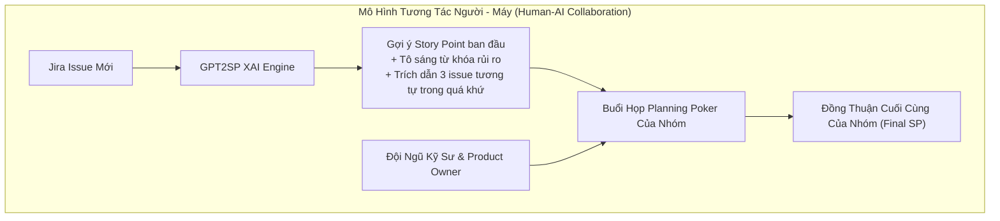

# 📖 CHƯƠNG 7: THẢO LUẬN VÀ HÀM Ý THỰC TIỄN (DISCUSSION)

> **Tài liệu gốc:** Trang 13, bài báo *GPT2SP: A Transformer-Based Agile Story Point Estimation Approach* (IEEE TSE 2023).  
> **Tác giả:** Michael Fu, Chakkrit Tantithamthavorn (Đại học Monash, Úc).

---

## 👥 1. HÀM Ý CHO CÁC CHUYÊN GIA THỰC HÀNH AGILE (BENEFITS TO PRACTITIONERS)

### AI đóng vai trò hỗ trợ ra quyết định (Decision-Support), không thay thế con người
Một thông điệp then chốt mà nhóm tác giả nhấn mạnh:
* **Mục tiêu của GPT2SP KHÔNG PHẢI là tự động hóa hoàn toàn quy trình Agile** (fully-automated Agile process). Việc loại bỏ con người khỏi quy trình lập kế hoạch là bất khả thi và phi thực tế đối với một hệ thống mang tính xã hội - kỹ thuật (socio-technical system).
* Thay vào đó, GPT2SP đóng vai trò là một **hệ thống hỗ trợ ra quyết định (Decision-Support System)**, đồng hành cùng các kỹ sư và Scrum Master trước và trong các buổi họp Backlog Refinement và Sprint Planning.

### Các giá trị thực tiễn đem lại cho đội ngũ Scrum:
1. **Chuẩn hóa tính nhất quán (Estimation Consistency):** Giúp điểm số ước lượng giữa các Sprint không bị trồi sụt thất thường do tâm lý chủ quan hoặc sự thay đổi nhân sự trong nhóm.
2. **Tiết kiệm thời gian tranh cãi:** Các buổi Planning Poker thường bị kéo dài hàng giờ do bất đồng quan điểm giữa các thành viên. Bằng chứng lịch sử do GPT2SP truy xuất giúp nhóm nhanh chóng đạt được sự đồng thuận.
3. **Phát hiện sớm các rủi ro kỹ thuật ẩn:** Các từ khóa kỹ thuật phức tạp (như `deadlock`, `race condition`, `memory leak`) được mô hình tô sáng giúp Product Owner nhận diện kịp thời các task tiềm ẩn rủi ro lớn để chủ động phân rã nhỏ hơn.

---

## 🔬 2. HÀM Ý CHO CÁC NHÀ NGHIÊN CỨU KỸ NGHỆ PHẦN MỀM (BENEFITS TO RESEARCHERS)

Công trình GPT2SP mở ra nhiều định hướng phương pháp luận quan trọng cho cộng đồng nghiên cứu SE:
* **Tính khả thi của Transformer cho các bài toán hồi quy (Regression Tasks):** Trước đây, các mô hình Transformer như BERT hay GPT chủ yếu được áp dụng cho các bài toán phân loại nhị phân (Binary Classification) hoặc sinh mã nguồn (Code Generation). GPT2SP chứng minh rằng việc kết hợp Transformer Decoder với một đầu MLP Regressor và hàm mất mát $L_1$ là một kiến trúc chuẩn mực, có thể nhân rộng sang nhiều tác vụ hồi quy khác trong kỹ nghệ phần mềm:
  * Ước lượng thời gian sửa lỗi (Bug Fix Time Estimation).
  * Dự đoán nỗ lực đánh giá mã nguồn (Code Review Effort Prediction).
  * Dự báo nỗ lực bảo trì nợ kỹ thuật (Technical Debt Effort).
* **Sức mạnh của Học chuyển giao (Transfer Learning):** Nghiên cứu chứng minh rằng việc tận dụng các mô hình nền tảng ngôn ngữ (Foundation Models) đã được tiền huấn luyện trên quy mô lớn mang lại hiệu quả vượt trội hơn hẳn việc cố gắng tiền huấn luyện các mô hình cục bộ từ đầu trên tập dữ liệu nhỏ hẹp của phần mềm.

---

## 💡 3. VÌ SAO GPT2SP HOẠT ĐỘNG VƯỢT TRỘI SO VỚI CÁC PHƯƠNG PHÁP CŨ?

Nhóm tác giả đúc kết 3 nguyên nhân công nghệ cốt lõi giúp GPT2SP đánh bại hoàn toàn Deep-SE và các mô hình học máy truyền thống:

| Yếu tố công nghệ | Cơ chế vận hành | Lợi thế cạnh tranh vượt trội |
| :--- | :--- | :--- |
| **Vốn từ vựng sâu rộng từ WebText** | Tiền huấn luyện trên 40GB văn bản, hiểu rõ ngữ cảnh kỹ thuật đa dạng. | Hiểu sâu sắc các thuật ngữ kỹ thuật ngay cả khi dự án đích chưa từng xuất hiện từ đó trong tập huấn luyện. |
| **Cơ chế Chú ý Tự thân Đa đầu (Multi-Head Self-Attention)** | Kết nối trực tiếp mọi cặp từ cách xa nhau trong mô tả issue dài. | Không bị giới hạn bộ nhớ ngắn hạn của LSTM; không bỏ sót các ràng buộc kỹ thuật nằm rải rác ở đầu và cuối văn bản. |
| **Phân tách từ con Byte-Pair Encoding (BPE)** | Phân rã linh hoạt các tên hàm, biến số, thuật ngữ ghép (`camelCase`, `snake_case`). | Xóa bỏ hoàn toàn điểm nghẽn Out-of-Vocabulary (OOV), luôn tạo ra biểu diễn vector có nghĩa cho mọi chuỗi ký tự. |
