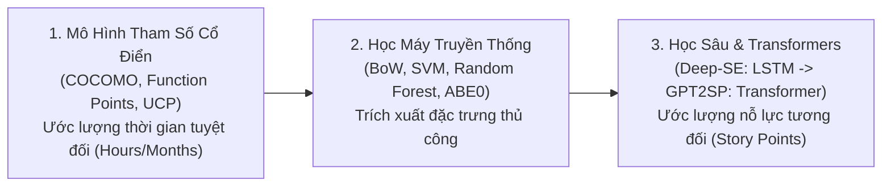

# 📖 CHƯƠNG 8: CÁC CÔNG TRÌNH LIÊN QUAN (RELATED WORK)

> **Tài liệu gốc:** Trang 13 – 14, bài báo *GPT2SP: A Transformer-Based Agile Story Point Estimation Approach* (IEEE TSE 2023).  
> **Tác giả:** Michael Fu, Chakkrit Tantithamthavorn (Đại học Monash, Úc).

---

## ⏳ 1. LỊCH SỬ TIẾN HÓA CỦA ƯỚC LƯỢNG NỖ LỰC PHẦN MỀM (8.1 EFFORT ESTIMATION)

Ước lượng nỗ lực phần mềm (Software Effort Estimation) là một trong những chủ đề nghiên cứu lâu đời và quan trọng nhất trong Kỹ nghệ Phần mềm, trải qua 3 kỷ nguyên phát triển:

### 1.1. Các mô hình tham số cổ điển (Classical Parametric Models)
* **COCOMO (Constructive Cost Model - Boehm, 1981):** Dự báo nỗ lực dựa trên quy mô dòng mã nguồn (Lines of Code - LOC) và các hệ số nhân chi phí (cost drivers).
* **Function Point Analysis (FPA - Albrecht, 1979):** Đo lường quy mô chức năng phần mềm độc lập với ngôn ngữ lập trình dựa trên số lượng màn hình nhập liệu, truy vấn và file dữ liệu logic.
* **Use Case Points (UCP - Karner, 1993):** Ước lượng nỗ lực dựa trên độ phức tạp của các biểu đồ Use Case và tác nhân (Actors).
* **Hạn chế trong kỷ nguyên Agile:** Các mô hình này đòi hỏi đặc tả yêu cầu chi tiết ngay từ đầu (phù hợp với mô hình Thác nước - Waterfall), hoàn toàn không tương thích với chu kỳ phát triển linh hoạt, lặp đi lặp lại và yêu cầu thay đổi liên tục của Agile.

---

## 🤖 2. HỌC MÁY TRUYỀN THỐNG TRONG ƯỚC LƯỢNG STORY POINT (8.2 ML-BASED ESTIMATION)

Khi Agile trở thành tiêu chuẩn công nghiệp, việc ước lượng dịch chuyển sang **Story Point**:
* **Khai thác đặc trưng túi từ (Bag-of-Words):** Porru et al. (2016) [36] là những người tiên phong chuyển đổi văn bản Jira Issue (Title, Description) thành ma trận tần suất từ (TF-IDF) và huấn luyện các thuật toán học máy như Support Vector Machine (SVM), Naive Bayes, Decision Trees và Logistic Regression.
* **Phương pháp dựa trên tương đồng (Analogy-Based Estimation - ABE0):** Dựa trên giả định rằng các task tương tự nhau sẽ tốn nỗ lực tương đương (Shepperd & Schofield, 1997; Mendes et al., 2002).
* **Hạn chế căn bản:** Các kỹ thuật này chỉ nhìn từ ngữ dưới dạng các túi từ rời rạc, làm mất hoàn toàn thứ tự cú pháp câu, ngữ nghĩa ngữ cảnh và gặp tình trạng ma trận đặc trưng cực kỳ thưa thớt (sparsity).

---

## 🧠 3. HỌC SÂU TRONG ƯỚC LƯỢNG STORY POINT (8.3 DL-BASED ESTIMATION)

Nhằm tự động hóa việc trích xuất đặc trưng ngữ nghĩa sâu từ văn bản, mạng nơ-ron học sâu bắt đầu được áp dụng:
* **Mạng truyền thẳng & RNN:** Panda et al. (2015) [29] thử nghiệm mạng General Regression Neural Network. Praynlin et al. (2019) [37] áp dụng mạng hồi quy Elman RNN. Marapelli et al. (2020) [27] đề xuất mô hình kết hợp Bi-LSTM và CNN.
* **Đỉnh cao Deep-SE (Choetkiertikul et al., 2019) [7]:** Là nghiên cứu toàn diện nhất trước GPT2SP, kết hợp mạng nhúng Word2Vec với LSTM và Recurrent Highway Network (RHWN).
* **Sự khác biệt đột phá của GPT2SP:**  
  GPT2SP là công trình **đầu tiên** chuyển dịch từ mạng hồi quy tuần tự (RNN/LSTM) sang kiến trúc **Transformer và Mô hình ngôn ngữ nền tảng (GPT-2)**, xóa bỏ hoàn toàn bước tiền huấn luyện tốn kém (2-7 giờ) và vượt trội về năng lực biểu diễn ngữ nghĩa.

---

## 🔍 4. TRÍ TUỆ NHÂN TẠO CÓ THỂ GIẢI THÍCH TRONG KỸ NGHỆ PHẦN MỀM (8.4 EXPLAINABLE AI FOR SE)

Khái niệm XAI ngày càng trở nên sống còn trong kỹ nghệ phần mềm vì nếu không hiểu được lý do, lập trình viên sẽ từ chối tin tưởng và áp dụng các khuyến nghị của AI (Tantithamthavorn et al., 2021) [49]:
* **Các nghiên cứu trước đây:** XAI chủ yếu được nghiên cứu trong bài toán Dự đoán Lỗi Mã Nguồn (Defect Prediction) thông qua các thuật toán giải thích mô hình hộp đen như LIME, SHAP hoặc PyExplainer (Pornprasit et al., 2021) [35]. Tuy nhiên, các công trình này chỉ tập trung giải thích cho các mô hình học máy truyền thống (như Random Forest).
* **Đóng góp của GPT2SP:** Là một trong những công trình **đầu tiên** mang năng lực giải thích XAI vào các mô hình học sâu Transformer phức tạp cho bài toán quản lý dự án phần mềm.

---

## 👁️ 5. CƠ CHẾ CHÚ Ý ĐÓNG VAI TRÒ CÔNG CỤ DIỄN GIẢI (8.5 ATTENTION AS INTERPRETABILITY)

Trong cộng đồng NLP thế giới, việc sử dụng trọng số chú ý (Attention Weights) để diễn giải mô hình đang là chủ đề học thuật sôi nổi:
* **Các nghiên cứu tiên phong:** Vaswani et al. (2017), Vig et al. (2019) đã chứng minh các đầu chú ý phản ánh cấu trúc ngữ pháp và mối liên kết phụ thuộc giữa các thực thể trong câu.
* **Luận điểm phản biện & Giải pháp của GPT2SP:** Dù có một số tranh luận học thuật về việc liệu trọng số chú ý có tương đương hoàn toàn với giải thích nhân quả hay không (Jain & Wallace, 2019 vs. Wiegreffe & Pinter, 2019), bài báo GPT2SP đã giải quyết rốt ráo bằng cách **kết hợp ma trận Attention với giải thuật Gradient Tích phân (Integrated Gradients)**. Kỹ thuật này đảm bảo việc quy gán điểm số đóng góp của từ (Word Attribution Score) tuân thủ chặt chẽ các tiên đề toán học, đem lại giải thích chuẩn xác và minh bạch cho kỹ sư phần mềm.
