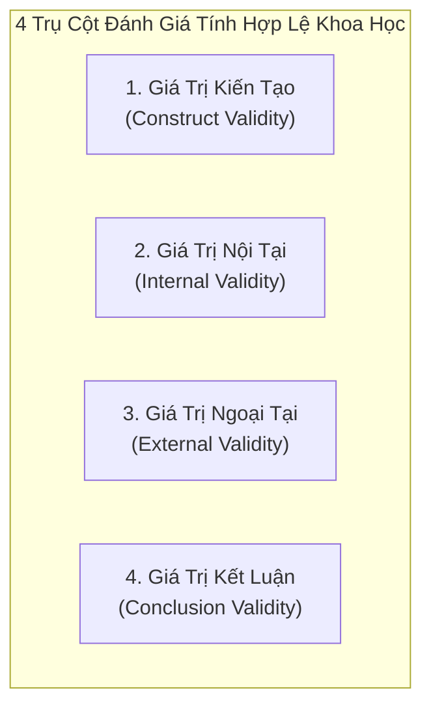

# 📖 CHƯƠNG 9: CÁC MỐI ĐE DỌA ĐỐI VỚI TÍNH HỢP LỆ (THREATS TO VALIDITY)

> **Tài liệu gốc:** Trang 14 – 15, bài báo *GPT2SP: A Transformer-Based Agile Story Point Estimation Approach* (IEEE TSE 2023).  
> **Tác giả:** Michael Fu, Chakkrit Tantithamthavorn (Đại học Monash, Úc).

---

## 🛡️ 1. PHÂN TÍCH 4 MỐI ĐE DỌA KHOA HỌC TRONG BÀI BÁO GỐC

Trong các bài báo khoa học chuẩn mực của IEEE Transactions on Software Engineering, việc tự đánh giá các mối đe dọa giá trị khoa học (Threats to Validity) là yêu cầu bắt buộc nhằm minh bạch hóa giới hạn của nghiên cứu:

---

### 1.1. Giá trị Kiến tạo (Construct Validity)
* **Sự phù hợp của thang đo MAE:**  
  * *Mối đe dọa:* Việc chỉ sử dụng MAE có thể chưa phản ánh hết mọi góc nhìn đánh giá sai số.
  * *Biện pháp giảm thiểu:* Tác giả lý giải rằng MAE đo lường chính xác độ lớn sai số thực tế mà không phân biệt chiều hướng (over/under). MAE khắc phục được nhược điểm bỏ qua sai số ngoại lai của MdAE, tránh được thiên kiến ước lượng non của MMRE, và tập trung vào việc vượt qua Deep-SE thay vì so sánh với đoán ngẫu nhiên như SA.
* **Độ tin cậy của Nhãn mục tiêu (Ground Truth):**  
  * *Mối đe dọa:* Điểm Story Point trong các dự án Jira được chấm bởi sự đồng thuận của con người (Planning Poker), do đó bản thân nhãn này vốn dĩ đã có độ nhiễu và tính chủ quan nhất định.
  * *Biện pháp giảm thiểu:* Dù có tính chủ quan, đây là "tiêu chuẩn vàng" thực tế duy nhất đang vận hành trong toàn bộ ngành công nghiệp phần mềm thế giới. Mô hình học cách mô phỏng sự đồng thuận của nhóm thay vì áp đặt một công thức cơ học phi thực tế.
* **Tính hợp lý của kỹ thuật XAI:**  
  * Nhóm tác giả sử dụng giải thuật Gradient Tích phân (Integrated Gradients) tuân thủ đầy đủ các tiên đề toán học, kết hợp trích xuất Attention Weights để đảm bảo lời giải thích là trung thực với cơ chế suy luận bên trong của mạng nơ-ron.

---

### 1.2. Giá trị Nội tại (Internal Validity)
* **Thiết lập siêu tham số:**  
  * *Mối đe dọa:* Việc lựa chọn siêu tham số có thể làm sai lệch kết quả so sánh giữa các mô hình.
  * *Biện pháp giảm thiểu:* Nhóm tác giả chỉ sử dụng phiên bản GPT-2 Small với cấu hình mặc định cơ bản nhất và tối ưu tốc độ học trên **tập Xác thực (Validation set)**, hoàn toàn không chạm vào tập Kiểm thử (Test set). Điều này chứng minh hiệu năng của GPT2SP đạt được không phải do "tinh chỉnh quá đà" (over-tuning) để gian lận số liệu.
* **Tính toàn vẹn của khảo sát chuyên gia:**  
  * Tác giả rà soát thủ công toàn bộ các câu trả lời mở, kiên quyết loại bỏ 17 bảng hỏi không đạt chuẩn chuyên môn Agile để đảm bảo dữ liệu khảo sát hoàn toàn đến từ những người có kinh nghiệm thực tế.

---

### 1.3. Giá trị Ngoại tại (External Validity)
* **Khả năng tổng quát hóa sang môi trường doanh nghiệp thương mại:**  
  * *Mối đe dọa:* Nghiên cứu được thực nghiệm trên **16 dự án mã nguồn mở (Open-Source Software - OSS)**. Văn hóa phát triển, tính kỷ luật trong chấm Story Point và độ chi tiết của mô tả issue trong các dự án OSS có thể khác biệt so với các công ty phần mềm đóng (Proprietary/Commercial Software).
  * *Biện pháp giảm thiểu:* 16 dự án được chọn thuộc các tổ chức lớn có quy trình quản trị chuyên nghiệp chuẩn mực (như Apache, Atlassian, Spring). Dù vậy, nhóm tác giả vẫn khuyến nghị cần có thêm các nghiên cứu người dùng trong các doanh nghiệp thương mại trong tương lai.

---

### 1.4. Giá trị Kết luận (Conclusion Validity)
* **Độ tin cậy của phân tích thống kê:**  
  * *Mối đe dọa:* Kết luận vượt trội có thể chỉ là ngẫu nhiên do phương sai mẫu.
  * *Biện pháp giảm thiểu:* Nghiên cứu không sử dụng các kiểm định tham số dựa trên giả định phân phối chuẩn (như Student's t-test hay ANOVA vốn không phù hợp với phân phối Story Point bị lệch). Thay vào đó, nhóm áp dụng toàn diện chuỗi kiểm định phi tham số nghiêm ngặt:
    * **Wilcoxon Signed-Rank Test** với mức ý nghĩa $\alpha = 0.05$.
    * **Cliff's Delta ($\delta$)** để khẳng định kích thước hiệu ứng là thực chất (Medium đến Large).
    * Thuật toán phân cụm **Scott-Knott ESD** để xếp hạng các mô hình một cách khách quan.

---

## ⚠️ 2. GÓC NHÌN PHẢN BIỆN KHOA HỌC CỦA ĐỀ TÀI NCKH NHÓM 3 (JOHNNY SNOWFLAKE)

> [!CAUTION]
> **LỖ HỔNG LỚN NHẤT MÀ BÀI BÁO GPT2SP HOÀN TOÀN BỎ QUÊN:**  
> Khi đào sâu vào phương pháp luận của Fu & Tantithamthavorn (2023), nhóm nghiên cứu NCKH Johnny Snowflake đã phát hiện **hai lỗ hổng rò rỉ dữ liệu cực kỳ nghiêm trọng** mà bài báo không hề đề cập trong phần Threats to Validity:

1. **Rò rỉ Dữ liệu Thời gian (Temporal Data Leakage):**
   * Bài báo GPT2SP lấy trực tiếp các file CSV tĩnh được kết xuất lúc dự án đã kết thúc (tháng 8/2016).
   * Trong thực tế Jira, trường `Description` liên tục bị lập trình viên chỉnh sửa trong suốt quá trình phát triển (bổ sung nguyên nhân lỗi, vết tràn ngăn xếp, các bước vá lỗi chi tiết). 
   * Việc đưa mô tả đã sửa sau Sprint vào để "dự đoán" Story Point ban đầu khiến mô hình đạt được con số $\text{MAE} = 0,96$ (trên Spring XD) một cách **ảo tưởng và không thể hoạt động trong các buổi Sprint Planning thực tế**.
2. **Rò rỉ do Phân chia Ngẫu nhiên (Random Split Leakage):**
   * Tác giả chia ngẫu nhiên $60/20/20$ toàn bộ dữ liệu, khiến mô hình được huấn luyện trên các issue của năm 2016 để đi "dự đoán" các issue phát sinh từ năm 2013-2014. Điều này vi phạm nghiêm trọng tính nhân quả của dòng thời gian thực tế.
3. **Sứ mệnh của Đề tài Nhóm 3:**  
   Sử dụng CSDL quan hệ **TAWOS v1.1** để tái dựng trạng thái lịch sử chuẩn xác tại mốc **`SP_Estimation_Date`** qua bảng `CHANGE_LOG`, áp dụng phân chia dòng thời gian (**Chronological Split**) nhằm đưa ra kết quả ước lượng trung thực và tin cậy nhất.
