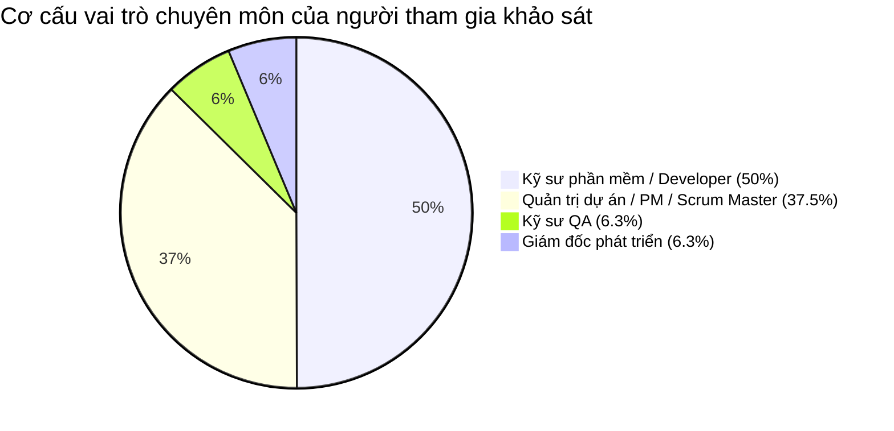

# 📖 PHỤ LỤC: CÁC THỰC NGHIỆM BỔ SUNG & SỐ LIỆU CHI TIẾT (APPENDIX)

> 📍 **Vị trí trong bài báo gốc:** **Appendix (Trang 17 – 19)**, bài báo *GPT2SP: A Transformer-Based Agile Story Point Estimation Approach* (IEEE TSE 2023).  
> Bao gồm: **Section 11, Section 12, Section 13 (13.1, 13.2)**, các biểu đồ **Fig. 9, Fig. 10** và các bảng số liệu chi tiết **Table 2, Table 3, Table 4**.  
> **Tác giả:** Michael Fu, Chakkrit Tantithamthavorn (Đại học Monash, Úc).

---

## 👥 1. CHƯƠNG 11: CƠ CẤU NHÂN KHẨU HỌC NGƯỜI THAM GIA KHẢO SÁT (11. SURVEY RESPONDENT DEMOGRAPHICS)
> 📍 **Vị trí bài báo gốc:** **Section 11 (Trang 17, Cột 1, Dòng y=74.2 – 234.1)** — *"11 SURVEY: RESPONDENT DEMOGRAPHICS"*

Để đảm bảo tính khách quan và loại trừ nguy cơ ý kiến khảo sát bị chi phối bởi một nhóm đối tượng hẹp, 16 chuyên gia Agile được lựa chọn có cơ cấu vị trí công tác và kinh nghiệm làm việc rất đa dạng:

### Cơ cấu vị trí đảm nhiệm trong dự án phần mềm
* **Kỹ sư Phần mềm / Lập trình viên (Software Engineer / Developer):** **$50,0\%$** (8 người).
* **Quản trị Dự án (Project Manager / Scrum Master):** **$37,5\%$** (6 người).
* **Kỹ sư Đảm bảo Chất lượng (Quality Assurance Engineer - QA):** **$6,3\%$** (1 người).
* **Giám đốc Phát triển Phần mềm (Development Manager):** **$6,3\%$** (1 người).

### Thâm niên kinh nghiệm làm việc trong ngành phần mềm
* **Dưới 5 năm:** $18,8\%$ (3 người).
* **Từ 6 đến 10 năm:** **$31,3\%$** (5 người - nhóm chiếm tỷ trọng lớn nhất).
* **Từ 11 đến 15 năm:** $12,5\%$ (2 người).
* **Từ 16 đến 20 năm:** $18,8\%$ (3 người).
* **Trên 20 năm kinh nghiệm:** $18,8\%$ (3 người).

> [!NOTE]
> **Nhận định về chất lượng mẫu khảo sát:**  
> Hơn **$81\%$** chuyên gia có trên 5 năm kinh nghiệm thực chiến trong các dự án phần mềm chuyên nghiệp, và hơn một phần ba có thâm niên từ 15 đến hơn 20 năm. Điều này bảo chứng rằng các nhận định về độ khó của Story Point và giá trị của công cụ giải thích XAI có độ tin cậy thực tế rất cao.

---

## 🗄️ 2. CHƯƠNG 12: CHI TIẾT TẬP DỮ LIỆU THỰC NGHIỆM (12. STUDIED DATASET)
> 📍 **Vị trí bài báo gốc:** **Section 12 (Trang 17, Cột 1, Dòng y=252.1 – 459.8)** — *"12 STUDIED DATASET"*

* **16 dự án mã nguồn mở chuẩn mực:** Apache Mesos (`ME`), Apache Usergrid (`UG`), Appcelerator Studio (`AS`), Aptana Studio (`AP`), Titanium SDK/CLI (`TI`), DuraCloud (`DC`), Bamboo (`BB`), Clover (`CV`), JIRA Software (`JI`), Moodle (`MD`), Data Management (`DM`), Mule (`MU`), Mule Studio (`MS`), Spring XD (`XD`), Talend Data Quality (`TD`), và Talend ESB (`TE`).
* **Đặc tính phân phối Story Point:**  
  * Phân phối điểm số trong thực tế bị lệch phải rất mạnh (right-skewed): Phần lớn các issue tập trung ở mức $1, 2, 3, 5$ điểm; các issue lớn ($20, 40, 100$ điểm) chiếm tỷ lệ rất nhỏ nhưng có độ phân tán phương sai cực cao (ví dụ: dự án `Moodle` có phương sai $\text{SP}_{\text{var}} = 468,53$ và độ lệch chuẩn $\text{SP}_{\text{std}} = 21,65$; dự án `Data Management` có $\text{SP}_{\text{var}} = 275,71$).
  * Điều này củng cố tính đúng đắn của việc tác giả lựa chọn **hàm mất mát L1 Loss** thay vì L2 Loss trong Chương 3.

---

## 🔬 3. CHƯƠNG 13: CÁC THỬ NGHIỆM MỞ RỘNG (13. ADDITIONAL EXPERIMENTS)
> 📍 **Vị trí bài báo gốc:** **Section 13 (Trang 17, Cột 1, Dòng y=477.8 đến Trang 18, Cột 2, Dòng y=91.8)** — *"13 ADDITIONAL EXPERIMENTS"*

### 13.1. Đánh giá ABE0 khi được tối ưu hóa siêu tham số (Hyperparameter Optimization)
> 📍 **Vị trí bài báo gốc:** Section 13.1 (Trang 17, Cột 1, Dòng y=495.7 – Trang 17, Cột 2, Dòng y=430.3) kèm **Fig. 9 (Trang 17, Cột 2, Dòng y=315.0 – 384.7)**.

* **Câu hỏi đặt ra:** Liệu phương pháp tương đồng cổ điển ABE0 khi được tinh chỉnh siêu tham số tự động có thể vượt qua GPT2SP hay không?
* **Thực nghiệm:** Tác giả xây dựng biến thể **`ABE0+Hyperopt`** sử dụng thư viện Hyperopt với giải thuật tối ưu hóa cây xác suất **Tree Parzen Estimators (TPE)** [4].
* **Kết quả:**  
  * `ABE0+Hyperopt` cải thiện sai số đáng kể so với bản ABE0 gốc và vượt qua cả Deep-SE trong một số tình huống liên dự án.
  * **Tuy nhiên, GPT2SP vẫn là mô hình chiến thắng áp đảo:** Cả trong kịch bản Cross-Repository và Within-Repository, GPT2SP vẫn duy trì khoảng cách sai số MAE thấp hơn rõ rệt so với `ABE0+Hyperopt`, tái khẳng định tính ưu việt của kiến trúc Transformer.

---

### 13.2. Năng lực truy xuất ví dụ minh chứng lịch sử (Model Inspection Analysis)
> 📍 **Vị trí bài báo gốc:** Section 13.2 (Trang 17, Cột 2, Dòng y=459.3 – Trang 18, Cột 2, Dòng y=91.8) kèm **Fig. 10 (Trang 18, Cột 1, Dòng y=315.0 – 348.9)**.

Để kiểm chứng xem công cụ GPT2SP XAI có thực sự tìm được các bằng chứng lịch sử thuyết phục hay không:
* Với mỗi issue kiểm thử mà GPT2SP ước lượng chính xác Story Point, tác giả tính toán tỷ lệ phần trăm ví dụ minh chứng:
  $$\text{Supporting Examples (\%)} = \frac{\#\text{ các issue quá khứ (cùng dự án, cùng từ khóa XAI, cùng mức SP)}}{\#\text{ các issue quá khứ (cùng dự án, cùng từ khóa XAI)}} \times 100\%$$
* **Kết quả thực nghiệm:**
  * Tính trên toàn bộ 16 dự án, GPT2SP tìm được trung bình **$20\%$** các issue lịch sử trong tập huấn luyện có chứa chính xác cùng từ khóa quan trọng và được chốt cùng mức Story Point!
  * **Top 5 dự án đạt tỷ lệ minh chứng cao nhất:**
    1. **DuraCloud:** $31\%$
    2. **Appcelerator Studio:** $31\%$
    3. **Talend ESB:** $28\%$
    4. **Bamboo:** $27\%$
    5. **Titanium SDK/CLI:** $26\%$
* *Kết luận:* Mô hình GPT2SP không "đoán mò", mà đã thực sự học được mối liên kết logic giữa các từ khóa kỹ thuật và mức nỗ lực từ kho dữ liệu quá khứ.

---

## ⏱️ 4. BẢNG THỜI GIAN HUẤN LUYỆN VÀ SUY LUẬN CHI TIẾT (TABLE 4 TRONG BÀI BÁO)
> 📍 **Vị trí bài báo gốc:** **TABLE 4 (Trang 19, Cột 1, Dòng y=546.6 – 733.5)**: *"TABLE 4: The model training time and inference time of our GPT2SP for each project."*  
> *(Ghi chú: Trang 19 của bài báo còn chứa **TABLE 2** - Bảng so sánh MAE nội dự án RQ1 tại y=64.3–243.2 và **TABLE 3** - Bảng so sánh MAE liên dự án RQ2 tại y=276.1–512.2)*.

Dưới đây là bảng thống kê thời gian huấn luyện (tính bằng Giây) và thời gian suy luận cho một issue (tính bằng Micro-giây, $\mu s$) của GPT2SP trên toàn bộ 16 dự án khi thực thi trên 01 card đồ họa NVIDIA RTX 3090:

| STT | Tên Dự Án (Project Name) | Số lượng Issue (#Issues) | Thời Gian Huấn Luyện (Giây - Seconds) | Thời Gian Suy Luận (Micro-giây - $\mu s$) |
| :-: | :--- | :-: | :-: | :-: |
| 1 | **Appcelerator Studio** | 2.919 | 13 s | $228\ \mu s$ |
| 2 | **Aptana Studio** | 829 | 10 s | $259\ \mu s$ |
| 3 | **Bamboo** | 521 | 12 s | $278\ \mu s$ |
| 4 | **Clover** | 384 | 9 s | $262\ \mu s$ |
| 5 | **Data Management** | 4.667 | **39 s** | $215\ \mu s$ |
| 6 | **DuraCloud** | 666 | 4 s | $253\ \mu s$ |
| 7 | **Jira Software** | 352 | **3 s** | $265\ \mu s$ |
| 8 | **Mesos** | 1.680 | 30 s | $226\ \mu s$ |
| 9 | **Moodle** | 1.166 | 5 s | $234\ \mu s$ |
| 10 | **Mule** | 889 | 7 s | $232\ \mu s$ |
| 11 | **Mule Studio** | 732 | 10 s | $242\ \mu s$ |
| 12 | **Spring XD** | **3.526** | **35 s** | **$219\ \mu s$** |
| 13 | **Talend Data Quality** | 1.381 | 11 s | $224\ \mu s$ |
| 14 | **Talend ESB** | 868 | 23 s | $234\ \mu s$ |
| 15 | **Titanium** | 2.251 | 5 s | $220\ \mu s$ |
| 16 | **Usergrid** | 482 | 9 s | $282\ \mu s$ |
| **-** | **TRUNG BÌNH (Average)** | **-** | **14 giây** | **$242\ \mu s$** |

### Nhận định về hiệu năng tính toán:
* **Tốc độ huấn luyện:** Dự án lớn nhất (`Data Management` với gần 4.700 issues) chỉ mất **39 giây**; dự án mục tiêu tái lập số 1 của đề tài (`Spring XD` với 3.526 issues) chỉ mất **35 giây**. Dự án nhỏ nhất (`Jira Software`) chỉ mất vẻn vẹn **3 giây**. So với mức 2 đến 7 giờ của Deep-SE, GPT2SP nhanh hơn hàng trăm lần!
* **Tốc độ suy luận thời gian thực:** Trung bình chỉ mất **$242$ micro-giây** ($0,000242$ giây) để đưa ra dự đoán Story Point cho một Jira issue mới. Tốc độ này hoàn toàn đáp ứng yêu cầu phản hồi thời gian thực tức thì khi tích hợp vào giao diện người dùng Jira Webhook hoặc Jira Cloud Plugin.
