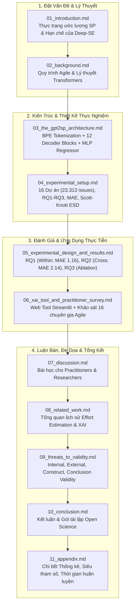

# 📑 HỆ THỐNG GIẢI THÍCH CHI TIẾT TỪNG CHƯƠNG BÀI BÁO KHOA HỌC GPT2SP (FU & TANTITHAMTHAVORN, IEEE TSE 2023)

> **Tài liệu nguồn:**  
> Michael Fu, Chakkrit Tantithamthavorn (2023).  
> *"GPT2SP: A Transformer-Based Agile Story Point Estimation Approach."*  
> **IEEE Transactions on Software Engineering (TSE)**, Tập 49, Số 5, Trang 3169–3185.  
> DOI: [10.1109/TSE.2023.3241517](https://doi.org/10.1109/TSE.2023.3241517) | File PDF cục bộ: [`docs/articles/paper_gpt2sp.pdf`](../paper_gpt2sp.pdf)

---

## 🧭 CẤU TRÚC PHÂN RÃ TOÀN DIỆN CỦA BÀI BÁO (MỖI CHƯƠNG MỘT TÀI LIỆU)

Để phục vụ công tác nghiên cứu, tái lập thực nghiệm và phản biện học thuật cho đề tài NCKH, toàn bộ 10 chương chính và 3 phần phụ lục của bài báo GPT2SP được phân tích chi tiết, dịch thuật học thuật, giữ nguyên công thức toán, số liệu thực nghiệm và đối soát toàn vẹn thành các tập tin độc lập dưới đây:

| Thứ tự | Tên File Markdown | Tiêu đề chương trong bài báo | Trọng tâm học thuật & Nội dung cốt lõi |
| :-: | :--- | :--- | :--- |
| **01** | [`01_introduction.md`](01_introduction.md) | **1. Introduction** | Bối cảnh ước lượng Story Point trong Agile; Sự thiếu chính xác của chuyên gia; 3 giới hạn chí tử của Deep-SE; Ý tưởng cốt lõi của GPT2SP; Tóm tắt kết quả vượt trội (RQ1-RQ3); Khảo sát 16 chuyên gia và 5 đóng góp học thuật. |
| **02** | [`02_background.md`](02_background.md) | **2. Background** | Quy trình Agile 4 bước; Bản chất 4 thành tố của Story Point; Cơ chế Planning Poker và thiên kiến chủ quan; Giới thiệu kiến trúc Deep-SE; Cơ sở lý thuyết về Mô hình ngôn ngữ tiền huấn luyện và Transformer. |
| **03** | [`03_the_gpt2sp_architecture.md`](03_the_gpt2sp_architecture.md) | **3. The GPT2SP Architecture** | Chi tiết luồng xử lý: Phân tách từ con Byte-Pair Encoding (BPE); Word & Positional Encoding; Xếp chồng 12 khối Transformer Decoders; Masked Multi-Head Self-Attention; MLP Regressor; Tối ưu hóa hàm mất mát L1 Loss qua AdamW. *(Kèm [Case Study minh họa](../case-study/case_study_gpt2sp_architecture.md) & [Bộ phân tích phản biện Critical Thinking](../critical-thinking/README.md))* |
| **04** | [`04_experimental_setup.md`](04_experimental_setup.md) | **4. Experimental Setup** | Thiết kế 3 câu hỏi nghiên cứu (RQ1, RQ2, RQ3); Thống kê chi tiết 16 bộ dữ liệu với 23.313 issues; Môi trường thực thi GPU RTX 3090; Siêu tham số cấu hình; Thang đo MAE và lý do loại bỏ MdAE/MMRE/SA; Kiểm định Scott-Knott ESD & Cliff's Delta. |
| **05** | [`05_experimental_design_and_results.md`](05_experimental_design_and_results.md) | **5. Experimental Design and Results** | Phân tích thực nghiệm chuyên sâu: **RQ1 (Within-project)** so với 9 baselines; **RQ2 (Cross-project)** trong và ngoài repository so với Deep-SE và ABE0; **RQ3 (Ablation study)** đo lường đóng góp của BPE và Transformer. Bảng số liệu chi tiết 16 dự án. |
| **06** | [`06_xai_tool_and_practitioner_survey.md`](06_xai_tool_and_practitioner_survey.md) | **6. A Proof-of-Concept Explainable AI Tool & Practitioner Survey** | Kiến trúc công cụ Web GPT2SP Streamlit; Giải thuật trích xuất trọng số Integrated Gradients; Thiết kế bảng hỏi khảo sát; Phân tích phản hồi từ 16 chuyên gia Agile thực tế về độ tin cậy (Trust) và tính hữu ích (Usefulness). |
| **07** | [`07_discussion.md`](07_discussion.md) | **7. Discussion** | Bài học thực tiễn cho Agile Practitioners; Ý nghĩa phương pháp luận cho Software Engineering Researchers; Lý giải vì sao kiến trúc Transformer tổng quát hóa vượt bậc so với mạng nơ-ron hồi quy LSTM. |
| **08** | [`08_related_work.md`](08_related_work.md) | **8. Related Work** | Toàn cảnh bức tranh nghiên cứu: Lịch sử ước lượng nỗ lực phần mềm (COCOMO, Function Points); Kỹ thuật Machine Learning truyền thống; Học sâu (Deep-SE, RNN, CNN); Trí tuệ nhân tạo có thể giải thích (XAI) và cơ chế Attention trong SE. |
| **09** | [`09_threats_to_validity.md`](09_threats_to_validity.md) | **9. Threats to Validity** | Đánh giá 4 nhóm đe dọa giá trị khoa học: Giá trị nội tại (Internal validity), Giá trị ngoại tại (External validity), Giá trị kiến tạo (Construct validity), Giá trị kết luận (Conclusion validity). |
| **10** | [`10_conclusion.md`](10_conclusion.md) | **10. Conclusion** | Tổng kết thành tựu bài báo; Công bố bộ tái lập mở (Open Science replication package trên GitHub và Hugging Face); Hướng nghiên cứu mở rộng trong tương lai. |
| **11** | [`11_appendix.md`](11_appendix.md) | **Appendix (Sections 11, 12, 13)** | Chi tiết cơ cấu nhân khẩu học người tham gia khảo sát; Bảng phân phối xác suất Story Point 16 dự án; Thử nghiệm bổ sung tối ưu siêu tham số ABE0+Hyperopt; Phân tích năng lực truy hồi ví dụ minh chứng lịch sử (Supporting Examples); Bảng thời gian huấn luyện và suy luận chi tiết. |

---

## 📊 SƠ ĐỒ DÒNG CHẢY HỌC THUẬT CỦA BÀI BÁO

---

## 🔗 LIÊN HỆ VỚI ĐỀ TÀI NCKH NHÓM 3 (JOHNNY SNOWFLAKE)

Tài liệu giải thích này là nền tảng để nhóm triển khai 2 mũi nhọn nghiên cứu:
1. **Tái lập khách quan (Replication Phase):** Tái lập chính xác số liệu của GPT2SP trên 16 dự án (tập trung vào `Spring XD` có checkpoint sẵn trên Hugging Face).
2. **Phản biện & Kiểm soát rò rỉ dữ liệu (Novel Contribution Phase):** Chứng minh kết quả MAE = 0.96 của GPT2SP trên `Spring XD` bị thổi phồng do **Temporal Leakage** (mô tả issue sau planning) và **Random Split Leakage**. Nhóm sẽ áp dụng CSDL **TAWOS v1.1** để tái dựng trạng thái tại `SP_Estimation_Date` và phân chia thời gian (Chronological Split) nhằm đưa ra kết quả ước lượng trung thực và tin cậy trong môi trường Agile thực tế.
