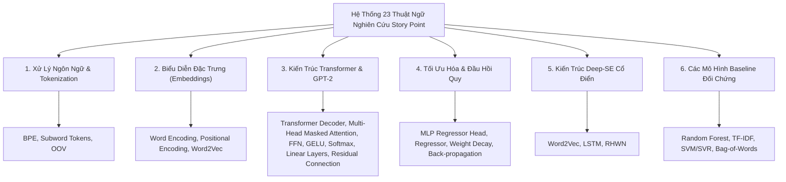

# 📚 TỪ ĐIỂN THUẬT NGỮ CHUYÊN SÂU (GLOSSARY DIRECTORY)

Thư mục này lưu trữ hệ thống từ điển thuật ngữ chuyên ngành phục vụ nghiên cứu **Ước lượng Nỗ lực trong Agile (Agile Story Point Estimation)**, **Mô hình Ngôn ngữ Lớn (LLMs)**, và **Kiến trúc Học sâu (Deep-SE vs GPT2SP)** theo công trình công bố trên *IEEE Transactions on Software Engineering (TSE 2023)*.

---

## 🗂️ TÀI LIỆU QUY CHUẨN & TRA CỨU TỔNG QUAN

| Tài liệu | Nội dung & Phạm vi | Liên kết |
| :--- | :--- | :--- |
| **`RULE.md`** | **Quy chuẩn bắt buộc biên soạn thuật ngữ**: Triết lý kỹ thuật Feynman (giải thích cho đứa trẻ 10 tuổi), cấu trúc khung 6 phần bắt buộc, quy tắc sơ đồ Mermaid và tiếng Việt có dấu. | [Xem chi tiết](RULE.md) |
| **`glossary_gpt2sp.md`** | Tổng hợp nhanh toàn bộ thuật ngữ của bài báo **GPT2SP (Fu & Tantithamthavorn, 2023)** phân theo 7 cụm chủ đề từ Agile, Transformer, Metrics đến XAI và Data Leakage. | [Xem chi tiết](glossary_gpt2sp.md) |

---

## 🔤 DANH MỤC THUẬT NGỮ CHUYÊN SÂU (SẮP XẾP THEO ALPHABET A – Z)

Toàn bộ **23 thuật ngữ** dưới đây đều được biên soạn riêng biệt theo chuẩn mực 6 phần của [`RULE.md`](RULE.md), bao gồm ẩn dụ trực giác, bóc tách chiết tự, ma trận dữ liệu "Aha!", phân tích thách thức kỹ thuật và đúc kết 30 giây:

| STT | Thuật ngữ (Alphabet A - Z) | Chủ đề chuyên môn (Topic) | Giải thích ngắn gọn bản chất | Liên kết tài liệu |
| :---: | :--- | :--- | :--- | :--- |
| 1 | **Back-propagation** | Optimization & Calculus | Thuật toán "chuyến đi lùi rút kinh nghiệm" dùng quy tắc chuỗi (Chain Rule) để truyền ngược đạo hàm sai số từ L1 Loss về tinh chỉnh đồng bộ 117 triệu tham số. | [backpropagation.md](backpropagation.md) |
| 2 | **Bag-of-Words (BoW)** | Traditional NLP | Kỹ thuật "ném từ vào bao tải rồi lắc đều", chỉ đếm tần suất xuất hiện và xóa bỏ hoàn toàn trật tự ngữ pháp cùng ngữ cảnh câu. Baseline BoW + RF bị GPT2SP vượt trội toàn diện. | [bag_of_words.md](bag_of_words.md) |
| 3 | **Byte-Pair Encoding (BPE)** | NLP & Tokenization | Thuật toán ghép cặp byte/ký tự thông minh theo tần suất, khống chế từ điển ở mức cố định 50.257 tokens và xóa bỏ hoàn toàn hiện tượng từ lạ ngoài từ điển (`OOV = 0%`). | [byte_pair_encoding.md](byte_pair_encoding.md) |
| 4 | **Feed-Forward Network (FFN)** | Deep Learning Architecture | Khoảng thời gian "tự suy ngẫm độc lập" của từng token: phóng to vector từ 768 lên 3072 chiều để nghiền ngẫm tri thức, chiếm 66% tổng số tham số của GPT-2 Small. | [feed_forward_neural_network.md](feed_forward_neural_network.md) |
| 5 | **GELU (Gaussian Error Linear Unit)** | Deep Learning Math | Hàm kích hoạt phi tuyến tính trơn mượt dựa trên phân phối chuẩn Gauss ($y = x \cdot \Phi(x)$), loại bỏ hoàn toàn hiện tượng chết nơ-ron và góc gãy $90^\circ$ của ReLU trong GPT-2 và GPT2SP. | [gelu.md](gelu.md) |
| 6 | **Linear Layers** | Deep Learning Core | "Chiếc máy trộn sinh tố" thực hiện phép biến đổi đại số affine $y = Wx + b$, thay đổi số chiều không gian và hòa trộn thông tin qua các kết nối đầy đủ (Fully Connected). | [linear_layers.md](linear_layers.md) |
| 7 | **Long Short-Term Memory (LSTM)** | Recurrent Neural Networks | Mạng nơ-ron có "cuốn sổ tay thần kỳ" và 3 cánh cổng kiểm soát (quên, ghi, báo cáo), khắc phục triệt tiêu đạo hàm trong Deep-SE nhưng bị nghẽn tuần tự thời gian (không chạy song song GPU được). | [lstm.md](lstm.md) |
| 8 | **MLP Regressor Head** | Specialized Prediction Heads | Đầu hồi quy chuyên biệt gồm 2 tầng tuyến tính ($768 \rightarrow 256 \rightarrow 1$) kết hợp GeLU và Dropout, gắn vào đỉnh token cuối cùng ($\mathbf{h}_N$) của GPT-2 để xuất ra điểm Story Point duy nhất. | [mlp_regressor_head.md](mlp_regressor_head.md) |
| 9 | **Multi-Head Masked Attention** | Transformers Architecture | Cơ chế chú ý tự thân dưới 12 góc nhìn song song, dùng mặt nạ tam giác dưới che khuất tương lai để bảo toàn tính nhân quả thời gian, chắt lọc toàn bộ ngữ cảnh vào token cuối. | [multi_head_masked_attention.md](multi_head_masked_attention.md) |
| 10 | **Out-Of-Vocabulary (OOV)** | NLP & Tokenization | Căn bệnh "người lạ ngoài từ điển": tử huyệt khiến Deep-SE bị mù tịt trước các từ ghép mã nguồn và bị bộ phân tách Byte-level BPE của GPT-2 xóa sổ hoàn toàn (`OOV = 0%`). | [oov.md](oov.md) |
| 11 | **Positional Encoding** | Transformers Architecture | "Thẻ đánh số thứ tự" được cộng trực tiếp vào vector từ ($\mathbf{e}_i = \mathbf{w}_i + \mathbf{p}_i$), giúp cơ chế Self-Attention song song phân biệt rõ vị trí Title và Description trong Jira. | [positional_encoding.md](positional_encoding.md) |
| 12 | **Random Forest (RF)** | Traditional ML & Ensemble | Rừng cây quyết định ngẫu nhiên (hội đồng 100 bác sĩ độc lập), lấy trung bình cộng dự đoán để triệt tiêu phương sai; dùng làm bộ hồi quy baseline (LSTM+RF, BoW+RF). | [random_forest.md](random_forest.md) |
| 13 | **Regressor / Regression Modeling** | Predictive Modeling | Bản chất toán học của bài toán dự đoán số thực liên tục (Story Point) thay vì phân loại rời rạc; kết hợp L1 Loss để kháng lại các điểm ngoại lai dị biệt trong Jira. | [regressor.md](regressor.md) |
| 14 | **Residual Connection** | Deep Learning Architecture | "Con đường tắt bưu điện" $y = x + F(x)$ giúp dòng thông tin gốc và đạo hàm lan truyền ngược chảy thông suốt 12 tầng Transformer mà không bị méo mó hay suy thoái mạng. | [residual_connection.md](residual_connection.md) |
| 15 | **Recurrent Highway Network (RHWN)** | Deep Recurrent Networks | Mạng nơ-ron có "làn đường cao tốc trên cao" (Carry Gate & Transform Gate), giúp Deep-SE tăng độ sâu biểu diễn trừu tượng sau lớp LSTM mà không làm biến mất đạo hàm. | [rhwn.md](rhwn.md) |
| 16 | **Softmax** | Deep Learning Math | "Chiếc lò nướng chia bánh kem xác suất", biến đổi một vector các con số thực bất kỳ thành phân phối xác suất trơn mượt có tổng bằng đúng 100%, dùng trong tính ma trận Attention. | [softmax.md](softmax.md) |
| 17 | **Subword Tokens** | NLP & Tokenization | Đơn vị từ con trung gian (như các khối Lego vừa vặn), giải quyết hoàn hảo các tên hàm mã nguồn (`camelCase`) và lỗi kỹ thuật ghép (`NullPointerException`) trong Jira. | [subword_tokens.md](subword_tokens.md) |
| 18 | **Support Vector Machine (SVM / SVR)** | Traditional ML & Convex Opt | Cỗ máy tìm kiếm dải hành lang an toàn biên cực đại; dạng hồi quy (SVR) dùng ống dung sai $\epsilon$-không nhạy cảm để chấp nhận sai số nhỏ; dùng trong baseline TF-IDF + SVM [36]. | [support_vector_machine.md](support_vector_machine.md) |
| 19 | **TF-IDF** | Traditional NLP & Mining | Công thức thám tử nhân tần suất từ ($\text{TF}$) với nghịch đảo độ phổ biến trong kho ($\text{IDF}$), giúp phạt từ dừng vô ích và nâng cao trọng số cho các từ khóa lỗi hiếm gặp. | [tf_idf.md](tf_idf.md) |
| 20 | **Transformer Decoder** | Deep Learning Models | Khối xử lý cốt lõi của GPT-2 gồm Masked Self-Attention (chỉ nhìn về quá khứ) và FFN; chắt lọc toàn bộ ngữ cảnh Jira vào token cuối cùng để dự đoán Story Point. | [transformer_decoder.md](transformer_decoder.md) |
| 21 | **Weight Decay** | Optimization & Regularization | Kỷ luật "gọt bớt trọng lượng thừa" của trọng số sau mỗi bước tối ưu; cơ chế Decoupled Weight Decay trong AdamW giúp mô hình 117M tham số không bị học vẹt trên dữ liệu Jira nhỏ. | [weight_decay.md](weight_decay.md) |
| 22 | **Word Encoding** | Representation Learning | Tọa độ không gian ngữ nghĩa $d=768$ của từng token, kế thừa tri thức tiền huấn luyện khổng lồ từ 40GB WebText của GPT-2 thay vì phải học lại từ đầu như Word2Vec. | [word_encoding.md](word_encoding.md) |
| 23 | **Word2Vec** | Representation Learning | Mô hình nhúng từ tĩnh nổi tiếng (CBOW / Skip-gram) dựa trên nguyên tắc "chọn bạn láng giềng mà chơi"; là lớp đầu vào của Deep-SE nhưng bị hạn chế bởi từ đa nghĩa và OOV. | [word2vec.md](word2vec.md) |

---

## 📂 PHÂN LOẠI THUẬT NGỮ THEO CHỦ ĐỀ CHUYÊN MÔN (TOPIC BREAKDOWN)

Nhằm phục vụ tra cứu nhanh theo từng giai đoạn nghiên cứu, 23 thuật ngữ được hệ thống hóa thành 6 nhóm chuyên đề logic:

### 1. Nhóm Xử Lý Ngôn Ngữ & Tokenization (NLP & Tokenization)
* [`byte_pair_encoding.md`](byte_pair_encoding.md): Thuật toán ghép cặp byte/ký tự theo tần suất.
* [`subword_tokens.md`](subword_tokens.md): Đơn vị từ con trung gian giải quyết tên hàm mã nguồn.
* [`oov.md`](oov.md): Tử huyệt "từ ngoài từ điển" và giải pháp đưa OOV về 0%.

### 2. Nhóm Biểu Diễn Đặc Trưng (Representation Learning)
* [`word_encoding.md`](word_encoding.md): Ánh xạ token vào không gian vector ngữ nghĩa $d=768$.
* [`positional_encoding.md`](positional_encoding.md): Mã hóa vị trí thứ tự trước sau cho cơ chế chú ý song song.
* [`word2vec.md`](word2vec.md): Mô hình nhúng từ tĩnh cục bộ (CBOW / Skip-gram).

### 3. Nhóm Kiến Trúc Transformer & GPT-2 (Transformers & Deep Learning)
* [`transformer_decoder.md`](transformer_decoder.md): Khối giải mã nhân quả một chiều với Masked Self-Attention.
* [`multi_head_masked_attention.md`](multi_head_masked_attention.md): Cơ chế chú ý tự thân đa đầu có mặt nạ nhân quả che tương lai.
* [`feed_forward_neural_network.md`](feed_forward_neural_network.md): Tầng truyền thẳng mở rộng $768 \rightarrow 3072 \rightarrow 768$ chiều.
* [`residual_connection.md`](residual_connection.md): Con đường tắt phần dư $y = x + F(x)$ chống triệt tiêu đạo hàm.
* [`linear_layers.md`](linear_layers.md): Lớp biến đổi tuyến tính kết nối đầy đủ affine $y = Wx + b$.
* [`gelu.md`](gelu.md): Hàm kích hoạt phân phối chuẩn Gauss trơn mượt thay thế ReLU.
* [`softmax.md`](softmax.md): Hàm biến đổi phân phối xác suất tính toán trọng số chú ý trong Self-Attention.

### 4. Nhóm Tối Ưu Hóa & Đầu Hồi Quy (Optimization & Regression)
* [`mlp_regressor_head.md`](mlp_regressor_head.md): Đầu hồi quy đa tầng gắn trên đỉnh GPT-2 để dự đoán Story Point.
* [`regressor.md`](regressor.md): Bản chất bài toán hồi quy liên tục và hàm mất mát L1 Loss chống ngoại lai.
* [`weight_decay.md`](weight_decay.md): Suy giảm trọng số tách rời (Decoupled Weight Decay) trong AdamW.
* [`backpropagation.md`](backpropagation.md): Lan truyền ngược đạo hàm theo quy tắc chuỗi (Chain Rule) đầu-cuối.

### 5. Nhóm Kiến Trúc Deep-SE Cổ Điển (Classic Deep-SE Stack)
* [`word2vec.md`](word2vec.md): Lớp trích xuất đặc trưng từ vựng tĩnh ban đầu.
* [`lstm.md`](lstm.md): Mạng nơ-ron bộ nhớ dài-ngắn tuần tự qua các bước thời gian.
* [`rhwn.md`](rhwn.md): Mạng đường cao tốc hồi quy với Carry Gate và Transform Gate.

### 6. Nhóm Mô Hình Học Máy Đối Chứng (Traditional ML Baselines)
* [`random_forest.md`](random_forest.md): Rừng cây quyết định ngẫu nhiên trong các baseline BoW+RF, LSTM+RF.
* [`tf_idf.md`](tf_idf.md): Tần suất từ kết hợp nghịch đảo tần suất văn bản.
* [`support_vector_machine.md`](support_vector_machine.md): Máy vector hỗ trợ và SVR trong baseline TF-IDF + SVM [36].
* [`bag_of_words.md`](bag_of_words.md): Mô hình túi từ đếm tần suất thô không ngữ pháp.

---

## 🧭 HƯỚNG DẪN ĐỌC & ĐỐI CHIẾU

* **Quy chuẩn xây dựng tài liệu:** Đọc kỹ [`RULE.md`](RULE.md) trước khi bổ sung bất kỳ thuật ngữ mới nào.
* **Tài liệu giải thích 11 chương bài báo GPT2SP:** Xem tại thư mục [`docs/articles/paper-information/explanation/`](../explanation/).
