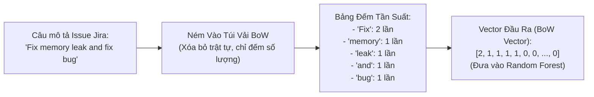
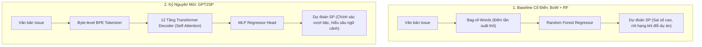

# 🧩 THUẬT NGỮ: BAG-OF-WORDS (BOW - TÚI TỪ PHI THỨ TỰ)

> **Mô hình túi chứa từ (Bag-of-Words - BoW)**  
> *Thuộc nhóm:* Xử Lý Ngôn Ngữ Tự Nhiên Truyền Thống (Traditional Natural Language Processing)  
> *Áp dụng trong:* Mô hình đối chứng cơ sở **BoW + RF** (Bag-of-Words kết hợp Random Forest) trong cả bài báo Deep-SE và **GPT2SP** (IEEE TSE 2023).

---

## 🧒 PHẦN 1: GIẢI THÍCH CHO ĐỨA TRẺ 10 TUỔI (THE 10-YEAR-OLD EXPLANATION)

Hãy tưởng tượng em có một trang truyện cổ tích rất hay, kể về một chú thỏ dũng cảm đánh bại con sói hung ác.

Bây giờ, em cầm kéo cắt rời từng từ trong câu chuyện ra thành hàng trăm mẩu giấy nhỏ: chữ `"thỏ"`, chữ `"sói"`, chữ `"đánh"`, chữ `"bại"`, chữ `"dũng cảm"`... Sau đó, em ném tất cả mớ giấy vụn đó vào **một chiếc túi vải (Bag)** rồi buộc túm miệng túi lại và lắc thật mạnh!

Khi mở túi ra:
* Mọi câu cú, ngữ pháp, trật tự trước sau của các từ đã bị xáo trộn lung tung, bay biến sạch sẽ!
* Điều duy nhất em có thể làm lúc này là **đếm xem trong túi có bao nhiêu mẩu giấy của mỗi từ**: có 3 chữ `"thỏ"`, có 1 chữ `"sói"`, có 1 chữ `"đánh"`, có 1 chữ `"bại"`.

Từ danh sách số lượng đếm được đó, một người đứng ngoài nhìn vào chỉ lờ mờ đoán được: *"À, câu chuyện này có vẻ liên quan đến loài thỏ và chó sói"*. Nhưng nếu ai đó hỏi: *"Thỏ đánh bại sói hay sói đánh bại thỏ?"*, chiếc túi vải sẽ hoàn toàn bó tay!

> 💡 **Định nghĩa bình dân:**  
> **Bag-of-Words (Túi từ)** là cách biến một đoạn văn bản thành một bảng đếm số lần xuất hiện của từng từ, nhưng ném bỏ hoàn toàn trật tự ngữ pháp và thứ tự trước sau, giống như ném tất cả các từ vào một chiếc bao tải rồi lắc đều.

---

## 🔍 PHẦN 2: BÓC TÁCH TỪNG TỪ NGỮ CHUYÊN NGÀNH (DECONSTRUCTING THE JARGON)

Thuật ngữ **Bag-of-Words (BoW)** mang tính hình tượng hóa rất cao:

| Thành tố | Gốc từ tiếng Anh | Ý nghĩa đời thường | Ý nghĩa trong Machine Learning & NLP | Khái niệm đối lập (Antonym) |
| :--- | :--- | :--- | :--- | :--- |
| **Bag** | *Bag* (chiếc bao tải, túi chứa) | Vật dụng đựng đồ đạc lộn xộn, không ngăn nắp. | Cấu trúc toán học dạng đa tập hợp (**Multiset**): chỉ quan tâm đến sự hiện diện và số lượng của phần tử, hoàn toàn bỏ qua thứ tự ($A \cup B = B \cup A$). | *Sequence / Ordered list* (chuỗi có thứ tự trước sau). |
| **Of Words** | *Of words* (chứa các từ ngữ) | Chứa các từ vựng. | Các đơn vị từ ngữ phân tách trong văn bản sau khi chuẩn hóa (tách từ, đưa về chữ thường). | *Characters / N-grams* (ký tự hoặc cụm từ liền kề). |
| **Count Vector** | *Vector đếm tần suất* | Bảng kê khai số lượng đồ vật. | Biểu diễn vector của một văn bản, trong đó mỗi chiều tương ứng với số lần xuất hiện của một từ trong từ điển. | *One-hot vector* (chỉ đánh dấu 0 hoặc 1). |

### Sơ đồ chuyển đổi từ văn bản Jira sang mô hình Túi Từ:

---

## 📊 PHẦN 3: TRỰC QUAN HÓA BẰNG BẢNG DỮ LIỆU (THE "AHA!" MOMENT)

Giả sử chúng ta có 3 User Story khác nhau trong dự án Jira, với kho từ vựng chung gồm 7 từ:  
`{bug, database, error, fix, no, server, urgent}`.

### Bảng ma trận dữ liệu Bag-of-Words (Term-Document Matrix):

| Văn bản gốc của Issue | `bug` | `database` | `error` | `fix` | `no` | `server` | `urgent` | Điểm Story Point thực tế |
| :--- | :---: | :---: | :---: | :---: | :---: | :---: | :---: | :---: |
| **Issue 1:** `"Urgent bug in database server"` | 1 | 1 | 0 | 0 | 0 | 1 | 1 | **$8.0$ SP** |
| **Issue 2:** `"Fix error in database"` | 0 | 1 | 1 | 1 | 0 | 0 | 0 | **$3.0$ SP** |
| **Issue 3:** `"No bug found in database"` | 1 | 1 | 0 | 0 | 1 | 0 | 0 | **$1.0$ SP** |
| **Issue 4:** `"Bug found, no fix in database"` | 1 | 1 | 0 | 1 | 1 | 0 | 0 | **$5.0$ SP** |

> 🎉 **Khoảnh khắc "Aha!":**  
> Hãy so sánh hai câu:  
> * Câu 1: `"No problem, server runs fine"` $\rightarrow$ Hệ thống hoàn hảo, $1$ SP!  
> * Câu 2: `"Server problem, no fine runs"` $\rightarrow$ Câu vô nghĩa hoặc chỉ sự cố kẹt hệ thống!  
> Cả hai câu đều có đúng tập hợp các từ như nhau. Mô hình Bag-of-Words sẽ biến cả hai thành **hai vector giống hệt nhau $100\%$**!  
> Đây chính là khoảnh khắc người ta nhận ra: **Một cỗ máy không biết ngữ pháp và thứ tự câu thì không thể nào hiểu được phần mềm thực sự đang gặp chuyện gì!**

---

## ⚡ PHẦN 4: THÁCH THỨC KỸ THUẬT & HẠN CHẾ CỦA BAG-OF-WORDS

Mô hình Bag-of-Words là giải pháp đơn giản nhất từ những năm 1950, nhưng bộc lộ 3 khuyết tật rất lớn trong phát triển phần mềm:

1. **Mất sạch ngữ cảnh và từ phủ định (Negation Blindness):**  
   Từ `"no"`, `"not"`, `"never"` đứng trước hay đứng sau một từ khác đều bị gom chung vào một túi. Một issue ghi *"Can not reproduce the memory leak"* (Không thể tái hiện lỗi) sẽ bị mô hình BoW nhận diện y như một issue *"Reproduce the memory leak"* (Tái hiện được lỗi), dẫn đến định giá độ khó sai hoàn toàn!
2. **Bùng nổ kích thước và ma trận siêu thưa (Sparsity Explosion):**  
   Từ điển các dự án Jira có thể lên tới $50.000$ từ. Mỗi issue chỉ dài khoảng 20–30 từ, đồng nghĩa với việc vector có tới $49.970$ số $0$. Điều này gây lãng phí bộ nhớ và làm mô hình máy học rất khó tìm quy luật.
3. **Mù tịt về quan hệ tương đồng (No Semantic Closeness):**  
   Trong BoW, từ `"purchase"` và từ `"buy"`, hay từ `"exception"` và từ `"crash"` là những chiều không gian vuông góc với nhau (khoảng cách góc 90 độ), không hề có mối dây liên kết ngữ nghĩa nào.

---

## 🚀 PHẦN 5: BOW + RANDOM FOREST BỊ ĐÁNH BẠI THẾ NÀO TRONG GPT2SP?

Trong bài báo **GPT2SP (Fu & Tantithamthavorn, TSE 2023)** và Deep-SE, baseline **BoW + Random Forest (BoW + RF)** đại diện cho phương pháp học máy truyền thống nguyên thủy nhất:

### So sánh kết quả thực nghiệm trong bài báo:
* **BoW + RF** đạt sai số MAE rất cao, xếp ở nhóm cuối cùng trong bảng xếp hạng thống kê Scott-Knott ESD. Mô hình chỉ đoán dựa vào một vài từ khóa đơn lẻ (như gặp chữ "database" thì tăng điểm, gặp "typo" thì giảm điểm) mà không hiểu bản chất luồng nghiệp vụ.
* **GPT2SP** đánh bại BoW + RF với mức giảm sai số MAE ngoạn mục (từ mức $2.5 - 3.2$ xuống xấp xỉ $1.7 - 2.0$), đồng thời nâng cao độ chính xác chuẩn hóa SA vượt trội trên cả 16 dự án mã nguồn mở.

---

## ⏱️ PHẦN 6: TỔNG KẾT 30 GIÂY (THE ELEVATOR PITCH)

* **Bản chất:** Bag-of-Words (BoW) là kỹ thuật biểu diễn văn bản cổ điển bằng cách đếm tần suất xuất hiện của từng từ trong từ điển và ném bỏ hoàn toàn cấu trúc ngữ pháp cùng thứ tự câu cú.
* **Điểm mạnh:** Đơn giản, trực quan, dễ lập trình và không tốn chi phí tính toán GPU.
* **Hạn chế & Vai trò trong bài báo:** Bị mù ngữ cảnh, không hiểu từ phủ định và ma trận vector cực kỳ thưa thớt. Baseline **BoW + Random Forest** trong bài báo GPT2SP là đại diện điển hình cho những hạn chế của phương pháp cũ, làm nổi bật sự vượt trội của kiến trúc Transformer.