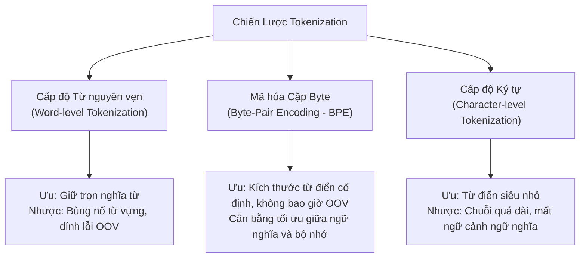
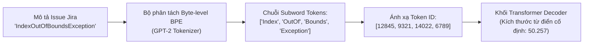

# 🧩 THUẬT NGỮ: BYTE-PAIR ENCODING (BPE)

> **Mã hóa cặp byte (Byte-Pair Encoding - BPE)**  
> *Thuộc nhóm:* Xử Lý Ngôn Ngữ Tự Nhiên & Tokenization (NLP & Tokenization)  
> *Áp dụng trong:* Mô hình ngôn ngữ GPT-2 và phương pháp ước lượng Story Point **GPT2SP** (IEEE TSE 2023).

---

## 🧒 PHẦN 1: GIẢI THÍCH CHO ĐỨA TRẺ 10 TUỔI (THE 10-YEAR-OLD EXPLANATION)

Hãy tưởng tượng em có một bộ đồ chơi xếp hình chữ cái để ghép thành các câu chuyện. 

Nếu em cố gắng đúc sẵn **từng từ trọn vẹn** trong từ điển thành một khối nhựa riêng (như từ *"người"*, *"chạy"*, *"trường học"*, hay những từ kỳ lạ như *"siêu-khổng-lồ-vô-địch"*), chiếc thùng đồ chơi của em sẽ nặng hàng tấn và chứa tới hàng triệu mảnh ghép khác nhau! Nguy hiểm hơn, nếu một ngày bạn em nghĩ ra một từ mới toanh chưa có trong thùng, em sẽ hoàn toàn bó tay, không biết làm sao để ghép được từ đó.

Ngược lại, nếu em chỉ giữ **từng chữ cái đơn lẻ** (a, b, c...), thùng đồ chơi rất nhẹ, nhưng để xếp một bức thư dài thì em phải tỉ mẩn ghép từng chữ cái một, vừa mỏi tay vừa rất dễ nhầm lẫn.

**Bác thợ thông minh BPE** nghĩ ra một mẹo kỳ diệu:
1. Ban đầu, bác chỉ giữ các chữ cái nhỏ nhất.
2. Bác quan sát xem **hai chữ cái nào hay đi liền cạnh nhau nhất** trong các cuốn sách (ví dụ: chữ `n` và chữ `g` hay đi cùng nhau thành `ng`).
3. Bác lấy keo dán dính hai chữ đó lại thành một **mảnh ghép mới**: `ng`.
4. Bác lặp lại việc này nhiều lần với các cặp phổ biến khác như `th`, `ch`, `học`.

> 💡 **Định nghĩa bình dân:**  
> **Byte-Pair Encoding (BPE)** là thuật toán "dán dính thông minh" các ký tự hay đi cùng nhau nhiều lần nhất để tạo ra một bộ từ vựng vừa vặn, không quá to làm chật bộ nhớ máy tính, nhưng cũng không quá nhỏ vụn vặt, giúp máy tính đọc hiểu bất kỳ từ ngữ nào mà không bao giờ gặp từ lạ.

---

## 🔍 PHẦN 2: BÓC TÁCH TỪNG TỪ NGỮ CHUYÊN NGÀNH (DECONSTRUCTING THE JARGON)

Tên gọi **Byte-Pair Encoding** được cấu thành từ ba thành tố kỹ thuật:

| Thành tố | Gốc từ tiếng Anh | Ý nghĩa đời thường | Ý nghĩa trong Machine Learning & NLP | Khái niệm đối lập (Antonym) |
| :--- | :--- | :--- | :--- | :--- |
| **Byte** | *Byte* (đơn vị 8-bit) | Đơn vị đo dung lượng lưu trữ trên máy tính. | Biểu diễn cấp độ thấp nhất của mọi ký tự văn bản (chuỗi byte UTF-8), cho phép xử lý mọi ngôn ngữ và ký tự đặc biệt. | *Word* (từ nguyên khối hoàn chỉnh). |
| **Pair** | *Pair* (cặp đôi) | Hai vật hoặc hai người đi liền cùng nhau. | Hai đơn vị ký tự hoặc hai mảnh từ con đứng cạnh nhau liên tiếp trong chuỗi văn bản. | *Single element* (phần tử đơn lẻ). |
| **Encoding** | *Encode* (mã hóa) | Đổi một thông điệp sang một dạng ký hiệu khác. | Quá trình gán một mã số nguyên duy nhất (Token ID) cho mỗi mảnh ghép để đưa vào mạng nơ-ron. | *Decoding* (giải mã vector thành văn bản). |

### Bảng phân tích chiết tự và so sánh chiến lược Tokenization:

---

## 📊 PHẦN 3: TRỰC QUAN HÓA BẰNG BẢNG DỮ LIỆU (THE "AHA!" MOMENT)

Giả sử chúng ta có một tập dữ liệu gồm 4 từ xuất hiện trong các báo cáo lỗi Jira với tần suất sau:
* `"low"` (xuất hiện 5 lần)
* `"lower"` (xuất hiện 2 lần)
* `"newest"` (xuất hiện 6 lần)
* `"widest"` (xuất hiện 3 lần)

### Bước 1: Khởi tạo ở cấp độ ký tự đơn
Thêm ký hiệu kết thúc từ `</w>` để phân định ranh giới từ:
* `l o w </w>` : 5
* `l o w e r </w>` : 2
* `n e w e s t </w>` : 6
* `w i d e s t </w>` : 3

*Từ điển ban đầu:* `{l, o, w, e, r, n, s, t, i, d, </w>}` (11 ký tự).

### Bước 2: Bảng đếm tần suất các cặp liền kề và thực hiện hợp nhất (Merge)

| Vòng lặp (Iteration) | Cặp ký tự liền kề xuất hiện nhiều nhất | Tổng tần suất | Mảnh ghép mới được tạo ra (Merged Token) | Tập từ vựng được mở rộng |
| :---: | :---: | :---: | :---: | :--- |
| **Vòng 1** | `('e', 's')` | $6 + 3 = 9$ lần | `es` | Thêm token `es` vào từ điển. |
| **Vòng 2** | `('es', 't')` | $6 + 3 = 9$ lần | `est` | Thêm token `est` vào từ điển. |
| **Vòng 3** | `('est', '</w>')` | $6 + 3 = 9$ lần | `est</w>` | Thêm token đuôi so sánh nhất `est</w>`. |
| **Vòng 4** | `('l', 'o')` | $5 + 2 = 7$ lần | `lo` | Thêm token `lo`. |
| **Vòng 5** | `('lo', 'w')` | $5 + 2 = 7$ lần | `low` | Thêm token `low`. |

> 🎉 **Khoảnh khắc "Aha!":**  
> Khi gặp một từ mới chưa từng xuất hiện trong tập huấn luyện như `"lowest"`:
> * Mô hình Deep-SE cũ sẽ báo lỗi không biết từ này và gán nhãn `<UNK>` (mù tịt).
> * Với BPE, thuật toán tự động tách thành hai mảnh ghép đã có trong từ điển: `["low", "est</w>"]`. Mô hình hiểu ngay lập tức nghĩa của từ này là *"thấp nhất"* dựa trên nghĩa của hai mảnh con!

---

## ⚡ PHẦN 4: THÁCH THỨC KỸ THUẬT & VÌ SAO CÁC PHƯƠNG PHÁP KHÁC BỊ HẠN CHẾ?

Trong bài toán ước lượng Story Point trước đây, mô hình **Deep-SE (Choetkiertikul et al., 2019)** sử dụng kỹ thuật phân tách ở cấp độ từ hoàn chỉnh (**Word-level Tokenization**) kết hợp với Word2Vec:

1. **Khủng hoảng bùng nổ không gian từ vựng (Vocabulary Explosion):**  
   Trong dữ liệu phần mềm, các lập trình viên thường đặt tên biến, tên hàm theo quy tắc lạc đà (`camelCase`) hoặc nối từ (`NullPointerException`, `HttpRequestHeaderParseException`). Deep-SE phải tạo một từ điển khổng lồ lên tới **185.625 từ duy nhất**, khiến ma trận trọng số phình to, tiêu tốn bộ nhớ RAM/VRAM và làm chậm tốc độ huấn luyện nghiêm trọng.
2. **Khủng hoảng từ ngoài từ điển (Out-Of-Vocabulary - OOV):**  
   Mỗi khi chuyển từ dự án này sang dự án khác (kịch bản Cross-Project), các thuật ngữ nghiệp vụ mới xuất hiện liên tục. Deep-SE buộc phải biến toàn bộ các từ này thành mã `<UNK>` (Unknown). Khi một mô tả issue có quá nhiều từ `<UNK>`, mô hình mất sạch ngữ cảnh và dự đoán Story Point hoàn toàn sai lệch.
3. **Chi phí huấn luyện cục bộ quá lớn:**  
   Do gắn chặt với từ vựng của từng dự án, Deep-SE tốn từ **2 đến 7 giờ** chỉ để huấn luyện lại bộ nhúng Word2Vec cho mỗi dự án mới, hoàn toàn không có tính tái sử dụng.

---

## 🚀 PHẦN 5: MÔ HÌNH GPT-2 & GPT2SP GIẢI QUYẾT VẤN ĐỀ NÀY NHƯ THẾ NÀO?

Bài báo GPT2SP (Fu & Tantithamthavorn, TSE 2023) tận dụng biến thể **Byte-level BPE** được thiết kế trong mô hình GPT-2:

1. **Biểu diễn ở cấp độ Byte (Byte-level):**  
   Thay vì bắt đầu từ bảng chữ cái Unicode với hơn 140.000 ký tự dễ gây loãng, BPE của GPT-2 xuất phát từ đúng **256 giá trị byte cơ bản** ($2^8 = 256$). Mọi ký tự văn bản, biểu tượng cảm xúc, đoạn mã code, dấu câu đều được cấu thành từ các byte này. Do đó, **tỷ lệ Out-Of-Vocabulary của GPT-2 bằng đúng 0%** — không bao giờ có bất kỳ chuỗi ký tự nào làm khó được mô hình.
2. **Kích thước từ điển được kiểm soát tối ưu:**  
   GPT-2 cố định kích thước từ điển ở mức **50.257 tokens**. Kích thước này vừa đủ để bao quát các từ tiếng Anh phổ thông nguyên vẹn, vừa chứa đủ các mảnh ghép subword để mô tả mọi thuật ngữ kỹ thuật phần mềm phức tạp.
3. **Hiệu quả vượt trội trong Cross-Project Estimation:**  
   Khi mang mô hình GPT2SP sang một dự án phần mềm hoàn toàn mới lạ, mô hình không cần huấn luyện lại từ vựng. Nó lập tức nhận diện được các mảnh ghép quen thuộc bên trong các tên hàm, biến số và biệt ngữ mới để suy luận nỗ lực chính xác.

---

## ⏱️ PHẦN 6: TỔNG KẾT 30 GIÂY (THE ELEVATOR PITCH)

* **Bản chất:** BPE là thuật toán nén và phân rã văn bản thông minh, ghép các ký tự hoặc byte hay xuất hiện cạnh nhau thành các mảnh từ con (*subwords*).
* **Điểm đột phá:** Xóa bỏ hoàn toàn lỗi từ ngoài từ điển (`OOV = 0%`), khống chế kích thước bộ từ vựng cố định ở mức 50.257 tokens, không bị bùng nổ bộ nhớ như Deep-SE (185.625 từ).
* **Giá trị trong GPT2SP:** Giúp mô hình đọc hiểu hoàn hảo các đoạn mã nguồn, tên lỗi kỹ thuật ghép phức tạp và chuyển giao tri thức mượt mà giữa các dự án phần mềm khác nhau mà không cần huấn luyện lại từ điển.