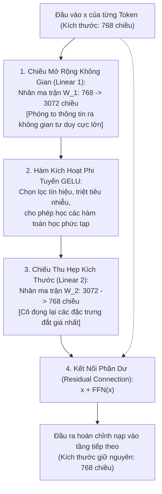

# 🧩 THUẬT NGỮ: FEED-FORWARD NEURAL NETWORK (FFN - MẠNG NƠ-RON TRUYỀN THẲNG)

> **Mạng nơ-ron truyền thẳng (Position-wise Feed-Forward Neural Network - FFN)**  
> *Thuộc nhóm:* Kiến Trúc Học Sâu & Transformers (Deep Learning & Transformers)  
> *Áp dụng trong:* Mỗi khối giải mã Transformer Decoder trong **GPT-2** và **GPT2SP** (IEEE TSE 2023).

---

## 🧒 PHẦN 1: GIẢI THÍCH CHO ĐỨA TRẺ 10 TUỔI (THE 10-YEAR-OLD EXPLANATION)

Hãy tưởng tượng trong một buổi học nhóm làm bài tập lớn:
1. **Bước 1 (Thảo luận nhóm - Self-Attention):** Tất cả các bạn học sinh ngồi lại với nhau, nhìn bài của nhau, trao đổi và chia sẻ manh mối (bạn phụ trách môn Sử chia sẻ dữ liệu với bạn phụ trách môn Địa).
2. **Bước 2 (Tự suy ngẫm độc lập - Feed-Forward Network):** Sau khi nghe ngóng xong thông tin từ cả nhóm, mỗi bạn học sinh **quay về bàn riêng của mình, đóng cửa phòng lại và tự suy ngẫm sâu sắc trong đầu**. Không ai nói chuyện với ai nữa, mỗi người tự tiêu hóa mớ kiến thức vừa thu thập được để rút ra kết luận riêng cho phần việc của mình.

Trong mỗi tầng của mô hình Transformer, mạng nơ-ron **FFN** chính là khoảng thời gian "tự suy ngẫm độc lập" đó:
* Nó nhận thông tin từ cơ chế chú ý (Attention).
* Nó "phóng to" thông tin ra một không gian tư duy rộng hơn gấp 4 lần để nghiền ngẫm chi tiết.
* Sau đó, nó cô đọng lại kiến thức quý giá nhất để sẵn sàng cho vòng thảo luận tiếp theo.

Và điều kỳ diệu là: dòng thông tin chỉ chảy một mạch **từ trước ra sau (truyền thẳng)**, không hề quay đầu hay chạy vòng vo!

> 💡 **Định nghĩa bình dân:**  
> **Feed-Forward Neural Network (Mạng truyền thẳng)** là mạng nơ-ron đơn giản và mạnh mẽ nhất, nơi thông tin chỉ đi thẳng theo một chiều từ đầu vào qua các tầng ẩn rồi ra đầu ra, giúp từng từ ngữ tự suy ngẫm và biến đổi kiến thức độc lập sau khi đã trao đổi với các từ khác.

---

## 🔍 PHẦN 2: BÓC TÁCH TỪNG TỪ NGỮ CHUYÊN NGÀNH (DECONSTRUCTING THE JARGON)

Thuật ngữ **Feed-Forward Neural Network** gồm ba thành tố kỹ thuật:

| Thành tố | Gốc từ tiếng Anh | Ý nghĩa đời thường | Ý nghĩa trong Kiến trúc Học Sâu | Khái niệm đối lập (Antonym) |
| :--- | :--- | :--- | :--- | :--- |
| **Feed** | *Feed* (nuôi, nạp vào) | Cung cấp thức ăn hoặc nhiên liệu. | Nạp dữ liệu đầu vào (tín hiệu vector) vào các nơ-ron. | *Starve / Idle* (trạng thái rỗng). |
| **Forward** | *Forward* (tiến về phía trước) | Đi thẳng một mạch, không lùi lại. | Đồ thị luồng tính toán là đồ thị có hướng không có chu trình (DAG: Directed Acyclic Graph), thông tin chỉ đi từ tầng $l$ sang tầng $l+1$. | **Recurrent (Hồi quy, lặp vòng tuần tự như RNN/LSTM).** |
| **Position-wise** | *Position-wise* (từng vị trí riêng rẽ) | Làm việc riêng cho từng người tại chỗ ngồi của họ. | Khối FFN áp dụng độc lập và giống hệt nhau lên từng token tại mỗi bước vị trí trong câu mà không bị pha tạp. | *Cross-position / Attention* (liên kết chéo giữa các vị trí khác nhau). |

### Công thức toán học của khối FFN trong Transformer (Vaswani et al., 2017):

$$
\text{FFN}(x) = \text{GELU}(x W_1 + b_1) W_2 + b_2
$$

Trong đó:
* $W_1 \in \mathbb{R}^{d_{model} \times d_{ff}}$: Ma trận mở rộng chiều (trong GPT-2 Small: $768 \rightarrow 3072$, mở rộng gấp 4 lần).
* $b_1 \in \mathbb{R}^{3072}$: Vector điều chỉnh (bias).
* $\text{GELU}$: Hàm kích hoạt phi tuyến tính.
* $W_2 \in \mathbb{R}^{d_{ff} \times d_{model}}$: Ma trận nén chiều trở về kích thước ban đầu ($3072 \rightarrow 768$).
* $b_2 \in \mathbb{R}^{768}$: Vector điều chỉnh tầng hai.

---

## 📊 PHẦN 3: TRỰC QUAN HÓA BẰNG BẢNG DỮ LIỆU & SƠ ĐỒ (THE "AHA!" MOMENT)

### Tại sao phải "Mở rộng 4 lần ($768 \rightarrow 3072$) rồi Nén lại ($3072 \rightarrow 768$)"?

| Giai đoạn chuyển đổi | Kích thước vector | Hành động thực tế của nơ-ron | Ẩn dụ đời sống |
| :--- | :---: | :--- | :--- |
| **Ban đầu ($x$)** | $768$ | Vector biểu diễn ngắn gọn của token sau tầng Attention. | Một chiếc cặp tài liệu được khóa kín. |
| **Mở rộng ($W_1$)** | **$3.072$** | Tách nhỏ các thuộc tính ngữ nghĩa thành hàng ngàn đặc trưng độc lập: đặc trưng cú pháp, đặc trưng logic, độ khẩn cấp, loại module phần mềm. | Mở tung chiếc cặp ra, bày tất cả giấy tờ lên một chiếc bàn họp rộng thênh thang để kiểm tra từng tờ một. |
| **Kích hoạt ($\text{GELU}$)** | $3.072$ | Tắt các nơ-ron không liên quan, chỉ kích hoạt các mẫu tri thức cốt lõi. | Đánh dấu bút dạ quang vào các dòng chữ then chốt. |
| **Nén lại ($W_2$)** | **$768$** | Tổng hợp các dòng chữ dạ quang trở lại thành một bản ghi nhớ tóm tắt sắc bén có cùng kích cỡ chuẩn $768$. | Đóng cặp tài liệu lại, sẵn sàng mang sang phòng ban tiếp theo. |

> 🎉 **Khoảnh khắc "Aha!":**  
> Nếu không có tầng mở rộng $3072$ chiều này, mô hình chỉ có thể thực hiện các phép xoay vector đơn giản trong không gian 768 chiều chật chội. Nhờ có "chiếc bàn họp" rộng gấp 4 lần, FFN trở thành **kho lưu trữ tri thức tĩnh (Key-Value Memory)** khổng lồ của mô hình ngôn ngữ!

---

## ⚡ PHẦN 4: THÁCH THỨC KỸ THUẬT & PHÂN BIỆT VỚI MẠNG HỒI QUY (RNN)

Trong các mô hình trước đây như **Deep-SE (LSTM + RHWN)**:
* Quá trình suy nghĩ bị ràng buộc vào cấu trúc lặp tuần tự qua thời gian ($h_t = f(h_{t-1}, x_t)$). Mỗi bước thời gian vừa phải lo trao đổi thông tin với quá khứ, vừa phải biến đổi phi tuyến tính, dẫn đến **rất khó huấn luyện sâu**.
* **Khác biệt cốt lõi của FFN trong Transformer:**  
  Transformer tách bạch rạch ròi 2 nhiệm vụ:
  1. Nhiệm vụ giao tiếp giữa các từ: giao hoàn toàn cho **Multi-Head Attention**.
  2. Nhiệm vụ biến đổi phi tuyến tính và trích xuất tri thức: giao hoàn toàn cho **FFN**.  
  Sự phân công lao động hoàn hảo này giúp FFN hoàn toàn không có trạng thái nhớ vòng lặp, chạy song song $100\%$ trên GPU với tốc độ cực đại!

---

## 🚀 PHẦN 5: FFN TRONG MÔ HÌNH GPT-2 VÀ GPT2SP

Trong kiến trúc **GPT2SP (Fu & Tantithamthavorn, TSE 2023)**:
* Có tổng cộng **12 khối Transformer Decoder**, đồng nghĩa với việc có **12 tầng FFN** xếp chồng nối tiếp nhau.
* **Số lượng tham số áp đảo:**  
  Trong mỗi khối Transformer, tầng FFN chiếm tới **gần 66% tổng số tham số** của cả khối! Cụ thể:
  $$\text{Params}_{\text{FFN}} = (768 \times 3072 + 3072) + (3072 \times 768 + 768) \approx 4.72 \text{ triệu tham số / tầng}$$
  Nhân với 12 tầng, riêng các khối FFN đóng góp hơn **56 triệu tham số** trong tổng số 117 triệu tham số của GPT-2 Small.
* **Vai trò trong ước lượng Story Point:**  
  Các tầng FFN đóng vai trò như một bách khoa toàn thư đã ghi nhớ mối liên hệ ngầm giữa các cấu trúc phần mềm và độ phức tạp công việc. Sau khi tầng Attention thu thập ngữ cảnh của issue Jira, FFN "tiêu hóa" ngữ cảnh đó để định hình độ khó kỹ thuật trước khi đẩy sang tầng tiếp theo.

---

## ⏱️ PHẦN 6: TỔNG KẾT 30 GIÂY (THE ELEVATOR PITCH)

* **Bản chất:** Feed-Forward Neural Network (FFN) là mạng nơ-ron truyền thẳng hai tầng kết hợp kích hoạt GeLU, hoạt động độc lập trên từng vị trí token sau lớp Attention.
* **Cơ chế:** Phóng to vector từ 768 lên 3072 chiều để nghiền ngẫm tri thức phi tuyến tính sâu sắc, sau đó nén trở lại 768 chiều.
* **Giá trị trong GPT2SP:** Chiếm 2/3 tổng số tham số của mô hình GPT-2, đóng vai trò là "bộ nhớ tri thức" chắt lọc thông tin độ khó từ văn bản Jira để phục vụ việc ước lượng nỗ lực chuẩn xác.