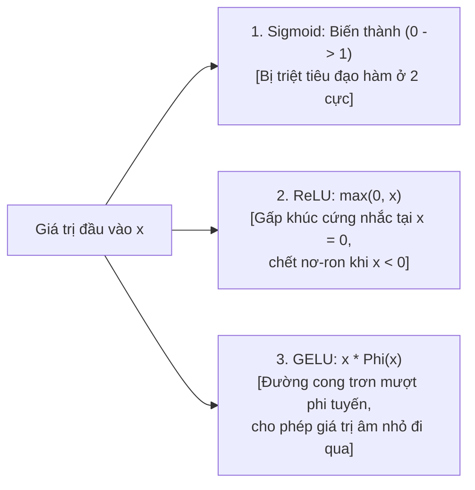

# 🧩 THUẬT NGỮ: GELU (GAUSSIAN ERROR LINEAR UNIT - HÀM KÍCH HOẠT PHÂN PHỐI GAUSS)

> **Hàm kích hoạt Gauss (Gaussian Error Linear Unit - GELU)**  
> *Thuộc nhóm:* Toán Học Học Sâu & Hàm Kích Hoạt Phi Tuyến (Deep Learning Math & Activation Functions)  
> *Áp dụng trong:* Toàn bộ các khối FFN của mô hình **GPT-2** và **GPT2SP** (IEEE TSE 2023), cũng như BERT và RoBERTa.

---

## 🧒 PHẦN 1: GIẢI THÍCH CHO ĐỨA TRẺ 10 TUỔI (THE 10-YEAR-OLD EXPLANATION)

Hãy tưởng tượng một người bảo vệ đứng ở cửa rạp chiếu phim để soát vé:

1. **Người bảo vệ khó tính cổ điển (Hàm ReLU):**  
   Bác này có một quy tắc sắt đá: Bất kỳ ai có vé (giá trị dương $x > 0$) thì cho đi qua nguyên vẹn; còn ai không có vé (giá trị âm $x \le 0$) thì bác lập tức chặt đứt ngang cổ, đuổi thẳng về nhà và biến thành số $0$ tròn trĩnh! Quy tắc này quá cứng nhắc, đôi khi có những người mang giấy tờ ưu tiên hoặc chỉ hơi thiếu một chút giấy tờ thì cũng bị bác "trảm" không thương tiếc (gây ra hiện tượng nơ-ron chết).
2. **Người bảo vệ thông minh, thấu tình đạt lý (Bác GELU):**  
   Bác GELU không chặt đứt cứng nhắc như vậy. Bác đưa ra một **xác suất may mắn**:
   * Nếu giá trị của em rất lớn và tích cực, bác gần như chắc chắn $100\%$ cho em đi qua trọn vẹn.
   * Nếu giá trị của em hơi âm một chút, bác không đuổi ngay mà vẫn cho em một **cơ hội nhỏ** được lọt qua khe cửa.
   * Càng âm nặng, cơ hội được đi qua càng teo nhỏ lại một cách mượt mà và êm ái.

Nhờ sự mềm mại và uyển chuyển này, dòng chảy thông tin trong bộ não máy tính diễn ra trơn tru, không có nơ-ron nào bị "đột tử" giữa đường!

> 💡 **Định nghĩa bình dân:**  
> **GELU** là hàm kích hoạt toán học thông minh, quyết định cho một con số đi qua dựa trên xác suất của phân phối hình chuông Gauss: số càng lớn thì càng dễ qua trọn vẹn, số âm nhẹ thì vẫn được giữ lại một phần nhỏ mượt mà thay vì bị chặt cụt thành số 0 như các hàm cũ.

---

## 🔍 PHẦN 2: BÓC TÁCH TỪNG TỪ NGỮ CHUYÊN NGÀNH (DECONSTRUCTING THE JARGON)

Tên gọi **Gaussian Error Linear Unit (GELU)** được đặt bởi Dan Hendrycks và Kevin Gimpel (2016):

| Thành tố | Gốc từ tiếng Anh | Ý nghĩa đời thường | Ý nghĩa trong Toán học & Machine Learning | Khái niệm đối lập (Antonym) |
| :--- | :--- | :--- | :--- | :--- |
| **Gaussian** | *Carl Friedrich Gauss* | Tên nhà toán học thiên tài người Đức. | Phân phối xác suất chuẩn hình quả chuông quen thuộc (**Normal Distribution** $\mathcal{N}(0, 1)$). | *Uniform / Discrete* (phân phối đều, rời rạc). |
| **Error (Function)** | *Error Function* (Hàm sai số $\text{erf}$) | Sự nhầm lẫn, sai số. | Hàm toán học tích phân đường cong Gauss: $\text{erf}(x) = \frac{2}{\sqrt{\pi}}\int_{0}^{x} e^{-t^2} dt$. | *Linear equation* (phương trình đường thẳng). |
| **Linear Unit** | *Đơn vị tuyến tính* | Đường thẳng $y = x$. | Tín hiệu đầu ra giữ nguyên tỷ lệ thuận với đầu vào khi được cho phép đi qua. | *Step function* (hàm bước nhảy gián đoạn). |

### Công thức toán học định nghĩa GELU:

$$
\text{GELU}(x) = x \cdot \Phi(x) = x \cdot P(X \le x) \quad \text{với } X \sim \mathcal{N}(0, 1)
$$

Trong đó $\Phi(x)$ là hàm phân phối tích lũy (CDF) của phân phối chuẩn tắc. Trong thực tế lập trình máy tính để tăng tốc độ tính toán, người ta dùng công thức xấp xỉ siêu nhanh (như trong GPT-2):

$$
\text{GELU}(x) \approx 0.5x \left(1 + \tanh\left(\sqrt{\frac{2}{\pi}} \left(x + 0.044715 x^3\right)\right)\right)
$$

---

## 📊 PHẦN 3: TRỰC QUAN HÓA BẰNG BẢNG DỮ LIỆU & ĐỒ THỊ (THE "AHA!" MOMENT)

Hãy so sánh phản ứng của 3 hàm kích hoạt phổ biến khi nhận các giá trị đầu vào khác nhau:

### Bảng đối chiếu giá trị đầu ra giữa ReLU và GELU:

| Giá trị đầu vào ($x$) | Hàm ReLU: $\max(0, x)$ | Xác suất tích lũy $\Phi(x)$ | Hàm GELU: $x \cdot \Phi(x)$ | Hành vi khác biệt cốt lõi |
| :---: | :---: | :---: | :---: | :--- |
| **$+3.0$** | $+3.0$ | $0.9987$ | **$+2.996$** | Giá trị dương lớn: Cả hai đều cho đi qua gần như nguyên vẹn. |
| **$+1.0$** | $+1.0$ | $0.8413$ | **$+0.841$** | Dương vừa phải: GELU giảm nhẹ một chút theo xác suất. |
| **$0.0$** | $0.0$ | $0.5000$ | **$0.000$** | Tại điểm gốc tọa độ: Cả hai đều bằng 0. |
| **$-0.5$** | **$0.0$ (Bị chặt cụt)** | $0.3085$ | **$-0.154$** | ⭐ **Khác biệt! GELU vẫn cho tín hiệu âm nhỏ sống sót!** |
| **$-1.0$** | **$0.0$ (Bị chặt cụt)** | $0.1587$ | **$-0.158$** | Điểm cực tiểu trơn mượt của đường cong GELU. |
| **$-3.0$** | $0.0$ | $0.0013$ | **$-0.004$** | Âm quá sâu: GELU tiệm cận mượt về 0. |

> 🎉 **Khoảnh khắc "Aha!":**  
> Đồ thị của ReLU bị **gãy gập đột ngột một góc nhọn 90 độ** ngay tại $x = 0$, khiến đạo hàm tại điểm đó không xác định và biến toàn bộ miền âm thành "vùng đất chết" có đạo hàm bằng 0.  
> Trong khi đó, đồ thị của GELU là một **đường cong trơn lượn sóng hoàn hảo, khả vi trên toàn trục số thực**! Đạo hàm không bao giờ bị cắt đột ngột, giúp quá trình lan truyền ngược cập nhật trọng số êm ái hơn bao giờ hết!

---

## ⚡ PHẦN 4: THÁCH THỨC KỸ THUẬT & VÌ SAO RELU GÂY LỖI "CHẾT NƠ-RON"?

Trong các mạng nơ-ron học sâu trước đây:
1. **Thảm họa nơ-ron chết (Dying ReLU Problem):**  
   Nếu một nơ-ron lỡ nhận trọng số khiến đầu vào bị âm sâu, đầu ra ReLU sẽ bằng $0$ và đạo hàm bằng $0$. Từ thời điểm đó trở đi, nơ-ron này vĩnh viễn không bao giờ được cập nhật trọng số nữa — nó trở thành một "nơ-ron xác sống" ăn bám bộ nhớ mà không đóng góp được gì cho việc học.
2. **Sự kết hợp giữa kích hoạt xác suất và điều chuẩn:**  
   GELU được lấy cảm hứng trực tiếp từ kỹ thuật **Dropout**: thay vì ngẫu nhiên tắt nơ-ron bằng phân phối nhị thức Bernoulli một cách nhân tạo, GELU nhúng thẳng tính chất bất định ngẫu nhiên này vào chính hàm toán học của nơ-ron thông qua phân phối chuẩn Gauss.

---

## 🚀 PHẦN 5: GELU TRONG GPT-2 VÀ MÔ HÌNH HỌC SÂU GPT2SP

Trong kiến trúc của bài báo **GPT2SP (Fu & Tantithamthavorn, TSE 2023)**:
* GELU là **hàm kích hoạt duy nhất** được dùng bên trong tất cả 12 khối Transformer Decoder (tại tầng FFN mở rộng $768 \rightarrow 3072$).
* Đồng thời, trong chính **MLP Regressor Head** được gắn ở tầng cuối cùng để dự đoán điểm Story Point, hàm GELU cũng được sử dụng giữa hai tầng tuyến tính ($768 \rightarrow 256 \rightarrow 1$).

### Ưu thế thực nghiệm trong bài toán Agile Story Point:
* Dữ liệu mô tả User Story trên Jira rất đa dạng và có nhiều yếu tố nhiễu. Sự mượt mà của hàm GELU giúp GPT2SP không bị phản ứng thái quá trước các từ ngữ bất thường, hỗ trợ quá trình tối ưu hóa với hàm mất mát **L1 Loss** hội tụ nhanh và ổn định hơn nhiều so với việc dùng ReLU truyền thống.

---

## ⏱️ PHẦN 6: TỔNG KẾT 30 GIÂY (THE ELEVATOR PITCH)

* **Bản chất:** GELU là hàm kích hoạt phi tuyến tính trơn mượt, điều tiết tín hiệu đầu vào theo xác suất phân phối chuẩn Gauss: $y = x \cdot \Phi(x)$.
* **Điểm đột phá:** Loại bỏ hoàn toàn nhược điểm "chết nơ-ron" và điểm gãy nhọn của ReLU, mang lại tính khả vi liên tục trên toàn bộ không gian số học.
* **Giá trị trong GPT2SP:** Là mắt xích quan trọng giúp 12 tầng Transformer và đầu hồi quy MLP của GPT2SP học được các hàm quan hệ phức tạp giữa nội dung công việc và điểm nỗ lực Story Point một cách trơn tru, không bị kẹt cục bộ.