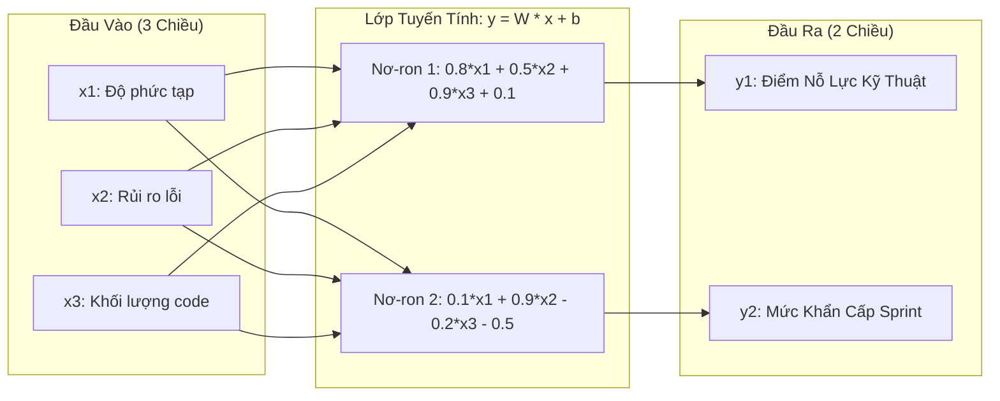

# 🧩 THUẬT NGỮ: LINEAR LAYERS (LỚP TUYẾN TÍNH / TẦNG KẾT NỐI ĐẦY ĐỦ)

> **Lớp tuyến tính / Tầng kết nối đầy đủ (Linear Layers / Fully Connected / Dense Layer)**  
> *Thuộc nhóm:* Kiến Trúc Học Sâu Nền Tảng (Core Deep Learning Architecture)  
> *Áp dụng trong:* Mọi thành phần của **GPT-2**, **GPT2SP** (chiếu Q, K, V, FFN, MLP Regressor Head) và **Deep-SE**.

---

## 🧒 PHẦN 1: GIẢI THÍCH CHO ĐỨA TRẺ 10 TUỔI (THE 10-YEAR-OLD EXPLANATION)

Hãy tưởng tượng em có một chiếc máy trộn sinh tố kỳ diệu có 3 cái phễu đầu vào và 2 cái vòi rót nước đầu ra:
* 3 cái phễu đầu vào nhận: **táo**, **chuối**, và **dâu tây** (đây là các con số dữ liệu đầu vào $x_1, x_2, x_3$).
* Chiếc vòi rót thứ nhất muốn tạo ra món *"Sinh tố ngọt ngào"*: Nó quyết định lấy $2$ quả chuối, cộng thêm $1$ quả dâu tây, và không lấy quả táo nào.
* Chiếc vòi rót thứ hai muốn tạo ra món *"Sinh tố chua thanh mát"*: Nó lấy $3$ quả táo, $2$ quả dâu tây, và bớt đi $1$ quả chuối.
* Cuối cùng, ở mỗi vòi, người đầu bếp cho thêm một thìa đường nhỏ cố định (gọi là số gia *bias* $b$).

Toàn bộ quá trình trộn các nguyên liệu theo tỷ lệ định sẵn bằng phép nhân và phép cộng đơn giản đó chính là **Lớp Tuyến Tính (Linear Layer)**! 

Mỗi chiếc vòi rót nước là một "nơ-ron". Nó chìa tay ra **kết nối với tất cả mọi nguyên liệu ở đầu vào**, cân đo đong đếm xem nguyên liệu nào quan trọng hơn để tạo ra hương vị mới ở đầu ra.

> 💡 **Định nghĩa bình dân:**  
> **Linear Layer (Lớp tuyến tính)** là khối gạch cơ bản nhất của mạng nơ-ron, thực hiện phép nhân ma trận trọng số và cộng số lệch ($y = Wx + b$) để biến đổi một dãy số này thành một dãy số khác theo kích thước mong muốn.

---

## 🔍 PHẦN 2: BÓC TÁCH TỪNG TỪ NGỮ CHUYÊN NGÀNH (DECONSTRUCTING THE JARGON)

Thuật ngữ **Linear Layer** mang đậm tính chất đại số tuyến tính:

| Thành tố | Gốc từ tiếng Anh | Ý nghĩa đời thường | Ý nghĩa trong Toán học & Machine Learning | Khái niệm đối lập (Antonym) |
| :--- | :--- | :--- | :--- | :--- |
| **Linear** | *Line* (đường thẳng) | Thẳng tắp, không bị cong queo gấp khúc. | Phép toán chỉ gồm **phép nhân hằng số và phép cộng**: thỏa mãn tính chất $f(u + v) = f(u) + f(v)$ và $f(cu) = c f(u)$. | **Non-linear (Phi tuyến tính, hàm cong như GeLU, ReLU).** |
| **Layer** | *Layer* (lớp, tầng) | Một tầng trong tòa nhà hoặc một lớp bánh kem. | Một cụm các nơ-ron nhân tạo hoạt động song song tại cùng một độ sâu trong mạng. | *Network / System* (toàn bộ mạng tổng thể). |
| **Fully Connected (FC)** | *Kết nối đầy đủ* | Ai cũng quen biết và bắt tay với tất cả mọi người. | Mọi nơ-ron ở tầng đầu vào đều có dây liên kết trọng số với **toàn bộ mọi nơ-ron** ở tầng đầu ra. | *Locally connected / Sparse* (kết nối cục bộ như CNN). |

### Công thức toán học đại số chuẩn mực:

$$
\mathbf{y} = \mathbf{x} \mathbf{W}^T + \mathbf{b}
$$

Trong đó:
* $\mathbf{x} \in \mathbb{R}^{d_{in}}$: Vector đầu vào có chiều dài $d_{in}$.
* $\mathbf{W} \in \mathbb{R}^{d_{out} \times d_{in}}$: Ma trận trọng số (Weight Matrix) — nơi lưu trữ toàn bộ các hệ số nhân được học.
* $\mathbf{b} \in \mathbb{R}^{d_{out}}$: Vector điều chỉnh độ lệch (Bias Vector) — cho phép đường thẳng dịch chuyển tự do trong không gian.
* $\mathbf{y} \in \mathbb{R}^{d_{out}}$: Vector đầu ra có chiều dài mới $d_{out}$.

---

## 📊 PHẦN 3: TRỰC QUAN HÓA BẰNG BẢNG DỮ LIỆU & MA TRẬN (THE "AHA!" MOMENT)

Hãy xem cách một Lớp Tuyến Tính biến đổi một vector ngữ nghĩa từ **3 chiều thành 2 chiều**:

### Bảng tính toán từng con số cụ thể trong ma trận:

Cho đầu vào của một Issue Jira: $\mathbf{x} = [3.0, 1.0, 4.0]$ (Độ phức tạp = 3, Rủi ro = 1, Khối lượng = 4).

| Nơ-ron đích | Phép nhân trọng số từng phần tử ($x \cdot w$) | Cộng tổng | Cộng độ lệch bias ($b$) | Kết quả đầu ra ($y$) |
| :---: | :--- | :---: | :---: | :---: |
| **Nơ-ron 1 (Nỗ lực)** | $3.0 \times 0.8 + 1.0 \times 0.5 + 4.0 \times 0.9 = 2.4 + 0.5 + 3.6$ | $6.5$ | $+0.1$ | **$\mathbf{6.6}$** |
| **Nơ-ron 2 (Khẩn cấp)** | $3.0 \times 0.1 + 1.0 \times 0.9 + 4.0 \times (-0.2) = 0.3 + 0.9 - 0.8$ | $0.4$ | $-0.5$ | **$\mathbf{-0.1}$** |

> 🎉 **Khoảnh khắc "Aha!":**  
> Chỉ bằng một phép nhân ma trận đơn giản, lớp tuyến tính đóng hai vai trò thần kỳ:
> 1. **Đổi chiều kích thước tự do:** Từ 3 chiều biến thành 2 chiều (hoặc trong GPT-2: từ $768 \rightarrow 3072$, hay từ $256 \rightarrow 1$).
> 2. **Hòa trộn thông tin:** Mỗi chiều đầu ra là một sự kết hợp khéo léo của tất cả các chiều đầu vào theo các tỷ lệ trọng số được máy tính tự học!

---

## ⚡ PHẦN 4: THÁCH THỨC KỸ THUẬT & GIỚI HẠN NẾU CHỈ CÓ TUYẾN TÍNH

Một định lý toán học nổi tiếng đã chỉ ra rằng:  
**Hai lớp tuyến tính xếp chồng lên nhau liên tiếp thì cũng chỉ tương đương với đúng MỘT lớp tuyến tính duy nhất!**

$$
y = W_2 (W_1 x + b_1) + b_2 = (W_2 W_1) x + (W_2 b_1 + b_2) = W_{\text{mới}} x + b_{\text{mới}}
$$

* Nếu chỉ xếp chồng hàng chục lớp tuyến tính mà không có hàm kích hoạt phi tuyến (như GeLU), toàn bộ mạng nơ-ron dù sâu bao nhiêu tầng cũng chỉ là một **bộ hồi quy tuyến tính đơn giản**, hoàn toàn bó tay trước các bài toán logic phức tạp như bài toán XOR hay ngữ nghĩa ngôn ngữ tự nhiên.
* Do đó, trong kiến trúc học sâu, **Lớp Tuyến Tính luôn phải đi kèm với một hàm kích hoạt phi tuyến tính** ngay phía sau!

---

## 🚀 PHẦN 5: CÁC LỚP TUYẾN TÍNH NẰM Ở ĐÂU TRONG GPT2SP?

Trong mô hình **GPT2SP (Fu & Tantithamthavorn, TSE 2023)**, các lớp tuyến tính xuất hiện ở khắp mọi nơi:

1. **Các lớp chiếu Query, Key, Value trong Multi-Head Attention:**  
   3 lớp tuyến tính độc lập biến đổi vector đầu vào 768 chiều thành các không gian truy vấn $Q$, chìa khóa $K$, và giá trị $V$:
   $$W_Q, W_K, W_V \in \mathbb{R}^{768 \times 768}$$
2. **Lớp tuyến tính chiếu đầu ra Attention:**  
   Chiếu hợp nhất thông tin từ 12 đầu chú ý: $W_O \in \mathbb{R}^{768 \times 768}$.
3. **Hai lớp tuyến tính trong khối FFN:**  
   * Lớp mở rộng: $W_1 \in \mathbb{R}^{768 \times 3072}$.
   * Lớp nén: $W_2 \in \mathbb{R}^{3072 \times 768}$.
4. **Hai lớp tuyến tính trong MLP Regressor Head (Đầu hồi quy Story Point):**  
   * Lớp ẩn: biến đổi từ $768 \rightarrow 256$ chiều (kết hợp kích hoạt GeLU).
   * Lớp xuất điểm: biến đổi từ $256 \rightarrow 1$ chiều (xuất ra điểm số Story Point duy nhất).

---

## ⏱️ PHẦN 6: TỔNG KẾT 30 GIÂY (THE ELEVATOR PITCH)

* **Bản chất:** Linear Layer (Lớp tuyến tính) là phép biến đổi toán học $y = Wx + b$, thực hiện phép chiếu không gian từ số chiều này sang số chiều khác.
* **Cơ chế:** Kết nối mọi nơ-ron đầu vào với mọi nơ-ron đầu ra, hòa trộn các đặc trưng thông qua các trọng số học được.
* **Giá trị trong GPT2SP:** Là thành phần xây dựng nền móng xuất hiện ở mọi ngóc ngách: từ việc tạo ma trận Attention, mở rộng tri thức trong FFN, cho đến bước cuối cùng biến đổi vector 256 chiều thành con số Story Point ước lượng.