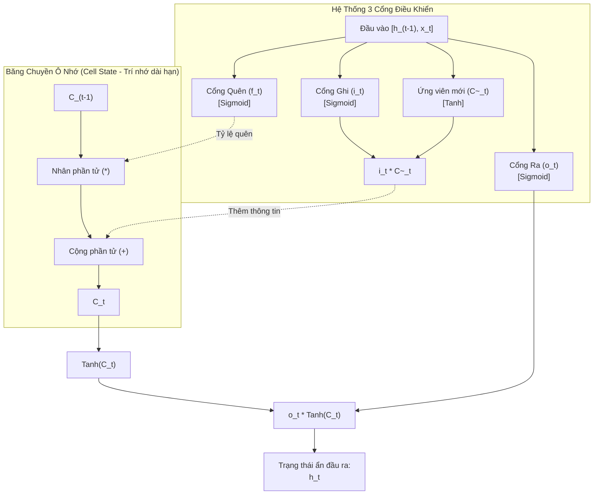

# 🧩 THUẬT NGỮ: LSTM (LONG SHORT-TERM MEMORY - MẠNG BỘ NHỚ DÀI-NGẮN)

> **Mạng bộ nhớ dài-ngắn (Long Short-Term Memory - LSTM)**  
> *Thuộc nhóm:* Kiến Trúc Học Sâu & Mạng Nơ-ron Hồi Quy (Deep Learning & RNNs)  
> *Áp dụng trong:* Mô hình học sâu **Deep-SE** (Choetkiertikul et al., 2019) và là đối chứng nền tảng được thay thế bởi Transformer trong **GPT2SP** (IEEE TSE 2023).

---

## 🧒 PHẦN 1: GIẢI THÍCH CHO ĐỨA TRẺ 10 TUỔI (THE 10-YEAR-OLD EXPLANATION)

Hãy tưởng tượng em là một người thủ kho canh giữ một kho báu khổng lồ. 

Mỗi buổi sáng thức dậy, em nhận được một lá thư báo cáo công việc rất dài. Trong lá thư đó có hàng trăm sự kiện diễn ra nối tiếp nhau theo thời gian: sự kiện lúc 8 giờ sáng, lúc 9 giờ, lúc 10 giờ... đến tận đêm khuya.

Nếu em dùng một bộ não bình thường (như mạng nơ-ron hồi quy RNN cổ điển), khi đọc đến dòng thứ 50 thì đầu em đã bắt đầu bị lẫn lộn, và đến dòng thứ 100 thì em hoàn toàn **quên sạch** những gì người ta đã viết ở dòng thứ nhất! 

Để chữa căn bệnh hay quên tai hại đó, bác thủ kho thông minh trang bị cho mình **một cuốn sổ tay thần kỳ** có tên là **LSTM**. Cuốn sổ tay này có **3 người trợ lý gác cổng vô cùng mẫn cán**:
1. **Người gác cổng Xóa bỏ (Forget Gate):** Xem lại những ghi chú cũ từ hôm qua, nếu có chi tiết nào đã lỗi thời hoặc vô ích (như chuyện *"sáng nay trời mưa"*), người này cầm cục tẩy xóa sạch đi để đỡ chật chỗ.
2. **Người gác cổng Ghi nhận (Input Gate):** Đọc tin tức mới vừa gửi tới lúc này, phát hiện ra chi tiết nào cực kỳ quan trọng (như *"hệ thống máy chủ bị mất điện"*), người này liền lấy bút ghi nạp thêm vào cuốn sổ tay.
3. **Người gác cổng Báo cáo (Output Gate):** Khi ông chủ hỏi tình hình hiện tại thế nào, người này chỉ chọn lọc những thông tin đắt giá nhất trong sổ tay để báo cáo tóm tắt, chứ không đọc liến thoắng toàn bộ mọi chuyện vụn vặt.

Nhờ cuốn sổ tay và 3 người gác cổng này, bác thủ kho có thể nhớ được những sự kiện quan trọng xảy ra từ rất lâu trước đó mà đầu óc không bao giờ bị quá tải!

> 💡 **Định nghĩa bình dân:**  
> **LSTM (Bộ nhớ dài-ngắn)** là loại mạng nơ-ron thông minh có khả năng ghi nhớ thông tin quan trọng xuyên suốt một thời gian rất dài nhờ cơ chế đóng-mở 3 cánh cổng: cổng quên chuyện cũ vô ích, cổng ghi nhớ chuyện mới quan trọng, và cổng báo cáo thông tin cần thiết.

---

## 🔍 PHẦN 2: BÓC TÁCH TỪNG TỪ NGỮ CHUYÊN NGÀNH (DECONSTRUCTING THE JARGON)

Tên gọi **Long Short-Term Memory** nghe như một sự mâu thuẫn hài hước (Vừa Dài - *Long*, lại vừa Ngắn hạn - *Short-Term*):

| Thành tố | Gốc từ tiếng Anh | Ý nghĩa đời thường | Ý nghĩa trong Khoa học Nhận thức & ML | Khái niệm đối lập (Antonym) |
| :--- | :--- | :--- | :--- | :--- |
| **Short-Term Memory** | *Trí nhớ ngắn hạn* | Khả năng giữ thông tin tạm thời trong đầu (như nhớ số điện thoại vừa đọc để bấm máy). | Trạng thái ẩn tức thời ($h_t$) của mạng nơ-ron hồi quy, liên tục thay đổi qua từng bước thời gian. | *Long-Term Memory* (trí nhớ dài hạn vĩnh viễn lưu trong trọng số mô hình $W$). |
| **Long** | *Kéo dài, bền bỉ* | Trải qua một quãng thời gian dài mà không biến mất. | Cơ chế đường dẫn băng chuyền thông tin trạng thái ô nhớ (**Cell State** $C_t$), giúp thông tin ngắn hạn có thể tồn tại **bền bỉ qua hàng trăm bước thời gian**. | *Vanishing / Fading* (tiêu biến, lãng quên nhanh chóng). |

### Bảng phân tích 3 cánh cổng điều khiển và 1 ô nhớ cốt lõi của LSTM (Hochreiter & Schmidhuber, 1997):

| Thành phần kiến trúc | Ký hiệu toán học | Hàm kích hoạt sử dụng | Nhiệm vụ kỹ thuật cốt lõi | Ý nghĩa trực giác |
| :--- | :---: | :---: | :--- | :--- |
| **Cổng Quên (Forget Gate)** | $f_t$ | $\sigma$ (Sigmoid: $0 \rightarrow 1$) | Quyết định tỷ lệ phần trăm thông tin cũ trong trạng thái ô nhớ $C_{t-1}$ cần giữ lại hay vứt bỏ. | $0$: Quên sạch, $1$: Nhớ toàn bộ. |
| **Cổng Ghi Nhận (Input Gate)** | $i_t$ | $\sigma$ (Sigmoid) | Quyết định những giá trị mới nào sẽ được phép cập nhật vào ô nhớ. | Lọc ra các dữ kiện mới quan trọng. |
| **Ứng Viên Trạng Thái Mới** | $\tilde{C}_t$ | $\tanh$ (Giá trị: $-1 \rightarrow +1$) | Tạo ra một vector thông tin mới từ đầu vào hiện tại $x_t$ và trạng thái ẩn $h_{t-1}$. | Bản nháp thông tin mới trước khi ghi vào sổ. |
| **Băng Chuyền Ô Nhớ (Cell State)** | $C_t$ | Tuyến tính: $C_t = f_t \odot C_{t-1} + i_t \odot \tilde{C}_t$ | Lưu trữ ký ức xuyên suốt chiều dài chuỗi, gradient truyền thẳng tắp mà không bị suy giảm. | Cuốn sổ cái lưu trữ thông tin cốt lõi. |
| **Cổng Đầu Ra (Output Gate)** | $o_t$ | $\sigma$ (Sigmoid) | Lọc trạng thái ô nhớ $C_t$ qua hàm $\tanh$ để sinh ra trạng thái ẩn đầu ra $h_t$. | Bản tóm tắt để báo cáo cho tầng tiếp theo. |

---

## 📊 PHẦN 3: TRỰC QUAN HÓA BẰNG BẢNG DỮ LIỆU & SƠ ĐỒ (THE "AHA!" MOMENT)

### Mô phỏng luồng thông tin khi LSTM đọc một issue Jira gồm 4 từ:

**Câu tiêu đề Jira:** `"Urgent: Fix authentication bypass vulnerability"`

| Bước $t$ | Từ nạp vào ($x_t$) | Trạng thái Cổng Quên $f_t$ | Trạng thái Cổng Ghi $i_t$ | Ô nhớ $C_t$ lưu giữ điều gì? | Trạng thái ẩn $h_t$ phát tín hiệu |
| :---: | :--- | :--- | :--- | :--- | :--- |
| **1** | `Urgent` | $1.0$ (Mở toang) | **$0.95$ (Ghi mạnh)** | Ghi nhận tính khẩn cấp cao độ. | Phát tín hiệu: *"Nhiệm vụ có độ ưu tiên tối khẩn!"* |
| **2** | `Fix` | $0.90$ (Giữ nguyên) | $0.80$ (Ghi thêm) | Tích hợp thêm hành động sửa đổi mã nguồn. | Phát tín hiệu: *"Đây là tác vụ can thiệp sửa lỗi."* |
| **3** | `authentication` | $0.95$ (Giữ nguyên) | **$0.98$ (Ghi mạnh)** | Bổ sung lĩnh vực: cơ chế xác thực danh tính. | Phát tín hiệu: *"Liên quan đến thành phần bảo mật cốt lõi."* |
| **4** | `vulnerability` | $0.90$ (Giữ nguyên) | **$0.99$ (Ghi mạnh)** | Xác lập bản chất: lỗ hổng bảo mật nghiêm trọng. | **Vector cuối cùng $h_4$**: Tổng hợp đầy đủ độ nghiêm trọng và độ khó cao! |

> 🎉 **Khoảnh khắc "Aha!":**  
> Hãy nhìn đường dây $C_t$ chạy ngang qua trên đỉnh: Phép toán cốt lõi cập nhật ô nhớ là **phép cộng tuyến tính** ($+$). Trong giải tích, đạo hàm của phép cộng bằng đúng $1$!  
> Nhờ đạo hàm không bị co lại theo cấp số nhân như hàm tanh của mạng RNN cũ, thông tin từ từ `Urgent` ở bước 1 truyền thẳng đến bước 4 mà **không hề bị biến mất đạo hàm (vanishing gradient)**!

---

## ⚡ PHẦN 4: THÁCH THỨC KỸ THUẬT & HẠN CHẾ CỐT LÕI CỦA LSTM

Mặc dù giải quyết được vấn đề triệt tiêu đạo hàm tốt hơn RNN truyền thống, mô hình **Deep-SE (dựa trên LSTM)** vẫn vấp phải hai rào cản chí mạng:

1. **Nghẽn cổ chai tính toán tuần tự (Sequential Bottleneck):**  
   Bản chất của LSTM là xử lý bước $t$ phải phụ thuộc trực tiếp vào trạng thái ẩn của bước $t-1$:
   $$h_t = \text{LSTM}(h_{t-1}, x_t)$$
   Điều này khiến máy tính **không thể tính toán song song** trên hàng ngàn lõi của GPU. Nếu một mô tả issue dài 500 từ, GPU bắt buộc phải chờ 500 vòng lặp tuần tự diễn ra nối tiếp nhau, làm tốc độ huấn luyện chậm chạp vô cùng.
2. **Nghẽn cổ chai dung lượng thông tin (Information Bottleneck):**  
   Mọi thông tin của một đoạn văn bản dài dằng dặc cuối cùng đều bị ép buộc phải nén vào một vector $h_T$ có kích thước cố định (ví dụ $d = 200$). Dù LSTM có cổng nhớ tốt đến đâu, khi chuỗi vượt quá 100–200 từ, thông tin ở các bước đầu tiên vẫn bị mờ nhạt dần trước các từ xuất hiện ở cuối câu.

---

## 🚀 PHẦN 5: GPT2SP THAY THẾ LSTM BẰNG TRANSFORMER NHƯ THẾ NÀO?

Bài báo **GPT2SP (Fu & Tantithamthavorn, 2023)** chứng minh sự vượt trội toàn diện khi thay thế LSTM của Deep-SE bằng các khối **Transformer Decoder**:

| Tiêu chí kỹ thuật | Mạng LSTM trong Deep-SE | Kiến trúc Transformer trong GPT2SP |
| :--- | :--- | :--- |
| **Khả năng song song hóa** | ❌ Xử lý tuần tự từng từ một theo thời gian ($O(N)$). | ⭐ **Xử lý song song toàn bộ chuỗi cùng một lúc ($O(1)$) trên GPU.** |
| **Độ dài đường dẫn thông tin** | Phải đi qua $N$ bước lặp trung gian ($O(N)$). | Cơ chế **Self-Attention** kết nối trực tiếp mọi cặp từ ($O(1)$). |
| **Hiện tượng quên ngữ cảnh** | Vẫn xảy ra khi chuỗi văn bản issue quá dài. | **Không bao giờ quên**, mọi từ trong quá khứ đều được chú ý trực tiếp. |
| **Khả năng mở rộng tham số** | Khó huấn luyện mô hình sâu trên vài triệu tham số. | Huấn luyện ổn định trên **117 triệu tham số** (GPT-2 Small). |

Nhờ loại bỏ cấu trúc tuần tự của LSTM, GPT2SP không chỉ giảm thiểu sai số dự đoán Story Point (đạt MAE thấp hơn đáng kể) mà còn rút ngắn thời gian huấn luyện và tổng quát hóa tốt hơn gấp nhiều lần.

---

## ⏱️ PHẦN 6: TỔNG KẾT 30 GIÂY (THE ELEVATOR PITCH)

* **Bản chất:** LSTM là kiến trúc mạng nơ-ron hồi quy có cấu trúc ô nhớ chuyên biệt và 3 cổng kiểm soát (cổng quên, cổng ghi, cổng ra) nhằm lưu trữ thông tin tuần tự qua thời gian.
* **Điểm đột phá:** Chữa khỏi căn bệnh "quên sạch quá khứ" (triệt tiêu đạo hàm) của mạng RNN cổ điển, cho phép Deep-SE học được ngữ cảnh chuỗi của các câu mô tả issue Jira.
* **Hạn chế & Thay thế:** Bị nghẽn cổ chai tuần tự không thể chạy song song và vẫn bị suy giảm trí nhớ khi văn bản dài. Trong GPT2SP, LSTM được thay thế hoàn toàn bằng cơ chế Multi-Head Self-Attention của Transformer.