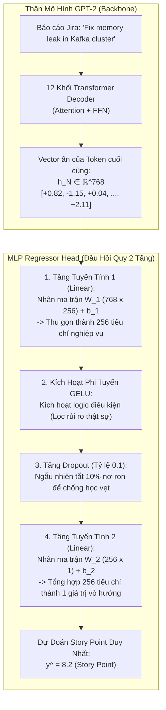
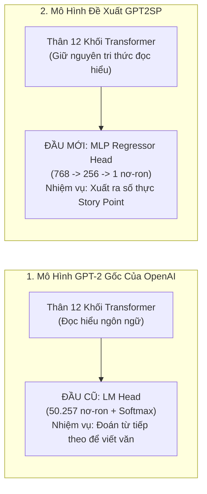

# 🧩 THUẬT NGỮ: MLP REGRESSOR HEAD (ĐẦU HỒI QUY ĐA TẦNG DỰ ĐOÁN STORY POINT)

> **Đầu hồi quy Perceptron đa tầng (MLP Regressor Head)**  
> *Thuộc nhóm:* Kiến Trúc Học Sâu & Đầu Dự Đoán Chuyên Biệt (Specialized Prediction Heads)  
> *Áp dụng trong:* Thành phần cốt lõi được gắn vào đỉnh mô hình ngôn ngữ GPT-2 để tạo nên **GPT2SP** (IEEE TSE 2023).

---

## 🧒 PHẦN 1: GIẢI THÍCH TRỰC QUAN — BẢN CHẤT NÓ LÀ GÌ VÀ DÙNG ĐỂ LÀM GÌ?

Để hiểu tại sao cần **MLP Regressor Head**, hãy nhìn vào mâu thuẫn lớn nhất giữa **Mô hình GPT-2** và **Đội ngũ lập trình viên Agile**:

```text
[Báo cáo Jira] ───> [12 Khối GPT-2 đọc hiểu] ───> Cho ra 1 dãy 768 con số thực (Vector h_N)
                                                                 │
                                                                 ▼
                                                  Đội Scrum nhìn vào và hỏi:
                                      "768 con số này nghĩa là gì? Cuối cùng là task này
                                          tốn bao nhiêu Story Point? 3 SP hay 8 SP?"
```

### 1. Vấn đề: GPT-2 chỉ biết "hiểu chữ", không biết "chấm điểm dự án"
* Sau khi đọc xong câu mô tả lỗi trên Jira (ví dụ: *"Fix memory leak in Kafka cluster"*), bộ não GPT-2 chỉ có thể gom toàn bộ ngữ nghĩa của câu thành một dãy gồm **768 con số tọa độ** (gọi là vector $\mathbf{h}_N \in \mathbb{R}^{768}$, ví dụ: `[+0.82, -1.15, +0.04, ..., +2.11]`).
* Dãy 768 con số này chỉ mô tả: từ nào đi với từ nào, câu này nói về chủ đề gì. Bản thân GPT-2 **hoàn toàn không biết 768 con số đó tương ứng với bao nhiêu ngày công hay bao nhiêu Story Point!**

### 2. Giải pháp: MLP Regressor Head là "Hội đồng thẩm định quy đổi điểm"
Hãy tưởng tượng **MLP Regressor Head** như một **Bác Tech Lead kỳ cựu** cầm trên tay một bảng tiêu chuẩn quy đổi:
1. **Bước 1 — Gom nhóm thành các tiêu chí đánh giá (Tầng Tuyến Tính 1: $768 \rightarrow 256$):**  
   Bác Tech Lead không xem xét rời rạc 768 con số kỹ thuật vụn vặt. Bác gom chúng lại thành **256 tiêu chí nghiệp vụ thực tế**:
   * Tiêu chí 1: Mức độ rủi ro sập hệ thống (cao hay thấp?).
   * Tiêu chí 2: Khối lượng mã nguồn dự kiến phải sửa (nhiều hay ít?).
   * Tiêu chí 3: Độ bất định của công nghệ (đã quen thuộc hay mới toanh?).
   * ... cho đến tiêu chí thứ 256.
2. **Bước 2 — Phán đoán điều kiện phi tuyến (Hàm GeLU):**  
   Bác xem xét các điều kiện kết hợp:  
   *Nếu* gặp lỗi nghiêm trọng (`Exception`) *nhưng* chỉ là sửa lỗi chính tả trong câu thông báo (`typo in message`), thì không được tính điểm cao!  
   Chỉ khi nào lỗi nghiêm trọng *kết hợp với* hệ thống phức tạp (`Kafka cluster`) thì mới kích hoạt mức điểm tối đa.
3. **Bước 3 — Xuất ra con số chốt hạ duy nhất (Tầng Tuyến Tính 2: $256 \rightarrow 1$):**  
   Bác cộng gộp tất cả 256 tiêu chí đó lại thành **đúng 1 con số thực duy nhất trên màn hình**:  
   👉 **`8.0 Story Points`**.

> 💡 **Định nghĩa ngắn gọn & bản chất nhất:**  
> **MLP Regressor Head** là một mạng nơ-ron nhỏ gồm 2 tầng được "gắn thêm" vào trên đỉnh của GPT-2, có nhiệm vụ duy nhất: **biến đổi vector 768 con số ngữ nghĩa trừu tượng thành đúng 1 con số thực đại diện cho điểm Story Point**.

---

## 🔍 PHẦN 2: BÓC TÁCH CHI TIẾT TỪNG TỪ NGỮ (DECONSTRUCTING THE JARGON)

Tên gọi **MLP Regressor Head** mô tả chính xác cấu trúc và chức năng:

| Thành tố | Ý nghĩa kỹ thuật chính xác | Vì sao lại dùng trong bài toán này? | Khái niệm đối lập |
| :--- | :--- | :--- | :--- |
| **Head (Đầu)** | Khối nơ-ron độc lập được gắn vào đỉnh của một mô hình nền tảng (Backbone). | GPT-2 đóng vai trò là "thân hình" (Backbone) chuyên trích xuất đặc trưng ngôn ngữ. Muốn giải quyết bài toán nào thì chỉ cần "lắp cái đầu" phù hợp cho bài toán đó. | **Backbone (Thân mô hình nền tảng gồm 12 khối Transformer).** |
| **Regressor (Bộ hồi quy)** | Bộ phận dự đoán một **giá trị số thực liên tục** ($y \in \mathbb{R}$, ví dụ: $1.5, 3.2, 8.0$ SP). | Story Point trong bài toán này được mô hình hóa dưới dạng số thực liên tục phản ánh mức độ nỗ lực. | **Classifier (Bộ phân loại nhãn rời rạc: ví dụ đoán Bug hay Feature).** |
| **MLP (Multi-Layer Perceptron)** | Mạng nơ-ron nhiều tầng (gồm ít nhất 1 tầng ẩn trung gian và hàm kích hoạt phi tuyến). | Giúp mô hình học được các tương tác điều kiện phức tạp giữa các từ, thay vì chỉ làm phép cộng tuyến tính đơn giản. | **Linear Head / Single-layer (chỉ có 1 phép nhân ma trận đơn giản không có tầng ẩn).** |

---

## 📊 PHẦN 3: BẢN CHẤT CƠ CHẾ HOẠT ĐỘNG — ĐI QUA TỪNG CON SỐ CỤ THỂ

Hãy theo dõi đường đi của dữ liệu từ khi kết thúc khối Transformer thứ 12 cho đến khi ra con số Story Point cuối cùng:



### Bảng theo dõi kích thước ma trận (Tensor Dimensions) qua từng bước:

| Bước | Thành phần thực thi | Kích thước dữ liệu vào | Phép toán thực hiện | Kích thước dữ liệu ra | Ý nghĩa ngữ nghĩa đạt được |
| :---: | :--- | :---: | :--- | :---: | :--- |
| **Đầu vào** | Token cuối cùng $\mathbf{h}_N$ | $1 \times 768$ | Lấy vector trạng thái ẩn tại token cuối của Khối 12. | $1 \times 768$ | Bản đúc kết ngữ nghĩa của toàn bộ issue Jira. |
| **Bước 1** | Tầng Tuyến tính 1 (`fc1`) | $1 \times 768$ | $\mathbf{z}_1 = \mathbf{h}_N \cdot W_1 + b_1$ với $W_1 \in \mathbb{R}^{768 \times 256}$ | **$1 \times 256$** | Quy đổi 768 đặc trưng ngôn ngữ thành 256 tiêu chí nghiệp vụ phần mềm. |
| **Bước 2** | Hàm phi tuyến GELU | $1 \times 256$ | $\mathbf{a}_1 = \text{GELU}(\mathbf{z}_1)$ | $1 \times 256$ | Bật/tắt các nơ-ron theo logic điều kiện thực tế. |
| **Bước 3** | Lớp Dropout | $1 \times 256$ | Tắt ngẫu nhiên $10\%$ nơ-ron khi huấn luyện. | $1 \times 256$ | Chống quá khớp (overfitting) trên tập dữ liệu nhỏ. |
| **Bước 4** | Tầng Tuyến tính 2 (`fc2`) | $1 \times 256$ | $\hat{y} = \mathbf{a}_1 \cdot W_2 + b_2$ với $W_2 \in \mathbb{R}^{256 \times 1}$ | **$1 \times 1$ (Số thực)** | Tổng hợp thành đúng **một con số Story Point duy nhất**. |

---

## ⚡ PHẦN 4: VÌ SAO PHẢI LÀ "MLP" (2 TẦNG) MÀ KHÔNG DÙNG 1 TẦNG TUYẾN TÍNH ĐƠN GIẢN?

Nhiều người sẽ hỏi: *Tại sao không chiếu thẳng từ $768 \rightarrow 1$ cho nhanh, việc gì phải qua tầng trung gian $256$ làm cho phức tạp?*

Đây chính là điểm khác biệt sống còn giữa **học máy ngây thơ** và **học sâu thực chiến**:

### 1. Phép chiếu 1 tầng ($768 \rightarrow 1$) chỉ học được phép cộng đơn giản
Nếu chiếu thẳng $768 \rightarrow 1$, công thức dự đoán chỉ là một hàm tuyến tính:
$$\text{Story Point} = w_1 h_1 + w_2 h_2 + \dots + w_{768} h_{768} + b$$
Điều này đồng nghĩa với việc:
* Mỗi khi từ `"Exception"` xuất hiện, nó luôn luôn **cộng cố định $+3$ điểm**.
* Mỗi khi từ `"typo"` xuất hiện, nó luôn luôn **trừ cố định $-2$ điểm**.

### 2. Nhưng thực tế phần mềm có tính "Tương tác điều kiện" (Non-linear Interaction)
Hãy xem hai User Story thực tế trong Jira:
* **Task A:** `"Fix typo in NullPointerException message"` (Sửa lỗi chính tả trong câu thông báo lỗi).  
  $\rightarrow$ Công việc này chỉ mất 15 phút, điểm nỗ lực thực tế chỉ là **$1$ Story Point**.
* **Task B:** `"Fix concurrent NullPointerException in distributed cache"` (Sửa lỗi con trỏ rỗng do xung đột đa luồng trong bộ nhớ đệm phân tán).  
  $\rightarrow$ Công việc này cực khó, có thể mất 2 tuần điều tra, điểm nỗ lực thực tế là **$13$ Story Points**.

> 💥 **Hạn chế của 1 tầng tuyến tính:**  
> Ở cả hai task, từ `"NullPointerException"` đều xuất hiện! Mô hình 1 tầng bắt buộc phải cộng một lượng điểm như nhau cho cả Task A và Task B, dẫn đến dự đoán sai lệch hoàn toàn!

>  **Sức mạnh của MLP (2 tầng + GELU):**  
> Tầng ẩn 256 nơ-ron hoạt động như các **cổng logic điều kiện**:  
> Nó học được quy luật: *"NẾU có từ NullPointerException NHƯNG đi kèm với từ typo $\rightarrow$ Không kích hoạt nơ-ron phức tạp. NẾU đi kèm với distributed $\rightarrow$ Kích hoạt tối đa!"*.  
> Điều này chỉ có thể làm được nhờ có tầng trung gian $256$ kết hợp hàm phi tuyến GELU!

---

## 🔄 PHẦN 5: CƠ CHẾ "THÁO ĐẦU CŨ, LẮP ĐẦU MỚI" TRONG GPT2SP

Để biến mô hình GPT-2 của OpenAI thành công cụ ước lượng Story Point, các tác giả (Fu & Tantithamthavorn, TSE 2023) đã thực hiện kỹ thuật **Transfer Learning (Học chuyển giao)**:



### So sánh trực quan giữa Đầu cũ và Đầu mới:

| Đặc tính kỹ thuật | Đầu gốc của GPT-2 (LM Head) | Đầu mới trong GPT2SP (MLP Regressor Head) |
| :--- | :--- | :--- |
| **Mục tiêu bài toán** | Sinh văn bản tự nhiên (Text Generation). | **Ước lượng nỗ lực phần mềm (Effort Estimation).** |
| **Dạng kết quả đầu ra** | Xác suất phân phối trên **$50.257$ từ vựng**. | **Đúng $1$ con số thực vô hướng duy nhất** (ví dụ: $5.2$ SP). |
| **Hàm kích hoạt cuối cùng** | $\text{Softmax}$ (tổng xác suất bằng 100%). | **Tuyến tính không giới hạn** (Linear). |
| **Hàm mất mát huấn luyện** | Cross-Entropy Loss (đo độ hỗn loạn từ ngữ). | **L1 Loss (Mean Absolute Error):** $|y_{\text{thực tế}} - \hat{y}|$. |

---

## ⏱️ PHẦN 6: TỔNG KẾT 30 GIÂY (THE ELEVATOR PITCH)

* **Nó là gì?** MLP Regressor Head là mạng nơ-ron hồi quy hai tầng ($768 \rightarrow 256 \rightarrow 1$) gắn trên đỉnh mô hình GPT-2.
* **Bản chất nó dùng để làm gì?** Nó đóng vai trò là "chiếc máy phiên dịch", nhận vector 768 con số ngữ nghĩa trừu tượng từ token cuối cùng của GPT-2 và quy đổi thành đúng **một con số thực duy nhất biểu thị điểm Story Point**.
* **Tại sao không dùng 1 tầng?** Vì tầng ẩn $256$ kết hợp hàm phi tuyến GELU cho phép mô hình học được các tương tác điều kiện phức tạp của kỹ nghệ phần mềm (phân biệt giữa lỗi nghiêm trọng thật sự và lỗi nhỏ kèm theo), mang lại độ chính xác vượt trội.