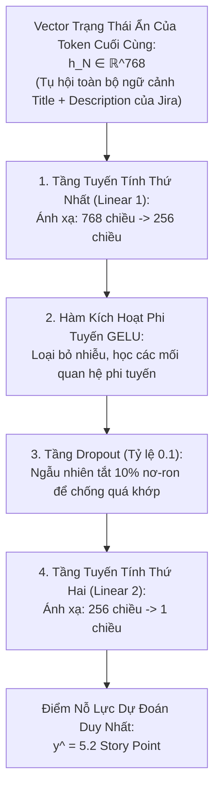

# 🧩 THUẬT NGỮ: MLP REGRESSOR HEAD (ĐẦU HỒI QUY ĐA TẦNG CỦA GPT2SP)

> **Đầu hồi quy Perceptron đa tầng (MLP Regressor Head)**  
> *Thuộc nhóm:* Kiến Trúc Học Sâu & Đầu Dự Đoán Chuyên Biệt (Specialized Neural Prediction Heads)  
> *Áp dụng trong:* Thành phần cốt lõi được gắn vào đỉnh mô hình GPT-2 để tạo nên **GPT2SP** (IEEE TSE 2023).

---

## 🧒 PHẦN 1: GIẢI THÍCH CHO ĐỨA TRẺ 10 TUỔI (THE 10-YEAR-OLD EXPLANATION)

Hãy tưởng tượng một chú robot thám tử tên là **GPT-2**:
* Nguyên bản của chú robot này được chế tạo để làm một việc: **"Kể chuyện nối tiếp"** (Language Modeling). Mỗi khi đọc được một câu chuyện, chú robot nhìn vào một danh bạ khổng lồ chứa 50.257 từ vựng, rồi đoán xem từ tiếp theo nên được viết là từ gì.

Nhưng trong cuộc thi ước lượng độ khó phần mềm (**Agile Story Point**), chúng ta không cần chú robot viết thêm truyện cổ tích! Chúng ta cần chú trả lời một câu hỏi duy nhất:  
*"Bản báo cáo lỗi này khó đến mức nào? Cần bao nhiêu điểm nỗ lực Story Point?"*

Để làm được điều đó, các kỹ sư đã làm một cuộc "phẫu thuật lắp ghép" tài tình:
1. Họ tháo bỏ cái "đầu loa phát thanh 50.257 từ" (Language Modeling Head qua Softmax) ra khỏi người chú robot.
2. Họ gắn vào đó một cái đầu mới tinh xảo tên là **MLP Regressor Head**:
   * Cái đầu này nhận toàn bộ suy nghĩ sâu sắc nhất đọng lại trong mắt chú robot sau khi đọc xong chữ cuối cùng của bản báo cáo.
   * Nó suy nghĩ qua hai tầng lọc nơ-ron (chuyển từ 768 ý niệm sâu xa xuống 256 đặc trưng cô đọng).
   * Và cuối cùng, nó xuất ra đúng **một con số thực duy nhất trên màn hình hiển thị**: *"Độ khó là 5.2 điểm Story Point!"*

> 💡 **Định nghĩa bình dân:**  
> **MLP Regressor Head (Đầu hồi quy đa tầng)** là bộ phận nơ-ron chuyên biệt gồm 2 tầng tuyến tính và hàm kích hoạt phi tuyến, được gắn vào đỉnh mô hình ngôn ngữ GPT-2 để thay thế nhiệm vụ sinh chữ bằng nhiệm vụ tính toán điểm số Story Point liên tục.

---

## 🔍 PHẦN 2: BÓC TÁCH TỪNG TỪ NGỮ CHUYÊN NGÀNH (DECONSTRUCTING THE JARGON)

Thuật ngữ **MLP Regressor Head** được cấu thành từ 3 cụm từ kỹ thuật:

| Thành tố | Gốc từ tiếng Anh | Ý nghĩa đời thường | Ý nghĩa trong Kiến trúc Học Sâu | Khái niệm đối lập (Antonym) |
| :--- | :--- | :--- | :--- | :--- |
| **MLP** | *Multi-Layer Perceptron* | Mạng nơ-ron nhiều tầng. | Kiến trúc mạng nơ-ron truyền thẳng gồm ít nhất một tầng ẩn (Hidden Layer) nằm giữa tầng đầu vào và tầng đầu ra. | *Single-layer Perceptron / Linear model* (mô hình 1 tầng không có lớp ẩn). |
| **Regressor** | *Regression* (hồi quy) | Dự đoán số đo liên tục. | Bộ phận dự đoán một giá trị số thực trên trục số vô hạn ($\hat{y} \in \mathbb{R}$) thay vì chọn một nhãn lớp rời rạc. | *Classifier* (bộ phân loại xác suất nhãn lớp). |
| **Head** | *Head* (cái đầu, phần đỉnh) | Phần chóp đỉnh của cơ thể. | Khối nơ-ron chuyên biệt phục vụ tác vụ hạ nguồn (Downstream Task), được gắn vào tầng trên cùng của mô hình nền tảng (Backbone). | *Backbone / Body* (phần thân nền tảng 12 khối Transformer). |

---

## 📊 PHẦN 3: TRỰC QUAN HÓA BẰNG BẢNG DỮ LIỆU & SƠ ĐỒ (THE "AHA!" MOMENT)

Kiến trúc chi tiết của **MLP Regressor Head** được tích hợp vào khối Decoder thứ 12 của GPT-2:

### So sánh giữa Đầu Sinh Ngôn Ngữ Gốc (LM Head) và Đầu Hồi Quy GPT2SP (MLP Head):

| Tiêu chí kỹ thuật | LM Head (GPT-2 Gốc của OpenAI) | MLP Regressor Head (GPT2SP của Fu et al.) |
| :--- | :--- | :--- |
| **Mục đích sử dụng** | Sinh từ tiếp theo trong văn bản tự nhiên. | **Ước lượng điểm Story Point trong Agile.** |
| **Số chiều đầu ra** | **$50.257$ chiều** (kích thước từ vựng BPE). | **Đúng $1$ chiều duy nhất (Scalar float).** |
| **Hàm kích hoạt cuối cùng** | $\text{Softmax}$ (tổng xác suất các từ bằng $1$). | **Tuyến tính không giới hạn** (Linear Activation). |
| **Hàm mất mát huấn luyện** | Cross-Entropy Loss (Độ hỗn loạn ngôn ngữ). | **L1 Loss (Mean Absolute Error Loss):** $\sum \|y - \hat{y}\|$. |

> 🎉 **Khoảnh khắc "Aha!":**  
> Tại sao lại lấy vector của **Token Cuối Cùng ($\mathbf{h}_N$)** mà không lấy trung bình cộng tất cả các token?  
> Vì trong cơ chế Masked Causal Attention của GPT-2, token đầu tiên chỉ nhìn thấy chính nó, token thứ hai nhìn thấy từ số 1 và số 2... Nhưng **chỉ duy nhất token cuối cùng mới được phép nhìn thấu toàn bộ tất cả các từ trong cả tiêu đề lẫn mô tả issue Jira**! Do đó, $\mathbf{h}_N$ chính là "bản đúc kết hoàn mỹ nhất" của toàn bộ bài toán!

---

## ⚡ PHẦN 4: THÁCH THỨC KỸ THUẬT & VÌ SAO PHẢI CẦN ĐẦU HỒI QUY ĐA TẦNG (MLP)?

Tại sao không dùng một tầng tuyến tính đơn giản chiếu thẳng $768 \rightarrow 1$?

1. **Khoảng cách ngữ nghĩa quá lớn (Semantic Gap):**  
   Vector 768 chiều từ khối Transformer chứa đựng các đặc trưng ngữ pháp, từ vựng và cấu trúc ngôn ngữ trừu tượng. Điểm Story Point lại là một khái niệm nghiệp vụ quản lý dự án (phản ánh thời gian, rủi ro, năng lực nhóm). Một tầng tuyến tính đơn lẻ $768 \rightarrow 1$ quá nông, không đủ sức bẻ gãy khoảng cách ngữ nghĩa khổng lồ này.
2. **Khả năng phi tuyến tính của tầng trung gian $256$ chiều:**  
   Việc chèn một tầng ẩn $256$ chiều cùng hàm kích hoạt **GELU** tạo ra một "không gian đệm", cho phép mô hình học được các tương tác điều kiện phức tạp (ví dụ: *"Nếu có từ Exception NHƯNG lại có thêm từ typo thì độ khó chỉ là 1 SP"*).
3. **Tác dụng chống quá khớp của Dropout ($0.1$):**  
   Dữ liệu Jira trong mỗi dự án chỉ có từ vài trăm đến vài ngàn issue. Một đầu hồi quy không có Dropout rất dễ bị học vẹt (overfitting) các mẫu số liệu cũ.

---

## 🚀 PHẦN 5: QUY TRÌNH HUẤN LUYỆN ĐẦU-CUỐI (END-TO-END FINE-TUNING)

Trong phương pháp cũ của **Deep-SE (Choetkiertikul et al., 2019)**:
* Mô hình phải chia thành 2 giai đoạn tách rời: học vector nhúng Word2Vec trước, sau đó nạp vào LSTM + RHWN, rồi nạp vào bộ hồi quy. Tín hiệu đạo hàm không thể truyền thông suốt từ đầu đến cuối.

Trong **GPT2SP (Fu & Tantithamthavorn, TSE 2023)**:
* Toàn bộ mô hình — từ các ma trận nhúng $W_{te}, W_{pe}$, qua 12 khối Transformer Decoder, đến tận **MLP Regressor Head** — đều được liên kết thành một khối thống nhất.
* Khi tính hàm mất mát L1 Loss:
  $$\mathcal{L} = |y - \hat{y}|$$
* Đạo hàm sai số chạy ngược một mạch xuyên suốt MLP Regressor Head và lan tỏa vào từng đầu chú ý của Transformer. Điều này giúp toàn bộ 117 triệu tham số cùng chung sức điều chỉnh để phục vụ mục tiêu duy nhất: **dự đoán Story Point chuẩn xác nhất**.

---

## ⏱️ PHẦN 6: TỔNG KẾT 30 GIÂY (THE ELEVATOR PITCH)

* **Bản chất:** MLP Regressor Head là mạng nơ-ron hồi quy hai tầng ($768 \rightarrow 256 \rightarrow 1$) kết hợp GeLU và Dropout, được gắn vào đỉnh mô hình GPT-2 thay thế cho đầu sinh từ vựng gốc.
* **Vị trí lấy mẫu:** Nhận vector biểu diễn của token cuối cùng ($\mathbf{h}_N$) — nơi tích hợp trọn vẹn toàn bộ ngữ cảnh nhân quả của issue Jira.
* **Giá trị trong GPT2SP:** Cầu nối hoàn hảo chuyển hóa tri thức ngôn ngữ sâu sắc thành điểm số nỗ lực Story Point thực tế, tối ưu hóa đồng thời với hàm mất mát L1 Loss để đạt độ chính xác thực nghiệm cao nhất.