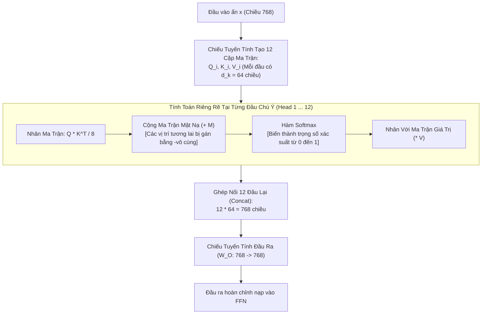

# 🧩 THUẬT NGỮ: MULTI-HEAD MASKED ATTENTION (CHÚ Ý TỰ THÂN ĐA ĐẦU CÓ CHE MẶT NẠ)

> **Cơ chế chú ý tự thân đa đầu có che mặt nạ (Masked Multi-Head Self-Attention)**  
> *Thuộc nhóm:* Kiến Trúc Học Sâu & Transformers (Deep Learning & Transformers)  
> *Áp dụng trong:* Trái tim xử lý của toàn bộ 12 khối Transformer Decoder trong **GPT-2** và **GPT2SP** (IEEE TSE 2023).

---

## 🧒 PHẦN 1: GIẢI THÍCH CHO ĐỨA TRẺ 10 TUỔI (THE 10-YEAR-OLD EXPLANATION)

Hãy tưởng tượng một hội đồng gồm **12 vị thám tử thông thái** cùng ngồi đọc một cuốn nhật ký hành trình vụ án dài 100 trang:

1. **Tại sao lại có 12 vị thám tử (Multi-Head - Đa đầu)?**  
   Nếu chỉ có 1 vị thám tử duy nhất, ông ấy rất dễ bị phân tâm và bỏ sót chi tiết. Vì vậy, 12 vị thám tử chia nhau quan sát theo các góc nhìn chuyên môn hoàn toàn khác nhau:
   * Vị thám tử số 1 chỉ chuyên soi xem **hành động nào** đi liền với hung khí (ví dụ: từ `"sửa"` đi với từ `"lỗi"`).
   * Vị thám tử số 2 chuyên soi **địa điểm xảy ra sự cố** (ví dụ: từ `"lỗi"` nằm ở phân hệ `"cơ sở dữ liệu"` hay `"giao diện"`).
   * Vị thám tử số 3 chuyên đánh giá **mức độ khẩn cấp** của sự việc.
2. **Tại sao lại phải đeo mặt nạ che mắt (Masked - Che mặt nạ)?**  
   Tất cả 12 vị thám tử đều phải tuân thủ một lời thề danh dự: Khi đọc đến trang số 10, họ bị một chiếc **mặt nạ kỳ diệu che kín toàn bộ mắt bên phải** — họ **tuyệt đối không được nhìn trộm các trang từ 11 đến 100 (tương lai)**! Họ chỉ được phép dùng mắt thần liên kết các manh mối từ trang 1 đến trang 10 (quá khứ và hiện tại) để suy luận.

Nhờ 12 góc nhìn chuyên sâu và việc tuân thủ nghiêm ngặt tính nhân quả thời gian, hội đồng thám tử thấu hiểu toàn bộ bối cảnh của câu chuyện một cách công tâm và sắc bén nhất!

> 💡 **Định nghĩa bình dân:**  
> **Masked Multi-Head Attention** là cơ chế cho phép máy tính nhìn câu văn dưới nhiều lăng kính độc lập cùng một lúc (12 đầu chú ý), đồng thời che kín các từ ngữ ở phía sau để máy tính không "ăn gian" nhìn trước tương lai, đảm bảo suy luận logic chặt chẽ theo dòng thời gian.

---

## 🔍 PHẦN 2: BÓC TÁCH TỪNG TỪ NGỮ CHUYÊN NGÀNH (DECONSTRUCTING THE JARGON)

Tên gọi **Masked Multi-Head Self-Attention** được ghép từ 4 khái niệm kỹ thuật cốt lõi:

| Thành tố | Gốc từ tiếng Anh | Ý nghĩa đời thường | Ý nghĩa trong Kiến trúc Transformer | Khái niệm đối lập (Antonym) |
| :--- | :--- | :--- | :--- | :--- |
| **Multi-Head** | *Multi-* (nhiều) + *Head* (đầu chú ý) | Nhiều cái đầu cùng suy nghĩ. | Chia vector biểu diễn 768 chiều thành **$H = 12$ không gian con song song**, mỗi đầu có kích thước $d_k = 768 / 12 = 64$ chiều để học các mối liên kết ngữ nghĩa độc lập. | *Single-head Attention* (chỉ có 1 góc nhìn duy nhất). |
| **Masked** | *Mask* (mặt nạ, tấm rèm che) | Đeo mặt nạ che khuất tầm nhìn. | Cộng thêm một ma trận mặt nạ chứa giá trị $-\infty$ vào nửa tam giác trên để ép trọng số chú ý tới các từ tương lai về đúng bằng $0$ sau hàm Softmax. | *Unmasked / Bidirectional Attention* (chú ý hai chiều tự do như BERT). |
| **Self-** | *Self* (bản thân, tự mình) | Tự soi gương, tự liên hệ. | Các từ ngữ bên trong **cùng một câu văn** tự kết nối và đo mức độ liên quan lẫn nhau. | *Cross-Attention* (chú ý chéo giữa văn bản nguồn và văn bản đích). |
| **Attention** | *Attention* (sự tập trung chú ý) | Tập trung ánh mắt vào điểm quan trọng nhất. | Cơ chế tính toán độ tương đồng giữa vector Truy vấn ($Q$) và vector Chìa khóa ($K$) để lấy trung bình có trọng số của vector Giá trị ($V$). | *Uniform / Flat pooling* (đối xử cào bằng mọi từ như nhau). |

---

## 📊 PHẦN 3: TRỰC QUAN HÓA BẰNG BẢNG DỮ LIỆU & MA TRẬN (THE "AHA!" MOMENT)

Công thức toán học của cơ chế Chú ý có tỷ lệ co dãn và che mặt nạ (Scaled Dot-Product Attention with Mask):

$$
\text{Attention}(Q, K, V) = \text{Softmax}\left(\frac{Q K^T}{\sqrt{d_k}} + M\right) V
$$

Trong đó:
* $Q, K, V \in \mathbb{R}^{L \times d_k}$: Các ma trận Truy vấn (Query), Chìa khóa (Key), và Giá trị (Value).
* $\sqrt{d_k} = \sqrt{64} = 8$: Hệ số co dãn giúp ổn định độ dốc trước hàm Softmax.
* $M \in \mathbb{R}^{L \times L}$: Ma trận mặt nạ nhân quả (Causal Mask).

### Ma trận mặt nạ $M$ và bảng trọng số Softmax thực tế cho câu: `"Fix memory leak bug"`

#### 1. Ma trận mặt nạ trước khi qua hàm Softmax:

$$
M = \begin{bmatrix}
0 & -\infty & -\infty & -\infty \\
0 & 0 & -\infty & -\infty \\
0 & 0 & 0 & -\infty \\
0 & 0 & 0 & 0
\end{bmatrix}
$$

#### 2. Bảng trọng số chú ý sau hàm Softmax (Tổng mỗi hàng luôn bằng $100\%$):

| Vị trí Token | Từ ngữ hiện tại | `Fix` ($j=1$) | `memory` ($j=2$) | `leak` ($j=3$) | `bug` ($j=4$) | Hành vi tiếp thu thông tin |
| :---: | :--- | :---: | :---: | :---: | :---: | :--- |
| **Hàng 1** | `Fix` | **$100\%$** | $0\%$ | $0\%$ | $0\%$ | Chỉ nhìn thấy chính mình, chưa biết sửa cái gì. |
| **Hàng 2** | `memory` | $40\%$ | **$60\%$** | $0\%$ | $0\%$ | Bắt đầu liên kết giữa hành động `Fix` và đối tượng `memory`. |
| **Hàng 3** | `leak` | $20\%$ | **$45\%$** | **$35\%$** | $0\%$ | Nhận diện cụm từ kỹ thuật `memory leak` (rò rỉ bộ nhớ). |
| **Hàng 4** | `bug` | $15\%$ | **$35\%$** | **$40\%$** | **$10\%$** | ⭐ **Được phép nhìn lại toàn bộ cả 4 từ! Nhận diện trọn vẹn lỗi rò rỉ bộ nhớ nghiêm trọng!** |

> 🎉 **Khoảnh khắc "Aha!":**  
> Hãy nhìn các con số $0\%$ ở nửa tam giác trên: Bất kỳ nỗ lực nào muốn nhìn lén tương lai đều bị giá trị $-\infty$ triệt tiêu thành $0\%$ tuyệt đối ($e^{-\infty} = 0$)!  
> Nhờ đó, mỗi bước tính toán đều hoàn toàn tuân thủ dòng thời gian tự nhiên của thế giới thực!

---

## ⚡ PHẦN 4: THÁCH THỨC KỸ THUẬT & SỰ ĐỘT PHÁ SO VỚI LSTM CỦA DEEP-SE

Trong mô hình **Deep-SE (Choetkiertikul et al., 2019)**:
1. **Rào cản một góc nhìn:** Mạng LSTM chỉ có một vector trạng thái ẩn $h_t$ duy nhất. Nó bị ép buộc phải nhồi nhét cả ngữ pháp, từ vựng lẫn độ khó vào cùng một kênh thông tin chật chội.
2. **Rào cản khoảng cách xa:** Để liên kết từ thứ 1 với từ thứ 50, LSTM phải truyền thông tin qua 49 trạm trung gian, tín hiệu bị suy giảm nặng nề.

### Sự vượt trội của Masked Multi-Head Attention:
* **12 đầu chú ý song song:** Mỗi đầu tự do chuyên môn hóa vào một loại quan hệ cú pháp và ngữ nghĩa khác nhau mà không dẫm chân lên nhau.
* **Khoảng cách trực tiếp $O(1)$:** Token thứ 50 có thể "bắn tia chú ý" trực tiếp về token thứ 1 trong một phép nhân ma trận duy nhất, không bị suy giảm thông tin dù văn bản có dài hàng trăm từ.
* **Tính toán song song trên GPU:** Vì không phụ thuộc vòng lặp thời gian như LSTM, toàn bộ ma trận chú ý $QK^T$ của toàn bộ câu được nhân đồng loạt trong chớp mắt!

---

## 🚀 PHẦN 5: VAI TRÒ CỦA CƠ CHẾ NÀY TRONG GPT2SP

Trong bài báo **GPT2SP (Fu & Tantithamthavorn, TSE 2023)**:
* Mô hình GPT-2 Small sở hữu **12 khối Transformer Decoder**, mỗi khối chứa một tầng **Masked Multi-Head Attention** gồm **12 đầu chú ý**.
* Tổng cộng có $12 \times 12 = \mathbf{144}$ **lăng kính chú ý độc lập** liên tục rà soát từng dòng mô tả của issue Jira.

### Ứng dụng đột phá trong bài toán Explainable AI (XAI):
* Không chỉ dùng để dự đoán Story Point, nhóm tác giả GPT2SP còn trích xuất các trọng số chú ý này để xây dựng **công cụ minh chứng trực quan XAI (Chương 6 bài báo)**:
  * Tô sáng các từ khóa kỹ thuật nhận được trọng số chú ý cao nhất (`memory leak`, `timeout`, `deadlock`).
  * Giúp các kỹ sư và Scrum Master hiểu rõ lý do vì sao AI lại đưa ra mức điểm Story Point đó, nâng mức độ tin cậy từ $19\%$ lên **$75\%$** trong khảo sát thực tế!

---

## ⏱️ PHẦN 6: TỔNG KẾT 30 GIÂY (THE ELEVATOR PITCH)

* **Bản chất:** Masked Multi-Head Self-Attention là cơ chế chú ý tự thân đa đầu chia tách vector thành 12 không gian song song và sử dụng mặt nạ nhân quả để che kín tương lai.
* **Điểm đột phá:** Cho phép mô hình nhìn văn bản dưới 12 góc nhìn chuyên môn cùng lúc, tính toán song song thần tốc trên GPU và kết nối trực tiếp mọi thông tin xa gần mà không bị lãng quên như LSTM.
* **Giá trị trong GPT2SP:** Là "đôi mắt thần" chắt lọc toàn bộ rủi ro và độ phức tạp kỹ thuật của issue Jira vào token cuối cùng, đồng thời cung cấp cơ chế giải thích minh chứng trực quan (XAI) cho các chuyên gia Agile.