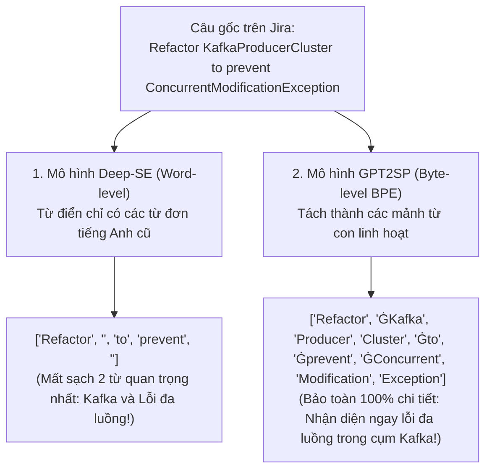

# 🧩 THUẬT NGỮ: OOV (OUT-OF-VOCABULARY - TỪ NGOÀI TỪ ĐIỂN)

> **Hiện tượng từ ngoài từ điển (Out-Of-Vocabulary - OOV)**  
> *Thuộc nhóm:* Xử Lý Ngôn Ngữ Tự Nhiên & Biểu Diễn Từ Vựng (NLP & Vocabulary Management)  
> *Áp dụng trong:* Tử huyệt lớn nhất của mô hình **Deep-SE** và cách giải quyết triệt để trong **GPT2SP** (IEEE TSE 2023).

---

## 🧒 PHẦN 1: GIẢI THÍCH CHO ĐỨA TRẺ 10 TUỔI (THE 10-YEAR-OLD EXPLANATION)

Hãy tưởng tượng em có một cuốn từ điển bỏ túi chứa đúng 1.000 từ vựng tiếng Anh cơ bản.

Hôm nay ở trường, cô giáo giao cho em một bài đọc mới toanh. Em chăm chỉ đọc từng câu từng chữ. Bỗng nhiên, trong bài văn xuất hiện một từ rất lạ mà em chưa bao giờ thấy trong đời: từ `"supercalifragilisticexpialidocious"` (hoặc một từ kỹ thuật máy tính như `"NullPointerException"`).

Em lật tung cuốn từ điển bỏ túi của mình từ trang 1 đến trang 1.000, nhưng **hoàn toàn không có từ đó trong sách**! 
* Vì không biết từ đó nghĩa là gì, đầu óc em bị đơ lại. Em buộc phải lấy một chiếc bút lông màu đen gạch xóa từ đó đi và thay bằng một ký tự bí ẩn: **`<???>`** (Kẻ lạ mặt - Unknown).
* Nếu bài văn có quá nhiều từ lạ bị gạch đen thành `<???>`, câu chuyện sẽ biến thành: *"Bạn Nam bị `<???>` trong khi đang `<???>` ở `<???>`"*. Câu văn trở nên vô nghĩa, và em không thể nào hiểu được câu chuyện nói về cái gì!

Hiện tượng gặp phải những "từ lạ mặt" không có trong từ điển như vậy được gọi là **OOV (Out-Of-Vocabulary)**!

> 💡 **Định nghĩa bình dân:**  
> **OOV (Từ ngoài từ điển)** là hiện tượng máy tính bắt gặp một từ mới lạ trong quá trình kiểm thử hoặc triển khai thực tế mà nó chưa từng được học trong tập huấn luyện, buộc máy tính phải coi từ đó là vô danh (`<UNK>`) và làm mất sạch ý nghĩa của câu văn.

---

## 🔍 PHẦN 2: BÓC TÁCH TỪNG TỪ NGỮ CHUYÊN NGÀNH (DECONSTRUCTING THE JARGON)

Thuật ngữ **Out-Of-Vocabulary** gồm 3 từ tiếng Anh ghép lại:

| Thành tố | Gốc từ tiếng Anh | Ý nghĩa đời thường | Ý nghĩa trong Xử lý Ngôn ngữ Tự nhiên (NLP) | Khái niệm đối lập (Antonym) |
| :--- | :--- | :--- | :--- | :--- |
| **Out-Of** | *Out of* (nằm ngoài, không thuộc về) | Nằm ở bên ngoài một ranh giới. | Nằm ngoài vùng phủ sóng của bảng chỉ mục từ vựng (Vocabulary Lookup Table). | *In-Vocabulary (IV - Từ nằm trong từ điển).* |
| **Vocabulary** | *Vocab* (kho từ vựng) | Cuốn từ điển danh sách các từ đã biết. | Tập hợp hữu hạn các token có mã số nguyên (ID) mà mô hình đã thiết lập sẵn ma trận nhúng trong quá trình huấn luyện: $\mathcal{V} = \{w_1, w_2, \dots, w_{|V|}\}$. | *Corpus / Open text* (toàn bộ kho văn bản mở). |
| **`<UNK>` Token** | *Unknown Token* | Kẻ vô danh, ẩn số. | Ký hiệu đặc biệt dùng để thay thế cho mọi từ OOV, thường nhận một vector rác vô nghĩa hoặc trung bình. | *Specific Token ID* (mã token định danh chuẩn xác). |

---

## 📊 PHẦN 3: TRỰC QUAN HÓA BẰNG BẢNG DỮ LIỆU (THE "AHA!" MOMENT)

Trong các dự án phần mềm Jira, lập trình viên liên tục tạo ra các từ mới: tên hàm, tên biến số, tên thư viện cập nhật phiên bản mới. 

Hãy xem điều gì xảy ra với mô hình **Deep-SE (Word-level Tokenization)** khi đọc một User Story thực tế trong kịch bản chuyển giao dự án (Cross-Project):

**Câu gốc trên Jira:**  
`"Refactor KafkaProducerCluster to prevent ConcurrentModificationException"`



### Bảng đối chiếu tỷ lệ mất mát thông tin giữa hai mô hình:

| Từ vựng trong câu | Tình trạng trong Deep-SE | Hậu quả đối với Deep-SE | Tình trạng trong GPT2SP (BPE) | Kết quả của GPT2SP |
| :--- | :---: | :--- | :---: | :--- |
| `Refactor` | In-Vocab | Hiểu là tái cấu trúc code. | In-Vocab | Hiểu là tái cấu trúc code. |
| `KafkaProducerCluster` | **OOV ($100\%$ lạ)** | Biến thành `<UNK>`. Mô hình **hoàn toàn không biết** hệ thống nào bị ảnh hưởng! | Tách thành 3 mảnh con: `['Kafka', 'Producer', 'Cluster']` | Nhận diện chính xác hệ thống hàng đợi phân tán Kafka phức tạp! |
| `to prevent` | In-Vocab | Giới từ thông thường. | In-Vocab | Giới từ thông thường. |
| `ConcurrentModificationException` | **OOV ($100\%$ lạ)** | Biến thành `<UNK>`. Mô hình **mù tịt về loại lỗi**, tưởng đây là việc sửa câu chữ bình thường! | Tách thành 3 mảnh con: `['Concurrent', 'Modification', 'Exception']` | Nhận diện lỗi xung đột đa luồng cực kỳ hóc búa, đòi hỏi nỗ lực Story Point rất cao! |

> 🎉 **Khoảnh khắc "Aha!":**  
> Trước mắt Deep-SE, hai câu:  
> * Câu 1: `"Refactor <UNK> to prevent <UNK>"`  
> * Câu 2: `"Refactor <UNK> to prevent <UNK>"`  
> trông hoàn toàn giống hệt nhau! Cho dù câu 1 là lỗi luồng Kafka phức tạp 13 điểm Story Point, còn câu 2 chỉ là lỗi đổi màu nút bấm 1 Story Point, Deep-SE cũng chỉ có thể đoán mò vì thông tin đã bị OOV xóa sổ!

---

## ⚡ PHẦN 4: VÌ SAO DEEP-SE THẤT BẠI DÙ CÓ TỪ ĐIỂN 185.625 TỪ?

Mô hình **Deep-SE (Choetkiertikul et al., 2019)** đã cố gắng giải quyết OOV bằng cách "vét cạn": họ thu thập toàn bộ từ ngữ trong cả 16 dự án Jira để tạo ra một từ điển khổng lồ lên tới **185.625 từ duy nhất**:

1. **Vẫn không tránh khỏi OOV:**  
   Thế giới phần mềm thay đổi từng ngày. Khi có một thư viện mới ra đời hoặc một dự án thứ 17 xuất hiện, các từ mới lại tiếp tục nảy sinh. Không có cuốn từ điển nguyên khối nào có thể bao quát hết được sự sáng tạo tên biến của lập trình viên.
2. **Cái giá đắt đỏ của ma trận khổng lồ:**  
   Một ma trận nhúng từ $185.625 \times 300$ tiêu tốn hàng trăm megabyte bộ nhớ RAM/VRAM, nhưng có tới hơn $80\%$ số từ là những từ hiếm gặp chỉ xuất hiện đúng 1 lần trong 5 năm, khiến mô hình bị quá khớp nặng nề.
3. **Thảm họa trong kịch bản Cross-Project (RQ2):**  
   Khi lấy mô hình huấn luyện trên dự án Apache Mesos mang sang dự án Talend Data Quality, tỷ lệ từ OOV tăng vọt lên tới $30 - 45\%$, khiến độ chính xác của Deep-SE sụt giảm nghiêm trọng.

---

## 🚀 PHẦN 5: GPT2SP ĐƯA TỶ LỆ OOV VỀ ĐÚNG 0% NHƯ THẾ NÀO?

Trong bài báo **GPT2SP (Fu & Tantithamthavorn, TSE 2023)**, các tác giả đã chấm dứt hoàn toàn cơn ác mộng OOV bằng cách sử dụng **Byte-level Byte-Pair Encoding (BPE)** của GPT-2:

```
Tỷ lệ Out-Of-Vocabulary của GPT2SP = ĐÚNG 0.00%
```

1. **Khởi nguyên từ 256 giá trị Byte UTF-8:**  
   Bất kỳ ký tự nào được gõ từ bàn phím máy tính — dù là tiếng Anh, tiếng Việt, ký hiệu toán học hay đoạn mã code kỳ lạ — cuối cùng đều được máy tính lưu trữ dưới dạng một chuỗi các byte ($0 \dots 255$). BPE của GPT-2 nhận diện trực tiếp các byte này.
2. **Không bao giờ có từ lạ:**  
   Nếu gặp một thuật ngữ mới chưa từng có trong lịch sử (ví dụ: `GPT2SPStoryPoint`), thuật ngữ đó sẽ tự động được phân rã thành các mảnh ghép đã biết: `['GPT', '2', 'SP', 'Story', 'Point']`.
3. **Thành công rực rỡ trong Cross-Project Estimation:**  
   Nhờ tỷ lệ `OOV = 0%`, khi chuyển giao mô hình GPT2SP sang bất kỳ dự án phần mềm xa lạ nào, mô hình vẫn đọc hiểu trọn vẹn $100\%$ ngữ nghĩa của các User Story, giúp sai số MAE giữ vững ở mức thấp vượt trội.

---

## ⏱️ PHẦN 6: TỔNG KẾT 30 GIÂY (THE ELEVATOR PITCH)

* **Bản chất:** OOV là hiện tượng mô hình bắt gặp các từ ngữ lạ nằm ngoài bảng từ vựng đã học, buộc phải thay thế bằng mã `<UNK>` làm mất trắng thông tin ngữ nghĩa.
* **Tử huyệt của Deep-SE:** Dù xây dựng từ điển khổng lồ 185.625 từ, Deep-SE vẫn bị OOV tàn phá nặng nề khi sang các dự án mới do các tên hàm và lỗi ghép kỹ thuật liên tục xuất hiện.
* **Giải pháp trong GPT2SP:** Tận dụng bộ phân tách Byte-level BPE của GPT-2, đưa tỷ lệ OOV về đúng **0% tuyệt đối**, đảm bảo mô hình không bao giờ bị "mù từ" trước bất kỳ báo cáo lỗi phần mềm nào.