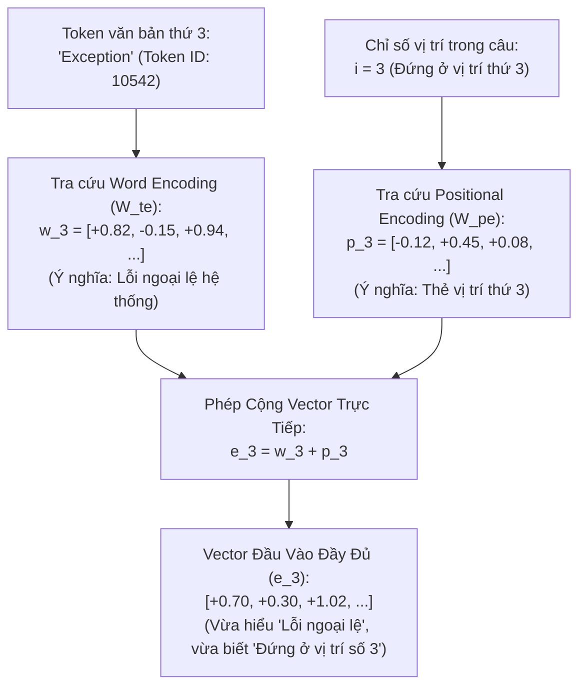

# 🧩 THUẬT NGỮ: POSITIONAL ENCODING (MÃ HÓA VỊ TRÍ)

> **Mã hóa vị trí (Positional Encoding / Positional Embedding)**  
> *Thuộc nhóm:* Kiến Trúc Học Sâu & Transformers (Deep Learning & Transformers)  
> *Áp dụng trong:* Mô hình ngôn ngữ GPT-2 và phương pháp ước lượng Story Point **GPT2SP** (IEEE TSE 2023).

---

## 🧒 PHẦN 1: GIẢI THÍCH CHO ĐỨA TRẺ 10 TUỔI (THE 10-YEAR-OLD EXPLANATION)

Hãy nghe hai câu sau đây và xem ý nghĩa của chúng khác nhau như thế nào:
1. *"Chó cắn mèo."*
2. *"Mèo cắn chó."*

Cả hai câu này đều chứa đúng 3 từ giống hệt nhau: `chó`, `cắn`, và `mèo`. Nhưng ai là kẻ gây sự, và ai là nạn nhân bị đau? Hoàn toàn đảo ngược 180 độ, chỉ vì **thứ tự trước sau** của các từ đã bị hoán đổi!

Trước đây, khi bác cảnh sát tuần tra (giống như mạng nơ-ron RNN hay LSTM) đọc câu văn, bác ấy đi bộ từ từ: bước vào từ thứ nhất, rồi bước sang từ thứ hai, rồi mới tới từ thứ ba. Vì đi tuần tự theo thời gian, bác ấy tự khắc biết từ nào xuất hiện trước, từ nào xuất hiện sau.

Nhưng siêu người máy **Transformer** (bộ não của GPT-2) lại có một đôi mắt thần kỳ: nó **nhìn thấy tất cả mọi từ cùng một lúc trong chớp mắt** (xử lý song song)! Đổi lại, mắt thần nhìn cùng một lúc thì nó sẽ nhìn thấy một "túi chứa từ" hỗn độn, không biết từ nào đứng ở đầu hàng, từ nào đứng ở cuối hàng.

Để giải quyết, các nhà khoa học đã làm một việc rất đơn giản: **Dán một tấm thẻ số thứ tự vào lưng mỗi từ** trước khi đưa cho Transformer đọc:
* Từ đứng đầu câu được dán thẻ số `1`.
* Từ đứng thứ hai được dán thẻ số `2`.
* Từ đứng thứ ba được dán thẻ số `3`.

Tấm thẻ số thứ tự bằng toán học này chính là **Positional Encoding**!

> 💡 **Định nghĩa bình dân:**  
> **Positional Encoding (Mã hóa vị trí)** là chiếc thẻ đánh số thứ tự được gắn thêm vào từng từ ngữ, giúp bộ não Transformer — vốn đọc tất cả các từ cùng một lúc — biết chính xác từ nào đứng trước, từ nào đứng sau để không hiểu nhầm ý nghĩa của câu chuyện.

---

## 🔍 PHẦN 2: BÓC TÁCH TỪNG TỪ NGỮ CHUYÊN NGÀNH (DECONSTRUCTING THE JARGON)

Thuật ngữ **Positional Encoding** gồm hai thành tố:

| Thành tố | Gốc từ tiếng Anh | Ý nghĩa đời thường | Ý nghĩa trong Machine Learning & Transformers | Khái niệm đối lập (Antonym) |
| :--- | :--- | :--- | :--- | :--- |
| **Positional** | *Position* (vị trí, chỗ đứng) | Nơi chốn hoặc số thứ tự trong hàng ngũ. | Tọa độ chỉ số thời gian $i \in \{0, 1, 2, \dots, L-1\}$ của token trong chuỗi văn bản đầu vào. | *Order-agnostic / Bag-of-words* (phi thứ tự, không quan tâm vị trí). |
| **Encoding** | *Encode* (mã hóa) | Đổi một thông tin thành dạng mã số. | Quá trình biến đổi chỉ số vị trí nguyên $i$ thành một vector số thực liên tục có cùng số chiều với vector từ ($d = 768$). | *Decoding* (giải mã). |

### Bảng phân loại các kỹ thuật mã hóa vị trí trong học sâu:

| Kỹ thuật mã hóa vị trí | Cơ chế sinh vector vị trí | Có thể học được bằng Gradient Descent? | Khả năng mở rộng độ dài chuỗi | Mô hình tiêu biểu áp dụng |
| :--- | :--- | :---: | :---: | :--- |
| **Sinusoidal Positional Encoding** | Dùng hàm lượng giác hình sin và cosin cố định: $\sin(pos/10000^{2i/d})$. | ❌ Không (tham số đóng băng cố định) | Rất tốt (ngoại suy được chuỗi dài hơn lúc train) | Transformer gốc (Vaswani et al., 2017) |
| **Learned Positional Embedding** | Khởi tạo ma trận trọng số $W_{pe}$ và cập nhật tự do qua lan truyền ngược. |  **Có (tham số tự học tối ưu theo dữ liệu)** | Bị chặn bởi chiều dài tối đa thiết lập trước | **GPT-2, GPT2SP, BERT** |
| **Rotary Position Embedding (RoPE)** | Xoay vector biểu diễn trong không gian phức theo góc tỷ lệ với vị trí. | Kết hợp hàm quay và trọng số học | Xuất sắc | LLaMA, Mistral, GPT-4 |

---

## 📊 PHẦN 3: TRỰC QUAN HÓA BẰNG BẢNG DỮ LIỆU (THE "AHA!" MOMENT)

Trong mô hình **GPT-2 / GPT2SP**, vector đầu vào hoàn chỉnh nạp vào khối Transformer thứ nhất được tính bằng **phép cộng trực tiếp từng phần tử (element-wise addition)** giữa vector từ và vector vị trí:

$$
\mathbf{e}_i = \mathbf{w}_i + \mathbf{p}_i \in \mathbb{R}^{768}
$$

Trong đó:
* $\mathbf{w}_i = W_{te}[x_i]$: Vector mã hóa từ ngữ (Word Encoding).
* $\mathbf{p}_i = W_{pe}[i]$: Vector mã hóa vị trí thứ $i$ (Positional Encoding).



### Bảng minh họa trực quan phép cộng vector cho một câu Jira ngắn:

| Vị trí $i$ | Token ($x_i$) | Vector Từ $\mathbf{w}_i$ (3 chiều đại diện) | Vector Vị Trí $\mathbf{p}_i$ (3 chiều đại diện) | Vector Tổng Nạp Vào Transformer $\mathbf{e}_i = \mathbf{w}_i + \mathbf{p}_i$ |
| :---: | :--- | :---: | :---: | :---: |
| **0** | `Cannot` | `[ +0.50,  -0.20,  +0.10 ]` | `[ +0.10,  +0.05,  -0.02 ]` | `[ +0.60,  -0.15,  +0.08 ]` |
| **1** | `reproduce` | `[ +0.20,  +0.80,  -0.40 ]` | `[ +0.18,  +0.12,  -0.05 ]` | `[ +0.38,  +0.92,  -0.45 ]` |
| **2** | `this` | `[ -0.10,  +0.05,  +0.02 ]` | `[ +0.25,  +0.19,  -0.09 ]` | `[ +0.15,  +0.24,  -0.07 ]` |
| **3** | `bug` | `[ +0.85,  -0.10,  +0.90 ]` | `[ +0.31,  +0.26,  -0.14 ]` | `[ +1.16,  +0.16,  +0.76 ]` |

> 🎉 **Khoảnh khắc "Aha!":**  
> Dù từ `bug` có nằm ở vị trí số 3 hay số 50 trong một đoạn mô tả issue dài dằng dặc, bản thân vector từ $\mathbf{w}_i$ vẫn giữ nguyên nhận diện về lỗi. Nhưng nhờ được cộng thêm $\mathbf{p}_3$ khác hẳn với $\mathbf{p}_{50}$, mạng nơ-ron nhận thức rõ ràng: *"Từ lỗi này nằm ngay ở dòng mở đầu của tiêu đề, hay nó chỉ là một lời kể phụ ở tít cuối đoạn văn!"*

---

## ⚡ PHẦN 4: THÁCH THỨC KỸ THUẬT & VÌ SAO TRANSFORMER BẮT BUỘC CẦN NÓ?

### Bản chất toán học: Phép nhân Self-Attention là "Bất biến hoán vị" (Permutation Equivariance)
Công thức cốt lõi của Transformer là cơ chế Self-Attention:

$$
\text{Attention}(Q, K, V) = \text{softmax}\left(\frac{QK^T}{\sqrt{d_k}}\right)V
$$

Nếu chúng ta xáo trộn thứ tự các từ trong câu (ví dụ từ chuỗi `[A, B, C]` đổi thành `[C, B, A]`) mà không có Positional Encoding:
* Các hàng của ma trận truy vấn $Q$ và ma trận chìa khóa $K$ chỉ đơn thuần đổi chỗ cho nhau.
* Giá trị tích vô hướng giữa các từ hoàn toàn không thay đổi.
* Kết quả ma trận Attention bị hoán vị hàng tương ứng — nghĩa là mô hình **hoàn toàn mù tịt về thứ tự cú pháp** của câu! Nó coi câu `"Khách hàng không thể thanh toán tiền"` và câu `"Khách hàng thanh toán tiền không thể"` là giống hệt nhau!

### Sự đánh đổi so với Deep-SE (Mạng LSTM):
* Mô hình **Deep-SE (LSTM)** đọc từng bước thời gian $h_t = f(h_{t-1}, x_t)$ nên không cần Positional Encoding vì thời gian đã được nhúng sẵn vào cấu trúc lặp. Tuy nhiên, LSTM **không thể chạy song song** trên GPU và bị quên lãng thông tin xa.
* **GPT2SP (Transformer)** muốn tận dụng khả năng tính toán song song thần tốc thì bắt buộc phải bù đắp thông tin thứ tự bằng **Positional Encoding**.

---

## 🚀 PHẦN 5: GPT2SP SỬ DỤNG POSITIONAL ENCODING NHƯ THẾ NÀO?

Trong công trình **GPT2SP (Fu & Tantithamthavorn, TSE 2023)**:

```
Ma trận vị trí tự học:  W_pe ∈ ℝ^(1024 × 768)
```

1. **Cơ chế nhúng vị trí tự học (Learned Positional Embeddings):**  
   GPT2SP không dùng công thức sin/cos cố định mà dùng ma trận học $W_{pe}$ gồm **1024 hàng** (tương ứng với chiều dài ngữ cảnh tối đa $L_{max} = 1024$ tokens) và **768 cột** (chiều ẩn của GPT-2 Small).
2. **Khả năng tự thích ứng với cấu trúc văn bản Jira:**  
   Trong quá trình tinh chỉnh (Fine-tuning) trên các báo cáo Jira, ma trận $W_{pe}$ tự động học các mẫu hình đặc thù:
   * Các vị trí đầu tiên ($i = 0 \dots 20$) thường là **Title** (tiêu đề issue) — chứa thông tin khái quát nhất, trọng số vị trí sẽ học cách đẩy mạnh tầm quan trọng của các vị trí này.
   * Các vị trí tiếp theo ($i > 20$) là **Description** (mô tả chi tiết và các bước tái hiện lỗi).
3. **Giới hạn kỹ thuật cần kiểm soát:**  
   Do $W_{pe}$ chỉ hỗ trợ tối đa 1024 vị trí, các issue quá dài vượt quá 1024 token sẽ buộc phải được cắt bớt (truncate). Các tác giả GPT2SP đã chứng minh rằng đa số issue Jira trong 16 dự án mã nguồn mở đều có độ dài nằm gọn dưới 1024 subword tokens, do đó không làm mất thông tin quan trọng.

---

## ⏱️ PHẦN 6: TỔNG KẾT 30 GIÂY (THE ELEVATOR PITCH)

* **Bản chất:** Positional Encoding là vector biểu diễn số thứ tự vị trí của token trong câu, được cộng trực tiếp vào vector từ ngữ trước khi nạp vào mạng.
* **Điểm đột phá:** Khắc phục nhược điểm "mù thứ tự cú pháp" vốn có của cơ chế chú ý song song (Self-Attention), cho phép mô hình xử lý văn bản cực nhanh trên GPU mà vẫn bảo toàn 100% ngữ pháp và trình tự logic.
* **Giá trị trong GPT2SP:** Giúp mô hình phân biệt rạch ròi giữa vị trí Tiêu đề (Title) và Nội dung mô tả (Description), hiểu đúng ngữ cảnh các bước gây lỗi trong Jira để đưa ra điểm ước lượng Story Point chuẩn xác nhất.