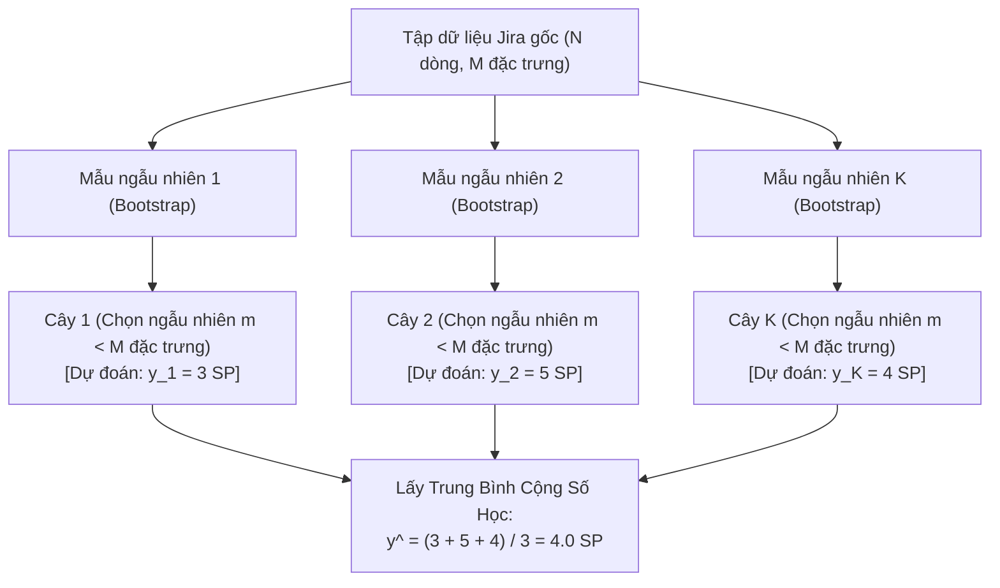

# 🧩 THUẬT NGỮ: RANDOM FOREST (RỪNG QUYẾT ĐỊNH NGẪU NHIÊN)

> **Rừng cây quyết định ngẫu nhiên (Random Forest)**  
> *Thuộc nhóm:* Học Máy Truyền Thống & Học Kết Hợp (Traditional ML & Ensemble Learning)  
> *Áp dụng trong:* Mô hình đối chứng cơ sở (Baselines: **LSTM + RF**, **BoW + RF**, **Doc2Vec + RF**) được so sánh với Deep-SE và **GPT2SP** (IEEE TSE 2023).

---

## 🧒 PHẦN 1: GIẢI THÍCH CHO ĐỨA TRẺ 10 TUỔI (THE 10-YEAR-OLD EXPLANATION)

Hãy tưởng tượng em bị một căn bệnh lạ và cần đi khám bác sĩ để biết phải uống thuốc trong bao nhiêu ngày thì khỏi.

Nếu em chỉ đến gặp **một vị bác sĩ duy nhất** (tương tự như một Cây Quyết Định đơn lẻ - *Decision Tree*):
* Bác sĩ đó có thể rất giỏi, nhưng đôi khi hôm đó bác ấy đang mệt mỏi, hoặc bác ấy có những thói quen thiên vị chủ quan cá nhân. Bác sĩ phán: *"Uống thuốc 14 ngày!"*. Em có thể lo lắng liệu phán đoán đó có quá già hoặc quá non không.

Để hoàn toàn yên tâm, bố mẹ em quyết định đưa em đến một **Hội Đồng Y Khoa gồm 100 bác sĩ khác nhau** (đây chính là **Rừng Cây Quyết Định - Random Forest**):
1. Mỗi vị bác sĩ đến từ một bệnh viện khác nhau và đọc những cuốn sách chuyên khoa khác nhau (chọn mẫu ngẫu nhiên).
2. Khi khám cho em, mỗi bác sĩ chỉ hỏi một vài câu hỏi ngẫu nhiên khác nhau (chọn đặc trưng ngẫu nhiên).
3. Sau khi khám xong, 100 bác sĩ cùng đưa ra dự đoán: bác thì bảo 4 ngày, bác bảo 5 ngày, bác bảo 6 ngày...
4. Bố mẹ em lấy **con số trung bình cộng** của tất cả 100 lời khuyên đó: $(4 + 5 + 6 + \dots) / 100 = 5.1\text{ ngày}$!

Con số trung bình của cả khu rừng 100 bác sĩ luôn thông thái, khách quan và đáng tin cậy hơn vạn lần lời phán đơn độc của một người!

> 💡 **Định nghĩa bình dân:**  
> **Random Forest (Rừng ngẫu nhiên)** là thuật toán tập hợp hàng trăm "cây quyết định" độc lập. Mỗi cây được huấn luyện trên một phần dữ liệu và đặc trưng ngẫu nhiên khác nhau, sau đó kết quả cuối cùng được tính bằng cách lấy trung bình cộng ý kiến của tất cả các cây để đưa ra dự đoán chuẩn xác nhất.

---

## 🔍 PHẦN 2: BÓC TÁCH TỪNG TỪ NGỮ CHUYÊN NGÀNH (DECONSTRUCTING THE JARGON)

Tên gọi **Random Forest** được sáng tạo bởi nhà toán học Leo Breiman (2001):

| Thành tố | Gốc từ tiếng Anh | Ý nghĩa đời thường | Ý nghĩa trong Machine Learning | Khái niệm đối lập (Antonym) |
| :--- | :--- | :--- | :--- | :--- |
| **Random** | *Random* (ngẫu nhiên) | Không theo thứ tự sắp đặt trước, xảy ra bất kỳ. | 1. Chọn ngẫu nhiên có hoàn lại các dòng dữ liệu (**Bootstrap Sampling**). 2. Chọn ngẫu nhiên một tập con các đặc trưng tại mỗi nhánh rẽ (**Feature Subsampling**). | *Deterministic / Systematic* (xác định, toàn bộ đặc trưng). |
| **Forest** | *Forest* (khu rừng) | Tập hợp của rất nhiều cây xanh mọc cùng nhau. | Một mô hình kết hợp (**Ensemble Model**) gồm hàng chục hoặc hàng trăm cây quyết định (*Decision Trees*) hoạt động song song. | *Single Tree / Monolithic model* (một cây đơn lẻ, mô hình đơn khối). |
| **Regressor** | *Random Forest Regressor* | Chiếc cân trung bình của khu rừng. | Dạng bài toán hồi quy: Đầu ra của toàn bộ rừng là **trung bình số học** của các giá trị liên tục mà từng cây dự đoán. | *Random Forest Classifier* (bầu chọn số đông theo nhãn lớp). |

### Bảng phân tích hai trụ cột ngẫu nhiên của Random Forest:

---

## 📊 PHẦN 3: TRỰC QUAN HÓA BẰNG BẢNG DỮ LIỆU (THE "AHA!" MOMENT)

Giả sử chúng ta sử dụng mô hình đối chứng **LSTM + Random Forest** (hoặc BoW + RF) để ước lượng Story Point cho một issue mới trên Jira:  
`"Optimize MySQL database connection pool timeout"`

Mỗi cây quyết định trong rừng nhận một tập con đặc trưng và đưa ra phán đoán độc lập:

| Chỉ số Cây | Tập mẫu huấn luyện ngẫu nhiên | Đặc trưng được xem xét | Phán đoán Story Point ($T_b(x)$) | Nhận xét chuyên môn của cây |
| :---: | :--- | :--- | :---: | :--- |
| **Cây #1** | Dự án Mesos, Usergrid | `timeout`, `database` | **$3.0$ SP** | Nhận diện đây là tinh chỉnh tham số cấu hình. |
| **Cây #2** | Dự án Camel, ActiveMQ | `connection pool`, `MySQL` | **$5.0$ SP** | Nhận diện tác vụ liên quan đến cơ sở dữ liệu nền tảng. |
| **Cây #3** | Dự án Cassandra | `Optimize`, `pool` | **$8.0$ SP** | Đánh giá việc tối ưu hóa hiệu năng là phức tạp. |
| **Cây #4** | Dự án Derby, Flink | `timeout`, `Optimize` | **$3.0$ SP** | Cho rằng chỉ cần đổi giá trị timeout. |
| ... | ... | ... | ... | ... |
| **Cây #100** | Dự án Mahout | `database`, `pool` | **$5.0$ SP** | Nhận định mức nỗ lực trung bình. |

### Kết quả tổng hợp cuối cùng:

$$
\hat{y} = \frac{1}{B} \sum_{b=1}^{B} T_b(x) = \frac{3.0 + 5.0 + 8.0 + 3.0 + \dots + 5.0}{100} = \mathbf{4.42\text{ Story Points}}
$$

> 🎉 **Khoảnh khắc "Aha!":**  
> Cây #3 dự đoán quá cao ($8.0$ SP) do bị ấn tượng mạnh bởi từ `Optimize`, còn Cây #1 và #4 lại đoán quá thấp ($3.0$ SP) do nhìn vào từ `timeout`.  
> Nhờ phép cộng trung bình của 100 cây, **sai số cá biệt (variance) của từng cây tự động triệt tiêu lẫn nhau**, mang lại con số cân bằng hoàn hảo $4.42$ SP mà không bị thiên lệch bởi bất kỳ đặc trưng cực đoan nào!

---

## ⚡ PHẦN 4: THÁCH THỨC KỸ THUẬT & HẠN CHẾ CỦA RANDOM FOREST

Trong bài toán ước lượng Story Point trong Agile, Random Forest vấp phải 3 rào cản chí mạng:

1. **Hoàn toàn bất lực trước văn bản thô (No Native Text Processing):**  
   Random Forest là thuật toán dạng bảng (Tabular Model), nó **không thể đọc trực tiếp các câu văn tiếng Anh**. Để dùng được Random Forest, con người bắt buộc phải dùng một mô hình khác làm trung gian (như Bag-of-Words, Doc2Vec, hoặc LSTM) để biến văn bản thành bảng số. Chất lượng của Random Forest bị phụ thuộc hoàn toàn vào độ tốt của khâu trung gian này.
2. **Không thể ngoại suy ngoài miền dữ liệu (Cannot Extrapolate):**  
   Cây quyết định chỉ chia cắt không gian thành các hình hộp chữ nhật. Nếu trong tập huấn luyện mức Story Point cao nhất là $20$ SP, thì dù gặp một User Story khổng lồ đến đâu, Random Forest **vĩnh viễn không bao giờ có thể dự đoán quá 20 SP**!
3. **Mất liên kết ngữ cảnh tuần tự:**  
   Khi kết hợp với Bag-of-Words (BoW + RF), mô hình hoàn toàn không hiểu được trật tự ngữ pháp và mối quan hệ ngữ nghĩa sâu sắc giữa các câu lệnh trong Jira.

---

## 🚀 PHẦN 5: RANDOM FOREST ĐƯỢC DÙNG LÀM BASELINE THẾ NÀO TRONG GPT2SP?

Trong bài báo **GPT2SP (Fu & Tantithamthavorn, TSE 2023)** và nghiên cứu nền tảng của Choetkiertikul et al. (2019), Random Forest được sử dụng làm **bộ hồi quy chuẩn (Standard Regressor Baseline)** trong nhiều kết hợp kinh điển:

| Mô hình đối chứng Baseline | Cơ chế trích xuất đặc trưng | Bộ hồi quy đầu ra | Điểm yếu cốt lõi bị GPT2SP đánh bại |
| :--- | :--- | :--- | :--- |
| **BoW + RF** | Đếm tần suất từ (Bag-of-Words) | Random Forest | Mất hoàn toàn ngữ cảnh và thứ tự từ vựng. |
| **Doc2Vec + RF** | Nhúng văn bản không giám sát | Random Forest | Chất lượng biểu diễn tĩnh kém trên từ ngữ phần mềm. |
| **LSTM + RF** | Mạng bộ nhớ dài-ngắn LSTM | Random Forest | Tách rời 2 giai đoạn (học đặc trưng xong mới nạp vào RF), không tối ưu hóa đầu-cuối được. |

### Sự vượt trội của GPT2SP so với Random Forest:
Khác với Random Forest phải tách thành 2 giai đoạn rời rạc, **GPT2SP là mô hình học sâu đầu-cuối (End-to-End Deep Learning)**:
* Toàn bộ các tầng Transformer và đầu hồi quy MLP được **tinh chỉnh đồng thời (Joint Fine-Tuning)** qua hàm mất mát L1 Loss.
* Tín hiệu sai số từ điểm Story Point truyền ngược thẳng về từng tầng chú ý, giúp mô hình tự học cách đọc hiểu những từ ngữ quan trọng nhất trong Jira thay vì phụ thuộc vào phép ghép nối rời rạc với Random Forest.

---

## ⏱️ PHẦN 6: TỔNG KẾT 30 GIÂY (THE ELEVATOR PITCH)

* **Bản chất:** Random Forest là thuật toán học máy kết hợp (Ensemble Learning), xây dựng hàng trăm cây quyết định trên các mẫu và đặc trưng ngẫu nhiên, sau đó lấy trung bình cộng dự đoán.
* **Điểm mạnh:** Ổn định, chống quá khớp (overfitting) cực tốt trên dữ liệu bảng, là baseline đối chứng kinh điển trong các nghiên cứu công nghệ phần mềm.
* **Hạn chế & Vai trò trong bài báo:** Không tự đọc được văn bản và không tối ưu hóa đầu-cuối được. Trong bài báo GPT2SP, các kết hợp dùng Random Forest (BoW+RF, LSTM+RF) đều bị mô hình Transformer vượt trội hoàn toàn về cả MAE và độ chính xác thực nghiệm.