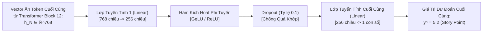

# 🧩 THUẬT NGỮ: REGRESSOR (BỘ HỒI QUY / ĐẦU HỒI QUY ĐA TẦNG)

> **Bộ hồi quy / Đầu hồi quy (Regressor / MLP Regression Head)**  
> *Thuộc nhóm:* Kiến Trúc Học Sâu & Mô Hình Hóa Dự Đoán (Deep Learning & Predictive Modeling)  
> *Áp dụng trong:* Tầng đầu ra dự đoán điểm Story Point của cả **Deep-SE** (Choetkiertikul et al., 2019) và **GPT2SP** (IEEE TSE 2023).

---

## 🧒 PHẦN 1: GIẢI THÍCH CHO ĐỨA TRẺ 10 TUỔI (THE 10-YEAR-OLD EXPLANATION)

Hãy tưởng tượng em cùng mẹ đi siêu thị mua hoa quả.

Có hai loại câu hỏi mà người bán hàng thường gặp:
1. **Câu hỏi dạng 1 (Phân loại - Classification):** *"Quả này là quả táo, quả cam, hay quả dưa hấu?"*  
   $\rightarrow$ Câu trả lời là một cái tên nhãn rời rạc trong danh sách có sẵn.
2. **Câu hỏi dạng 2 (Hồi quy - Regression):** *"Túi táo này nặng chính xác bao nhiêu ki-lô-gam?"*  
   $\rightarrow$ Câu trả lời không phải là một cái tên, mà là một **con số thực liên tục trên chiếc cân điện tử** (ví dụ: $1.25\text{ kg}$, $3.7\text{ kg}$, hay $5.0\text{ kg}$).

Trong bài toán ước lượng Story Point cho phần mềm:
* Các tầng nơ-ron Transformer hay LSTM ở phía trước đóng vai trò như người đầu bếp đi gom nhặt toàn bộ nguyên liệu (đọc hiểu mô tả lỗi, phân tích độ dài dòng code, xem xét các rủi ro hệ thống).
* Bộ phận cuối cùng đứng ở đầu ra là **Chiếc Cân Điện Tử Siêu Thông Minh (Regressor)**: nó nhận toàn bộ mớ nguyên liệu phức tạp đó và xuất ra đúng một con số thực duy nhất trên màn hình hiển thị: *"Độ khó của công việc này tương đương 5.2 Story Point!"*.

> 💡 **Định nghĩa bình dân:**  
> **Regressor (Bộ hồi quy)** là bộ phận đầu ra của mô hình máy học, có nhiệm vụ chuyển đổi toàn bộ thông tin trừu tượng thu thập được thành **một con số thực liên tục duy nhất** (như số điểm nỗ lực Story Point, số giờ công, hay số tiền chi phí) thay vì chọn một nhãn tên có sẵn.

---

## 🔍 PHẦN 2: BÓC TÁCH TỪNG TỪ NGỮ CHUYÊN NGÀNH (DECONSTRUCTING THE JARGON)

Thuật ngữ **Regressor** bắt nguồn từ thống kê cổ điển và được phát triển trong học máy hiện đại:

| Thành tố | Gốc từ tiếng Anh | Ý nghĩa đời thường | Ý nghĩa trong Thống kê & Machine Learning | Khái niệm đối lập (Antonym) |
| :--- | :--- | :--- | :--- | :--- |
| **Regress** | *Regress* (quay lui, quay về mức trung bình) | Đi lùi lại, quay trở về tình trạng trước đó. | Xu hướng thống kê của các biến ngẫu nhiên quay về đường trung bình (*Regression to the mean* của Francis Galton). | *Progress* (tiến lên phía trước). |
| **-or** | Hậu tố chỉ tác nhân | Người hoặc cỗ máy thực hiện hành động. | Khối kiến trúc nơ-ron (như lớp Perceptron đa tầng MLP) đảm nhận việc tính toán giá trị đầu ra. | *Target / Dependent variable* (biến mục tiêu bị dự đoán). |

### Bảng đối chiếu bản chất giữa Hồi quy (Regression) và Phân loại (Classification):

| Tiêu chí so sánh | Bài toán Phân loại (Classification) | Bài toán Hồi quy (Regression - Áp dụng trong GPT2SP) |
| :--- | :--- | :--- |
| **Không gian nhãn đầu ra** | Tập hữu hạn các lớp rời rạc: $y \in \{C_1, C_2, \dots, C_k\}$. | **Trục số thực liên tục vô hạn:** $y \in \mathbb{R}$ (hoặc $y \in [0, +\infty)$). |
| **Hàm kích hoạt tầng cuối** | Softmax (tính xác suất phân phối tổng bằng 1). | **Tuyến tính (Linear: $W \cdot h + b$)** hoặc ReLU/Softplus. |
| **Hàm mất mát tối ưu (Loss)** | Cross-Entropy Loss, Focal Loss. | **L1 Loss (MAE), L2 Loss (MSE), Huber Loss.** |
| **Ví dụ trong Agile** | Đoán xem Issue là `Bug` hay `Feature` hay `Task`. | **Dự đoán Issue tốn bao nhiêu điểm Story Point (ví dụ $4.8$ SP).** |

---

## 📊 PHẦN 3: TRỰC QUAN HÓA BẰNG BẢNG DỮ LIỆU & SƠ ĐỒ (THE "AHA!" MOMENT)

Trong mô hình **GPT2SP (Fu & Tantithamthavorn, 2023)**, các tác giả đã tháo bỏ lớp Softmax sinh từ vựng của GPT-2 gốc và thay thế bằng một **MLP Regressor Head**:

### So sánh hàm mất mát: Vì sao GPT2SP chọn L1 Loss (MAE) thay vì L2 Loss (MSE)?

Trong dữ liệu quản lý dự án phần mềm Jira, phân phối Story Point bị **lệch phải rất nặng (Heavy Right-Skewed)**: $90\%$ các task có điểm nhỏ ($1, 2, 3, 5$), nhưng có một số ít task khổng lồ (outliers) có điểm $20, 40$ hoặc $100$ SP.

| Trường hợp thử nghiệm | Giá trị thực tế ($y$) | Mô hình dự đoán ($\hat{y}$) | Sai lệch tuyệt đối $|y - \hat{y}|$ | Mất mát L1 Loss (MAE): $|y - \hat{y}|$ | Mất mát L2 Loss (MSE): $(y - \hat{y})^2$ | Phản ứng của mô hình |
| :--- | :---: | :---: | :---: | :---: | :---: | :--- |
| **Task bình thường** | $5.0$ SP | $3.0$ SP | $2.0$ | **$2.0$** | **$4.0$** | Đạo hàm cập nhật nhẹ nhàng, ổn định. |
| **Task ngoại lai (Outlier)** | $40.0$ SP | $10.0$ SP | $30.0$ | **$30.0$** | **$900.0$ (Bùng nổ!)** | L2 Loss phạt quá nặng, làm rung chuyển toàn bộ trọng số mạng! |

> 🎉 **Khoảnh khắc "Aha!":**  
> Khi gặp một task dị biệt bị lệch 30 điểm:
> * Nếu dùng **L2 Loss (MSE)**, sai số bị bình phương lên tới **$900$**! Đạo hàm khổng lồ này sẽ giật phăng toàn bộ các trọng số của mô hình, khiến mô hình bị phá hỏng khả năng dự đoán các task nhỏ thông thường.
> * Khi dùng **L1 Loss (Regressor trong GPT2SP)**, mức phạt tăng tuyến tính đúng bằng $30$, giúp đạo hàm luôn giữ ở mức hằng số $\pm 1$, bảo vệ mô hình **kháng lại các điểm dị biệt (Robust to Outliers)** một cách hoàn hảo!

---

## ⚡ PHẦN 4: THÁCH THỨC KỸ THUẬT KHI THIẾT KẾ REGRESSOR CHO STORY POINT

Ước lượng Story Point không phải là bài toán hồi quy thông thường (như dự đoán giá nhà hay nhiệt độ), mà có những rào cản đặc thù:

1. **Ranh giới giá trị không âm:**  
   Story Point trong thực tế không bao giờ có giá trị âm ($SP \ge 0$). Nếu thiết kế đầu hồi quy tuyến tính không có ràng buộc, mô hình rất dễ dự đoán ra số âm (ví dụ: $-1.5$ SP) cho các task quá đơn giản, gây phi lý trong thực tế quản lý dự án.
2. **Hiện tượng co cụm về giá trị trung vị (Regression toward the Mean):**  
   Do đa số các task trong Jira nhận điểm $1, 2, 3$, các bộ hồi quy yếu kém có xu hướng học "mẹo lười biếng": luôn luôn đoán xung quanh mức $2$ hoặc $3$ SP cho mọi task để giảm thiểu tổng sai số trung bình. Điều này khiến mô hình mất hoàn toàn năng lực cảnh báo các task khó.
3. **Sự không liên tục của thang Fibonacci:**  
   Dù là số thực, con người chỉ chấm điểm theo các nấc Fibonacci ($1, 2, 3, 5, 8, 13$). Regressor xuất ra số thực (ví dụ $4.2$ SP), đội ngũ phát triển phải quyết định làm tròn hay giữ nguyên số thực để đo vận tốc Sprint.

---

## 🚀 PHẦN 5: BỘ HỒI QUY TRONG DEEP-SE VÀ GPT2SP HOẠT ĐỘNG NHƯ THẾ NÀO?

Cả hai mô hình Deep-SE và GPT2SP đều sử dụng kiến trúc đầu hồi quy để đưa ra quyết định nỗ lực:

| Đặc tính kỹ thuật | Regressor trong Deep-SE (2019) | Regressor trong GPT2SP (2023) |
| :--- | :--- | :--- |
| **Vị trí lấy vector đầu vào** | Trạng thái ẩn cuối cùng của mạng **RHWN**. | Vector trạng thái ẩn của **Token cuối cùng ($\mathbf{h}_N$)** tại Khối Transformer thứ 12. |
| **Cấu trúc lớp hồi quy** | 1 Lớp Dense liên kết đầy đủ (Fully Connected) đơn giản. | Mạng **Perceptron đa tầng (MLP Regressor)** kết hợp kích hoạt phi tuyến và Dropout. |
| **Hàm mất mát tối ưu** | Tối ưu hóa trực tiếp trên hàm hồi quy liên tục. | **L1 Loss (Mean Absolute Error Loss)** giúp chống nhiễu ngoại lai. |
| **Kết quả sai số đạt được** | MAE trung bình = $2.08$. | **MAE trung bình giảm sâu vượt trội**, phân định tốt hơn các mức nỗ lực khó. |

---

## ⏱️ PHẦN 6: TỔNG KẾT 30 GIÂY (THE ELEVATOR PITCH)

* **Bản chất:** Regressor là khối nơ-ron đầu ra biến đổi các vector ngữ nghĩa nhiều chiều trừu tượng thành một giá trị số thực liên tục duy nhất biểu thị điểm nỗ lực Story Point.
* **Điểm đột phá:** Chuyển đổi mô hình nền tảng GPT-2 từ nhiệm vụ sinh văn bản (Language Modeling) sang nhiệm vụ thẩm định nỗ lực phần mềm chính xác.
* **Giá trị trong GPT2SP:** Kết hợp cùng hàm mất mát L1 Loss để miễn nhiễm với các giá trị ngoại lai dị biệt trong Jira, mang lại dự đoán điểm nỗ lực ổn định và có độ tin cậy cao nhất cho đội ngũ Agile.