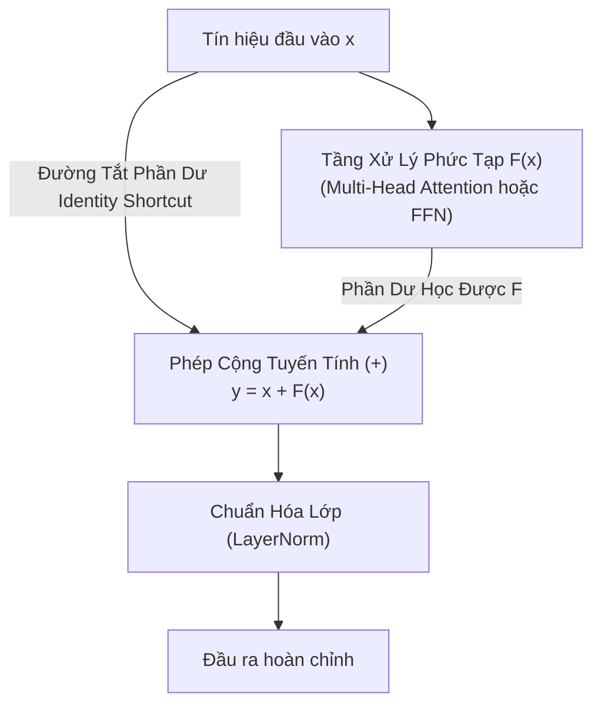

# 🧩 THUẬT NGỮ: RESIDUAL CONNECTION (KẾT NỐI PHẦN DƯ / ĐƯỜNG TẮT SKIP CONNECTION)

> **Kết nối phần dư / Đường tắt (Residual Connection / Skip Connection)**  
> *Thuộc nhóm:* Kiến Trúc Học Sâu Đột Phá (Breakthrough Deep Learning Architecture)  
> *Áp dụng trong:* Toàn bộ 12 khối Transformer Decoder của **GPT-2** và **GPT2SP** (IEEE TSE 2023).

---

## 🧒 PHẦN 1: GIẢI THÍCH CHO ĐỨA TRẺ 10 TUỔI (THE 10-YEAR-OLD EXPLANATION)

Hãy tưởng tượng em đang chơi trò chơi truyền tin qua 12 bạn học sinh xếp thành một hàng dài.

Người đầu hàng thì thầm vào tai bạn thứ nhất một câu chuyện: *"Hôm nay trời nắng đẹp, bạn Nam đi câu cá được một con cá chép to"*.  
* Khi thông điệp phải truyền qua tai của 12 bạn (tương đương tín hiệu đi qua 12 tầng mạng nơ-ron sâu), hiện tượng "tam sao thất bản" xảy ra: bạn thứ ba nghe thiếu một từ, bạn thứ sáu nghe nhầm một chữ, và đến bạn thứ 12 ở cuối hàng thì câu chuyện biến thành một câu hoàn toàn ngớ ngẩn: *"Hôm nay Nam bị cá cắn vỡ đầu"*.  
* Càng xếp nhiều bạn vào hàng (mạng càng sâu), thông điệp gốc ban đầu càng bị **méo mó hoặc biến mất sạch sẽ**!

Nhà phát minh Kaiming He (ResNet, 2015) đã nghĩ ra một mẹo thiên tài:
Em đưa cho bạn thứ nhất một **tờ giấy gốc** ghi rõ câu chuyện ban đầu. Bạn thứ nhất không chỉ nói thầm vào tai bạn thứ hai, mà còn **chụp ảnh tờ giấy gốc gửi thẳng qua đường bưu điện tốc hành đến tận tay bạn thứ 12**!

Khi bạn thứ 12 nhận được tin đồn từ bạn số 11, bạn ấy chỉ việc cầm tờ giấy gốc ban đầu ra đối chiếu và **cộng thêm** phần bổ sung vào. Nhờ con đường tắt bưu điện này, thông điệp gốc **không bao giờ bị thất lạc hay biến dạng** dù hàng dài có đến 100 hay 1.000 người!

> 💡 **Định nghĩa bình dân:**  
> **Residual Connection (Kết nối phần dư)** là "con đường tắt bưu điện" nối thẳng từ đầu vào đến đầu ra của một tầng nơ-ron ($y = x + F(x)$), giúp dòng thông tin gốc và đạo hàm toán học chạy thẳng tắp xuyên qua hàng chục tầng sâu mà không bị méo mó hay biến mất.

---

## 🔍 PHẦN 2: BÓC TÁCH TỪNG TỪ NGỮ CHUYÊN NGÀNH (DECONSTRUCTING THE JARGON)

Thuật ngữ **Residual Connection** được chiết tự từ toán học giải tích:

| Thành tố | Gốc từ tiếng Anh | Ý nghĩa đời thường | Ý nghĩa trong Toán học & Machine Learning | Khái niệm đối lập (Antonym) |
| :--- | :--- | :--- | :--- | :--- |
| **Residual** | *Residue* (phần dư, phần còn lại) | Mẩu thức ăn thừa còn sót lại trên đĩa sau bữa ăn. | Phần chênh lệch còn thiếu giữa đầu ra mong muốn và đầu vào hiện tại: $\mathcal{F}(x) = \mathcal{H}(x) - x$. Mô hình chỉ cần học "phần dư thừa này" thay vì học lại toàn bộ từ đầu. | *Whole / Total mapping* (phép ánh xạ toàn thể $\mathcal{H}(x)$). |
| **Connection** | *Connect* (kết nối) | Dây cáp nối hai thiết bị với nhau. | Đường dây dẫn tín hiệu bắc cầu trực tiếp giữa hai tầng nơ-ron không liền kề. | *Disconnected / Isolated* (bị ngắt kết nối). |
| **Skip Connection** | *Skip* (nhảy cóc, bỏ qua) | Nhảy cóc qua một vài bậc thang khi bước lên gác. | Bỏ qua một hoặc nhiều tầng xử lý phi tuyến tính trung gian để truyền tín hiệu gốc đi tiếp. | *Sequential-only* (bắt buộc phải đi tuần tự từng bước). |

### Công thức toán học cốt lõi (He et al., 2015):

$$
\mathbf{y} = \mathbf{x} + \mathcal{F}(\mathbf{x})
$$

Trong đó:
* $\mathbf{x}$: Tín hiệu gốc đầu vào (Identity Mapping).
* $\mathcal{F}(\mathbf{x})$: Hàm phần dư được tính toán qua các tầng xử lý (ví dụ: tầng Self-Attention hoặc FFN).
* $\mathbf{y}$: Đầu ra tổng hợp nạp vào lớp chuẩn hóa LayerNorm tiếp theo.

---

## 📊 PHẦN 3: TRỰC QUAN HÓA BẰNG BẢNG DỮ LIỆU & SƠ ĐỒ (THE "AHA!" MOMENT)

### Tại sao lại gọi là "Học Phần Dư"? (Trực giác qua bảng số học):

Giả sử tại một tầng nơ-ron, tín hiệu đầu vào hiện tại là $x = 5.0$, và mục tiêu thực sự cần đạt được ở đầu ra là $y = 5.1$.

| Phương pháp kiến trúc | Nhiệm vụ mạng nơ-ron phải làm | Độ khó của bài toán | Nếu tầng nơ-ron vô dụng (học dở)? |
| :--- | :--- | :--- | :--- |
| **Mạng Cổ Điển (Không có Shortcut)** | Phải tự tìm ma trận trọng số $W$ sao cho $W \cdot x = \mathbf{5.1}$. | Rất khó, phải tự dựng lại toàn bộ giá trị $5.1$ từ con số 0. | Đầu ra bị lệch lạc nghiêm trọng, phá hỏng toàn bộ kết quả của các tầng trước. |
| **Mạng Phần Dư (Có Residual Connection)** | Đường tắt đã mang sẵn $x = \mathbf{5.0}$ sang đầu ra. Mạng $\mathcal{F}(x)$ chỉ cần học phần chênh lệch nhỏ: $\mathbf{+0.1}$! | Siêu dễ, chỉ cần học một chỉnh sửa vi mô li ti! | Nếu tầng này vô dụng, nó chỉ việc gán $\mathcal{F}(x) = 0$. Khi đó $y = x + 0 = \mathbf{5.0}$ (bảo toàn nguyên vẹn $100\%$ kết quả tốt của tầng trước)! |

> 🎉 **Khoảnh khắc "Aha!":**  
> Phép toán đạo hàm khi lan truyền ngược:
> $$
> \frac{\partial \mathbf{y}}{\partial \mathbf{x}} = \frac{\partial \mathbf{x}}{\partial \mathbf{x}} + \frac{\partial \mathcal{F}(\mathbf{x})}{\partial \mathbf{x}} = \mathbf{1} + \frac{\partial \mathcal{F}(\mathbf{x})}{\partial \mathbf{x}}
> $$
> Số **$1$** kỳ diệu xuất hiện! Nhờ số $1$ này, gradient đạo hàm **không bao giờ bị nhân với các số nhỏ hơn 1 để teo tóp về 0**. Nó có một "đường ống siêu dẫn" để chảy ngược không ma sát từ tầng 12 về tận tầng 1!

---

## ⚡ PHẦN 4: THÁCH THỨC KỸ THUẬT & CĂN BỆNH SUY THOÁI MẠNG (DEGRADATION PROBLEM)

Trước khi có Residual Connection:
* Các nhà khoa học nhận thấy một hiện tượng kỳ quặc: Khi tăng độ sâu của mạng nơ-ron từ 10 tầng lên 20 tầng, hoặc 50 tầng, sai số huấn luyện không những không giảm mà lại **tăng vọt lên** (hiện tượng suy thoái mạng - *Degradation Problem*).
* Lý do: Các phép biến đổi liên tiếp khiến tín hiệu bị phân rã, đạo hàm lan truyền ngược bị triệt tiêu (*Vanishing Gradient*).
* **Deep-SE (LSTM + RHWN)** phải dùng cấu trúc cổng đóng mở phức tạp (Carry Gate và Transform Gate) để cố gắng mở đường cho tín hiệu đi qua, nhưng vẫn rất tốn kém tài nguyên tính toán.

---

## 🚀 PHẦN 5: RESIDUAL CONNECTIONS TRONG GPT-2 VÀ GPT2SP

Trong mỗi khối Transformer Decoder của mô hình **GPT2SP (Fu & Tantithamthavorn, 2023)**, có **2 đường kết nối phần dư** hoạt động song hành:

1. **Đường tắt số 1 (Bọc quanh tầng Masked Multi-Head Attention):**
   $$\mathbf{x}_{\text{mid}} = \text{LayerNorm}(\mathbf{x} + \text{Attention}(\mathbf{x}))$$
   Giúp bảo toàn nhận diện từ vựng ban đầu của issue Jira trong khi vẫn tiếp nhận thông tin ngữ cảnh từ các từ xung quanh.
2. **Đường tắt số 2 (Bọc quanh tầng Feed-Forward Network):**
   $$\mathbf{x}_{\text{out}} = \text{LayerNorm}(\mathbf{x}_{\text{mid}} + \text{FFN}(\mathbf{x}_{\text{mid}}))$$
   Giúp bảo toàn các liên kết ngữ cảnh vừa học được trong khi FFN mở rộng và cô đọng tri thức.

Nhờ 2 đường tắt này nhân với 12 khối (tổng cộng **24 đường tắt phần dư** xuyên suốt mô hình), GPT-2 Small với 117 triệu tham số có thể huấn luyện cực kỳ ổn định, hội tụ mượt mà và chuyển giao tri thức hoàn hảo cho bài toán Story Point.

---

## ⏱️ PHẦN 6: TỔNG KẾT 30 GIÂY (THE ELEVATOR PITCH)

* **Bản chất:** Residual Connection là cơ chế cộng trực tiếp đầu vào vào đầu ra qua công thức $y = x + F(x)$, tạo ra một con đường tắt không bị cản trở xuyên qua các lớp nơ-ron.
* **Điểm đột phá:** Giải quyết triệt để căn bệnh triệt tiêu đạo hàm, cho phép các mô hình ngôn ngữ lớn mở rộng độ sâu lên hàng chục hoặc hàng trăm tầng mà vẫn huấn luyện ổn định.
* **Giá trị trong GPT2SP:** Xuất hiện 24 lần trong 12 khối Transformer Decoder, đảm bảo toàn bộ ngữ nghĩa của các issue Jira được bảo toàn và tinh chỉnh chính xác mà không bị méo mó tín hiệu.