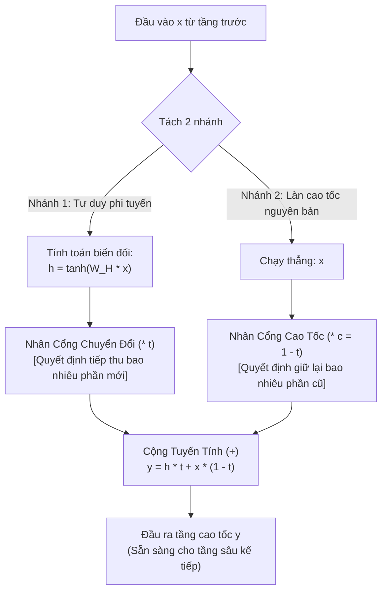
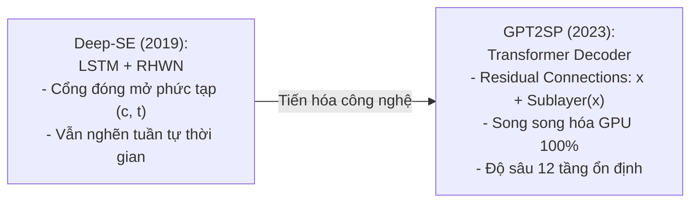

# 🧩 THUẬT NGỮ: RHWN (RECURRENT HIGHWAY NETWORK - MẠNG ĐƯỜNG CAO TỐC HỒI QUY)

> **Mạng đường cao tốc hồi quy (Recurrent Highway Network - RHWN)**  
> *Thuộc nhóm:* Kiến Trúc Học Sâu & Mạng Nơ-ron Sâu (Deep Learning & Deep Recurrent Architectures)  
> *Áp dụng trong:* Tầng suy luận trừu tượng của mô hình **Deep-SE** (Choetkiertikul et al., 2019) và là đối chứng được thay thế bởi Transformer trong **GPT2SP** (IEEE TSE 2023).

---

## 🧒 PHẦN 1: GIẢI THÍCH CHO ĐỨA TRẺ 10 TUỔI (THE 10-YEAR-OLD EXPLANATION)

Hãy tưởng tượng một thành phố lớn có rất nhiều ngã tư và đèn giao thông. 

Vào giờ cao điểm, các con đường bên dưới mặt đất bị kẹt xe cứng ngắc. Một chiếc xe cứu thương chở bệnh nhân nguy kịch cần đi từ đầu thành phố đến bệnh viện ở cuối thành phố. Nếu chiếc xe cứu thương phải dừng lại ở từng ngã tư, rẽ qua 10 con hẻm ngoằn ngoèo (tương tự như tín hiệu đi qua 10 lớp nơ-ron sâu), chiếc xe sẽ bị chết máy giữa đường và không bao giờ đến nơi kịp lúc!

Các kỹ sư giao thông đã xây dựng một **cây cầu cạn đường cao tốc trên cao (Highway)**:
* Cây cầu này chạy thẳng tắp trên không trung, không hề có bất kỳ ngã tư hay cột đèn đỏ nào chắn đường.
* Xe cứu thương chỉ cần phóng một mạch trên đường cao tốc là tới đích an toàn trong chớp mắt mà không tốn chút sức lực nào!

Mạng nơ-ron **RHWN (Đường cao tốc hồi quy)** cũng hoạt động y hệt như vậy:  
Nó cho phép các nhà khoa học xếp chồng nhiều tầng nơ-ron sâu bên trong mỗi bước thời gian để suy nghĩ sâu sắc hơn, nhưng tín hiệu thông tin quan trọng luôn có một **"làn đường cao tốc riêng"** để chạy xuyên suốt mà không bị thất lạc hay biến mất!

> 💡 **Định nghĩa bình dân:**  
> **RHWN (Mạng đường cao tốc hồi quy)** là mạng nơ-ron cho phép máy tính suy nghĩ sâu nhiều tầng tại mỗi bước thời gian bằng cách mở ra một "làn đường cao tốc thông suốt", giúp thông tin và độ dốc toán học chạy thẳng từ tầng dưới lên tầng trên mà không bị kẹt xe hay biến mất giữa đường.

---

## 🔍 PHẦN 2: BÓC TÁCH TỪNG TỪ NGỮ CHUYÊN NGÀNH (DECONSTRUCTING THE JARGON)

Tên gọi **Recurrent Highway Network (RHWN)** được ghép từ 3 khái niệm toán học và học sâu:

| Thành tố | Gốc từ tiếng Anh | Ý nghĩa đời thường | Ý nghĩa trong Kiến trúc Học Sâu | Khái niệm đối lập (Antonym) |
| :--- | :--- | :--- | :--- | :--- |
| **Recurrent** | *Recur* (lặp lại theo chu kỳ) | Sự việc xảy ra lặp đi lặp lại nhiều lần. | Mạng nơ-ron xử lý chuỗi dữ liệu theo các bước thời gian tuần tự ($t = 1, 2, \dots, T$). | *Feed-Forward* (chỉ truyền thẳng một chiều, không hồi quy). |
| **Highway** | *Highway* (đường cao tốc) | Tuyến đường giao thông tốc độ cao, không có chướng ngại vật hay ngã tư. | Cơ chế cổng dẫn đường tắt (**Gated Skip Connection**) cho phép thông tin truyền thẳng nguyên vẹn qua các lớp mà không bị biến đổi phi tuyến tính. | *Dense bottleneck / Blocked path* (nút thắt nghẽn, đường bị chặn). |
| **Network** | *Network* (mạng lưới) | Hệ thống các điểm nút kết nối chằng chịt với nhau. | Tập hợp các nơ-ron nhân tạo được tổ chức thành nhiều tầng liên kết với nhau bằng ma trận trọng số. | *Single layer* (một tầng đơn lẻ). |

### Bảng công thức toán học và cơ chế đóng-mở của Khối Cao Tốc (Highway Block):

Tại mỗi tầng cao tốc thứ $l \in \{1, 2, \dots, L\}$, trạng thái được tính toán dựa trên hai cánh cổng song sinh:

$$
\mathbf{y} = \mathbf{h} \odot \mathbf{t} + \mathbf{x} \odot \mathbf{c}
$$

| Đại lượng | Tên gọi chuyên môn | Công thức tính toán | Vai trò và ý nghĩa trực giác |
| :--- | :--- | :--- | :--- |
| $\mathbf{h}$ | **Phép Biến Đổi Phi Tuyến (Transform)** | $\tanh(W_H \mathbf{x} + b_H)$ | Luồng xử lý tư duy sâu: tính toán các đặc trưng phi tuyến tính phức tạp mới. |
| $\mathbf{t}$ | **Cổng Chuyển Đổi (Transform Gate)** | $\sigma(W_T \mathbf{x} + b_T)$ | Tỷ lệ mở cửa cho phép thông tin mới vừa tính toán đi qua ($0 \le \mathbf{t} \le 1$). |
| $\mathbf{c}$ | **Cổng Chở Hàng / Đường Cao Tốc (Carry Gate)** | Thường quy ước $\mathbf{c} = 1 - \mathbf{t}$ | Tỷ lệ mở cửa cho phép thông tin nguyên bản cũ $\mathbf{x}$ chạy thẳng trên đường cao tốc. |
| $\mathbf{x}$ | **Tín Hiệu Gốc Đầu Vào** | Vector từ tầng trước | Dòng dữ liệu ban đầu chưa bị thay đổi. |

---

## 📊 PHẦN 3: TRỰC QUAN HÓA BẰNG BẢNG DỮ LIỆU & SƠ ĐỒ (THE "AHA!" MOMENT)

Trong kiến trúc mạng hồi quy truyền thống (như RNN hay LSTM tiêu chuẩn), **độ sâu chuyển tiếp (Recurrence Depth)** giữa hai bước thời gian liên tiếp chỉ bằng đúng $1$ ($L = 1$). 

Mạng **RHWN (Zilly et al., 2017)** cho phép tăng độ sâu này lên $L = 2, 4, 8$ hoặc sâu hơn mà không làm nổ hay biến mất đạo hàm:

### Bảng minh họa trực quan sự linh hoạt của Cổng Cao Tốc:

| Tình huống thực tế của tác vụ | Giá trị Cổng Chuyển Đổi $\mathbf{t}$ | Giá trị Cổng Cao Tốc $\mathbf{c} = 1 - \mathbf{t}$ | Đầu ra $\mathbf{y}$ sẽ hành động như thế nào? |
| :--- | :---: | :---: | :--- |
| **1. Cần suy nghĩ trừu tượng cao độ** | **$1.0$ (Mở tối đa)** | $0.0$ (Đóng đường cao tốc) | $\mathbf{y} = \mathbf{h}$: Thực hiện biến đổi phi tuyến 100%, bỏ qua đường tắt để học logic phức tạp. |
| **2. Tín hiệu đã đủ hoàn hảo, không cần sửa** | $0.0$ (Đóng biến đổi) | **$1.0$ (Mở toang cao tốc)** | $\mathbf{y} = \mathbf{x}$: Tín hiệu chạy vèo qua lớp này mà **không bị sai lệch một milimet nào**! |
| **3. Cân bằng thông minh** | $0.3$ | $0.7$ | $\mathbf{y} = 0.3\mathbf{h} + 0.7\mathbf{x}$: Giữ lại $70\%$ cốt lõi ban đầu, chỉ thêm vào $30\%$ đặc trưng suy luận mới. |

> 🎉 **Khoảnh khắc "Aha!":**  
> Khi $\mathbf{c} = 1$ và $\mathbf{t} = 0$, mạng nơ-ron hoạt động như một **hàm đồng nhất (Identity Mapping)**: $\mathbf{y} = \mathbf{x}$.  
> Điều này đảm bảo mạng RHWN sâu bao nhiêu tầng cũng **không bao giờ hoạt động kém hơn một mạng nông**, vì nó luôn có khả năng tự động "tắt" các tầng thừa bằng cách mở toang làn đường cao tốc!

---

## ⚡ PHẦN 4: VAI TRÒ CỦA RHWN TRONG MÔ HÌNH DEEP-SE & HẠN CHẾ CÒN TỒN TẠI

Trong mô hình **Deep-SE (Choetkiertikul et al., 2019)**:
* Các tác giả nhận thấy mạng LSTM chỉ học được mối liên hệ nông giữa các từ cạnh nhau. Để ước lượng được Story Point chính xác, mô hình cần phải hiểu được các khái niệm trừu tượng cấp cao hơn (ví dụ: sự kết hợp giữa *"thay đổi cơ sở dữ liệu"* + *"ảnh hưởng 5 dịch vụ khác"* $\rightarrow$ nỗ lực cực kỳ lớn).
* Do đó, Deep-SE đã **kết hợp RHWN ngay phía sau LSTM** để tạo ra các biểu diễn phi tuyến tính sâu sắc trước khi xuất ra điểm số.

### Tuy nhiên, RHWN vẫn không thể cứu vãn các điểm yếu cố hữu:
1. **Vẫn bị trói buộc vào cơ chế tuần tự:**  
   RHWN làm tăng độ sâu tại mỗi bước thời gian, nhưng nó vẫn là mạng hồi quy tuần tự. Nó không giải quyết được vấn đề cơ bản: **vẫn không thể chạy song song trên GPU** và thời gian huấn luyện vẫn rất chậm.
2. **Số lượng siêu tham số bùng nổ:**  
   Việc tinh chỉnh số tầng cao tốc ($L$), kích thước cổng chuyển đổi, hệ số suy giảm trọng số khiến mô hình Deep-SE trở nên rất nhạy cảm và khó huấn luyện đồng đều trên nhiều dự án phần mềm khác nhau.

---

## 🚀 PHẦN 5: GPT2SP ĐÃ THAY THẾ RHWN BẰNG CƠ CHẾ GÌ?

Trong bài báo **GPT2SP (Fu & Tantithamthavorn, TSE 2023)**, các tác giả hoàn toàn không cần đến mạng RHWN phức tạp. Thay vào đó, kiến trúc **Transformer Decoder** đã kế thừa và hoàn thiện ý tưởng đường cao tốc bằng một kỹ thuật thanh lịch hơn: **Kết nối phần dư (Residual Connections)**:

1. **Kết nối phần dư đơn giản và hiệu quả hơn ($x + \text{Sublayer}(x)$):**  
   Thay vì phải tốn tài nguyên tính toán thêm hai ma trận trọng số cho cổng $t$ và cổng $c$ như trong RHWN, Transformer chỉ cần cộng trực tiếp tín hiệu đầu vào vào đầu ra qua phép cộng tắt $x + f(x)$. Cơ chế này mang lại tác dụng chống biến mất đạo hàm tương đương nhưng tính toán nhẹ hơn nhiều.
2. **Khả năng tư duy sâu vượt bậc:**  
   GPT2SP xếp chồng **12 tầng Transformer Decoder** (với 12 đầu chú ý mỗi tầng), tạo ra năng lực biểu diễn sâu và trừu tượng vượt xa kiến trúc LSTM + RHWN của Deep-SE.

---

## ⏱️ PHẦN 6: TỔNG KẾT 30 GIÂY (THE ELEVATOR PITCH)

* **Bản chất:** RHWN là mạng nơ-ron hồi quy sâu được trang bị các cổng đóng mở đường cao tốc (Carry Gate & Transform Gate), cho phép tín hiệu truyền qua nhiều tầng xử lý mà không bị suy giảm đạo hàm.
* **Điểm đột phá:** Cho phép Deep-SE tăng độ sâu biểu diễn ngữ nghĩa lên nhiều tầng sau lớp LSTM, đạt mức sai số MAE = 2.08 — vượt trội so với các mô hình học máy truyền thống thời điểm 2019.
* **Hạn chế & Thay thế:** Vẫn bị giới hạn bởi tính toán tuần tự chậm chạp. Trong GPT2SP, RHWN được thay thế hoàn toàn bởi cấu trúc 12 tầng Transformer Decoder kết hợp các đường tắt Residual Connections song song hóa hoàn toàn.