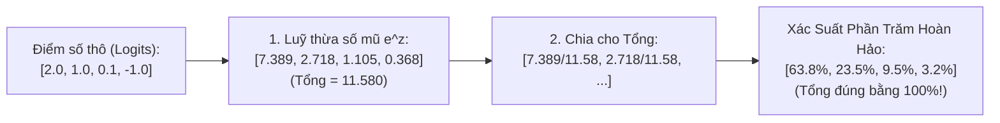

# 🧩 THUẬT NGỮ: SOFTMAX (HÀM BIẾN ĐỔI PHÂN PHỐI XÁC SUẤT)

> **Hàm Softmax / Hàm làm mềm cực đại (Softmax Function)**  
> *Thuộc nhóm:* Toán Học Học Sâu & Phân Phối Xác Suất (Deep Learning Math & Probability)  
> *Áp dụng trong:* Tính toán ma trận trọng số chú ý trong cơ chế Self-Attention của **GPT-2** và **GPT2SP** (IEEE TSE 2023).

---

## 🧒 PHẦN 1: GIẢI THÍCH CHO ĐỨA TRẺ 10 TUỔI (THE 10-YEAR-OLD EXPLANATION)

Hãy tưởng tượng một lớp học tổ chức bầu chọn lớp trưởng giữa 4 bạn học sinh:
* Bạn An được ban giám khảo chấm: **$+3.0$ điểm**.
* Bạn Bình được chấm: **$+1.0$ điểm**.
* Bạn Cường được chấm: **$0.0$ điểm**.
* Bạn Dũng phạm quy bị trừ điểm âm: **$-2.0$ điểm**.

Bây giờ, cô giáo mang ra một chiếc **bánh kem sinh nhật tròn xoe tượng trưng cho $100\%$ quyền lực**. Cô muốn chia chiếc bánh kem này thành 4 miếng cho 4 bạn sao cho:
1. Bạn nào điểm cao hơn thì được miếng bánh to hơn hẳn.
2. Bạn bị điểm âm vẫn được chia một mẩu bánh nhỏ xíu xiu an ủi chứ không bị bỏ đói hoàn toàn.
3. Tổng diện tích của cả 4 miếng bánh cộng lại phải **đúng bằng $100\%$ chiếc bánh tròn** ($1.0$).

Để làm được điều đó, cô giáo đưa các con số điểm số vào một chiếc **lò nướng ma thuật (Hàm số mũ $e^x$)**:
* Chiếc lò nướng biến tất cả mọi con số (dù âm hay dương) thành những con số dương rực rỡ ($e^{-2} = 0.135$, $e^0 = 1$, $e^1 = 2.718$, $e^3 = 20.085$). Điểm của bạn An ($+3.0$) được phóng to vọt lên thành một con số khổng lồ!
* Sau đó, cô lấy từng con số chia cho tổng của cả 4 con số cộng lại.

Chiếc lò nướng chia bánh kem kỳ diệu đó chính là **Hàm Softmax**!

> 💡 **Định nghĩa bình dân:**  
> **Softmax** là công thức toán học biến đổi một danh sách các con số thực bất kỳ (có thể âm, dương, to, nhỏ lộn xộn) thành một **danh sách các tỷ lệ phần trăm xác suất đẹp đẽ** từ $0\%$ đến $100\%$, với tổng cộng tất cả các phần tử luôn luôn bằng đúng $100\%$ ($1.0$).

---

## 🔍 PHẦN 2: BÓC TÁCH TỪNG TỪ NGỮ CHUYÊN NGÀNH (DECONSTRUCTING THE JARGON)

Thuật ngữ **Softmax** là sự kết hợp giữa hai khái niệm đối lập:

| Thành tố | Gốc từ tiếng Anh | Ý nghĩa đời thường | Ý nghĩa trong Toán học & Machine Learning | Khái niệm đối lập (Antonym) |
| :--- | :--- | :--- | :--- | :--- |
| **Soft** | *Soft* (mềm mại, êm ái) | Mềm dẻo, dễ uốn nắn. | Tính chất trơn tru, khả vi (differentiable), có đạo hàm liên tục tại mọi điểm trên trục số thực. | **Hard (Cứng nhắc, đột ngột, gián đoạn).** |
| **Max** | *Maximum* (cực đại, lớn nhất) | Giá trị cao nhất trong nhóm. | Phép chọn ra phần tử có giá trị lớn nhất (**Argmax**). | *Min / Minimum* (cực tiểu, nhỏ nhất). |
| **Softmax** | *Làm mềm cực đại* | Lựa chọn kẻ thắng cuộc một cách êm ái. | Phiên bản làm trơn (smooth approximation) của hàm tìm giá trị lớn nhất: thay vì gán $100\%$ cho kẻ về nhất và $0\%$ cho tất cả những người còn lại, nó chia xác suất mượt mà theo tỷ lệ hàm mũ. | **Hardmax / Argmax (Hàm chọn số lớn nhất cứng nhắc).** |

### Công thức toán học định nghĩa Softmax:

Cho một vector gồm $K$ con số thực thô (Raw Logits): $\mathbf{z} = [z_1, z_2, \dots, z_K] \in \mathbb{R}^K$.  
Giá trị xác suất sau hàm Softmax của phần tử thứ $i$ được tính bằng:

$$
\text{Softmax}(z_i) = \frac{e^{z_i}}{\sum_{j=1}^{K} e^{z_j}}
$$

Hai tính chất vàng không thể phá vỡ của Softmax:
1. **Mọi giá trị đều là xác suất hợp lệ:** $0 < \text{Softmax}(z_i) < 1 \quad \forall i$.
2. **Tổng xác suất bảo toàn tuyệt đối:** $\sum_{i=1}^{K} \text{Softmax}(z_i) = 1.0 \quad (100\%)$.

---

## 📊 PHẦN 3: TRỰC QUAN HÓA BẰNG BẢNG DỮ LIỆU (THE "AHA!" MOMENT)

Hãy xem cách Softmax biến đổi 4 giá trị điểm số thô ($z$) thành xác suất phần trăm:

### Bảng so sánh giữa Hardmax (Cứng nhắc) và Softmax (Mềm mại):

| Ứng viên | Điểm số thô ($z_i$) | Giá trị hàm mũ $e^{z_i}$ | Tỷ lệ Softmax: $\frac{e^{z_i}}{\sum e^z}$ | Tỷ lệ Hardmax (Argmax cứng) | Nhận xét hành vi |
| :---: | :---: | :---: | :---: | :---: | :--- |
| **A** | **$+2.0$** | $7.389$ | **$63.8\%$** | **$100\%$ ($1.0$)** | Người về nhất: Softmax ưu tiên số đông ($63.8\%$), Hardmax thâu tóm tất cả. |
| **B** | $+1.0$ | $2.718$ | **$23.5\%$** | $0\%$ ($0.0$) | Người về nhì: Vẫn nhận được $23.5\%$ sự chú ý xứng đáng. |
| **C** | $+0.1$ | $1.105$ | **$9.5\%$** | $0\%$ ($0.0$) | Điểm dương nhỏ: Nhận được gần $10\%$ chú ý. |
| **D** | **$-1.0$** | $0.368$ | **$3.2\%$** | $0\%$ ($0.0$) | Điểm âm: Hàm mũ biến thành số dương ($0.368$), vẫn được chia $3.2\%$ cơ hội. |
| **TỔNG** | - | **$11.580$** | **$100.0\%$ ($1.0$)** | **$100.0\%$ ($1.0$)** | - |

> 🎉 **Khoảnh khắc "Aha!":**  
> Nếu dùng Hardmax, bạn A chiếm trọn $100\%$, còn bạn B dù được điểm cao $+1.0$ cũng bị coi như rác và nhận $0\%$!  
> Nhờ có Softmax, máy tính không chỉ biết bạn A là người dẫn đầu, mà còn **đo lường được khoảng cách mức độ tin cậy**: A hơn B gấp gần 3 lần ($63.8\%$ so với $23.5\%$)! Điều này cung cấp thông tin vô cùng phong phú cho mạng nơ-ron học tập!

---

## ⚡ PHẦN 4: THÁCH THỨC KỸ THUẬT & TẠI SAO PHẢI CO DÃN TRƯỚC KHI SOFTMAX?

Trong cơ chế tính toán Attention của Transformer:

$$
\text{Attention}(Q, K, V) = \text{Softmax}\left(\frac{Q K^T}{\sqrt{d_k}}\right) V
$$

Tại sao các tác giả bắt buộc phải chia cho **$\sqrt{d_k}$ (Scaled Factor)** trước khi nạp vào Softmax?

1. **Hiểm họa bão hòa Softmax (Softmax Saturation):**  
   Khi số chiều của vector $d_k$ lớn (ví dụ $d_k = 64$), phép nhân tích vô hướng $Q K^T$ là tổng của 64 phép nhân số thực. Giá trị này có phương sai lớn và rất dễ bị đẩy lên các con số khổng lồ (như $+50$ hoặc $-50$).
2. **Cực hạn đạo hàm biến mất (Vanishing Gradient):**  
   Khi đầu vào của Softmax quá lớn:
   * Giá trị lớn nhất nhận gần $100\%$, các giá trị khác nhận $0\%$.
   * Tại vùng này, **đạo hàm của hàm Softmax gần như bằng đúng số 0 tròn trĩnh**!
   * Khi đạo hàm bằng 0, quá trình lan truyền ngược (Back-propagation) bị chặn đứng, mô hình không thể học thêm được gì nữa.
3. **Chiếc phanh co dãn $\sqrt{d_k}$:**  
   Việc chia cho $\sqrt{64} = 8$ kéo giá trị của các con số về lại vùng lân cận quanh 0 — nơi mà hàm Softmax có **độ dốc đạo hàm dồi dào nhất**, giúp mô hình huấn luyện ổn định và nhanh chóng!

---

## 🚀 PHẦN 5: VAI TRÒ CỦA SOFTMAX TRONG GPT-2 VÀ GPT2SP

Trong mô hình ngôn ngữ **GPT-2 nguyên bản**:
* Softmax xuất hiện ở **hai vị trí hoàn toàn khác nhau**:
  1. *Bên trong mỗi khối Decoder:* Nằm ở trung tâm của cơ chế Self-Attention để tính ma trận trọng số chú ý giữa các từ.
  2. *Ở đỉnh trên cùng (LM Head):* Biến đổi vector 50.257 chiều thành phân phối xác suất để chọn từ tiếp theo.

Trong công trình **GPT2SP (Fu & Tantithamthavorn, TSE 2023)**:
* **Loại bỏ Softmax ở đỉnh:** Vì bài toán ước lượng Story Point là bài toán hồi quy số thực liên tục ($SP \in \mathbb{R}$), các tác giả đã gỡ bỏ hoàn toàn tầng Softmax phân loại từ vựng ở đỉnh và thay bằng **MLP Regressor Head** tuyến tính.
* **Bảo tồn Softmax bên trong Self-Attention:** Tầng Softmax bên trong 12 khối Transformer Decoder vẫn được giữ nguyên vẹn $100\%$. Nó đóng vai trò quyết định trong việc cân đo xem từ nào trong tiêu đề và mô tả Jira cần được "chú ý" nhiều hơn (như các từ khóa `NullPointerException`, `timeout`, `deadlock`) để truyền tải ngữ cảnh trọn vẹn nhất về token cuối cùng!

---

## ⏱️ PHẦN 6: TỔNG KẾT 30 GIÂY (THE ELEVATOR PITCH)

* **Bản chất:** Softmax là hàm kích hoạt toán học sử dụng hàm số mũ $e^x$ để biến đổi một vector các con số thực bất kỳ thành một phân phối xác suất chuẩn mực có tổng bằng đúng $1.0$ ($100\%$).
* **Điểm đột phá:** Là phiên bản trơn tru, có đạo hàm liên tục của phép chọn cực đại (Argmax), giúp các thuật toán tối ưu hóa lan truyền ngược đạo hàm một cách mượt mà.
* **Giá trị trong GPT2SP:** Đóng vai trò là "chiếc cân đo sự chú ý" bên trong tất cả 144 đầu Self-Attention, quyết định trọng số liên kết ngữ nghĩa giữa các từ ngữ kỹ thuật trong báo cáo lỗi Jira.