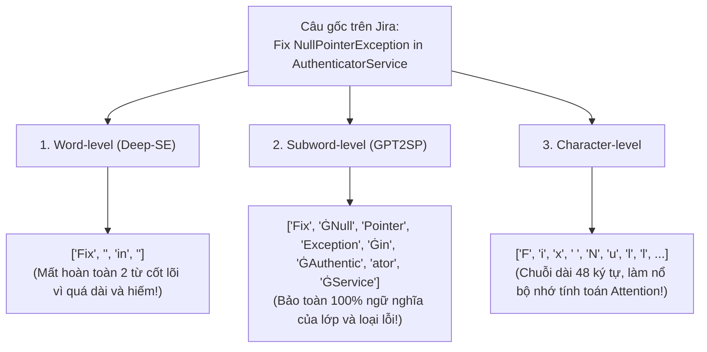

# 🧩 THUẬT NGỮ: SUBWORD TOKENS (MẢNH TỪ CON / ĐƠN VỊ TỪ CON)

> **Mảnh từ con (Subword Tokens)**  
> *Thuộc nhóm:* Xử Lý Ngôn Ngữ Tự Nhiên & Tokenization (NLP & Tokenization)  
> *Áp dụng trong:* Mô hình ngôn ngữ GPT-2 và phương pháp ước lượng Story Point **GPT2SP** (IEEE TSE 2023).

---

## 🧒 PHẦN 1: GIẢI THÍCH CHO ĐỨA TRẺ 10 TUỔI (THE 10-YEAR-OLD EXPLANATION)

Hãy tưởng tượng em có một hộp mô hình xe đua đồ chơi. 

Nếu nhà sản xuất đúc sẵn **nguyên một chiếc xe liền khối** bằng kim loại (như một "Từ nguyên vẹn" - *Full Word*), chiếc xe rất đẹp nhưng em không thể biến hóa nó thành xe tải, xe cần cẩu hay xe cảnh sát được. Nếu muốn có 100 loại xe, em phải mua đủ 100 khối kim loại cồng kềnh.

Ngược lại, nếu họ chỉ bán cho em **từng con ốc vít và hạt cát vụn** (như từng "Ký tự đơn lẻ" - *Character*), em sẽ mất cả buổi chiều chỉ để lắp ráp được một cái bánh xe, rất dễ nản lòng và dễ rơi mất ốc.

Nhà sản xuất đồ chơi thông minh nhất đã tạo ra các **khối mô-đun Lego nhỡ cỡ**: một khối cụm bánh xe, một khối khung sườn, một khối kính chắn gió (đây chính là các **Subword Tokens**). 
* Khi gặp một từ quen thuộc ngắn gọn như `"xe"`, nó dùng nguyên khối.
* Khi gặp một từ dài phức tạp như `"xe-cứu-hỏa-siêu-tốc"`, nó ghép khối `xe` + khối `cứu-hỏa` + khối `siêu-tốc`.

> 💡 **Định nghĩa bình dân:**  
> **Subword Token** là các mẩu từ có kích thước "vừa vặn" — không to nguyên khối như một từ hoàn chỉnh, cũng không vụn vặt như từng chữ cái. Chúng là những khối ghép linh hoạt giúp máy tính hiểu được cả những từ dài ngoằng, từ ghép lập trình hay từ lạ bằng cách ghép các mẩu quen thuộc lại với nhau.

---

## 🔍 PHẦN 2: BÓC TÁCH TỪNG TỪ NGỮ CHUYÊN NGÀNH (DECONSTRUCTING THE JARGON)

Thuật ngữ **Subword Token** gồm hai thành tố:

| Thành tố | Gốc từ tiếng Anh | Ý nghĩa đời thường | Ý nghĩa trong Machine Learning & NLP | Khái niệm đối lập (Antonym) |
| :--- | :--- | :--- | :--- | :--- |
| **Subword** | *Sub-* (tiền tố: dưới, con, bộ phận) + *Word* (từ ngữ) | Mẩu từ nhỏ, phần con nằm bên trong một từ hoàn chỉnh. | Một chuỗi con các ký tự hoặc byte biểu thị một đơn vị ngữ nghĩa tối thiểu (hình vị - morpheme, tiền tố, hậu tố). | *Whole-word* (từ nguyên khối hoàn chỉnh). |
| **Token** | *Token* (thẻ bài, đồng xu tượng trưng) | Một vật tượng trưng dùng để đổi lấy dịch vụ (như thẻ chơi xèng, vé xe bus). | Đơn vị văn bản rời rạc nhỏ nhất mà mô hình máy tính xử lý tại mỗi bước, được biểu diễn bằng một số nguyên (Token ID). | *Raw text / Character string* (chuỗi văn bản thô chưa cắt). |

### Bảng phân tích các cấp độ chia cắt văn bản trong xử lý ngôn ngữ tự nhiên:

| Cấp độ Token (Granularity) | Ví dụ cắt từ `"Unbelievable"` | Kích thước từ điển (Vocab Size) | Độ dài chuỗi token sau cắt | Khả năng rò rỉ lỗi OOV |
| :--- | :--- | :--- | :--- | :--- |
| **Cấp độ Từ (Word-level)** | `["Unbelievable"]` | Rất lớn (100.000 – 1.000.000+) | Rất ngắn (1 token) | Rất cao (gặp từ mới là mù tịt) |
| **Cấp độ Mảnh từ con (Subword-level)** | `["Un", "believ", "able"]` | Cố định và tối ưu (30.000 – 50.000) | Trung bình (2 – 3 tokens) | **Bằng 0%** (xử lý được mọi từ) |
| **Cấp độ Ký tự (Character-level)** | `["U", "n", "b", "e", "l", "i", "e", "v", "a", "b", "l", "e"]` | Siêu nhỏ (khoảng 100 – 256) | Cực kỳ dài (12 tokens) | Bằng 0% |

---

## 📊 PHẦN 3: TRỰC QUAN HÓA BẰNG BẢNG DỮ LIỆU (THE "AHA!" MOMENT)

Trong các báo cáo issue trên Jira của các dự án phần mềm, các lập trình viên thường viết mô tả pha trộn giữa tiếng Anh thông thường và các đoạn mã lỗi, tên lớp kỹ thuật. 

Hãy xem cách ba phương pháp xử lý câu tiêu đề issue thực tế:  
`"Fix NullPointerException in AuthenticatorService"`

### Bảng đối chiếu Token ID thực tế trong bộ mã hóa GPT-2 (Subword Tokens):

| Mảnh từ con (Subword Token) | Ký hiệu trong GPT-2 | Token ID (Mã số nguyên) | Ý nghĩa nhận diện ngữ nghĩa |
| :--- | :--- | :---: | :--- |
| `Fix` | `Fix` | `18421` | Hành động: sửa chữa, khắc phục sự cố. |
| `ĠNull` | `ĠNull` (dấu `Ġ` biểu thị khoảng trắng trước từ) | `13745` | Giá trị rỗng trong lập trình. |
| `Pointer` | `Pointer` | `18063` | Con trỏ bộ nhớ máy tính. |
| `Exception` | `Exception` | `10542` | Ngoại lệ, lỗi thực thi phần mềm. |
| `Ġin` | `Ġin` | `287` | Giới từ chỉ vị trí. |
| `ĠAuthentic` | `ĠAuthentic` | `33036` | Tiền tố gốc từ xác thực danh tính. |
| `ator` | `ator` | `753` | Hậu tố chỉ tác nhân thực thi. |
| `ĠService` | `ĠService` | `5619` | Dịch vụ, tiến trình phần mềm nền tảng. |

> 🎉 **Khoảnh khắc "Aha!":**  
> Dù từ `NullPointerException` chưa từng xuất hiện như một từ điển đơn lẻ, việc chia tách thành `Null` + `Pointer` + `Exception` giúp mô hình lập tức hiểu rằng đây là một **lỗi nghiêm trọng về con trỏ rỗng**, đòi hỏi nỗ lực gỡ lỗi và kiểm thử cao, từ đó gán mức Story Point chính xác hơn nhiều!

---

## ⚡ PHẦN 4: THÁCH THỨC KỸ THUẬT & HẠN CHẾ CỦA MÔ HÌNH DEEP-SE

Mô hình học sâu đầu-cuối trước đó là **Deep-SE (Choetkiertikul et al., 2019)** sử dụng phân tách từ hoàn chỉnh (*Word-level Tokenization*):

1. **Khủng hoảng mất dấu thông tin kỹ thuật:**  
   Các từ ngữ quan trọng nhất quyết định độ phức tạp của một User Story (như tên thư viện `org.apache.hadoop`, tên exception `ConcurrentModificationException`, hoặc mã định danh `ISSUE-402`) đều là từ ghép. Deep-SE biến tất cả thành token `<UNK>`. Hai nhiệm vụ hoàn toàn khác nhau về bản chất:
   * Issue A: `"Fix <UNK> in <UNK>"`
   * Issue B: `"Fix <UNK> in <UNK>"`  
   đều trông y hệt nhau trước mắt Deep-SE, khiến mô hình chỉ có thể đoán mò điểm nỗ lực.
2. **Chi phí bộ nhớ không gian $O(V \times d)$:**  
   Với từ điển $V = 185.625$ từ, ma trận trọng số nhúng của Deep-SE tiêu tốn dung lượng khổng lồ nhưng phần lớn các hàng vector lại chứa những từ chỉ xuất hiện đúng 1 lần trong suốt 5 năm lịch sử dự án.

---

## 🚀 PHẦN 5: GPT2SP TẬN DỤNG SUBWORD TOKENS NHƯ THẾ NÀO?

Kiến trúc GPT2SP (Fu & Tantithamthavorn, 2023) tận dụng cơ chế Subword Tokenization của GPT-2 để giải quyết triệt để các vấn đề trên:

1. **Xử lý linh hoạt mọi ngôn ngữ lập trình và văn bản:**  
   Dù lập trình viên viết theo chuẩn `camelCase` (`getStoryPoint`), `snake_case` (`calculate_velocity`), hay `kebab-case` (`sprint-planning-tool`), bộ phân tách subword dễ dàng bẻ nhỏ thành các token con có ý nghĩa mà không cần người dùng phải viết thủ công các biểu thức quy tắc (regex) phức tạp.
2. **Kích thước từ vựng ổn định tuyệt đối:**  
   Cố định ở mức **50.257 tokens**, ma trận nhúng từ $W_{te} \in \mathbb{R}^{50257 \times 768}$ chiếm dung lượng hợp lý và toàn bộ các token đều được cập nhật thường xuyên trong quá trình huấn luyện, tránh hiện tượng trọng số chết.
3. **Bảo toàn chiều dài chuỗi hợp lý:**  
   Khác với Character-level làm chuỗi văn bản dài lê thê gấp 5–7 lần khiến cơ chế Attention bị nghẽn bộ nhớ theo cấp số nhân $O(N^2)$, Subword Tokens chỉ tăng độ dài chuỗi từ khoảng $1.2$ đến $1.4$ lần so với Word-level, hoàn toàn nằm gọn trong cửa sổ ngữ cảnh 1024 token của GPT-2 Small.

---

## ⏱️ PHẦN 6: TỔNG KẾT 30 GIÂY (THE ELEVATOR PITCH)

* **Bản chất:** Subword Tokens là các mẩu từ con trung gian giữa từ hoàn chỉnh và ký tự đơn lẻ, được tạo ra bằng thuật toán ghép cặp tần suất như BPE.
* **Điểm đột phá:** Bảo toàn trọn vẹn ngữ nghĩa của các thuật ngữ chuyên ngành và mã nguồn ghép phức tạp trong Jira mà không làm bùng nổ từ điển và không bao giờ gặp từ lạ (`OOV = 0%`).
* **Giá trị trong GPT2SP:** Giúp mô hình đọc hiểu chính xác các báo cáo lỗi phức tạp, giữ độ dài chuỗi tối ưu cho ma trận Self-Attention và dự đoán Story Point với sai số MAE vượt trội hơn hẳn Deep-SE.