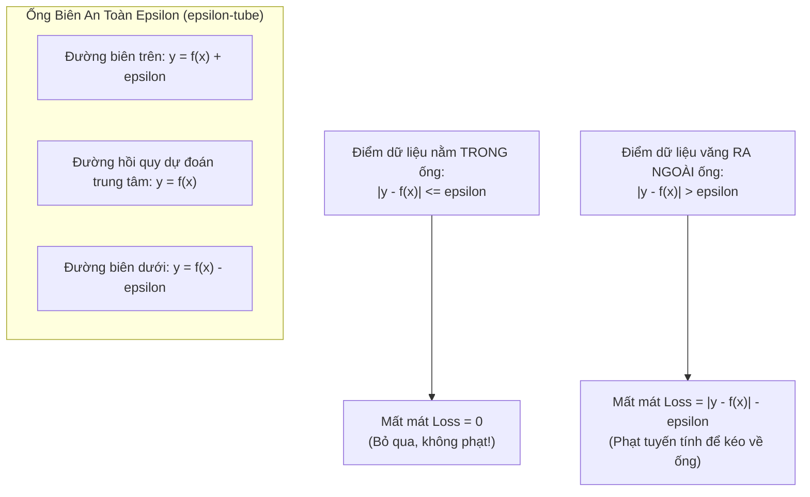
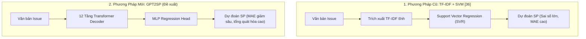

# 🧩 THUẬT NGỮ: SUPPORT VECTOR MACHINE (SVM / SVR - MÁY VECTOR HỖ TRỢ)

> **Máy vector hỗ trợ (Support Vector Machine - SVM / Support Vector Regression - SVR)**  
> *Thuộc nhóm:* Học Máy Truyền Thống & Tối Ưu Hóa Lồi (Traditional ML & Convex Optimization)  
> *Áp dụng trong:* Mô hình đối chứng cơ sở **TF-IDF + SVM** [36] (Porru et al.) được so sánh với Deep-SE và **GPT2SP** (IEEE TSE 2023).

---

## 🧒 PHẦN 1: GIẢI THÍCH CHO ĐỨA TRẺ 10 TUỔI (THE 10-YEAR-OLD EXPLANATION)

Hãy tưởng tượng em có một khu vườn, trong đó có hai nhóm thú nuôi đang chơi đùa: một nhóm là các chú thỏ trắng, một nhóm là các chú chó săn.

Em muốn căng một hàng rào thẳng tắp để chia đôi khu vườn, sao cho thỏ ở một bên và chó ở một bên. 
* Em có thể vẽ bừa một sợi dây mỏng dính chạy sát ngay mũi một chú chó. Nhưng nếu chú chó đó chỉ cần nhảy nhẹ một bước là đã vượt qua hàng rào sang cắn thỏ! Đó là một ranh giới rất nguy hiểm.
* Người làm vườn thông minh nhất (**Bác SVM**) làm một việc tuyệt vời: Bác tìm xem **chú chó nào đứng gần đàn thỏ nhất** và **chú thỏ nào đứng gần đàn chó nhất** (đây là những nhân vật then chốt gọi là các **Vector Hỗ Trợ - Support Vectors**). Sau đó, bác xây một **con đường cao tốc rộng thênh thang** nằm ở chính giữa, đẩy hai bên ra xa nhất có thể!

Khi chuyển sang bài toán đoán điểm Story Point (**Hồi quy - SVR**):  
Bác SVM đặt một chiếc **ống thủy tinh an toàn** có bán kính nhất định (gọi là ống $\epsilon$) bao bọc lấy các điểm dữ liệu. Nếu một công việc có độ khó rơi vào bên trong chiếc ống đó, bác coi như dự đoán hoàn hảo và không phạt lỗi gì cả. Chỉ khi nào có điểm văng ra ngoài thành ống, bác mới tính lỗi và kéo nó lại!

> 💡 **Định nghĩa bình dân:**  
> **Support Vector Machine (SVM)** là thuật toán tìm kiếm ranh giới phân tách hoặc dải hành lang an toàn rộng nhất có thể giữa các nhóm dữ liệu, dựa trên một số ít điểm dữ liệu then chốt nằm sát ranh giới nhất gọi là các "vector hỗ trợ".

---

## 🔍 PHẦN 2: BÓC TÁCH TỪNG TỪ NGỮ CHUYÊN NGÀNH (DECONSTRUCTING THE JARGON)

Thuật ngữ **Support Vector Machine** được phát minh bởi Vladimir Vapnik và Corinna Cortes (1995):

| Thành tố | Gốc từ tiếng Anh | Ý nghĩa đời thường | Ý nghĩa trong Toán học & Machine Learning | Khái niệm đối lập (Antonym) |
| :--- | :--- | :--- | :--- | :--- |
| **Support** | *Support* (chống đỡ, làm điểm tựa) | Cột trụ giữ vững mái nhà. | Các điểm dữ liệu nằm ngay trên đường biên biên giới, trực tiếp quyết định vị trí của siêu phẳng tối ưu. | *Non-support points* (các điểm nằm sâu bên trong không ảnh hưởng đến ranh giới). |
| **Vector** | *Vector* (vectơ tọa độ) | Dãy số biểu diễn một vật thể. | Tọa độ đặc trưng của một mẫu dữ liệu (ví dụ: vector TF-IDF của một issue Jira). | *Scalar* (con số đơn lẻ). |
| **Machine** | *Machine* (cỗ máy) | Thiết bị tự động thực thi. | Thuật toán máy học tự động tìm kiếm nghiệm tối ưu toàn cục bằng quy hoạch toàn phương lồi. | *Manual rule* (quy tắc thủ công do con người viết). |
| **SVR** | *Support Vector Regression* | Phiên bản hồi quy. | Ứng dụng SVM cho bài toán dự đoán số thực liên tục (Story Point) sử dụng hàm mất mát $\epsilon$-insensitive loss. | *SVC* (Support Vector Classifier - bài toán phân loại). |

### Sơ đồ nguyên lý chiếc ống an toàn $\epsilon$-Insensitive Tube trong SVR:

---

## 📊 PHẦN 3: TRỰC QUAN HÓA BẰNG BẢNG DỮ LIỆU (THE "AHA!" MOMENT)

Trong bài toán ước lượng Story Point bằng **SVR**, hàm mất mát $\epsilon$-không nhạy cảm ($\epsilon$-insensitive loss function) hoạt động với một ngưỡng dung sai cho phép, ví dụ $\epsilon = 0.5$ Story Point:

$$
L_\epsilon(y, \hat{y}) = \max(0, |y - \hat{y}| - \epsilon)
$$

### Bảng minh họa cách SVR đánh giá sai số của 4 User Story trong Sprint:

| Tên Issue trên Jira | Story Point thực tế ($y$) | SVR dự đoán ($\hat{y}$) | Độ lệch tuyệt đối $|y - \hat{y}|$ | Điểm rơi so với ống dung sai $\epsilon = 0.5$ | Mất mát tính phạt $L_\epsilon$ | Tình trạng điểm dữ liệu |
| :--- | :---: | :---: | :---: | :---: | :---: | :--- |
| **Issue A** (`Fix typos in login form`) | $1.0$ SP | $1.2$ SP | $0.2$ SP | Nằm trọn bên trong ống ($0.2 \le 0.5$) | **$0.0$ (Miễn phạt!)** | Điểm dữ liệu thông thường. |
| **Issue B** (`Update API documentation`) | $2.0$ SP | $1.6$ SP | $0.4$ SP | Nằm trọn bên trong ống ($0.4 \le 0.5$) | **$0.0$ (Miễn phạt!)** | Điểm dữ liệu thông thường. |
| **Issue C** (`Add OAuth2 authentication`) | $5.0$ SP | $4.5$ SP | $0.5$ SP | Nằm ngay trên mép thành ống ($0.5 = 0.5$) | **$0.0$** | ⭐ **Support Vector (Điểm tựa biên)!** |
| **Issue D** (`Database sharding cluster`) | $13.0$ SP | $8.0$ SP | $5.0$ SP | Văng xa tít ra ngoài ống ($5.0 > 0.5$) | $5.0 - 0.5 = \mathbf{4.5}$ | ⚠️ Điểm lỗi, bị phạt mạnh để kéo ống lại. |

> 🎉 **Khoảnh khắc "Aha!":**  
> Hãy nhìn Issue A và B: Mô hình không đoán trúng $100\%$ (lệch $0.2$ và $0.4$ SP), nhưng SVR **hoàn toàn không phạt một đồng nào** ($Loss = 0$)!  
> Khác với hồi quy bình phương tối thiểu (OLS) luôn căng thẳng với từng sai số li ti, SVR tạo ra một **khoảng dung sai thoải mái**, giúp mô hình có tính khái quát hóa cực cao và không bị quá khớp với những nhiễu nhỏ nhặt trong việc con người chấm điểm Story Point!

---

## ⚡ PHẦN 4: THÁCH THỨC KỸ THUẬT & HẠN CHẾ CỦA SVM

Mặc dù có nền tảng toán học tối ưu lồi rất chặt chẽ, SVM/SVR lại bộc lộ những nhược điểm lớn trong bài toán Agile:

1. **Độ phức tạp tính toán bùng nổ theo cấp số nhân ($O(N^2)$ đến $O(N^3)$):**  
   Thuật toán tối ưu hóa của SVM đòi hỏi phải giải bài toán quy hoạch toàn phương trên ma trận nhân giữa tất cả các cặp mẫu dữ liệu ($N \times N$). Khi tập dữ liệu Jira lên đến hơn **23.000 issues** (như trong bài báo Deep-SE và GPT2SP), việc huấn luyện SVM trở nên vô cùng chậm chạp và tiêu tốn bộ nhớ RAM khổng lồ.
2. **Quá phụ thuộc vào hàm nhân (Kernel Trick):**  
   Để xử lý quan hệ phi tuyến, SVM phải dùng Kernel (RBF, Polynomial). Tuy nhiên, việc chọn hàm kernel và tinh chỉnh hai siêu tham số $C$ (hệ số phạt) và $\gamma$ (độ rộng kernel) giống như "mò kim đáy bể".
3. **Không học được biểu diễn ngôn ngữ (No Feature Learning):**  
   SVM chỉ là bộ phân loại/hồi quy trên các vector số có sẵn. Nó không có khả năng tự trích xuất ngữ pháp, cấu trúc câu hay ngữ cảnh ngữ nghĩa như mạng nơ-ron sâu.

---

## 🚀 PHẦN 5: TF-IDF + SVM [36] BỊ GPT2SP ĐÁNH BẠI NHƯ THẾ NÀO?

Trong công trình **GPT2SP (Fu & Tantithamthavorn, TSE 2023)**, nghiên cứu của Porru et al. [36] sử dụng kết hợp **TF-IDF + SVM** được lấy làm một trong những mốc đối chứng then chốt:

### Kết quả đối chiếu thực nghiệm trong bài báo:
* **Hạn chế của TF-IDF + SVM:** Khi gặp các dự án mới lạ trong kịch bản Cross-Project, các vector TF-IDF bị lệch phân phối hoàn toàn. Siêu phẳng của SVM không thể phân định được các điểm dữ liệu mới, dẫn đến sai số MAE tăng vọt và chỉ số Standardised Accuracy (SA) rất thấp.
* **Sự thống trị của GPT2SP:** GPT2SP vượt trội hơn hẳn TF-IDF + SVM trên toàn bộ 16 dự án mã nguồn mở, đạt cải thiện ý nghĩa thống kê qua kiểm định **Wilcoxon Signed-Rank Test ($p < 0.05$)** và kích thước ảnh hưởng **Cliff's Delta** ở mức lớn (*large effect size*).

---

## ⏱️ PHẦN 6: TỔNG KẾT 30 GIÂY (THE ELEVATOR PITCH)

* **Bản chất:** SVM là thuật toán tối ưu hóa hình học tìm kiếm siêu phẳng có khoảng cách biên an toàn (margin) cực đại; dạng hồi quy SVR dùng ống dung sai $\epsilon$-insensitive để dự đoán số thực.
* **Điểm mạnh:** Cơ sở toán học lồi vững chắc, kháng quá khớp tốt trên các tập dữ liệu nhỏ và vừa.
* **Hạn chế & Vai trò trong bài báo:** Chậm chạp trên tập dữ liệu lớn ($O(N^3)$) và không tự học được biểu diễn ngôn ngữ. Baseline kinh điển **TF-IDF + SVM [36]** bị mô hình học sâu GPT2SP vượt mặt toàn diện về mọi thước đo thực nghiệm.