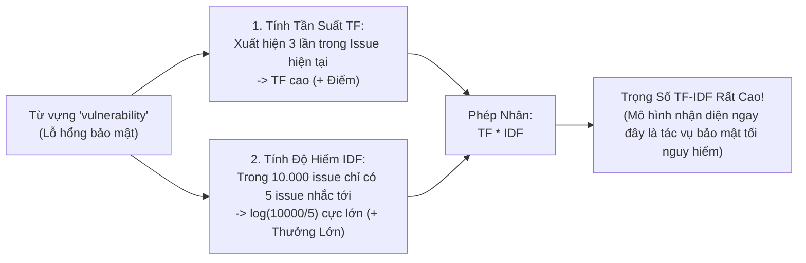
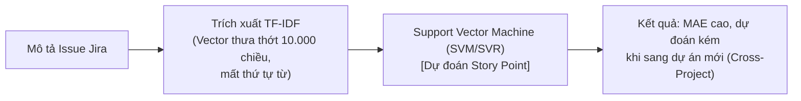

# 🧩 THUẬT NGỮ: TF-IDF (TERM FREQUENCY - INVERSE DOCUMENT FREQUENCY)

> **Tần suất từ - Nghịch đảo tần suất văn bản (TF-IDF)**  
> *Thuộc nhóm:* Xử Lý Ngôn Ngữ Tự Nhiên Truyền Thống & Khai Phá Văn Bản (Traditional NLP & Text Mining)  
> *Áp dụng trong:* Mô hình đối chứng cơ sở **TF-IDF + SVM** [36] được so sánh với Deep-SE và **GPT2SP** (IEEE TSE 2023).

---

## 🧒 PHẦN 1: GIẢI THÍCH CHO ĐỨA TRẺ 10 TUỔI (THE 10-YEAR-OLD EXPLANATION)

Hãy tưởng tượng em là một vị thám tử nhí đi điều tra một vụ án mất trộm trong một tòa lâu đài có 1.000 căn phòng.

Tại hiện trường vụ án, em tìm thấy một mẩu giấy ghi lại các manh mối:  
`"Kẻ trộm là một người đàn ông đi giày cỡ 42 mang theo chất độc xyanua."`

Nếu em đếm xem từ nào xuất hiện nhiều nhất:
* Các từ như `"là"`, `"một"`, `"người"`, `"đi"` xuất hiện khắp mọi nơi trong tất cả 1.000 căn phòng của lâu đài. Bất kỳ ai mở miệng ra cũng nói những từ đó! Do đó, những từ này **hoàn toàn vô giá trị** đối với công việc điều tra của thám tử.
* Ngược lại, cụm từ `"chất độc xyanua"` hay `"giày cỡ 42"` là những manh mối **cực kỳ hiếm hoi**, lục tung cả 1.000 căn phòng chỉ có đúng 1 căn phòng nhắc tới! 

Vì vậy, thám tử nhí phải chấm điểm cho các từ:
1. Từ nào xuất hiện nhiều trong căn phòng hiện tại? $\rightarrow$ Điểm cộng (**Tần suất từ - TF**).
2. Từ nào xuất hiện nhan nhản ở khắp mọi căn phòng khác? $\rightarrow$ Bị phạt trừ điểm thật nặng! Chỉ từ nào **cực kỳ hiếm gặp ở các phòng khác** mới được nhân điểm thưởng lên cao ngất ngưởng (**Nghịch đảo tần suất văn bản - IDF**).

Tích số giữa hai điểm đó chính là **TF-IDF**!

> 💡 **Định nghĩa bình dân:**  
> **TF-IDF** là công thức toán học giúp máy tính chấm điểm xem từ ngữ nào là "từ khóa vàng" thực sự mang thông tin quan trọng nhất của bài viết, bằng cách khen thưởng những từ xuất hiện nhiều trong bài hiện tại nhưng lại rất hiếm khi xuất hiện ở các bài viết khác.

---

## 🔍 PHẦN 2: BÓC TÁCH TỪNG TỪ NGỮ CHUYÊN NGÀNH (DECONSTRUCTING THE JARGON)

Thuật ngữ **TF-IDF** được ghép từ hai đại lượng thống kê nhân với nhau:

| Thành tố | Ký hiệu | Ý nghĩa đời thường | Công thức toán học | Vai trò trong xử lý ngôn ngữ tự nhiên |
| :--- | :---: | :--- | :--- | :--- |
| **Term Frequency (Tần suất từ)** | $\text{TF}(t, d)$ | Đếm xem từ đó lặp lại bao nhiêu lần trong bài viết hiện tại. | $\text{TF}(t, d) = \frac{f_{t, d}}{\sum_{t' \in d} f_{t', d}}$ | Đo lường mức độ phổ biến của từ bên trong tài liệu khảo sát. |
| **Inverse Document Frequency (Nghịch đảo tần suất tài liệu)** | $\text{IDF}(t, D)$ | Phạt những từ phổ biến đại trà, thưởng lớn cho các từ hiếm hoi. | $\text{IDF}(t, D) = \log\left(\frac{N}{|\{d \in D : t \in d\}|}\right)$ | Đo lường độ quý hiếm và lượng thông tin đặc thù của từ trên toàn bộ kho tài liệu. |
| **Trọng số TF-IDF tổng hợp** | $\text{TF-IDF}$ | Điểm số quyền lực của từ khóa. | $\text{TF-IDF}(t, d, D) = \text{TF}(t, d) \times \text{IDF}(t, D)$ | Biến một đoạn văn bản thành một vector số thực phản ánh tầm quan trọng của từng từ vựng. |

### Sơ đồ luồng tính toán trọng số TF-IDF:

---

## 📊 PHẦN 3: TRỰC QUAN HÓA BẰNG BẢNG DỮ LIỆU (THE "AHA!" MOMENT)

Giả sử chúng ta có kho dữ liệu Jira gồm $N = 1.000$ issues.  
Đang khảo sát một issue có nội dung: `"The database connection throws NullPointerException when the user authentication fails"` (tổng cộng 10 từ).

| Từ vựng ($t$) | Số lần xuất hiện trong Issue ($f_{t, d}$) | Tần suất $\text{TF} = f/10$ | Số issue trong kho có chứa từ này ($DF$) | Nghịch đảo $\text{IDF} = \log(1000 / DF)$ | Điểm số trọng số cuối cùng $\text{TF-IDF} = \text{TF} \times \text{IDF}$ | Đánh giá giá trị thông tin |
| :--- | :---: | :---: | :---: | :---: | :---: | :--- |
| `the` | 2 | **0.20** | 980 | $\log(1000/980) = \mathbf{0.02}$ | $0.20 \times 0.02 = \mathbf{0.004}$ | ❌ Vô giá trị (từ dừng - stopword). |
| `fails` | 1 | 0.10 | 450 | $\log(1000/450) = 0.80$ | $0.10 \times 0.80 = 0.080$ | ⚠️ Thông thường, xuất hiện nhiều nơi. |
| `database` | 1 | 0.10 | 120 | $\log(1000/120) = 2.12$ | $0.10 \times 2.12 = 0.212$ |  Quan trọng, chỉ phân hệ dữ liệu. |
| `NullPointerException` | 1 | 0.10 | 8 | $\log(1000/8) = \mathbf{4.83}$ | $0.10 \times 4.83 = \mathbf{0.483}$ | ⭐ **Từ khóa vàng! Trọng số cao gấp 120 lần từ "the"!** |

> 🎉 **Khoảnh khắc "Aha!":**  
> Dù từ `the` xuất hiện tới 2 lần (nhiều gấp đôi từ `NullPointerException`), điểm số TF-IDF của nó gần như bị ép về bằng $0$ do bị đại lượng IDF trừng phạt!  
> Máy tính nhờ vậy tự động loại bỏ rác từ vựng và tập trung toàn bộ sự chú ý vào các thuật ngữ kỹ thuật cốt lõi để phán đoán mức độ khó khăn của issue!

---

## ⚡ PHẦN 4: THÁCH THỨC KỸ THUẬT & HẠN CHẾ CỦA TF-IDF

Mặc dù TF-IDF là công cụ trích xuất từ khóa kinh điển, nó có những điểm yếu chí mạng khi dùng để ước lượng Story Point:

1. **Vẫn mang bản chất "Túi chứa từ" (Bag-of-Words):**  
   TF-IDF chỉ quan tâm đến tần suất đếm số lượng, nó **hoàn toàn mù tịt về thứ tự xuất hiện của từ**. Hai câu:
   * Câu A: *"Máy chủ hoạt động tốt, không có lỗi"*
   * Câu B: *"Máy chủ có lỗi, hoạt động không tốt"*  
   sẽ có vector TF-IDF y hệt nhau $100\%$, dù ý nghĩa đối nghịch hoàn toàn!
2. **Không hiểu từ đồng nghĩa và biến thể ngữ nghĩa (No Semantic Understanding):**  
   Từ `bug`, từ `defect`, từ `issue`, và từ `error` là 4 từ có các cột riêng biệt hoàn toàn trong ma trận TF-IDF. Thuật toán coi chúng là 4 khái niệm xa lạ không hề liên quan gì đến nhau.
3. **Ma trận cực kỳ thưa thớt (High Sparsity):**  
   Nếu kho từ vựng Jira có $20.000$ từ, một issue ngắn 20 từ sẽ tạo ra một vector có $20.000$ chiều nhưng chứa tới $99.9\%$ là số $0$. Điều này gây lãng phí bộ nhớ và khiến các mô hình học máy rất dễ bị quá khớp.

---

## 🚀 PHẦN 5: TF-IDF ĐƯỢC DÙNG LÀM BASELINE THẾ NÀO TRONG GPT2SP?

Trong bài báo **GPT2SP (Fu & Tantithamthavorn, TSE 2023)**, một trong những baseline học máy truyền thống quan trọng nhất được đem ra so sánh là **TF-IDF + SVM [36]** (nghiên cứu của Porru et al.):

### So sánh đối đầu giữa TF-IDF + SVM và GPT2SP:

| Đặc tính | Mô hình đối chứng TF-IDF + SVM | Mô hình GPT2SP (Đề xuất) |
| :--- | :--- | :--- |
| **Không gian biểu diễn** | Vector thưa thớt (Sparse Vector), chiều dài bằng số từ vựng. | **Vector dày đặc (Dense Vector $d=768$)** được học liên tục. |
| **Ngữ cảnh & Thứ tự từ** | ❌ Bị mất sạch (Bag-of-words assumption). | ⭐ **Bảo toàn 100% nhờ Positional Encoding & Self-Attention.** |
| **Quan hệ đồng nghĩa** | ❌ Không hiểu (coi `fix` và `patch` là 2 cột độc lập). | ⭐ **Hiểu sâu sắc quan hệ ngữ nghĩa nhờ tiền huấn luyện GPT-2.** |
| **Hiệu năng thực nghiệm** | Sai số MAE cao, độ chính xác SA rất thấp. | **Vượt trội hoàn toàn về cả MAE và SA trên cả 16 dự án.** |

---

## ⏱️ PHẦN 6: TỔNG KẾT 30 GIÂY (THE ELEVATOR PITCH)

* **Bản chất:** TF-IDF là phương pháp thống kê cổ điển chấm điểm tầm quan trọng của từ ngữ bằng tích giữa tần suất xuất hiện trong văn bản (TF) và nghịch đảo mức độ phổ biến trong toàn bộ kho tài liệu (IDF).
* **Điểm mạnh:** Đơn giản, tính toán siêu nhanh, tự động lọc bỏ các từ dừng thông dụng mà không cần huấn luyện mạng nơ-ron phức tạp.
* **Hạn chế & Vai trò trong bài báo:** Bị mù ngữ pháp, mất thứ tự từ và không nắm bắt được ngữ nghĩa đồng nghĩa. Trong GPT2SP, baseline kinh điển **TF-IDF + SVM** bị đánh bại hoàn toàn bởi cơ chế biểu diễn ngữ nghĩa tự nhiên của mô hình Transformer.