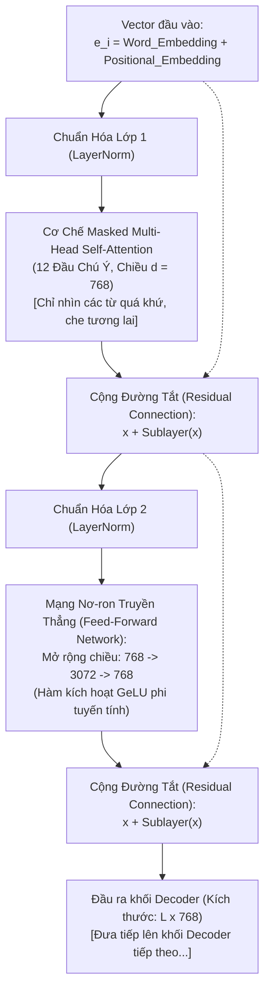
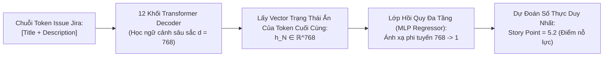

# 🧩 THUẬT NGỮ: TRANSFORMER DECODER (KHỐI GIẢI MÃ TRANSFORMER)

> **Khối giải mã Transformer (Transformer Decoder Block)**  
> *Thuộc nhóm:* Kiến Trúc Học Sâu & Transformers (Deep Learning & Transformers)  
> *Áp dụng trong:* Mô hình ngôn ngữ GPT-2 và phương pháp ước lượng Story Point **GPT2SP** (IEEE TSE 2023).

---

## 🧒 PHẦN 1: GIẢI THÍCH CHO ĐỨA TRẺ 10 TUỔI (THE 10-YEAR-OLD EXPLANATION)

Hãy tưởng tượng em đang đọc một cuốn tiểu thuyết trinh thám cực kỳ ly kỳ và hồi hộp. 

Nhưng em có một lời thề danh dự: **tuyệt đối không được lật trộm các trang sau để xem trước hung thủ là ai**! Mỗi khi em đọc tới một trang sách, em chỉ được phép nhớ lại những manh mối ở **các trang sách trước đó** mà em đã đọc qua. 

Từ toàn bộ các tình tiết trong quá khứ đã được tích lũy kỹ càng trong đầu, em sẽ đưa ra lời phán đoán thông minh nhất cho câu hỏi: *"Vụ án này khó giải quyết đến mức nào?"*

Bộ não của mô hình GPT-2 được xây dựng từ 12 "người đọc sách nghiêm túc" như vậy xếp chồng lên nhau. Mỗi tầng người đọc được gọi là một **Transformer Decoder**:
* Họ có cơ chế **"mắt thần chú ý"** (Self-Attention) để liên kết từng chi tiết nhỏ ở các trang trước lại với nhau.
* Họ có một **"tấm rèm che tương lai"** (Masking) che kín mít những trang sách phía sau để không bị "ăn gian" nhìn trước tương lai.
* Họ có một **"bộ lọc tư duy"** (Feed-Forward Network) để cô đọng lại kiến thức sâu sắc nhất.

> 💡 **Định nghĩa bình dân:**  
> **Transformer Decoder (Khối giải mã)** là khối xử lý thông minh cốt lõi của GPT-2, có khả năng nhìn thấu mối liên hệ giữa mọi từ ngữ đã xuất hiện trong quá khứ nhưng bị che mắt không nhìn trước tương lai, giúp máy tính tích lũy toàn bộ bối cảnh của câu chuyện để đưa ra kết luận chuẩn xác.

---

## 🔍 PHẦN 2: BÓC TÁCH TỪNG TỪ NGỮ CHUYÊN NGÀNH (DECONSTRUCTING THE JARGON)

Thuật ngữ **Transformer Decoder** được cấu thành từ hai từ chuyên môn:

| Thành tố | Gốc từ tiếng Anh | Ý nghĩa đời thường | Ý nghĩa trong Machine Learning & NLP | Khái niệm đối lập (Antonym) |
| :--- | :--- | :--- | :--- | :--- |
| **Transformer** | *Transform* (biến đổi hình thái) | Cỗ máy biến đổi (như robot biến hình). | Kiến trúc mạng nơ-ron đột phá (Vaswani et al., 2017) dựa hoàn toàn trên cơ chế chú ý (Self-Attention) thay vì mạng lặp tuần tự (RNN) hay mạng tích chập (CNN). | *Recurrent Neural Network (RNN / LSTM)*. |
| **Decoder** | *Decode* (giải mã) | Người hoặc thiết bị dịch mật mã ra thông điệp rõ ràng. | Phân nhánh kiến trúc sinh chuỗi tự hồi quy (Autoregressive), xử lý thông tin theo một chiều từ trái sang phải với mặt nạ nhân quả (**Causal Masking**). | **Encoder** (bộ mã hóa hai chiều không che mặt nạ, như trong BERT). |

### Bảng so sánh 3 biến thể kiến trúc Transformer trong thực tế:

| Nhánh kiến trúc | Cơ chế chú ý (Attention Type) | Đại diện tiêu biểu | Tác vụ thế mạnh truyền thống | Ứng dụng trong ước lượng Story Point |
| :--- | :--- | :--- | :--- | :--- |
| **Encoder-only** | Hai chiều tự do (Bidirectional Attention: nhìn cả trái và phải) | **BERT, RoBERTa** | Phân loại văn bản, trích xuất thực thể (NER), đánh giá cảm xúc | Có thể làm hồi quy nhưng không có bản chất tự hồi quy sinh ngôn ngữ. |
| **Decoder-only** | **Một chiều nhân quả (Masked Causal Attention: chỉ nhìn bên trái)** | **GPT-2, GPT-3, LLaMA** | Sinh văn bản tự nhiên, hội thoại, tiếp nối suy luận logic | ⭐ **Được chọn trong GPT2SP nhờ khả năng chuyển giao tri thức xuất sắc.** |
| **Encoder-Decoder** | Kết hợp cả hai khối thông qua Cross-Attention | **T5, BART** | Dịch máy (Machine Translation), tóm tắt văn bản tự động | Kiến trúc cồng kềnh, số lượng tham số lớn gấp đôi. |

---

## 📊 PHẦN 3: TRỰC QUAN HÓA BẰNG SƠ ĐỒ & DỮ LIỆU (THE "AHA!" MOMENT)

Trong mô hình **GPT-2 Small** được dùng trong bài báo GPT2SP, có **12 khối Transformer Decoder** giống hệt nhau xếp chồng lên nhau thành một tòa tháp xử lý:

### Bản chất của Ma trận Mặt Nạ Nhân Quả (Causal Mask Matrix):
Để đảm bảo token tại bước thời gian $i$ không nhìn trộm token ở bước tương lai $j > i$, ma trận Attention Score trước hàm Softmax được cộng thêm một ma trận mặt nạ $M$ với giá trị $-\infty$ ở nửa tam giác trên:

$$
M_{i, j} = \begin{cases} 0 & \text{khi } j \le i \quad (\text{quá khứ và hiện tại: được phép nhìn}) \\ -\infty & \text{khi } j > i \quad (\text{tương lai: bị chặn hoàn toàn}) \end{cases}
$$

### Bảng minh họa ma trận mặt nạ cho câu: `"Fix JIRA issue bug"`

| Vị trí | Token hiện tại | Fix ($j=1$) | JIRA ($j=2$) | issue ($j=3$) | bug ($j=4$) | Hành động của mô hình |
| :---: | :--- | :---: | :---: | :---: | :---: | :--- |
| **1** | `Fix` | **$0$** | $-\infty$ | $-\infty$ | $-\infty$ | Chỉ nhìn thấy chính mình. |
| **2** | `JIRA` | **$0$** | **$0$** | $-\infty$ | $-\infty$ | Nhìn thấy `Fix` và `JIRA`. |
| **3** | `issue` | **$0$** | **$0$** | **$0$** | $-\infty$ | Nhìn thấy `Fix`, `JIRA`, `issue`. |
| **4** | `bug` | **$0$** | **$0$** | **$0$** | **$0$** | **Nhìn thấy toàn bộ câu từ đầu đến cuối!** |

> 🎉 **Khoảnh khắc "Aha!":**  
> Hãy nhìn dòng cuối cùng (tại token `bug`): Đây là vị trí duy nhất trong chuỗi **được phép nhìn lại toàn bộ tất cả các từ đứng trước nó**!  
> Chính vì vậy, vector trạng thái ẩn tại token cuối cùng này là nơi **tụ hội tinh hoa nhất** của toàn bộ bài toán Jira. Các tác giả GPT2SP đã trích xuất đúng vector này để đưa vào đầu hồi quy dự đoán Story Point!

---

## ⚡ PHẦN 4: THÁCH THỨC KỸ THUẬT & SỰ ĐỘT PHÁ SO VỚI LSTM CỦA DEEP-SE

Mô hình học sâu trước đó là **Deep-SE (Choetkiertikul et al., 2019)** sử dụng sự kết hợp giữa **LSTM + Recurrent Highway Network (RHWN)**:

1. **Điểm nghẽn cổ chai thông tin (Information Bottleneck):**  
   Mạng LSTM buộc phải nén toàn bộ thông tin của câu văn qua một vector trạng thái ẩn $h_t$ có kích thước cố định. Khi văn bản Jira dài (chứa hàng trăm từ mô tả lỗi và các bước tái hiện), thông tin ở các câu mở đầu sẽ bị pha loãng dần và biến mất (Vanishing Gradient).
2. **Không thể tính toán song song (Sequential Bottleneck):**  
   Để tính trạng thái ở bước $t=100$, LSTM bắt buộc phải đợi bước $t=99$ chạy xong. Điều này khiến Deep-SE không thể khai thác tối đa sức mạnh xử lý hàng ngàn lõi song song của GPU hiện đại, dẫn đến thời gian huấn luyện rất lâu.
3. **Ưu thế vượt trội của Transformer Decoder:**  
   * **Đường dẫn thông tin cực ngắn $O(1)$:** Nhờ cơ chế Self-Attention, token đầu tiên và token thứ 100 có thể "nói chuyện" trực tiếp với nhau mà không cần đi qua 98 bước trung gian.
   * **Xử lý ma trận song song:** Toàn bộ chuỗi được nạp vào và tính toán trong một lần nhân ma trận duy nhất trên GPU.

---

## 🚀 PHẦN 5: GPT2SP BIẾN ĐỔI TRANSFORMER DECODER THẾ NÀO CHO BÀI TOÁN HỒI QUY STORY POINT?

Thông thường, mô hình GPT-2 được sinh ra để làm nhiệm vụ **mô hình hóa ngôn ngữ (Language Modeling)** — tức là dự đoán từ tiếp theo trong câu bằng một đầu ra phân loại qua từ điển 50.257 từ với hàm kích hoạt Softmax.

Nhóm tác giả GPT2SP (Fu & Tantithamthavorn, 2023) đã có một cải tiến then chốt:

1. **Loại bỏ đầu sinh từ (LM Head):**  
   GPT2SP gỡ bỏ lớp phân loại từ vựng Softmax ở trên cùng của GPT-2, vì mục tiêu không phải là "viết tiếp câu chuyện" mà là "đánh giá độ khó".
2. **Gắn thêm đầu hồi quy (MLP Regression Head):**  
   Gắn một mạng Perceptron đa tầng (MLP) vào đầu ra của khối Decoder thứ 12. Lớp này nhận vector ẩn $\mathbf{h}_N \in \mathbb{R}^{768}$ của token cuối cùng và biến đổi thành một con số thực duy nhất đại diện cho Story Point ước lượng:
   $$
   \hat{y} = \text{MLP}(\mathbf{h}_N)
   $$
3. **Tối ưu hóa với hàm mất mát L1 Loss (MAE Loss):**  
   Thay vì Cross-Entropy của bài toán sinh từ, GPT2SP dùng hàm mất mát giá trị tuyệt đối trung bình ($L_1$ Loss) để huấn luyện toàn bộ mạng từ đầu đến cuối (End-to-End Fine-Tuning):
   $$
   \mathcal{L} = \sum_{k=1}^{n} |y_k - \hat{y}_k|
   $$
   Điều này giúp mô hình thích ứng hoàn hảo với các giá trị ngoại lai thường gặp trong việc chấm điểm Story Point thực tế.

---

## ⏱️ PHẦN 6: TỔNG KẾT 30 GIÂY (THE ELEVATOR PITCH)

* **Bản chất:** Transformer Decoder là khối nơ-ron nền tảng của GPT-2, kết hợp giữa cơ chế chú ý một chiều có che mặt nạ (Masked Self-Attention) và mạng truyền thẳng (FFN) được bọc bởi các đường tắt Residual Connections.
* **Điểm đột phá:** Cho phép mô hình tính toán song song thần tốc trên GPU, liên kết trực tiếp mọi thông tin xa gần trong mô tả mà không bị nghẽn cổ chai hay lãng quên như mạng LSTM trong Deep-SE.
* **Giá trị trong GPT2SP:** Tận dụng 12 khối Decoder để chắt lọc toàn bộ độ phức tạp kỹ thuật của issue vào token cuối cùng, sau đó ánh xạ qua đầu hồi quy MLP để dự đoán Story Point với độ chính xác và tính tổng quát hóa cao nhất.