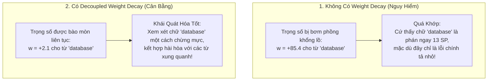

# 🧩 THUẬT NGỮ: WEIGHT DECAY (SUY GIẢM TRỌNG SỐ / ĐIỀU CHUẨN HÓA TRỌNG SỐ)

> **Suy giảm trọng số (Weight Decay / Decoupled Weight Decay)**  
> *Thuộc nhóm:* Tối Ưu Hóa & Điều Chuẩn Hóa Học Sâu (Optimization & Regularization)  
> *Áp dụng trong:* Thuật toán tối ưu hóa **AdamW** khi huấn luyện tinh chỉnh mô hình **GPT2SP** (IEEE TSE 2023).

---

## 🧒 PHẦN 1: GIẢI THÍCH CHO ĐỨA TRẺ 10 TUỔI (THE 10-YEAR-OLD EXPLANATION)

Hãy tưởng tượng em có một chiếc xe đạp leo núi để đi học hàng ngày.

Nếu em cứ tùy tiện lắp thêm vào xe đủ thứ phụ tùng cồng kềnh: loa đài khổng lồ, còi hơi cực lớn, đèn pha sáng chói lọi, và một chiếc ba lô nặng trịch 50kg (tương đương với việc các trọng số trong mạng nơ-ron bị phình to quá mức):
* Chiếc xe đạp của em có thể chạy rất oai trên đúng con đường nhựa bằng phẳng trước cửa nhà em (tương ứng với tập dữ liệu huấn luyện đã biết).
* Nhưng chỉ cần rẽ sang một con đường đất lạ gồ ghề (tương ứng với tập kiểm thử hoặc một dự án mới), chiếc xe nặng nề đó sẽ lập tức bị sa lầy, đổ kềnh ra đường vì quá cồng kềnh và mất cân bằng! Đó chính là căn bệnh **"Học vẹt - Quá khớp" (Overfitting)**.

Để giúp em đi đường an toàn, bố em đưa ra một quy tắc kỷ luật nghiêm khắc gọi là **Weight Decay (Bào mòn trọng lượng)**:
* Sau mỗi chuyến đi, bố em yêu cầu em phải **gọt bớt một phần trọng lượng thừa thãi** của chiếc xe đạp, chỉ giữ lại những bộ phận thực sự thanh mảnh, vừa vặn và cần thiết nhất.
* Bằng cách liên tục ép chiếc xe phải nhẹ nhàng, em có thể đạp xe linh hoạt và băng qua bất kỳ con đường đồi núi xa lạ nào một cách mượt mà!

> 💡 **Định nghĩa bình dân:**  
> **Weight Decay (Suy giảm trọng số)** là kỹ thuật kỷ luật toán học liên tục "bào mòn" và ép các con số trọng số trong mạng nơ-ron nhỏ lại sau mỗi bước học, ngăn không cho mô hình bị phụ thuộc thái quá vào một vài từ ngữ cá biệt, giúp mô hình luôn khiêm tốn và phán đoán thông minh trên dữ liệu mới.

---

## 🔍 PHẦN 2: BÓC TÁCH TỪNG TỪ NGỮ CHUYÊN NGÀNH (DECONSTRUCTING THE JARGON)

Thuật ngữ **Weight Decay** gồm hai từ chuyên môn trong đại số và giải tích:

| Thành tố | Gốc từ tiếng Anh | Ý nghĩa đời thường | Ý nghĩa trong Học Sâu & Tối Ưu Hóa | Khái niệm đối lập (Antonym) |
| :--- | :--- | :--- | :--- | :--- |
| **Weight** | *Weight* (trọng lượng, sức nặng) | Cân nặng của một vật thể. | Các tham số kết nối ($w_{ij}$) trong ma trận của mạng nơ-ron, quyết định mức độ quan trọng của tín hiệu truyền qua. | *Bias / Activation* (độ lệch hoặc hàm kích hoạt). |
| **Decay** | *Decay* (suy tàn, bào mòn, phân rã) | Quá trình gỗ mục hoặc chất phóng xạ tự phân rã hao mòn dần theo thời gian. | Phép nhân trừ lùi trực tiếp một tỷ lệ phần trăm nhỏ của trọng số tại mỗi bước cập nhật: $w \leftarrow w \cdot (1 - \eta \lambda)$. | *Growth / Explosion* (bùng nổ, tăng trưởng không kiểm soát). |
| **Decoupled** | *Decouple* (tách rời, tháo móc) | Tháo hai toa tàu hỏa rời nhau ra. | Tách riêng việc suy giảm trọng số ra khỏi việc tính toán đạo hàm động lượng thích nghi (phát minh đột phá của **AdamW**). | *Coupled / Mixed* (trộn lẫn trong Adam truyền thống). |

### Công thức toán học cập nhật trọng số trong thuật toán AdamW (Loshchilov & Hutter, 2019):

$$
w_{t+1} = w_t - \underbrace{\eta \lambda w_t}_{\text{Decoupled Weight Decay}} - \underbrace{\eta \frac{\hat{m}_t}{\sqrt{\hat{v}_t} + \epsilon}}_{\text{Adam Gradient Step}}
$$

Trong đó:
* $\eta$: Tốc độ học (Learning Rate, trong bài báo GPT2SP dùng $\eta = 5 \times 10^{-4}$).
* $\lambda$: Hệ số suy giảm trọng số (Weight Decay Coefficient, ví dụ $\lambda = 0.01$).
* $\hat{m}_t, \hat{v}_t$: Ước lượng mô-men động lượng bậc 1 và bậc 2 của độ dốc.

---

## 📊 PHẦN 3: TRỰC QUAN HÓA BẰNG BẢNG DỮ LIỆU (THE "AHA!" MOMENT)

Hãy xem điều gì xảy ra với các trọng số của mô hình khi có và không có **Weight Decay**:

### Bảng minh họa trực quan bước cập nhật trọng số sau 3 vòng lặp (Epochs):

Giả sử trọng số ban đầu $w_0 = 10.0$, tốc độ học $\eta = 0.1$, hệ số suy giảm $\lambda = 0.05$. Giả sử bước này độ dốc gradient tạm thời bằng 0:

| Vòng lặp ($t$) | Trọng số đầu bước ($w_t$) | Lượng bị bào mòn bởi Weight Decay: $\eta \lambda w_t$ | Trọng số sau khi cập nhật ($w_{t+1}$) | Xu hướng hình học |
| :---: | :---: | :---: | :---: | :--- |
| **Bước 0** | $10.000$ | $0.1 \times 0.05 \times 10.0 = \mathbf{0.050}$ | **$9.950$** | Bắt đầu bị co lại. |
| **Bước 10** | $9.512$ | $0.1 \times 0.05 \times 9.512 = \mathbf{0.048}$ | **$9.464$** | Giảm dần đều đặn. |
| **Bước 100** | $6.058$ | $0.1 \times 0.05 \times 6.058 = \mathbf{0.030}$ | **$6.028$** | Co cụm về gần 0. |

> 🎉 **Khoảnh khắc "Aha!":**  
> Hãy chú ý lượng bị trừ: $\eta \lambda w_t$ tỷ lệ thuận với chính độ lớn của $w_t$!  
> * Trọng số nào càng to phình một cách vô lý $\rightarrow$ Bị "chém" phạt càng đau!  
> * Trọng số nào nhỏ bé, khiêm tốn $\rightarrow$ Gần như không bị suy giảm.  
> Cơ chế này tự động dọn sạch các trọng số rác và giữ cho bộ não của mạng nơ-ron luôn gọn gàng, thanh thoát!

---

## ⚡ PHẦN 4: THÁCH THỨC KỸ THUẬT & SỰ ĐỘT PHÁ CỦA ADAMW SO VỚI ADAM CŨ

Trước năm 2017, hầu hết mọi người đều dùng thuật toán tối ưu hóa **Adam (Kingma & Ba, 2014)** kết hợp điều chuẩn $L_2$:
1. **Lỗi trộn lẫn chết người trong Adam cổ điển:**  
   Trong Adam cũ, người ta cộng thêm đạo hàm của $L_2$ trực tiếp vào vector gradient $\nabla L$. Khi đi qua phép chia căn bậc hai của phương sai $\sqrt{v_t}$, các trọng số có gradient lớn lại bị chia nhỏ, làm cho việc suy giảm trọng số **hoàn toàn mất tác dụng đối với những trọng số hay thay đổi**!
2. **Giải pháp AdamW (Decoupled Weight Decay):**  
   Loshchilov & Hutter phát hiện ra sai lầm này và đề xuất thuật toán **AdamW**: Tách hẳn việc suy giảm trọng số ra thành một phép trừ độc lập ở bên ngoài, không đi qua bộ chia phương sai. Nhờ vậy, hiệu quả chống quá khớp được phục hồi nguyên vẹn $100\%$!

---

## 🚀 PHẦN 5: WEIGHT DECAY TRONG BÀI BÁO GPT2SP

Trong nghiên cứu **GPT2SP (Fu & Tantithamthavorn, TSE 2023)**:
* Mô hình GPT-2 Small có tới **117 triệu tham số**.
* Trong khi đó, các tập dữ liệu Jira của từng dự án phần mềm chỉ có từ vài trăm đến vài ngàn issue (ví dụ: dự án Titanium chỉ có vài trăm issue có gắn điểm Story Point).
* **Mối nguy cơ quá khớp cực độ:** Nếu lấy một mô hình 117 triệu tham số huấn luyện trực tiếp trên một tập dữ liệu chỉ có vài ngàn dòng, mô hình sẽ "học vẹt" thuộc lòng đáp án của từng câu chỉ sau vài lượt chạy!

### AdamW và Weight Decay chính là "vị cứu tinh":
Các tác giả GPT2SP đã sử dụng bộ tối ưu hóa **AdamW** với tốc độ học $\text{LR} = 5 \times 10^{-4}$ kết hợp cơ chế suy giảm trọng số:
* Nó liên tục ghìm chặt 117 triệu tham số không cho chúng tự do phình to theo các mẫu nhiễu của dự án nguồn.
* Nhờ đó, mô hình giữ được sự tổng quát hóa cao độ và đạt được kết quả xuất sắc trong **kịch bản Cross-Project (RQ2)** khi mang sang dự đoán trên các dự án hoàn toàn xa lạ.

---

## ⏱️ PHẦN 6: TỔNG KẾT 30 GIÂY (THE ELEVATOR PITCH)

* **Bản chất:** Weight Decay là cơ chế toán học liên tục làm suy giảm độ lớn của các trọng số sau mỗi bước cập nhật, tương đương với hình phạt điều chuẩn hóa $L_2$.
* **Điểm đột phá:** Thuật toán AdamW tách rời hoàn toàn phép suy giảm trọng số ra khỏi việc tính toán động lượng thích nghi, khôi phục khả năng chống quá khớp mạnh mẽ cho các mô hình Transformer.
* **Giá trị trong GPT2SP:** Cho phép tinh chỉnh an toàn mô hình ngôn ngữ khổng lồ 117 triệu tham số trên tập dữ liệu Jira kích thước vừa và nhỏ mà không bị học vẹt, duy trì khả năng suy luận sắc bén giữa các dự án.