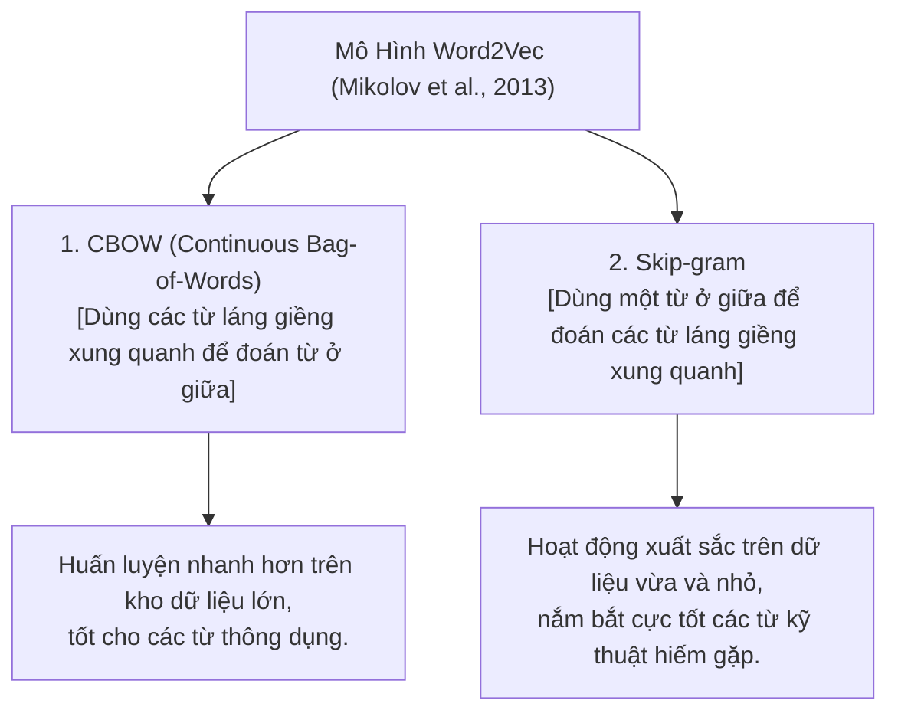
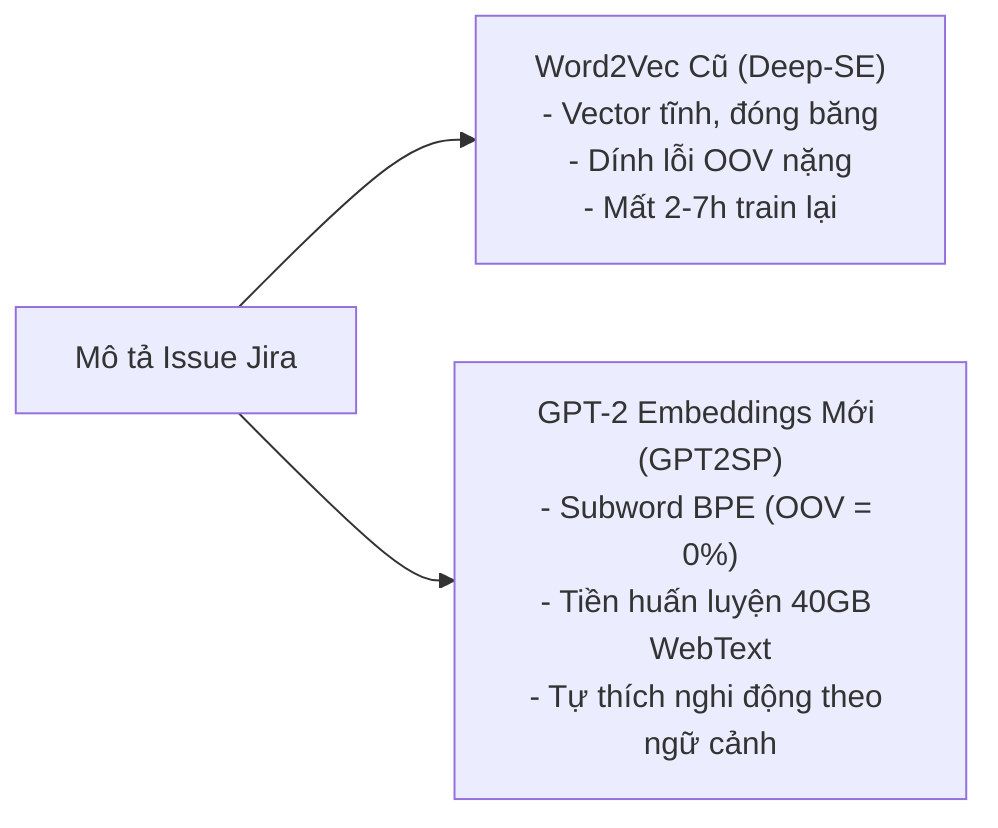

# 🧩 THUẬT NGỮ: WORD2VEC (MÔ HÌNH NHÚNG TỪ THEO NGỮ CẢNH CỤC BỘ)

> **Word2Vec (Biểu diễn từ thành vector)**  
> *Thuộc nhóm:* Xử Lý Ngôn Ngữ Tự Nhiên & Biểu Diễn Đặc Trưng (NLP & Representation Learning)  
> *Áp dụng trong:* Mô hình học sâu **Deep-SE** (Choetkiertikul et al., 2019) và là đối chứng nền tảng được thay thế bởi GPT-2 trong **GPT2SP** (IEEE TSE 2023).

---

## 🧒 PHẦN 1: GIẢI THÍCH CHO ĐỨA TRẺ 10 TUỔI (THE 10-YEAR-OLD EXPLANATION)

Có một câu tục ngữ rất nổi tiếng: *"Hãy cho tôi biết bạn của bạn là ai, tôi sẽ nói cho bạn biết bạn là người như thế nào!"*

Máy tính ban đầu hoàn toàn không biết chữ. Khi nhìn thấy các từ trong báo cáo lỗi phần mềm như `"lỗi"`, `"sửa"`, `"bảo mật"`, máy tính chỉ coi chúng là các chuỗi ký tự vô hồn. 

Để dạy máy tính hiểu nghĩa của một từ, **chú chim bồ câu đưa thư Word2Vec** đã làm một trò chơi quan sát:
1. Chú bay qua từng trang sách và nhìn vào các từ đứng cạnh nhau trong một khoảng cách ngắn (gọi là "hàng xóm láng giềng").
2. Chú nhận ra: từ `"lỗi"` (*bug*) rất hay xuất hiện cạnh từ `"sửa"` (*fix*), từ `"nghiêm trọng"` (*critical*), và từ `"chạy lại"` (*restart*).
3. Chú cũng nhận ra: từ `"mèo"` hay đi cùng từ `"chuột"`, từ `"cá"`, từ `"kêu meo meo"`.
4. Chú bồ câu liền xếp những từ có cùng nhóm bạn láng giềng đứng gần nhau trong một khu phố ma thuật (gọi là không gian vector).

Khi muốn biết từ `"lỗi"` có nghĩa gì, máy tính chỉ cần nhìn xem ai hay làm bạn với nó. Vì từ `"lỗi"` và từ `"hỏng hóc"` có chung những người bạn láng giềng giống hệt nhau, máy tính kết luận ngay: hai từ này có nghĩa rất gần nhau!

> 💡 **Định nghĩa bình dân:**  
> **Word2Vec** là thuật toán thông minh dạy máy tính hiểu nghĩa của một từ bằng cách quan sát những từ thường xuyên làm "hàng xóm" đứng cạnh nó, sau đó biến mỗi từ thành một dãy số (vector) để các từ cùng chủ đề sẽ nằm sát cạnh nhau.

---

## 🔍 PHẦN 2: BÓC TÁCH TỪNG TỪ NGỮ CHUYÊN NGÀNH (DECONSTRUCTING THE JARGON)

Tên gọi **Word2Vec** là cách viết tắt của cụm từ *"Word to Vector"*:

| Thành tố | Gốc từ tiếng Anh | Ý nghĩa đời thường | Ý nghĩa trong Machine Learning & NLP | Khái niệm đối lập (Antonym) |
| :--- | :--- | :--- | :--- | :--- |
| **Word** | *Word* (từ ngữ) | Một từ hoàn chỉnh trong câu nói hoặc bài viết. | Đơn vị từ vựng hoàn chỉnh được phân tách theo dấu khoảng trắng (*Word-level token*). | *Character / Subword* (ký tự hoặc mẩu từ con). |
| **2 (To)** | *To* (chuyển thành, sang) | Đi từ điểm này đến điểm khác. | Phép ánh xạ toán học từ không gian rời rạc sang không gian liên tục. | *Identity* (giữ nguyên). |
| **Vec** | *Vector* (vectơ toán học) | Mũi tên chỉ hướng và độ dài trong hình học. | Một dãy số thực liên tục có số chiều cố định (ví dụ $d = 100$ hoặc $300$) biểu diễn tọa độ ngữ nghĩa của từ. | *Scalar / Discrete symbol* (con số đơn lẻ hoặc ký tự rời rạc). |

### Bảng so sánh 2 kiến trúc cốt lõi của Word2Vec (Mikolov et al., 2013):

---

## 📊 PHẦN 3: TRỰC QUAN HÓA BẰNG BẢNG DỮ LIỆU (THE "AHA!" MOMENT)

Hãy xem cách thuật toán **Skip-gram** (vốn được mô hình Deep-SE sử dụng) trích xuất dữ liệu huấn luyện từ một câu mô tả Jira với kích thước cửa sổ láng giềng $C = 2$ (2 từ bên trái và 2 từ bên phải):

**Câu mẫu trong Jira:** `"Developer must fix critical memory leak bug immediately"`

| Bước trượt | Từ trung tâm mục tiêu ($w_t$) | Cửa sổ láng giềng xung quanh ($w_{t \pm 2}$) | Cặp dữ liệu huấn luyện nạp vào mạng nơ-ron |
| :---: | :--- | :--- | :--- |
| 1 | `fix` | `[Developer, must, critical, memory]` | `(fix, Developer)`, `(fix, must)`, `(fix, critical)`, `(fix, memory)` |
| 2 | `critical` | `[must, fix, memory, leak]` | `(critical, must)`, `(critical, fix)`, `(critical, memory)`, `(critical, leak)` |
| 3 | `memory` | `[fix, critical, leak, bug]` | `(memory, fix)`, `(memory, critical)`, `(memory, leak)`, `(memory, bug)` |
| 4 | `leak` | `[critical, memory, bug, immediately]` | `(leak, critical)`, `(leak, memory)`, `(leak, bug)`, `(leak, immediately)` |

### Ma trận vector sau khi huấn luyện xong (Không gian số thực $d = 5$ chiều thu nhỏ):

| Từ ngữ | Chiều 1 (Mức độ nghiêm trọng) | Chiều 2 (Hành động lập trình) | Chiều 3 (Bộ phận tài nguyên) | Chiều 4 (Trạng thái lỗi) | Chiều 5 (Tính khẩn cấp) |
| :--- | :---: | :---: | :---: | :---: | :---: |
| `leak` (rò rỉ) | +0.78 | -0.10 | **+0.85** | **+0.92** | +0.45 |
| `overflow` (tràn bộ nhớ) | +0.81 | -0.08 | **+0.89** | **+0.90** | +0.50 |
| `fix` (sửa chữa) | -0.20 | **+0.95** | +0.05 | -0.30 | +0.60 |
| `patch` (bản vá) | -0.15 | **+0.91** | +0.10 | -0.25 | +0.55 |

> 🎉 **Khoảnh khắc "Aha!":**  
> Hai từ `leak` và `overflow` chưa từng được con người định nghĩa là đồng nghĩa trong từ điển. Nhưng vì cả hai đều đứng cạnh `memory`, `critical`, `bug`, các con số ở Chiều 3 (Tài nguyên: $+0.85$ và $+0.89$) và Chiều 4 (Lỗi: $+0.92$ và $+0.90$) của chúng tự động đồng quy về gần nhau!  
> Phép toán nổi tiếng được chứng minh: $\text{Vector}("King") - \text{Vector}("Man") + \text{Vector}("Woman") \approx \text{Vector}("Queen")$.

---

## ⚡ PHẦN 4: THÁCH THỨC KỸ THUẬT & HẠN CHẾ CỦA WORD2VEC TRONG DEEP-SE

Mô hình **Deep-SE (Choetkiertikul et al., 2019)** sử dụng Word2Vec làm lớp biểu diễn đầu vào đầu tiên trước khi đưa vào mạng LSTM:

1. **Vector tĩnh - Mù ngữ cảnh động (Static Embedding & Polysemy):**  
   Word2Vec chỉ gán đúng **1 vector cố định** duy nhất cho mỗi từ. Nhưng trong các dự án phần mềm, từ ngữ thay đổi nghĩa hoàn toàn theo ngữ cảnh:
   * `"Java"` là ngôn ngữ lập trình, nhưng cũng có thể là hòn đảo Java.
   * `"Thread"` có thể là luồng xử lý đa luồng (*multithreading*) cực khó, nhưng cũng có thể chỉ là chuỗi bình luận trao đổi (*comment thread*) bình thường.  
   Word2Vec trộn lẫn tất cả vào một vector trung bình thô thiển.
2. **Khủng hoảng từ ngoài từ điển (Out-Of-Vocabulary - OOV):**  
   Word2Vec vận hành trên từ nguyên khối. Khi gặp bất kỳ từ mới nào trong tập kiểm thử hoặc khi chuyển sang dự án mới (Cross-Project), Word2Vec hoàn toàn bất lực và phải thay bằng `<UNK>`.
3. **Chi phí huấn luyện lặp đi lặp lại:**  
   Mỗi dự án phần mềm có kho từ vựng riêng. Deep-SE phải tốn **từ 2 đến 7 tiếng đồng hồ** chỉ để chạy Word2Vec huấn luyện lại từ đầu cho từng dự án mới, gây lãng phí tài nguyên tính toán.

---

## 🚀 PHẦN 5: GPT2SP THAY THẾ WORD2VEC NHƯ THẾ NÀO?

Trong công trình **GPT2SP (Fu & Tantithamthavorn, 2023)**, các tác giả đã khai tử hoàn toàn việc huấn luyện Word2Vec cục bộ và thay thế bằng cơ chế nhúng của Transformer:

1. **Từ biểu diễn tĩnh sang biểu diễn động (Contextualized Embeddings):**  
   Khác với Word2Vec, vector của từ trong GPT2SP không đứng yên mà được cập nhật liên tục qua 12 tầng Self-Attention. Nhờ đó, từ `"Thread"` khi đi cùng `"concurrency"` sẽ có biểu diễn hoàn toàn khác khi đi cùng `"discussion"`.
2. **Kế thừa tri thức ngôn ngữ nhân loại:**  
   Thay vì chỉ học trên vài trăm issue ít ỏi của một dự án đơn lẻ, ma trận nhúng của GPT-2 mang sẵn vốn từ vựng phong phú được tiền huấn luyện trên 40GB văn bản toàn diện, sẵn sàng áp dụng ngay lập tức cho bài toán ước lượng Story Point.

---

## ⏱️ PHẦN 6: TỔNG KẾT 30 GIÂY (THE ELEVATOR PITCH)

* **Bản chất:** Word2Vec là thuật toán nhúng từ tĩnh nổi tiếng, chuyển đổi từ ngữ thành vector số học dựa trên quy luật phân phối láng giềng (CBOW và Skip-gram).
* **Điểm đột phá:** Là bước nhảy vọt so với Bag-of-Words thời kỳ đầu, giúp máy tính tính toán được độ tương đồng ngữ nghĩa giữa các từ ngữ kỹ thuật.
* **Hạn chế & Thay thế:** Bị hạn chế bởi tính tĩnh (không đổi theo ngữ cảnh), bùng nổ từ vựng và dính lỗi OOV nặng nề. Trong GPT2SP, Word2Vec được thay thế hoàn toàn bởi bộ nhúng Byte-level BPE và Transformer Decoder năng động của GPT-2.