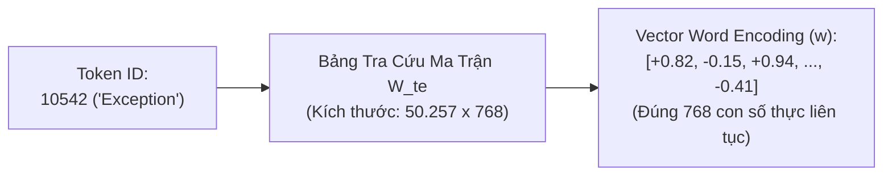

# 🧩 THUẬT NGỮ: WORD ENCODING (MÃ HÓA TỪ NGỮ / NHÚNG VECTOR NGỮ NGHĨA)

> **Mã hóa từ ngữ / Nhúng từ (Word Encoding / Word Embedding)**  
> *Thuộc nhóm:* Xử Lý Ngôn Ngữ Tự Nhiên & Biểu Diễn Đặc Trưng (NLP & Representation Learning)  
> *Áp dụng trong:* Mô hình ngôn ngữ GPT-2 và phương pháp ước lượng Story Point **GPT2SP** (IEEE TSE 2023).

---

## 🧒 PHẦN 1: GIẢI THÍCH CHO ĐỨA TRẺ 10 TUỔI (THE 10-YEAR-OLD EXPLANATION)

Hãy tưởng tượng em có một bản đồ kho báu ma thuật nhiều chiều trong không gian.

Máy tính chỉ là một cỗ máy tính toán các con số khô khan, nó không hề biết chữ cái tiếng Việt hay tiếng Anh. Nó không hiểu từ `"con mèo"` hay `"con hổ"` nghĩa là gì, và nó càng không biết từ `"lỗi phần mềm"` (*bug*) có liên quan gì đến từ *"sửa chữa"* (*fix*).

Để giúp máy tính hiểu được ý nghĩa của các từ, các nhà khoa học đã cấp cho mỗi từ **tọa độ vị trí của một ngôi nhà** trên bản đồ không gian ma thuật đó:
* Ngôi nhà của từ `"con mèo"` và ngôi nhà của từ `"con hổ"` sẽ nằm **rất gần nhau** vì chúng đều là loài động vật có móng vuốt, thích ăn thịt.
* Ngôi nhà của từ `"xe tăng"` sẽ nằm ở một khu phố xa tít tắp.
* Trong thế giới phần mềm, ngôi nhà của từ `"lỗi"` (*bug*) và từ `"sửa"` (*fix*) sẽ nằm sát cạnh nhau trên cùng một con đường.

Dãy số tọa độ chỉ vị trí ngôi nhà đó (ví dụ: `[kinh độ 12, vĩ độ 85, độ cao 40...]`) chính là **Word Encoding**!

> 💡 **Định nghĩa bình dân:**  
> **Word Encoding (Mã hóa từ ngữ)** là cách biến một từ hoặc mẩu chữ cái thành một dãy số (vector tọa độ). Dãy số này mang theo linh hồn và ý nghĩa của từ, giúp máy tính biết từ nào có nghĩa gần gũi với nhau bằng cách đo khoảng cách giữa các dãy số.

---

## 🔍 PHẦN 2: BÓC TÁCH TỪNG TỪ NGỮ CHUYÊN NGÀNH (DECONSTRUCTING THE JARGON)

Thuật ngữ **Word Encoding** gồm hai thành tố:

| Thành tố | Gốc từ tiếng Anh | Ý nghĩa đời thường | Ý nghĩa trong Machine Learning & NLP | Khái niệm đối lập (Antonym) |
| :--- | :--- | :--- | :--- | :--- |
| **Word** | *Word* (từ ngữ) | Một đơn vị ngôn ngữ có ý nghĩa khi nói hoặc viết. | Đơn vị từ vựng hoặc token con (subword) trong bảng từ điển được định danh bằng số nguyên $i$. | *Number / Scalar* (con số vô hướng thuần túy). |
| **Encoding** | *Encode* (mã hóa) | Chuyển một thông điệp sang mật mã hoặc hệ thống ký hiệu khác. | Quá trình ánh xạ chỉ số nguyên rời rạc của token thành một vector số thực liên tục nhiều chiều (**Dense Vector**). | *Decoding* (chuyển vector ngược về từ ngữ). |

### Bảng so sánh 3 thế hệ biểu diễn từ ngữ trong trí tuệ nhân tạo:

| Phương pháp biểu diễn | Cách hoạt động | Số chiều của vector ($d$) | Nắm bắt quan hệ ngữ nghĩa? | Nhược điểm lớn nhất |
| :--- | :--- | :---: | :---: | :--- |
| **One-Hot Encoding** | Một vector toàn số 0, chỉ có đúng một số 1 tại vị trí của từ. | Bằng kích thước từ điển ($V \approx 50.000$) | ❌ Hoàn toàn không (mọi từ đều cách đều nhau góc 90 độ) | Cực kỳ thưa thớt, tốn bộ nhớ, không có tính khái quát. |
| **Static Word Embedding** *(Word2Vec / FastText / Deep-SE)* | Ma trận tra cứu tọa độ cố định được tiền huấn luyện theo ngữ cảnh lân cận. | $d = 100 \dots 300$ |  Có (các từ cùng nghĩa có vector gần nhau) | Một từ chỉ có một nghĩa duy nhất, không đổi theo ngữ cảnh câu. |
| **Transformer Word Encoding** *(GPT-2 / GPT2SP)* | Ma trận nhúng $W_{te}$ kết hợp các tầng Self-Attention động. | $d = 768$ (GPT-2 Small) | ⭐ Xuất sắc (ngữ nghĩa được làm giàu linh hoạt qua từng tầng) | Đòi hỏi mô hình lớn và năng lực tính toán GPU để tối ưu. |

---

## 📊 PHẦN 3: TRỰC QUAN HÓA BẰNG BẢNG DỮ LIỆU (THE "AHA!" MOMENT)

Trong mô hình **GPT-2 Small** (nền tảng của GPT2SP), mỗi token được ánh xạ thành một vector số thực gồm **768 chiều không gian** ($d = 768$). 

Mỗi chiều số học này âm thầm học một khía cạnh ngữ nghĩa trừu tượng nào đó của ngôn ngữ:



### Bảng minh họa trực quan 4 chiều tiêu biểu giữa các token trong bài toán Jira:

| Token | Chiều 1 (Tính lỗi kỹ thuật) | Chiều 2 (Mức độ khẩn cấp) | Chiều 3 (Hành động sửa đổi) | Chiều 4 (Độ phức tạp kiến trúc) | ... | Chiều 768 |
| :--- | :---: | :---: | :---: | :---: | :---: | :---: |
| `Exception` | **+0.92** | +0.65 | -0.10 | +0.45 | ... | -0.12 |
| `Bug` | **+0.88** | +0.70 | -0.05 | +0.30 | ... | -0.08 |
| `Fix` | -0.15 | +0.40 | **+0.95** | +0.20 | ... | +0.34 |
| `Refactor` | -0.20 | -0.30 | **+0.80** | **+0.91** | ... | +0.62 |
| `Document` | -0.85 | -0.70 | +0.30 | -0.80 | ... | +0.05 |

> 🎉 **Khoảnh khắc "Aha!":**  
> Hãy nhìn hai dòng đầu: Vector của `Exception` và `Bug` có các con số ở Chiều 1 và Chiều 2 **gần như tương đồng tuyệt đối** ($+0.92$ và $+0.88$). Máy tính chỉ cần tính khoảng cách hình học (Cosine Similarity hoặc Euclidean Distance) là biết ngay: *"À! Hai từ này cùng nói về sự cố kỹ thuật!"*  
> Ngược lại, từ `Document` có số âm ở cả hai chiều, nghĩa là công việc này không liên quan đến lỗi hỏng hóc, nỗ lực có thể sẽ nhẹ nhàng hơn nhiều!

---

## ⚡ PHẦN 4: THÁCH THỨC KỸ THUẬT & HẠN CHẾ CỦA WORD2VEC TRONG DEEP-SE

Trước GPT2SP, mô hình **Deep-SE (Choetkiertikul et al., 2019)** sử dụng kỹ thuật Word Encoding kiểu cũ bằng mô hình **Word2Vec (Skip-gram)**:

1. **Vấn đề từ đa nghĩa (Polysemy):**  
   Trong Word2Vec của Deep-SE, một từ luôn nhận đúng một vector cố định duy nhất trong mọi hoàn cảnh. Nhưng trong kỹ thuật phần mềm:
   * Từ `"Spring"` trong câu *"Spring Framework 5.0 migration"* là một hệ thống khung phát triển phần mềm cực kỳ phức tạp.
   * Từ `"Spring"` trong câu *"Sprint meeting in this Spring season"* lại chỉ mùa xuân thông thường.  
   Word2Vec trộn lẫn hai nghĩa này thành một vector trung bình lộn xộn, làm sai lệch nhận định về độ khó của tác vụ.
2. **Sự cô lập giữa các dự án (Lack of Universal Representations):**  
   Deep-SE phải tự huấn luyện ma trận Word2Vec từ đầu trên dữ liệu của riêng từng dự án mã nguồn mở. Với các dự án nhỏ có ít issue, dữ liệu văn bản quá ít ỏi khiến các vector từ học được rất nghèo nàn, khoảng cách không chính xác.

---

## 🚀 PHẦN 5: MA TRẬN WORD ENCODING TRONG GPT2SP HOẠT ĐỘNG NHƯ THẾ NÀO?

Kiến trúc **GPT2SP (Fu & Tantithamthavorn, 2023)** kế thừa ma trận nhúng từ đã được tiền huấn luyện của mô hình nền tảng GPT-2:

```
Ma trận nhúng từ ngữ:  W_te ∈ ℝ^(50.257 × 768)
```

1. **Tri thức ngôn ngữ nền tảng khổng lồ:**  
   Ma trận $W_{te}$ của GPT-2 đã hấp thụ hơn 40GB văn bản từ 8 triệu trang web (WebText). Nó hiểu sâu sắc mối quan hệ ngữ nghĩa tinh tế giữa hàng chục ngàn từ ngữ và khái niệm khoa học máy tính trước khi nhìn thấy dữ liệu Jira.
2. **Cơ chế tra cứu vector từ (Lookup Operation):**  
   Khi nhận một chuỗi các token ID sau bước BPE:
   $$X = [x_1, x_2, \dots, x_N] \quad \text{với } x_i \in \{1, 2, \dots, 50.257\}$$
   Bộ mã hóa thực hiện phép nhân ma trận hoặc tra cứu trực tiếp trong $W_{te}$ để sinh ra chuỗi vector từ:
   $$\mathbf{w}_i = W_{te}[x_i] \in \mathbb{R}^{768}$$
3. **Cộng hưởng với các tầng Transformer Decoder:**  
   Khác với Deep-SE (vector đứng im), chuỗi vector Word Encoding $\mathbf{w}_i$ trong GPT2SP sau khi cộng với vector vị trí sẽ tiếp tục được "nhào nặn" qua 12 tầng Self-Attention. Tại tầng cuối cùng, vector biểu diễn của từ đã được tích hợp toàn bộ bối cảnh xung quanh của toàn bộ đoạn mô tả issue Jira.

---

## ⏱️ PHẦN 6: TỔNG KẾT 30 GIÂY (THE ELEVATOR PITCH)

* **Bản chất:** Word Encoding là quá trình chuyển đổi các mã token rời rạc thành các vector số thực liên tục nhiều chiều ($d=768$) đại diện cho tọa độ ngữ nghĩa của từ trong không gian.
* **Điểm đột phá:** Thừa hưởng kho tri thức tiền huấn luyện từ tập dữ liệu khổng lồ của GPT-2, nắm bắt chuẩn xác quan hệ giữa các thuật ngữ kỹ thuật phần mềm thay vì phải học lại từ con số không như Word2Vec của Deep-SE.
* **Giá trị trong GPT2SP:** Cung cấp đầu vào ngữ nghĩa giàu có và chuẩn xác để các tầng Transformer phía sau học mối tương quan giữa nội dung công việc và điểm nỗ lực Story Point.