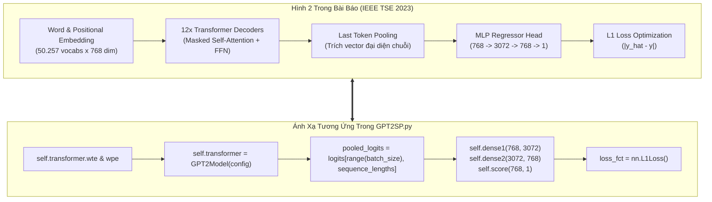

# 📖 GIẢI THÍCH CHI TIẾT MÃ NGUỒN KIẾN TRÚC MÔ HÌNH (`GPT2SP.py`)
## ĐỐI SOÁT TỪNG DÒNG CODE VỚI LÝ THUYẾT BÀI BÁO (SECTION 3 THE GPT2SP ARCHITECTURE)

> **Mã nguồn phân tích:** File [`GPT2SP.py`](https://github.com/awsm-research/gpt2sp/blob/main/GPT2SP.py) trong Replication Package.  
> **Chương đối ứng trong bài báo gốc:** **Section 3: The GPT2SP Architecture** (Trang 3 – 5, IEEE TSE 2023).  
> **Hình minh họa tương ứng:** Hình 2 (*Fig. 2: The architecture of our proposed GPT2SP approach*, Trang 3).

---

## 🧭 1. TỔNG QUAN ÁNH XẠ: GIỮA HÌNH 2 TRONG BÀI BÁO VÀ CLASS PYTORCH

Trong bài báo, nhóm tác giả Fu & Tantithamthavorn mô tả GPT2SP gồm 3 phân hệ chính:
1. **BPE Tokenization + Embedding Lookup Layer** (Từ vựng $50.257$ chiều ghép với Positional Encoding).
2. **12 khối Transformer Decoders** (Ẩn $768$ chiều, $12$ Attention Heads, cơ chế Masked Multi-Head Self-Attention).
3. **MLP Regressor Head + Last Token Pooling** (Đầu mạng nơ-ron hồi quy 2 tầng chiếu vector token cuối cùng ra điểm số thực).

Trong mã nguồn thực tế, toàn bộ 3 phân hệ này được gói trọn vào class:
```python
class GPT2ForSequenceClassification(GPT2PreTrainedModel):
```



---

## 🔍 2. GIẢI THÍCH CHI TIẾT TỪNG ĐOẠN MÃ NGUỒN

### 2.1. Khởi tạo Mô hình (`__init__`) và Cấu hình MLP Head
```python
class GPT2ForSequenceClassification(GPT2PreTrainedModel):
    _keys_to_ignore_on_load_missing = [r"h\.\d+\.attn\.masked_bias", r"lm_head\.weight"]

    def __init__(self, config):
        super().__init__(config)
        self.num_labels = config.num_labels
        self.transformer = GPT2Model(config)
        self.dense1 = nn.Linear(config.n_embd, 4 * config.n_embd, bias=False)
        self.dense2 = nn.Linear(4 * config.n_embd, config.n_embd, bias=False)
        self.score = nn.Linear(config.n_embd, self.num_labels, bias=False)

        self.init_weights()
```

* **`GPT2PreTrainedModel` & `GPT2Model(config)`:**
  * Kế thừa nguyên vẹn 12 khối Transformer Decoder từ Hugging Face Transformer thư viện.
  * `_keys_to_ignore_on_load_missing`: Tác giả bỏ qua trọng số `lm_head.weight` (đầu sinh từ vựng của GPT-2 gốc vốn có kích thước $768 \times 50.257$). Đây là bước phẫu thuật quan trọng: **cắt bỏ đầu sinh ngôn ngữ để chuyển thành bài toán hồi quy điểm số**.
* **Khối MLP Regressor Head (`dense1`, `dense2`, `score`):**
  * `config.n_embd = 768`.
  * `self.dense1 = nn.Linear(768, 4 * 768 = 3072, bias=False)`: Tầng tuyến tính mở rộng $4$ lần (phóng đại chiều không gian nơ-ron).
  * `self.dense2 = nn.Linear(3072, 768, bias=False)`: Tầng nén chiều trở lại $768$.
  * `self.score = nn.Linear(768, self.num_labels = 1, bias=False)`: Chiếu từ $768$ về đúng **$1$ giá trị thực** biểu diễn điểm Story Point ($\hat{y}$).
  * **Lưu ý đặc biệt:** Tác giả đặt `bias=False` cho cả 3 tầng ma trận trọng số trong MLP head nhằm giảm số lượng tham số cần tối ưu trên tập Jira nhỏ.

---

### 2.2. Cơ chế Lan truyền Xuôi (`forward pass`)
```python
        transformer_outputs = self.transformer(
            input_ids,
            past_key_values=past_key_values,
            attention_mask=attention_mask,
            token_type_ids=token_type_ids,
            position_ids=position_ids,
            head_mask=head_mask,
            inputs_embeds=inputs_embeds,
            use_cache=use_cache,
            output_attentions=output_attentions,
            output_hidden_states=output_hidden_states,
            return_dict=return_dict,
        )
        hidden_states = transformer_outputs[0]
                
        # MLP Layer
        hidden_states = self.dense1(hidden_states)
        hidden_states = self.dense2(hidden_states)
        
        logits = self.score(hidden_states)
```

* **`hidden_states = transformer_outputs[0]`:**  
  Vector đầu ra từ khối Transformer Decoder thứ 12, có kích thước tensor:  
  $$[\text{batch\_size}, \text{sequence\_length}, 768]$$
* **Biến đổi qua MLP Head:**  
  * `dense1`: Tensor chuyển thành $[\text{batch\_size}, \text{sequence\_length}, 3072]$.
  * `dense2`: Tensor chuyển thành $[\text{batch\_size}, \text{sequence\_length}, 768]$.
  * `score`: Tensor chuyển thành $[\text{batch\_size}, \text{sequence\_length}, 1]$.
* **Điểm đáng chú ý:** Trong code này, tác giả chiếu thẳng qua 2 tầng Dense **mà không hề chèn hàm kích hoạt phi tuyến (như GELU hay ReLU) giữa `dense1` và `dense2`**! Về mặt đại số tuyến tính:
  $$W_{\text{eff}} = W_2 \times W_1$$
  Hai phép nhân ma trận liên tiếp không có hàm phi tuyến thực chất chỉ tương đương với một phép chiếu tuyến tính đơn nhất. Đây là một chi tiết cài đặt thú vị và có phần thô sơ trong mã nguồn gốc.

---

### 2.3. Cơ chế Last Token Pooling (Trích xuất Vector Đại diện Chuỗi)
```python
        if self.config.pad_token_id is None:
            sequence_lengths = -1
        else:
            if input_ids is not None:
                sequence_lengths = torch.ne(input_ids, self.config.pad_token_id).sum(-1) - 1
            else:
                sequence_lengths = -1

        pooled_logits = logits[range(batch_size), sequence_lengths]
```

* **Tại sao phải dùng Last Token Pooling?**
  * Trong kiến trúc Transformer Decoders (như GPT-2), cơ chế Self-Attention sử dụng **Mặt nạ Tam giác dưới (Causal Masking)**: Token ở vị trí thứ $i$ chỉ được phép chú ý đến các token từ $1$ đến $i$.
  * Do đó, **Token cuối cùng của câu là token duy nhất đã tích lũy toàn bộ thông tin ngữ cảnh của các từ đứng trước nó**.
* **Giải mã dòng code bắt vị trí:**
  * `torch.ne(input_ids, self.config.pad_token_id)`: Trả về ma trận boolean đánh dấu các token không phải là padding `[PAD]`.
  * `.sum(-1) - 1`: Đếm số lượng token thực tế trừ đi 1 để ra chỉ số index của token có nghĩa cuối cùng.
  * `pooled_logits = logits[range(batch_size), sequence_lengths]`: Trích xuất chính xác điểm dự đoán tại vị trí token cuối cùng cho mỗi mẫu trong batch.

---

### 2.4. Hàm Mất mát Tối ưu hóa (L1 Loss vs. Cross-Entropy)
```python
        loss = None
        if labels is not None:
            if self.num_labels == 1:
                #  We are doing regression
                loss_fct = nn.L1Loss()
                loss = loss_fct(pooled_logits.view(-1), labels.to(self.dtype).view(-1))
            else:
                loss_fct = CrossEntropyLoss()
                loss = loss_fct(pooled_logits.view(-1, self.num_labels), labels.view(-1))
```

* **Khớp với bài báo (Mục 3.4 Regression Head, Trang 5):**  
  Tác giả giải thích vì phân phối Story Point trong thực tế bị lệch phải mạnh và có nhiều giá trị ngoại lai lớn ($40, 100$ điểm), việc dùng hàm mất mát bình phương sai số ($L_2$ Loss / MSE) sẽ khiến mô hình bị phạt quá nặng bởi các ngoại lai và mất ổn định gradient.
* **`nn.L1Loss()`:**  
  Mô hình tối ưu hóa trực tiếp hàm sai số tuyệt đối trung bình:
  $$\mathcal{L}_{L1} = \frac{1}{N} \sum_{i=1}^N |\hat{y}_i - y_i|$$
  Điều này đồng nhất 100% giữa hàm mục tiêu huấn luyện và thước đo đánh giá kết quả kiểm thử ($\text{MAE}$).

---

## 📋 3. BẢNG TỔNG HỢP ĐỐI CHIẾU THÀNH PHẦN

| Thành phần trong Bài Báo | Đoạn code trong `GPT2SP.py` | Ý nghĩa kỹ thuật |
| :--- | :--- | :--- |
| **BPE Subword Tokenizer** | Kế thừa từ `GPT2Model` qua `config` | Xử lý từ hiếm, OOV với kho từ điển 50.257 tokens |
| **12 Transformer Decoders** | `self.transformer = GPT2Model(config)` | 12 tầng tự chú ý có mặt nạ (Masked Multi-Head Attention) |
| **MLP Regressor Head** | `self.dense1`, `self.dense2`, `self.score` | Mạng MLP chiếu không gian biểu diễn $768 \rightarrow 3072 \rightarrow 768 \rightarrow 1$ |
| **Last Token Representation** | `logits[range(batch_size), sequence_lengths]` | Lấy vector token cuối cùng chứa toàn bộ ngữ cảnh |
| **Objective Function ($L_1$)** | `loss_fct = nn.L1Loss()` | Trực tiếp tối ưu sai số MAE, kháng ngoại lai |
