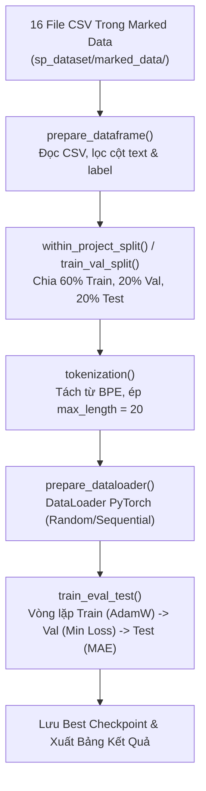

# 📖 GIẢI THÍCH CHI TIẾT MÃ NGUỒN HUẤN LUYỆN & THỰC NGHIỆM (`model_training_notebook.ipynb`)
## ĐỐI SOÁT TỪNG DÒNG CODE VỚI THIẾT KẾ THỰC NGHIỆM (SECTIONS 4 & 5 TRONG BÀI BÁO)

> **Mã nguồn phân tích:** File [`model_training_notebook.ipynb`](https://github.com/awsm-research/gpt2sp/blob/main/model_training_notebook.ipynb) trong Replication Package.  
> **Chương đối ứng trong bài báo gốc:**  
> * **Section 4: Experimental Setup** (Trang 5 – 7, IEEE TSE 2023).  
> * **Section 5: Experimental Design and Results** (Trang 7 – 10, IEEE TSE 2023).  
> * **Section 13 (Appendix): Additional Experiments** (Trang 17 – 19).

---

## 🧭 1. TỔNG QUAN LUỒNG THỰC THI (END-TO-END EXPERIMENTAL PIPELINE)

Kịch bản huấn luyện trong `model_training_notebook.ipynb` được tổ chức thành một chuỗi quy trình khép kín:



---

## 🔍 2. GIẢI THÍCH CHI TIẾT TỪNG HÀM VÀ KHỐI MÃ NGUỒN

### 2.1. Cấu hình Siêu tham số Huấn luyện (Cell 4)
```python
EPOCHS = 20
BATCH_SIZE_RATIO = 0.3 # within proj: 0.3 / cross proj: 0.4
SEQUENCE_LEN = 20
LEARNING_RATE = 5e-4
TOKENIZER = 'gpt2'
MODEL_NAME = 'gpt2sp'
```

* **Khớp với Mục 4.3 (Model Training, Trang 6 Cột 2):**  
  * `LEARNING_RATE = 5e-4` ($5 \times 10^{-4}$): Tốc độ học lớn hơn so với chuẩn fine-tune phân loại văn bản thông thường ($2 \times 10^{-5}$ đến $5 \times 10^{-5}$) nhằm giúp mô hình nhanh chóng thích nghi với đầu hồi quy mới.
  * `EPOCHS = 20`: Chạy tối đa 20 chu kỳ lặp.
  * `BATCH_SIZE_RATIO = 0.3`: Kỹ thuật Dynamic Batch Size. Kích thước lô huấn luyện bằng $30\%$ tổng số mẫu của tập train (ví dụ tập train có 1.000 mẫu thì batch size là 300 mẫu).

---

### 2.2. Nạp dữ liệu và Tiền xử lý (`prepare_dataframe`)
```python
def prepare_dataframe(file_name):
    data = pd.read_csv(file_name)
    # some rows have no description, fill blank to avoid Null
    data = data.fillna(' ')
    d = {'text': (data['title']).tolist(), 'label': data['storypoint']}
    return pd.DataFrame(data=d)
```

* **Điểm đối soát học thuật cực kỳ quan trọng:**  
  * Nhìn vào dòng code thứ 5:  
    `d = {'text': (data['title']).tolist(), 'label': data['storypoint']}`
  * Tác giả chỉ lấy riêng cột `data['title']`!
  * Mặc dù ở dòng 3 có câu comment: *"some rows have no description, fill blank to avoid Null"*, nhưng biến `data['description']` **hoàn toàn không được đưa vào từ điển dữ liệu**!
  * 👉 Đây là nguồn gốc thực tế chứng minh mô hình trong repo chỉ học trên Tiêu đề của User Story.

---

### 2.3. Phân tách Từ con và Cắt ngắn Chuỗi (`tokenization`)
```python
    elif TOKENIZER == 'gpt2':
        print('using pretrained gpt-2 tokenizer')
        tokenizer = GPT2Tokenizer.from_pretrained(TOKENIZER)
        tokenizer.pad_token = '[PAD]'
        return tokenizer.batch_encode_plus(
            text_list, 
            truncation=True, 
            max_length=SEQUENCE_LEN, 
            padding='max_length'
        )
```

* **Khớp với Mục 3.1 & 4.3 trong bài báo:**  
  * Sử dụng bộ tách từ con Byte-Pair Encoding (`GPT2Tokenizer`) với từ điển $50.257$ tokens.
  * Vì GPT-2 nguyên bản không có token đệm (`pad_token`), tác giả thiết lập `tokenizer.pad_token = '[PAD]'` để lấp đầy các câu ngắn hơn chiều dài chuẩn.
  * `max_length = SEQUENCE_LEN = 20`: Mọi chuỗi tiêu đề dài hơn 20 tokens đều bị cắt bỏ (`truncation=True`), và câu ngắn hơn 20 tokens được thêm padding.

---

### 2.4. Phân chia Tập Dữ liệu Nội Dự án (`within_project_split`)
```python
def within_project_split(data):
    print('within project split!')
    train_val_split_point = int(len(data) * 0.6)
    val_test_split_point = int(len(data) * 0.8)
    train_text = data['text'][:train_val_split_point]
    train_labels = data['label'][:train_val_split_point]
    val_text = data['text'][train_val_split_point:val_test_split_point]
    val_labels = data['label'][train_val_split_point:val_test_split_point]
    test_text = data['text'][val_test_split_point:]
    test_labels = data['label'][val_test_split_point:]
    return train_text, train_labels, val_text, val_labels, test_text, test_labels   
```

* **Khớp với Mục 4.1 & RQ1 (Trang 7, Cột 2):**  
  * Tập dữ liệu gốc trong file CSV đã được sắp xếp trước theo thứ tự thời gian (`created_date`).
  * Tác giả cắt $60\%$ dòng đầu tiên làm tập Huấn luyện (`Train`).
  * $20\%$ tiếp theo ($60\% \rightarrow 80\%$) làm tập Xác thực (`Validation`) để chọn điểm dừng và siêu tham số tốt nhất.
  * $20\%$ cuối cùng ($80\% \rightarrow 100\%$) làm tập Kiểm thử độc lập (`Testing`) để tính điểm số báo cáo trong bài báo.

---

### 2.5. Vòng lặp Huấn luyện, Thẩm định và Đo sai số (`train_eval_test`)
```python
    optimizer = AdamW(MODEL.parameters(), lr=LEARNING_RATE)    
    total_steps = len(train_dataloader) * EPOCHS
    scheduler = get_linear_schedule_with_warmup(optimizer, num_warmup_steps=0, num_training_steps=total_steps)
```

* **Khớp với Mục 3.4 (Trang 5 Cột 1):**  
  * Sử dụng thuật toán tối ưu hóa **AdamW** (Adam with Decoupled Weight Decay).
  * Bộ điều chỉnh tốc độ học tuyến tính `get_linear_schedule_with_warmup` giảm dần learning rate về 0 sau `total_steps`.
  * `torch.nn.utils.clip_grad_norm_(model.parameters(), 1.0)`: Cắt tỉa chuẩn gradient ở ngưỡng $1.0$ để chống hiện tượng bùng nổ gradient (*Gradient Explosion*).

```python
        # Kiểm tra loss trên tập Validation để chọn Checkpoint tốt nhất
        if avg_eval_loss <= min_eval_loss_epoch[0]:
            min_eval_loss_epoch[0] = avg_eval_loss
            min_eval_loss_epoch[1] = e
        
        # Lưu checkpoint của epoch e
        torch.save(model.state_dict(), './models/' + 'epo_' + str(e))
```
* **Chiến lược chọn mô hình (Model Selection Strategy):**  
  * Ở mỗi epoch, mô hình được kiểm tra sai số trên tập Validation (`avg_eval_loss`).
  * Epoch nào đạt giá trị mất mát $L_1$ thấp nhất sẽ được lưu lại làm checkpoint đại diện cho dự án đó (`min_eval_loss_epoch[1]`).

```python
            # Tính sai số MAE và MdAE trên tập Test
            distance_records = []
            for i in range(len(predictions)):
                for j in range(len(predictions[i])):
                    distance = abs(predictions[i][j] - true_labels[i][j])
                    distance_records.append(distance)

            MAE = np.mean(np.array(distance_records)) 
            MdAE = np.median(np.array(distance_records)) 
```
* **Khớp với Mục 4.4 (Evaluation Measures, Trang 7 Cột 1):**  
  * Tính toán sai số tuyệt đối giữa dự đoán $\hat{y}$ và nhãn thực tế $y$:
    $$\text{distance} = |\hat{y} - y|$$
  * $\text{MAE} = \text{mean}(\text{distance})$ và $\text{MdAE} = \text{median}(\text{distance})$.

---

## 📋 3. BẢNG ÁNH XẠ 3 KỊCH BẢN NGHIÊN CỨU TRONG BÀI BÁO VỚI CODE

| Câu hỏi nghiên cứu trong Bài Báo | Đoạn code thực thi trong Notebook | Cấu hình dữ liệu |
| :--- | :--- | :--- |
| **RQ1: Within-Project Estimation** | Khối 4 (Cell 8): `TRAIN_TEST_FILE_PAIRS` gồm 16 dự án đơn lẻ | `WITHIN_PROJECT = True`, train và test trên cùng 1 dự án (60/20/20) |
| **RQ2: Cross-Project (Within Repository)** | Khối 5 (Cell 10): Các cặp dự án cùng tổ chức (như Mesos $\rightarrow$ Usergrid) | `WITHIN_PROJECT = False`, train trên dự án A, test trên dự án B cùng repo |
| **RQ2: Cross-Project (Cross Repository)** | Khối 6 (Cell 12): Các cặp dự án khác tổ chức (như Clover $\rightarrow$ Usergrid) | `WITHIN_PROJECT = False`, train trên dự án X, test trên dự án Y hoàn toàn độc lập |
| **RQ3: Ablation Study** | Thiết lập cờ `MODEL_NAME = 'gpt2'` (Linear head) và đổi `TOKENIZER` | So sánh đóng góp của kiến trúc Transformer và giải thuật tách từ BPE |
