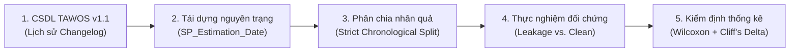
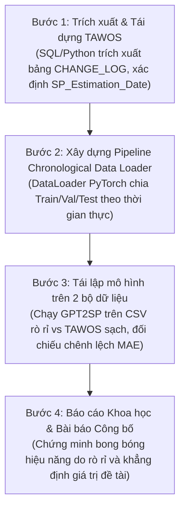

# 🧠 PHÂN TÍCH PHẢN BIỆN 09: BÀI BÁO GPT2SP ĐÃ GIẢI QUYẾT VẤN ĐỀ DATA LEAKAGE CHƯA VÀ KẾ HOẠCH HÀNH ĐỘNG CỦA NHÓM 3

> **Chuyên mục:** Phân tích phản biện khoa học độc lập (Scientific Critical Thinking).  
> **Chủ đề trung tâm:** Đối chiếu sự thật học thuật về CSDL TAWOS, Chronological Split trong bài báo *GPT2SP* (IEEE TSE 2023), giải phẫu lỗ hổng rò rỉ dữ liệu (Data Leakage) tiềm ẩn, và thiết lập lộ trình nghiên cứu của Đề tài NCKH Nhóm 3:  
> **"Agile Story Point Estimation at Planning Time with Temporal & Data Leakage Control"**.

---

## 🎯 1. BÀI BÁO GPT2SP ĐÃ GIẢI QUYẾT VẤN ĐỀ DATA LEAKAGE CHƯA?

### Câu trả lời trực diện: **HOÀN TOÀN CHƯA!**

Để làm rõ điều này một cách khách quan và chính xác theo chuẩn mực học thuật, chúng ta đối chiếu hai dữ kiện cốt lõi:

| Câu hỏi thực chứng | Thực tế trong bài báo gốc GPT2SP (*Fu & Tantithamthavorn, 2023*) | Nhận định học thuật |
| :--- | :--- | :--- |
| **1. GPT2SP có dùng CSDL TAWOS v1.1 không?** | **KHÔNG!** Bài báo dùng 16 file CSV tĩnh trích xuất năm 2016 của Choetkiertikul et al. (*Deep-SE*). | CSDL TAWOS v1.1 là của Vali Tawosi et al. (*SOLAR Group - UCL*, 2021–2022). GPT2SP không hề tiếp cận nguồn dữ liệu này. |
| **2. GPT2SP có dùng Chronological Split khi kiểm thử không?** | **CÓ!** Tại Trang 7, Cột 2, tác giả sắp xếp các issue theo thứ tự thời gian và chia $60\%$ Train, $20\%$ Validation, $20\%$ Test. | GPT2SP đã nỗ lực kiểm soát thứ tự phân chia giữa các issue (Inter-issue Temporal Order). |

> [!CAUTION]
> **NÚT THẮT KHOA HỌC THEN CHỐT (THE SCIENTIFIC BOTTLENECK):**  
> Dù GPT2SP **có dùng Chronological Split** để phân chia các issue theo trục thời gian, mô hình **vẫn bị rò rỉ dữ liệu nghiêm trọng (Severe Data Leakage)**!  
> **Bởi vì:** Chronological Split chỉ giải quyết được trật tự giữa các issue (**Inter-issue Order**), nhưng hoàn toàn bất lực trước hiện tượng rò rỉ thông tin tương lai bên trong từng issue (**Intra-issue Content Leakage**)!

```mermaid
flowchart TD
    subgraph GPT2SP_Flaw["1. Thực Trạng Phương Pháp Luận Của GPT2SP (Fu et al. 2023)"]
        A1["Dùng tập CSV tĩnh năm 2016\n(Choetkiertikul et al.)"] --> A2["Sắp xếp issue theo Created Date\n(Chronological Split 60/20/20)"]
        A2 --> A3["Tuy các issue ở Test Set nằm ở tương lai...\nNHƯNG trường Description của từng issue lại là\nSNAPSHOT CUỐI CÙNG LÚC DỰ ÁN KẾT THÚC!"]
        A3 --> A4["Mô hình đọc trước Stack trace, Root cause,\nCode patch sinh ra SAU KHI task hoàn thành\n==> RÒ RỈ THÔNG TIN TƯƠNG LAI NỘI TẠI"]
    end

    subgraph Solution_Group3["2. Giải Pháp Đột Phá Của Nhóm NCKH 3 (Johnny Snowflake)"]
        B1["Khai thác CSDL Quan Hệ TAWOS v1.1\n(Có bảng CHANGELOG, CHANGE_ITEM)"] --> B2["Xác định chuẩn xác mốc SP_Estimation_Date\n(Thời điểm diễn ra Sprint Planning Poker)"]
        B2 --> B3["Tua ngược thời gian (Time-Travel Reconstruction):\nKhôi phục Title & Description nguyên bản\ntại thời điểm t <= SP_Estimation_Date"]
        B3 --> B4["Loại bỏ 100% Stack trace, Comment, Solution sau Planning\n==> MÔ HÌNH THỰC SỰ SẠCH VÀ SẴN SÀNG TRIỂN KHAI"]
    end
```

---

## 🔍 2. GIẢI PHẪU 3 LỖ HỔNG RÒ RỈ DỮ LIỆU CỐT LÕI MÀ BÀI BÁO GPT2SP BỎ QUÊN

### 2.1. Lỗ hổng 1: Rò rỉ Văn bản Nội tại sau Lập kế hoạch (Intra-Issue Post-Planning Leakage)
Đây là lỗ hổng tinh vi và nghiêm trọng nhất của toàn bộ các nghiên cứu SOTA hiện nay:
* **Bản chất của file CSV tĩnh (Choetkiertikul 2016):** Khi Choetkiertikul cào dữ liệu Jira vào tháng 8/2016, họ chỉ cào một **ảnh chụp tức thời cuối cùng (Final Snapshot)** của trường `Description`.
* **Diễn biến thực tế trong chu kỳ Agile:**
  1. **Tại buổi Sprint Planning ($t_{\text{Planning}}$):** Lập trình viên chỉ có một bản mô tả sơ khai (User Story thô, ví dụ: *"Khắc phục lỗi treo luồng khi ghi log người dùng"*). Đây là lúc nhóm chấm Story Point (ví dụ: 5 điểm).
  2. **Trong quá trình thực hiện task ($t > t_{\text{Planning}}$):** Lập trình viên debug mã nguồn, tìm ra nguyên nhân, và liên tục sửa đổi trường `Description` để bổ sung:
     * Dấu vết ngăn xếp chi tiết (`Stack trace`, Exception logs).
     * Tên class, package, method gây lỗi (`ThreadLogger.java:142`).
     * Nguyên nhân cốt lõi (`Deadlock do race condition`) và giải pháp vá lỗi (kèm link Pull Request).
* **Hậu quả rò rỉ:** Dù issue đó nằm trong tập Test (sau mốc thời gian phân chia), nhưng `Description` mà GPT-2 đọc được lại chứa **chính lời giải và kết quả debug của tương lai**! Mô hình dễ dàng ước lượng đúng Story Point không phải vì hiểu độ phức tạp ban đầu, mà vì nó "đọc trộm đáp án" đã được thêm vào sau đó.

---

### 2.2. Lỗ hổng 2: Lệch pha giữa Ngày tạo (`Created Date`) và Ngày ước lượng (`SP_Estimation_Date`)
* GPT2SP sắp xếp các issue theo thứ tự thời gian dựa trên ngày tạo issue (`created_date`).
* Tuy nhiên, trong thực tế quản trị dự án Jira:
  * Nhiều issue được tạo ra trong Backlog từ **hàng tháng trước**, nhưng mãi đến các Sprint sau mới được đưa vào họp Planning Poker để chấm Story Point.
  * Ngược lại, có những task đột xuất được đưa vào Sprint và lập trình viên đã bắt đầu nghiên cứu/code trước khi điểm Story Point được gán chính thức.
* Việc sắp xếp theo `created_date` thay vì mốc thời gian gán điểm thực tế (**`SP_Estimation_Date`**) làm sai lệch thứ tự nhân quả thực sự của kho tri thức mà nhóm phát triển sở hữu tại từng thời điểm.

---

### 2.3. Lỗ hổng 3: Sự vắng mặt hoàn toàn của Nhật ký Thay đổi (`CHANGELOG`)
* Trong bộ dữ liệu của Choetkiertikul (2016) mà GPT2SP sử dụng, toàn bộ dữ liệu chỉ là các bảng CSV phẳng 1 dòng cho mỗi issue.
* Dữ liệu phẳng **hoàn toàn không có bảng `CHANGELOG` hay `CHANGE_ITEM`**. Do đó, nhóm tác giả Fu & Tantithamthavorn (2023) **về mặt kỹ thuật là hoàn toàn bất khả thi** trong việc khôi phục lại trạng thái của issue lúc họp Sprint Planning nếu chỉ dựa vào tập dữ liệu cũ này!

> [!IMPORTANT]
> **KẾT LUẬN HỌC THUẬT:**  
> Chronological Split của GPT2SP là một **bước tiến về mặt phương pháp luận** so với việc chia ngẫu nhiên (Random Split), nhưng nó **mới chỉ là điều kiện cần chứ chưa đủ**. Việc sử dụng văn bản kết xuất cuối vòng đời khiến con số $\text{MAE} = 1{,}16$ vẫn chứa đựng **ảo ảnh hiệu năng** do rò rỉ nội dung sau quy hoạch.

---

## 🛡️ 3. SỨ MỆNH VÀ KẾ HOẠCH HÀNH ĐỘNG CỦA NHÓM NCKH 3 (JOHNNY SNOWFLAKE)

Nhận diện được khoảng trống nghiên cứu (Research Gap) mà cả Deep-SE (2016), TAWOS Replication (2022), và GPT2SP (2023) đều chưa giải quyết trọn vẹn, đề tài Nhóm 3 được định danh:  
**"Agile Story Point Estimation at Planning Time with Temporal & Data Leakage Control"**.

Nhóm nghiên cứu triển khai kế hoạch hành động 5 trụ cột:

---

### 3.1. Trụ cột 1: Tiên phong sử dụng CSDL quan hệ TAWOS v1.1
* Thay thế hoàn toàn bộ 16 file CSV tĩnh cũ bằng CSDL quan hệ chuẩn mực **TAWOS v1.1** (SOLAR Group - UCL).
* Khai thác cấu trúc quan hệ:
  * Bảng `ISSUE`: Lưu trữ thông tin định danh và ngày tạo gốc.
  * Bảng `CHANGE_LOG` & `CHANGE_ITEM`: Lưu giữ toàn bộ lịch sử biến động từng trường theo thời gian thực (ai sửa, sửa trường gì, giá trị cũ `oldvalue`, giá trị mới `newvalue`, vào thời điểm nào `created`).

---

### 3.2. Trụ cột 2: Tái dựng nguyên trạng Issue tại mốc Lập kế hoạch (`SP_Estimation_Date`)
Đây là đóng góp kỹ thuật độc bản và tiên phong của Nhóm 3:
1. **Xác định mốc `SP_Estimation_Date` ($t_{\text{SP\_Estimation}}$):**  
   Truy vấn bảng nhật ký thay đổi để tìm chính xác thời điểm đầu tiên trường Story Point được gán giá trị:
   $$t_{\text{SP\_Estimation}} = \min \{ t \mid \text{field} = \text{Story Points} \wedge \text{newvalue} \neq \emptyset \}$$
2. **Khôi phục văn bản ngược thời gian (Time-Travel Reconstruction):**  
   * Lấy phiên bản trường `Title` và `Description` tồn tại **ngay tại hoặc trước mốc $t_{\text{SP\_Estimation}}$**.
   * Đảo ngược (rollback) toàn bộ các chỉnh sửa bổ sung stack trace, exception log, code patch được thêm vào sau $t_{\text{SP\_Estimation}}$.
3. **Thanh lọc dữ liệu tương lai:**  
   * Cắt bỏ toàn bộ bình luận (`Comments`), trạng thái `Resolution`, `Fix Versions` phát sinh sau buổi họp Planning.

---

### 3.3. Trụ cột 3: Chuẩn hóa Chronological Split trên mốc `SP_Estimation_Date`
* Khác với GPT2SP (sắp xếp theo ngày tạo `created_date`), Nhóm 3 sắp xếp toàn bộ dữ liệu theo **chính mốc thời gian diễn ra ước lượng $t_{\text{SP\_Estimation}}$**.
* Đảm bảo tính nhân quả tuyệt đối:
  $$\text{Train} = \{ \text{Issue}_i \mid t_{\text{SP}, i} \le T_{\text{train}} \}$$
  $$\text{Validation} = \{ \text{Issue}_j \mid T_{\text{train}} < t_{\text{SP}, j} \le T_{\text{val}} \}$$
  $$\text{Test} = \{ \text{Issue}_k \mid T_{\text{val}} < t_{\text{SP}, k} \}$$

---

### 3.4. Trụ cột 4: Thiết kế thực nghiệm đối chứng đa chiều (Ablation Study on Leakage)
Để chứng minh cho hội đồng khoa học giá trị của việc kiểm soát Data Leakage, Nhóm 3 tiến hành thực nghiệm so sánh song song:

| Tiêu chí đối chứng | Kịch bản 1: Baseline Rò rỉ (Cách làm của GPT2SP / Deep-SE) | Kịch bản 2: Đề xuất Sạch (Nhóm 3 Johnny Snowflake) |
| :--- | :--- | :--- |
| **Nền tảng dữ liệu** | 16 file CSV tĩnh năm 2016 (Choetkiertikul et al.) | CSDL Quan Hệ TAWOS v1.1 |
| **Trạng thái Description** | Snapshot cuối cùng (chứa stack trace, giải pháp) | Tái dựng nguyên bản tại $t \le t_{\text{SP\_Estimation}}$ |
| **Trục thời gian phân chia** | Dựa trên `created_date` | Dựa trên chuẩn xác `SP_Estimation_Date` |
| **Mô hình thử nghiệm** | GPT2SP, Deep-SE, SBERT | GPT2SP, Deep-SE, SBERT |
| **Baseline đối chứng** | Median Effort Baseline | **Median Effort Baseline** (tính động theo các Sprint quá khứ) |

---

### 3.5. Trụ cột 5: Kiểm định ý nghĩa thống kê theo quy chuẩn [AGENTS.md](file:///d:/NCKH_3/AGENTS.md)
* Mọi mô hình đề xuất đều phải đánh bại **Median Effort Baseline**.
* Áp dụng kiểm định phi tham số **Wilcoxon Signed-Rank Test** với mức ý nghĩa $\alpha = 0{,}05$.
* Đo lường kích thước hiệu ứng thực chất thông qua **Cliff's Delta ($\delta$)** hoặc **Vargha-Delaney $\hat{A}_{12}$**, khẳng định sự vượt trội là có ý nghĩa thực tế chứ không chỉ là ngẫu nhiên.

---

## 📋 4. BẢNG TỔNG KẾT SO SÁNH GIỮA GPT2SP (2023) VÀ ĐỀ TÀI NHÓM 3

| Tiêu chí so sánh | Bài báo gốc GPT2SP (*IEEE TSE 2023*) | Đề tài NCKH Nhóm 3 (*Đề xuất*) |
| :--- | :--- | :--- |
| **Nguồn dữ liệu sử dụng** | ❌ CSV tĩnh 2016 (Choetkiertikul et al.) | ✅ CSDL quan hệ TAWOS v1.1 (SOLAR UCL) |
| **Dữ liệu Changelog** | ❌ Không có (chỉ có bảng phẳng 1 dòng/issue) | ✅ Có bảng `CHANGE_LOG` & `CHANGE_ITEM` |
| **Phân chia theo thời gian** | ⚠️ Có (theo `created_date` của issue) | ✅ Có (theo chuẩn xác `SP_Estimation_Date`) |
| **Kiểm soát Intra-issue Leak** | ❌ Hoàn toàn bỏ qua | ✅ Kỹ thuật *Time-Travel Reconstruction* |
| **Trạng thái Description** | ❌ Bị rò rỉ stack trace, log, code fix | ✅ Rollback về User Story thô sơ khai |
| **Đánh giá tính khả thi XAI** | ⚠️ Bị thiên kiến bởi từ khóa sửa sau | ✅ XAI giải thích trên từ khóa lúc Planning |
| **Mức độ sẵn sàng triển khai** | ❌ Dễ rớt độ chính xác khi áp dụng | ✅ Sẵn sàng tích hợp vào Sprint Planning |

---

## 🚀 5. LỘ TRÌNH TRIỂN KHAI KỸ THUẬT TIẾP THEO CHO NHÓM 3

1. **Xây dựng Script trích xuất và lọc TAWOS:** Viết mã nguồn Python / SQL để truy vấn CSDL TAWOS, xác định cột mốc `SP_Estimation_Date` và tái dựng lịch sử văn bản cho dự án thí điểm đầu tiên (**Spring XD**).
2. **Xây dựng Pipeline Chronological Data Loader:** Thiết lập bộ nạp dữ liệu PyTorch tuân thủ nguyên tắc dòng thời gian nghiêm ngặt.
3. **Tái lập mô hình GPT2SP trên 2 bộ dữ liệu:** Chạy huấn luyện và đánh giá trên bộ dữ liệu rò rỉ (CSV gốc) và bộ dữ liệu sạch (TAWOS tái dựng) để đo lường độ chênh lệch sai số thực tế.
4. **Viết bài báo khoa học công bố phát hiện:** Trình bày kết quả thực nghiệm chứng minh rằng các nghiên cứu SOTA trước đây đã đánh giá quá cao năng lực của AI do rò rỉ thông tin tương lai, từ đó khẳng định giá trị tiên phong của đề tài Nhóm 3.

---

## 🔗 6. LIÊN KẾT ĐIỀU HƯỚNG HỆ THỐNG

* 🛡️ [Chương 9: Các mối đe dọa đối với tính hợp lệ trong bài báo gốc](file:///d:/NCKH_3/docs/articles/paper-information/gpt2sp/explanation/09_threats_to_validity.md)
* 🔬 [Chương 4: Thiết lập thực nghiệm gốc của Fu et al. (Mục 4.1 Chronological Split)](file:///d:/NCKH_3/docs/articles/paper-information/gpt2sp/explanation/04_experimental_setup.md)
* 📖 [Chương 10: Kết luận và cam kết Open Science của Fu et al.](file:///d:/NCKH_3/docs/articles/paper-information/gpt2sp/explanation/10_conclusion.md)
* 📑 [Tài liệu phân tích bài báo TAWOS (Tawosi et al. TSE 2022)](file:///d:/NCKH_3/docs/articles/paper-information/paper_tawosi_2022_replication.md)
* 📚 [Chuyên mục Critical Thinking tổng quan](file:///d:/NCKH_3/docs/articles/paper-information/gpt2sp/critical-thinking/README.md)
* 👑 [Quy chuẩn vận hành nghiên cứu NCKH Nhóm 3](file:///d:/NCKH_3/AGENTS.md)
